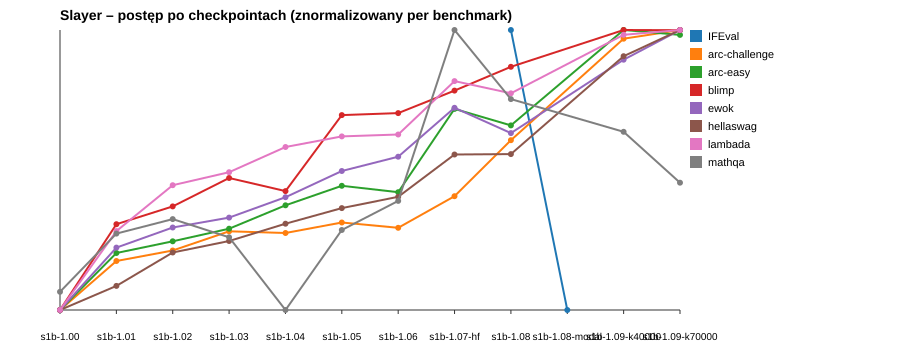

# Leaderboard PL

To repo zbiera wyniki benchmarków modeli w jednej, generowanej tabeli. Każdy rekord ma źródło (repo/ścieżka/commit/SHA256) i jest walidowany schematem. Główna sekcja pokazuje tylko pomiary tego projektu (`adgr3`); wyniki innych autorów z repo Bench są osobno, z linkami do źródeł. Nie ma ręcznie wpisanych liczb: `scripts/buduj.py --check` sprawdza spójność.

Najnowszy rekord: 2026-11-26  
Dane (SHA-256): `5009d2058ea6d4d0a922a272a78cff0e8d467ee42a213b842e5796f47fb039a6`  
Liczba rekordów: 364 (adgr3: 37, bench-team: 327, model-card: 0)  

## Jak czytać

- `★` nasz pomiar (`measured_by=adgr3`), `†` odstępstwo/protokół nieporównywalny, `∅` null z powodem, `ⓡ` wartość z karty modelu.
- Wyniki dokładności/pass są pokazane w % (0–100, 1 miejsce po przecinku), chyba że metryka jest z natury inna (BPB, perplexity, fertility, bytes/token).
- `—` oznacza brak błędu standardowego/CI w źródle. Tokenizery są w osobnej tabeli bez `±`.
- Porównuj tylko wiersze z tym samym benchmarkiem, metryką i podobnymi ustawieniami; odstępstwa są w sekcji „Odstępstwa i znane problemy”.

## Przegląd (nasze pomiary)

| Model | IFBench (Bielik IF-PL local) | IFEval (Bielik IF-PL local) | Humanity's Last Exam (no tools) |
|---|---|---|---|
| slayer1b-1.09-k70000 | — | — | not run (maintainer decision (Slayer not run in PR #358)) ★∅ [bielik-11b-v3.1.json](https://github.com/slayerlabs/benchmarks-fabryka-ai/pull/358) |
| bielik-11b-v3.1 | 25.9% ★† ifbench.json (lokalnie) | 70.9% ★† ifeval.json (lokalnie) | 5.4% ± 0.49 ★† [bielik-11b-v3.1.json](https://github.com/slayerlabs/benchmarks-fabryka-ai/pull/358) |

## Kod

Brak naszych pomiarów w tej rodzinie.

## Wiedza i rozumowanie

| Model | Benchmark | Metryka | Wynik | n | puste | przepełn. | Ustawienia | Źródło | Odstępstwa |
|---|---|---|---|---|---|---|---|---|---|
| slayer1b-1.09-k70000 | Humanity's Last Exam (no tools) | accuracy | not run (maintainer decision (Slayer not run in PR #358)) | — | — | — | text-only | [bielik-11b-v3.1.json](https://github.com/slayerlabs/benchmarks-fabryka-ai/pull/358) | — |
| bielik-11b-v3.1 | Humanity's Last Exam (no tools) | accuracy | 5.4% ± 0.49 | 2158 | — | 0 | text-only | [bielik-11b-v3.1.json](https://github.com/slayerlabs/benchmarks-fabryka-ai/pull/358) | 1 sample per item (methodology: 10); 5 unjudged answers counted incorrect; see source README Deviations |

## Polszczyzna i instrukcje

| Model | Benchmark | Metryka | Wynik | n | puste | przepełn. | Ustawienia | Źródło | Odstępstwa |
|---|---|---|---|---|---|---|---|---|---|
| bielik-11b-v3.1 | IFBench (Bielik IF-PL local) | instruction_level_loose | 25.9% | 300 | — | — | full test set | ifbench.json (lokalnie) | local Bielik IF-PL protocol; not part of Bench Team harness |
| bielik-11b-v3.1 | IFBench (Bielik IF-PL local) | instruction_level_strict | 19.5% | 300 | — | — | full test set | ifbench.json (lokalnie) | local Bielik IF-PL protocol; not part of Bench Team harness |
| bielik-11b-v3.1 | IFBench (Bielik IF-PL local) | prompt_level_loose | 22.0% | 300 | — | — | full test set | ifbench.json (lokalnie) | local Bielik IF-PL protocol; not part of Bench Team harness |
| bielik-11b-v3.1 | IFBench (Bielik IF-PL local) | prompt_level_strict | 17.0% | 300 | — | — | full test set | ifbench.json (lokalnie) | local Bielik IF-PL protocol; not part of Bench Team harness |
| bielik-11b-v3.1 | IFEval (Bielik IF-PL local) | instruction_level_loose | 70.9% | 541 | — | — | full test set | ifeval.json (lokalnie) | local Bielik IF-PL protocol; not part of Bench Team harness |
| bielik-11b-v3.1 | IFEval (Bielik IF-PL local) | instruction_level_strict | 69.4% | 541 | — | — | full test set | ifeval.json (lokalnie) | local Bielik IF-PL protocol; not part of Bench Team harness |
| bielik-11b-v3.1 | IFEval (Bielik IF-PL local) | prompt_level_loose | 60.4% | 541 | — | — | full test set | ifeval.json (lokalnie) | local Bielik IF-PL protocol; not part of Bench Team harness |
| bielik-11b-v3.1 | IFEval (Bielik IF-PL local) | prompt_level_strict | 58.4% | 541 | — | — | full test set | ifeval.json (lokalnie) | local Bielik IF-PL protocol; not part of Bench Team harness |

## Długi kontekst

Brak naszych pomiarów w tej rodzinie.

## Narzędzia i agenci

Brak naszych pomiarów w tej rodzinie.

## Slayer w checkpointach

| Model | Benchmark | Metryka | Wynik | n | Flagi | Źródło |
|---|---|---|---|---|---|---|
| slayer1b-1.00 | arc-challenge | acc_norm | 21.8% ± 1.21 | 1172 |  | [results.json](https://github.com/slayerlabs/benchmarks-fabryka-ai/blob/a46eabf41b22e9ad80f9bf48a1961dc1c32e4faf/research/results/full-run-2026-11/arc-challenge/slayer1b-1.00/results.json) |
| slayer1b-1.00 | arc-easy | acc | 42.4% ± 1.01 | 2376 |  | [results.json](https://github.com/slayerlabs/benchmarks-fabryka-ai/blob/a46eabf41b22e9ad80f9bf48a1961dc1c32e4faf/research/results/full-run-2026-11/arc-easy/slayer1b-1.00/results.json) |
| slayer1b-1.00 | blimp | acc | 73.8% ± 2.56 | 67000 |  | [results.json](https://github.com/slayerlabs/benchmarks-fabryka-ai/blob/a46eabf41b22e9ad80f9bf48a1961dc1c32e4faf/research/results/full-run-2026-11/blimp/slayer1b-1.00/results.json) |
| slayer1b-1.00 | ewok | ewok | 0.5296 ± 0.0076 | 4374 |  | [results_rozszerzone.json](https://github.com/slayerlabs/benchmarks-fabryka-ai/blob/a46eabf41b22e9ad80f9bf48a1961dc1c32e4faf/research/results/full-run-2026-11/ewok/slayer1b-1.00/results_rozszerzone.json) |
| slayer1b-1.00 | hellaswag | acc_norm | 28.5% ± 0.45 | 10042 |  | [results.json](https://github.com/slayerlabs/benchmarks-fabryka-ai/blob/a46eabf41b22e9ad80f9bf48a1961dc1c32e4faf/research/results/full-run-2026-11/hellaswag/slayer1b-1.00/results.json) |
| slayer1b-1.00 | lambada | acc | 20.7% ± 0.56 | 5153 |  | [results.json](https://github.com/slayerlabs/benchmarks-fabryka-ai/blob/a46eabf41b22e9ad80f9bf48a1961dc1c32e4faf/research/results/full-run-2026-11/lambada/slayer1b-1.00/results.json) |
| slayer1b-1.00 | mathqa | acc_norm | 21.0% ± 0.75 | 2985 |  | [results.json](https://github.com/slayerlabs/benchmarks-fabryka-ai/blob/a46eabf41b22e9ad80f9bf48a1961dc1c32e4faf/research/results/full-run-2026-11/mathqa/slayer1b-1.00/results.json) |
| slayer1b-1.00 | medmcqa | acc | 31.8% ± 0.72 | 4183 |  | [results.json](https://github.com/slayerlabs/benchmarks-fabryka-ai/blob/a46eabf41b22e9ad80f9bf48a1961dc1c32e4faf/research/results/full-run-2026-11/medmcqa/slayer1b-1.00/results.json) |
| slayer1b-1.00 | multiblimp-pl | accuracy | 97.9829 ± 0.2458 | 3272 |  | [results.json](https://github.com/slayerlabs/benchmarks-fabryka-ai/blob/a46eabf41b22e9ad80f9bf48a1961dc1c32e4faf/research/results/full-run-2026-11/multiblimp-pl/slayer1b-1.00/results.json) |
| slayer1b-1.00 | piqa | acc_norm | 57.6% ± 1.15 | 1838 |  | [results.json](https://github.com/slayerlabs/benchmarks-fabryka-ai/blob/a46eabf41b22e9ad80f9bf48a1961dc1c32e4faf/research/results/full-run-2026-11/piqa/slayer1b-1.00/results.json) |
| slayer1b-1.00 | pubmedqa | acc | 49.8% ± 2.24 | 500 |  | [results.json](https://github.com/slayerlabs/benchmarks-fabryka-ai/blob/a46eabf41b22e9ad80f9bf48a1961dc1c32e4faf/research/results/full-run-2026-11/pubmedqa/slayer1b-1.00/results.json) |
| slayer1b-1.00 | social-iqa | acc | 35.8% ± 1.08 | 1954 |  | [results.json](https://github.com/slayerlabs/benchmarks-fabryka-ai/blob/a46eabf41b22e9ad80f9bf48a1961dc1c32e4faf/research/results/full-run-2026-11/social-iqa/slayer1b-1.00/results.json) |
| slayer1b-1.00 | wikitext-2 | byte_perplexity | 2.0706 ± 0.0194 | 62 |  | [results.json](https://github.com/slayerlabs/benchmarks-fabryka-ai/blob/a46eabf41b22e9ad80f9bf48a1961dc1c32e4faf/research/results/full-run-2026-11/wikitext-2/slayer1b-1.00/results.json) |
| slayer1b-1.00 | winogrande | acc | 50.5% ± 1.27 | 1267 |  | [results.json](https://github.com/slayerlabs/benchmarks-fabryka-ai/blob/a46eabf41b22e9ad80f9bf48a1961dc1c32e4faf/research/results/full-run-2026-11/winogrande/slayer1b-1.00/results.json) |
| slayer1b-1.00 | wsc273 | acc | 53.8% ± 2.04 | 273 |  | [results.json](https://github.com/slayerlabs/benchmarks-fabryka-ai/blob/a46eabf41b22e9ad80f9bf48a1961dc1c32e4faf/research/results/full-run-2026-11/wsc273/slayer1b-1.00/results.json) |
| slayer1b-1.01 | arc-challenge | acc_norm | 24.1% ± 1.25 | 1172 |  | [results.json](https://github.com/slayerlabs/benchmarks-fabryka-ai/blob/a46eabf41b22e9ad80f9bf48a1961dc1c32e4faf/research/results/full-run-2026-11/arc-challenge/slayer1b-1.01/results.json) |
| slayer1b-1.01 | arc-easy | acc | 47.3% ± 1.02 | 2376 |  | [results.json](https://github.com/slayerlabs/benchmarks-fabryka-ai/blob/a46eabf41b22e9ad80f9bf48a1961dc1c32e4faf/research/results/full-run-2026-11/arc-easy/slayer1b-1.01/results.json) |
| slayer1b-1.01 | blimp | acc | 76.2% ± 2.31 | 67000 |  | [results.json](https://github.com/slayerlabs/benchmarks-fabryka-ai/blob/a46eabf41b22e9ad80f9bf48a1961dc1c32e4faf/research/results/full-run-2026-11/blimp/slayer1b-1.01/results.json) |
| slayer1b-1.01 | ewok | ewok | 0.5541 ± 0.0077 | 4374 |  | [results_rozszerzone.json](https://github.com/slayerlabs/benchmarks-fabryka-ai/blob/a46eabf41b22e9ad80f9bf48a1961dc1c32e4faf/research/results/full-run-2026-11/ewok/slayer1b-1.01/results_rozszerzone.json) |
| slayer1b-1.01 | hellaswag | acc_norm | 30.8% ± 0.46 | 10042 |  | [results.json](https://github.com/slayerlabs/benchmarks-fabryka-ai/blob/a46eabf41b22e9ad80f9bf48a1961dc1c32e4faf/research/results/full-run-2026-11/hellaswag/slayer1b-1.01/results.json) |
| slayer1b-1.01 | lambada | acc | 27.8% ± 0.62 | 5153 |  | [results.json](https://github.com/slayerlabs/benchmarks-fabryka-ai/blob/a46eabf41b22e9ad80f9bf48a1961dc1c32e4faf/research/results/full-run-2026-11/lambada/slayer1b-1.01/results.json) |
| slayer1b-1.01 | mathqa | acc_norm | 21.6% ± 0.75 | 2985 |  | [results.json](https://github.com/slayerlabs/benchmarks-fabryka-ai/blob/a46eabf41b22e9ad80f9bf48a1961dc1c32e4faf/research/results/full-run-2026-11/mathqa/slayer1b-1.01/results.json) |
| slayer1b-1.01 | medmcqa | acc | 31.3% ± 0.72 | 4183 |  | [results.json](https://github.com/slayerlabs/benchmarks-fabryka-ai/blob/a46eabf41b22e9ad80f9bf48a1961dc1c32e4faf/research/results/full-run-2026-11/medmcqa/slayer1b-1.01/results.json) |
| slayer1b-1.01 | multiblimp-pl | accuracy | 98.5024 ± 0.2124 | 3272 |  | [results.json](https://github.com/slayerlabs/benchmarks-fabryka-ai/blob/a46eabf41b22e9ad80f9bf48a1961dc1c32e4faf/research/results/full-run-2026-11/multiblimp-pl/slayer1b-1.01/results.json) |
| slayer1b-1.01 | piqa | acc_norm | 58.8% ± 1.15 | 1838 |  | [results.json](https://github.com/slayerlabs/benchmarks-fabryka-ai/blob/a46eabf41b22e9ad80f9bf48a1961dc1c32e4faf/research/results/full-run-2026-11/piqa/slayer1b-1.01/results.json) |
| slayer1b-1.01 | pubmedqa | acc | 54.4% ± 2.23 | 500 |  | [results.json](https://github.com/slayerlabs/benchmarks-fabryka-ai/blob/a46eabf41b22e9ad80f9bf48a1961dc1c32e4faf/research/results/full-run-2026-11/pubmedqa/slayer1b-1.01/results.json) |
| slayer1b-1.01 | social-iqa | acc | 35.8% ± 1.08 | 1954 |  | [results.json](https://github.com/slayerlabs/benchmarks-fabryka-ai/blob/a46eabf41b22e9ad80f9bf48a1961dc1c32e4faf/research/results/full-run-2026-11/social-iqa/slayer1b-1.01/results.json) |
| slayer1b-1.01 | wikitext-2 | byte_perplexity | 1.9591 ± 0.0178 | 62 |  | [results.json](https://github.com/slayerlabs/benchmarks-fabryka-ai/blob/a46eabf41b22e9ad80f9bf48a1961dc1c32e4faf/research/results/full-run-2026-11/wikitext-2/slayer1b-1.01/results.json) |
| slayer1b-1.01 | winogrande | acc | 52.0% ± 1.26 | 1267 |  | [results.json](https://github.com/slayerlabs/benchmarks-fabryka-ai/blob/a46eabf41b22e9ad80f9bf48a1961dc1c32e4faf/research/results/full-run-2026-11/winogrande/slayer1b-1.01/results.json) |
| slayer1b-1.01 | wsc273 | acc | 55.3% ± 2.10 | 273 |  | [results.json](https://github.com/slayerlabs/benchmarks-fabryka-ai/blob/a46eabf41b22e9ad80f9bf48a1961dc1c32e4faf/research/results/full-run-2026-11/wsc273/slayer1b-1.01/results.json) |
| slayer1b-1.02 | arc-challenge | acc_norm | 24.7% ± 1.26 | 1172 |  | [results.json](https://github.com/slayerlabs/benchmarks-fabryka-ai/blob/a46eabf41b22e9ad80f9bf48a1961dc1c32e4faf/research/results/full-run-2026-11/arc-challenge/slayer1b-1.02/results.json) |
| slayer1b-1.02 | arc-easy | acc | 48.4% ± 1.03 | 2376 |  | [results.json](https://github.com/slayerlabs/benchmarks-fabryka-ai/blob/a46eabf41b22e9ad80f9bf48a1961dc1c32e4faf/research/results/full-run-2026-11/arc-easy/slayer1b-1.02/results.json) |
| slayer1b-1.02 | blimp | acc | 76.7% ± 2.31 | 67000 |  | [results.json](https://github.com/slayerlabs/benchmarks-fabryka-ai/blob/a46eabf41b22e9ad80f9bf48a1961dc1c32e4faf/research/results/full-run-2026-11/blimp/slayer1b-1.02/results.json) |
| slayer1b-1.02 | ewok | ewok | 0.562 ± 0.0077 | 4374 |  | [results_rozszerzone.json](https://github.com/slayerlabs/benchmarks-fabryka-ai/blob/a46eabf41b22e9ad80f9bf48a1961dc1c32e4faf/research/results/full-run-2026-11/ewok/slayer1b-1.02/results_rozszerzone.json) |
| slayer1b-1.02 | hellaswag | acc_norm | 34.0% ± 0.47 | 10042 |  | [results.json](https://github.com/slayerlabs/benchmarks-fabryka-ai/blob/a46eabf41b22e9ad80f9bf48a1961dc1c32e4faf/research/results/full-run-2026-11/hellaswag/slayer1b-1.02/results.json) |
| slayer1b-1.02 | lambada | acc | 31.9% ± 0.65 | 5153 |  | [results.json](https://github.com/slayerlabs/benchmarks-fabryka-ai/blob/a46eabf41b22e9ad80f9bf48a1961dc1c32e4faf/research/results/full-run-2026-11/lambada/slayer1b-1.02/results.json) |
| slayer1b-1.02 | mathqa | acc_norm | 21.7% ± 0.75 | 2985 |  | [results.json](https://github.com/slayerlabs/benchmarks-fabryka-ai/blob/a46eabf41b22e9ad80f9bf48a1961dc1c32e4faf/research/results/full-run-2026-11/mathqa/slayer1b-1.02/results.json) |
| slayer1b-1.02 | medmcqa | acc | 31.7% ± 0.72 | 4183 |  | [results.json](https://github.com/slayerlabs/benchmarks-fabryka-ai/blob/a46eabf41b22e9ad80f9bf48a1961dc1c32e4faf/research/results/full-run-2026-11/medmcqa/slayer1b-1.02/results.json) |
| slayer1b-1.02 | multiblimp-pl | accuracy | 98.6858 ± 0.1991 | 3272 |  | [results.json](https://github.com/slayerlabs/benchmarks-fabryka-ai/blob/a46eabf41b22e9ad80f9bf48a1961dc1c32e4faf/research/results/full-run-2026-11/multiblimp-pl/slayer1b-1.02/results.json) |
| slayer1b-1.02 | piqa | acc_norm | 60.6% ± 1.14 | 1838 |  | [results.json](https://github.com/slayerlabs/benchmarks-fabryka-ai/blob/a46eabf41b22e9ad80f9bf48a1961dc1c32e4faf/research/results/full-run-2026-11/piqa/slayer1b-1.02/results.json) |
| slayer1b-1.02 | pubmedqa | acc | 53.8% ± 2.23 | 500 |  | [results.json](https://github.com/slayerlabs/benchmarks-fabryka-ai/blob/a46eabf41b22e9ad80f9bf48a1961dc1c32e4faf/research/results/full-run-2026-11/pubmedqa/slayer1b-1.02/results.json) |
| slayer1b-1.02 | social-iqa | acc | 36.9% ± 1.09 | 1954 |  | [results.json](https://github.com/slayerlabs/benchmarks-fabryka-ai/blob/a46eabf41b22e9ad80f9bf48a1961dc1c32e4faf/research/results/full-run-2026-11/social-iqa/slayer1b-1.02/results.json) |
| slayer1b-1.02 | wikitext-2 | byte_perplexity | 1.9169 ± 0.0168 | 62 |  | [results.json](https://github.com/slayerlabs/benchmarks-fabryka-ai/blob/a46eabf41b22e9ad80f9bf48a1961dc1c32e4faf/research/results/full-run-2026-11/wikitext-2/slayer1b-1.02/results.json) |
| slayer1b-1.02 | winogrande | acc | 51.1% ± 1.25 | 1267 |  | [results.json](https://github.com/slayerlabs/benchmarks-fabryka-ai/blob/a46eabf41b22e9ad80f9bf48a1961dc1c32e4faf/research/results/full-run-2026-11/winogrande/slayer1b-1.02/results.json) |
| slayer1b-1.02 | wsc273 | acc | 57.1% ± 2.19 | 273 |  | [results.json](https://github.com/slayerlabs/benchmarks-fabryka-ai/blob/a46eabf41b22e9ad80f9bf48a1961dc1c32e4faf/research/results/full-run-2026-11/wsc273/slayer1b-1.02/results.json) |
| slayer1b-1.03 | arc-challenge | acc_norm | 25.6% ± 1.28 | 1172 |  | [results.json](https://github.com/slayerlabs/benchmarks-fabryka-ai/blob/a46eabf41b22e9ad80f9bf48a1961dc1c32e4faf/research/results/full-run-2026-11/arc-challenge/slayer1b-1.03/results.json) |
| slayer1b-1.03 | arc-easy | acc | 49.5% ± 1.03 | 2376 |  | [results.json](https://github.com/slayerlabs/benchmarks-fabryka-ai/blob/a46eabf41b22e9ad80f9bf48a1961dc1c32e4faf/research/results/full-run-2026-11/arc-easy/slayer1b-1.03/results.json) |
| slayer1b-1.03 | blimp | acc | 77.4% ± 2.20 | 67000 |  | [results.json](https://github.com/slayerlabs/benchmarks-fabryka-ai/blob/a46eabf41b22e9ad80f9bf48a1961dc1c32e4faf/research/results/full-run-2026-11/blimp/slayer1b-1.03/results.json) |
| slayer1b-1.03 | ewok | ewok | 0.5658 ± 0.0075 | 4374 |  | [results_rozszerzone.json](https://github.com/slayerlabs/benchmarks-fabryka-ai/blob/a46eabf41b22e9ad80f9bf48a1961dc1c32e4faf/research/results/full-run-2026-11/ewok/slayer1b-1.03/results_rozszerzone.json) |
| slayer1b-1.03 | hellaswag | acc_norm | 35.1% ± 0.48 | 10042 |  | [results.json](https://github.com/slayerlabs/benchmarks-fabryka-ai/blob/a46eabf41b22e9ad80f9bf48a1961dc1c32e4faf/research/results/full-run-2026-11/hellaswag/slayer1b-1.03/results.json) |
| slayer1b-1.03 | lambada | acc | 33.1% ± 0.66 | 5153 |  | [results.json](https://github.com/slayerlabs/benchmarks-fabryka-ai/blob/a46eabf41b22e9ad80f9bf48a1961dc1c32e4faf/research/results/full-run-2026-11/lambada/slayer1b-1.03/results.json) |
| slayer1b-1.03 | mathqa | acc_norm | 21.5% ± 0.75 | 2985 |  | [results.json](https://github.com/slayerlabs/benchmarks-fabryka-ai/blob/a46eabf41b22e9ad80f9bf48a1961dc1c32e4faf/research/results/full-run-2026-11/mathqa/slayer1b-1.03/results.json) |
| slayer1b-1.03 | medmcqa | acc | 32.1% ± 0.72 | 4183 |  | [results.json](https://github.com/slayerlabs/benchmarks-fabryka-ai/blob/a46eabf41b22e9ad80f9bf48a1961dc1c32e4faf/research/results/full-run-2026-11/medmcqa/slayer1b-1.03/results.json) |
| slayer1b-1.03 | multiblimp-pl | accuracy | 98.5636 ± 0.208 | 3272 |  | [results.json](https://github.com/slayerlabs/benchmarks-fabryka-ai/blob/a46eabf41b22e9ad80f9bf48a1961dc1c32e4faf/research/results/full-run-2026-11/multiblimp-pl/slayer1b-1.03/results.json) |
| slayer1b-1.03 | piqa | acc_norm | 62.2% ± 1.13 | 1838 |  | [results.json](https://github.com/slayerlabs/benchmarks-fabryka-ai/blob/a46eabf41b22e9ad80f9bf48a1961dc1c32e4faf/research/results/full-run-2026-11/piqa/slayer1b-1.03/results.json) |
| slayer1b-1.03 | pubmedqa | acc | 52.4% ± 2.24 | 500 |  | [results.json](https://github.com/slayerlabs/benchmarks-fabryka-ai/blob/a46eabf41b22e9ad80f9bf48a1961dc1c32e4faf/research/results/full-run-2026-11/pubmedqa/slayer1b-1.03/results.json) |
| slayer1b-1.03 | social-iqa | acc | 37.4% ± 1.09 | 1954 |  | [results.json](https://github.com/slayerlabs/benchmarks-fabryka-ai/blob/a46eabf41b22e9ad80f9bf48a1961dc1c32e4faf/research/results/full-run-2026-11/social-iqa/slayer1b-1.03/results.json) |
| slayer1b-1.03 | wikitext-2 | byte_perplexity | 1.8988 ± 0.0168 | 62 |  | [results.json](https://github.com/slayerlabs/benchmarks-fabryka-ai/blob/a46eabf41b22e9ad80f9bf48a1961dc1c32e4faf/research/results/full-run-2026-11/wikitext-2/slayer1b-1.03/results.json) |
| slayer1b-1.03 | winogrande | acc | 53.5% ± 1.29 | 1267 |  | [results.json](https://github.com/slayerlabs/benchmarks-fabryka-ai/blob/a46eabf41b22e9ad80f9bf48a1961dc1c32e4faf/research/results/full-run-2026-11/winogrande/slayer1b-1.03/results.json) |
| slayer1b-1.03 | wsc273 | acc | 56.0% ± 2.18 | 273 |  | [results.json](https://github.com/slayerlabs/benchmarks-fabryka-ai/blob/a46eabf41b22e9ad80f9bf48a1961dc1c32e4faf/research/results/full-run-2026-11/wsc273/slayer1b-1.03/results.json) |
| slayer1b-1.04 | arc-challenge | acc_norm | 25.5% ± 1.27 | 1172 |  | [results.json](https://github.com/slayerlabs/benchmarks-fabryka-ai/blob/a46eabf41b22e9ad80f9bf48a1961dc1c32e4faf/research/results/full-run-2026-11/arc-challenge/slayer1b-1.04/results.json) |
| slayer1b-1.04 | arc-easy | acc | 51.5% ± 1.03 | 2376 |  | [results.json](https://github.com/slayerlabs/benchmarks-fabryka-ai/blob/a46eabf41b22e9ad80f9bf48a1961dc1c32e4faf/research/results/full-run-2026-11/arc-easy/slayer1b-1.04/results.json) |
| slayer1b-1.04 | blimp | acc | 77.1% ± 2.25 | 67000 |  | [results.json](https://github.com/slayerlabs/benchmarks-fabryka-ai/blob/a46eabf41b22e9ad80f9bf48a1961dc1c32e4faf/research/results/full-run-2026-11/blimp/slayer1b-1.04/results.json) |
| slayer1b-1.04 | ewok | ewok | 0.5738 ± 0.0071 | 4374 |  | [results_rozszerzone.json](https://github.com/slayerlabs/benchmarks-fabryka-ai/blob/a46eabf41b22e9ad80f9bf48a1961dc1c32e4faf/research/results/full-run-2026-11/ewok/slayer1b-1.04/results_rozszerzone.json) |
| slayer1b-1.04 | hellaswag | acc_norm | 36.7% ± 0.48 | 10042 |  | [results.json](https://github.com/slayerlabs/benchmarks-fabryka-ai/blob/a46eabf41b22e9ad80f9bf48a1961dc1c32e4faf/research/results/full-run-2026-11/hellaswag/slayer1b-1.04/results.json) |
| slayer1b-1.04 | lambada | acc | 35.3% ± 0.67 | 5153 |  | [results.json](https://github.com/slayerlabs/benchmarks-fabryka-ai/blob/a46eabf41b22e9ad80f9bf48a1961dc1c32e4faf/research/results/full-run-2026-11/lambada/slayer1b-1.04/results.json) |
| slayer1b-1.04 | mathqa | acc_norm | 20.9% ± 0.74 | 2985 |  | [results.json](https://github.com/slayerlabs/benchmarks-fabryka-ai/blob/a46eabf41b22e9ad80f9bf48a1961dc1c32e4faf/research/results/full-run-2026-11/mathqa/slayer1b-1.04/results.json) |
| slayer1b-1.04 | medmcqa | acc | 31.1% ± 0.72 | 4183 |  | [results.json](https://github.com/slayerlabs/benchmarks-fabryka-ai/blob/a46eabf41b22e9ad80f9bf48a1961dc1c32e4faf/research/results/full-run-2026-11/medmcqa/slayer1b-1.04/results.json) |
| slayer1b-1.04 | multiblimp-pl | accuracy | 99.2359 ± 0.1523 | 3272 |  | [results.json](https://github.com/slayerlabs/benchmarks-fabryka-ai/blob/a46eabf41b22e9ad80f9bf48a1961dc1c32e4faf/research/results/full-run-2026-11/multiblimp-pl/slayer1b-1.04/results.json) |
| slayer1b-1.04 | piqa | acc_norm | 62.6% ± 1.13 | 1838 |  | [results.json](https://github.com/slayerlabs/benchmarks-fabryka-ai/blob/a46eabf41b22e9ad80f9bf48a1961dc1c32e4faf/research/results/full-run-2026-11/piqa/slayer1b-1.04/results.json) |
| slayer1b-1.04 | pubmedqa | acc | 52.8% ± 2.23 | 500 |  | [results.json](https://github.com/slayerlabs/benchmarks-fabryka-ai/blob/a46eabf41b22e9ad80f9bf48a1961dc1c32e4faf/research/results/full-run-2026-11/pubmedqa/slayer1b-1.04/results.json) |
| slayer1b-1.04 | social-iqa | acc | 38.0% ± 1.10 | 1954 |  | [results.json](https://github.com/slayerlabs/benchmarks-fabryka-ai/blob/a46eabf41b22e9ad80f9bf48a1961dc1c32e4faf/research/results/full-run-2026-11/social-iqa/slayer1b-1.04/results.json) |
| slayer1b-1.04 | wikitext-2 | byte_perplexity | 1.8705 ± 0.0163 | 62 |  | [results.json](https://github.com/slayerlabs/benchmarks-fabryka-ai/blob/a46eabf41b22e9ad80f9bf48a1961dc1c32e4faf/research/results/full-run-2026-11/wikitext-2/slayer1b-1.04/results.json) |
| slayer1b-1.04 | winogrande | acc | 51.1% ± 1.28 | 1267 |  | [results.json](https://github.com/slayerlabs/benchmarks-fabryka-ai/blob/a46eabf41b22e9ad80f9bf48a1961dc1c32e4faf/research/results/full-run-2026-11/winogrande/slayer1b-1.04/results.json) |
| slayer1b-1.04 | wsc273 | acc | 56.0% ± 2.25 | 273 |  | [results.json](https://github.com/slayerlabs/benchmarks-fabryka-ai/blob/a46eabf41b22e9ad80f9bf48a1961dc1c32e4faf/research/results/full-run-2026-11/wsc273/slayer1b-1.04/results.json) |
| slayer1b-1.05 | arc-challenge | acc_norm | 26.0% ± 1.28 | 1172 |  | [results.json](https://github.com/slayerlabs/benchmarks-fabryka-ai/blob/a46eabf41b22e9ad80f9bf48a1961dc1c32e4faf/research/results/full-run-2026-11/arc-challenge/slayer1b-1.05/results.json) |
| slayer1b-1.05 | arc-easy | acc | 53.2% ± 1.02 | 2376 |  | [results.json](https://github.com/slayerlabs/benchmarks-fabryka-ai/blob/a46eabf41b22e9ad80f9bf48a1961dc1c32e4faf/research/results/full-run-2026-11/arc-easy/slayer1b-1.05/results.json) |
| slayer1b-1.05 | blimp | acc | 79.2% ± 2.12 | 67000 |  | [results.json](https://github.com/slayerlabs/benchmarks-fabryka-ai/blob/a46eabf41b22e9ad80f9bf48a1961dc1c32e4faf/research/results/full-run-2026-11/blimp/slayer1b-1.05/results.json) |
| slayer1b-1.05 | ewok | ewok | 0.5841 ± 0.0072 | 4374 |  | [results_rozszerzone.json](https://github.com/slayerlabs/benchmarks-fabryka-ai/blob/a46eabf41b22e9ad80f9bf48a1961dc1c32e4faf/research/results/full-run-2026-11/ewok/slayer1b-1.05/results_rozszerzone.json) |
| slayer1b-1.05 | hellaswag | acc_norm | 38.2% ± 0.48 | 10042 |  | [results.json](https://github.com/slayerlabs/benchmarks-fabryka-ai/blob/a46eabf41b22e9ad80f9bf48a1961dc1c32e4faf/research/results/full-run-2026-11/hellaswag/slayer1b-1.05/results.json) |
| slayer1b-1.05 | lambada | acc | 36.3% ± 0.67 | 5153 |  | [results.json](https://github.com/slayerlabs/benchmarks-fabryka-ai/blob/a46eabf41b22e9ad80f9bf48a1961dc1c32e4faf/research/results/full-run-2026-11/lambada/slayer1b-1.05/results.json) |
| slayer1b-1.05 | mathqa | acc_norm | 21.6% ± 0.75 | 2985 |  | [results.json](https://github.com/slayerlabs/benchmarks-fabryka-ai/blob/a46eabf41b22e9ad80f9bf48a1961dc1c32e4faf/research/results/full-run-2026-11/mathqa/slayer1b-1.05/results.json) |
| slayer1b-1.05 | medmcqa | acc | 31.5% ± 0.72 | 4183 |  | [results.json](https://github.com/slayerlabs/benchmarks-fabryka-ai/blob/a46eabf41b22e9ad80f9bf48a1961dc1c32e4faf/research/results/full-run-2026-11/medmcqa/slayer1b-1.05/results.json) |
| slayer1b-1.05 | multiblimp-pl | accuracy | 98.7469 ± 0.1945 | 3272 |  | [results.json](https://github.com/slayerlabs/benchmarks-fabryka-ai/blob/a46eabf41b22e9ad80f9bf48a1961dc1c32e4faf/research/results/full-run-2026-11/multiblimp-pl/slayer1b-1.05/results.json) |
| slayer1b-1.05 | piqa | acc_norm | 63.8% ± 1.12 | 1838 |  | [results.json](https://github.com/slayerlabs/benchmarks-fabryka-ai/blob/a46eabf41b22e9ad80f9bf48a1961dc1c32e4faf/research/results/full-run-2026-11/piqa/slayer1b-1.05/results.json) |
| slayer1b-1.05 | pubmedqa | acc | 50.0% ± 2.24 | 500 |  | [results.json](https://github.com/slayerlabs/benchmarks-fabryka-ai/blob/a46eabf41b22e9ad80f9bf48a1961dc1c32e4faf/research/results/full-run-2026-11/pubmedqa/slayer1b-1.05/results.json) |
| slayer1b-1.05 | social-iqa | acc | 39.0% ± 1.10 | 1954 |  | [results.json](https://github.com/slayerlabs/benchmarks-fabryka-ai/blob/a46eabf41b22e9ad80f9bf48a1961dc1c32e4faf/research/results/full-run-2026-11/social-iqa/slayer1b-1.05/results.json) |
| slayer1b-1.05 | wikitext-2 | byte_perplexity | 1.8513 ± 0.0161 | 62 |  | [results.json](https://github.com/slayerlabs/benchmarks-fabryka-ai/blob/a46eabf41b22e9ad80f9bf48a1961dc1c32e4faf/research/results/full-run-2026-11/wikitext-2/slayer1b-1.05/results.json) |
| slayer1b-1.05 | winogrande | acc | 52.2% ± 1.24 | 1267 |  | [results.json](https://github.com/slayerlabs/benchmarks-fabryka-ai/blob/a46eabf41b22e9ad80f9bf48a1961dc1c32e4faf/research/results/full-run-2026-11/winogrande/slayer1b-1.05/results.json) |
| slayer1b-1.05 | wsc273 | acc | 58.6% ± 2.22 | 273 |  | [results.json](https://github.com/slayerlabs/benchmarks-fabryka-ai/blob/a46eabf41b22e9ad80f9bf48a1961dc1c32e4faf/research/results/full-run-2026-11/wsc273/slayer1b-1.05/results.json) |
| slayer1b-1.06 | arc-challenge | acc_norm | 25.8% ± 1.28 | 1172 |  | [results.json](https://github.com/slayerlabs/benchmarks-fabryka-ai/blob/a46eabf41b22e9ad80f9bf48a1961dc1c32e4faf/research/results/full-run-2026-11/arc-challenge/slayer1b-1.06/results.json) |
| slayer1b-1.06 | arc-easy | acc | 52.6% ± 1.02 | 2376 |  | [results.json](https://github.com/slayerlabs/benchmarks-fabryka-ai/blob/a46eabf41b22e9ad80f9bf48a1961dc1c32e4faf/research/results/full-run-2026-11/arc-easy/slayer1b-1.06/results.json) |
| slayer1b-1.06 | blimp | acc | 79.2% ± 1.97 | 67000 |  | [results.json](https://github.com/slayerlabs/benchmarks-fabryka-ai/blob/a46eabf41b22e9ad80f9bf48a1961dc1c32e4faf/research/results/full-run-2026-11/blimp/slayer1b-1.06/results.json) |
| slayer1b-1.06 | ewok | ewok | 0.5897 ± 0.0071 | 4374 |  | [results_rozszerzone.json](https://github.com/slayerlabs/benchmarks-fabryka-ai/blob/a46eabf41b22e9ad80f9bf48a1961dc1c32e4faf/research/results/full-run-2026-11/ewok/slayer1b-1.06/results_rozszerzone.json) |
| slayer1b-1.06 | hellaswag | acc_norm | 39.3% ± 0.49 | 10042 |  | [results.json](https://github.com/slayerlabs/benchmarks-fabryka-ai/blob/a46eabf41b22e9ad80f9bf48a1961dc1c32e4faf/research/results/full-run-2026-11/hellaswag/slayer1b-1.06/results.json) |
| slayer1b-1.06 | lambada | acc | 36.4% ± 0.67 | 5153 |  | [results.json](https://github.com/slayerlabs/benchmarks-fabryka-ai/blob/a46eabf41b22e9ad80f9bf48a1961dc1c32e4faf/research/results/full-run-2026-11/lambada/slayer1b-1.06/results.json) |
| slayer1b-1.06 | mathqa | acc_norm | 21.9% ± 0.76 | 2985 |  | [results.json](https://github.com/slayerlabs/benchmarks-fabryka-ai/blob/a46eabf41b22e9ad80f9bf48a1961dc1c32e4faf/research/results/full-run-2026-11/mathqa/slayer1b-1.06/results.json) |
| slayer1b-1.06 | medmcqa | acc | 31.6% ± 0.72 | 4183 |  | [results.json](https://github.com/slayerlabs/benchmarks-fabryka-ai/blob/a46eabf41b22e9ad80f9bf48a1961dc1c32e4faf/research/results/full-run-2026-11/medmcqa/slayer1b-1.06/results.json) |
| slayer1b-1.06 | multiblimp-pl | accuracy | 98.5941 ± 0.2059 | 3272 |  | [results.json](https://github.com/slayerlabs/benchmarks-fabryka-ai/blob/a46eabf41b22e9ad80f9bf48a1961dc1c32e4faf/research/results/full-run-2026-11/multiblimp-pl/slayer1b-1.06/results.json) |
| slayer1b-1.06 | piqa | acc_norm | 64.1% ± 1.12 | 1838 |  | [results.json](https://github.com/slayerlabs/benchmarks-fabryka-ai/blob/a46eabf41b22e9ad80f9bf48a1961dc1c32e4faf/research/results/full-run-2026-11/piqa/slayer1b-1.06/results.json) |
| slayer1b-1.06 | pubmedqa | acc | 47.6% ± 2.24 | 500 |  | [results.json](https://github.com/slayerlabs/benchmarks-fabryka-ai/blob/a46eabf41b22e9ad80f9bf48a1961dc1c32e4faf/research/results/full-run-2026-11/pubmedqa/slayer1b-1.06/results.json) |
| slayer1b-1.06 | social-iqa | acc | 38.9% ± 1.10 | 1954 |  | [results.json](https://github.com/slayerlabs/benchmarks-fabryka-ai/blob/a46eabf41b22e9ad80f9bf48a1961dc1c32e4faf/research/results/full-run-2026-11/social-iqa/slayer1b-1.06/results.json) |
| slayer1b-1.06 | wikitext-2 | byte_perplexity | 1.8463 ± 0.0162 | 62 |  | [results.json](https://github.com/slayerlabs/benchmarks-fabryka-ai/blob/a46eabf41b22e9ad80f9bf48a1961dc1c32e4faf/research/results/full-run-2026-11/wikitext-2/slayer1b-1.06/results.json) |
| slayer1b-1.06 | winogrande | acc | 52.2% ± 1.22 | 1267 |  | [results.json](https://github.com/slayerlabs/benchmarks-fabryka-ai/blob/a46eabf41b22e9ad80f9bf48a1961dc1c32e4faf/research/results/full-run-2026-11/winogrande/slayer1b-1.06/results.json) |
| slayer1b-1.06 | wsc273 | acc | 59.0% ± 2.01 | 273 |  | [results.json](https://github.com/slayerlabs/benchmarks-fabryka-ai/blob/a46eabf41b22e9ad80f9bf48a1961dc1c32e4faf/research/results/full-run-2026-11/wsc273/slayer1b-1.06/results.json) |
| slayer1b-1.07-hf | arc-challenge | acc_norm | 27.3% ± 1.30 | 1172 |  | [results.json](https://github.com/slayerlabs/benchmarks-fabryka-ai/blob/a46eabf41b22e9ad80f9bf48a1961dc1c32e4faf/research/results/full-run-2026-11/arc-challenge/slayer1b-1.07-hf/results.json) |
| slayer1b-1.07-hf | arc-easy | acc | 59.8% ± 1.01 | 2376 |  | [results.json](https://github.com/slayerlabs/benchmarks-fabryka-ai/blob/a46eabf41b22e9ad80f9bf48a1961dc1c32e4faf/research/results/full-run-2026-11/arc-easy/slayer1b-1.07-hf/results.json) |
| slayer1b-1.07-hf | blimp | acc | 79.8% ± 2.12 | 67000 |  | [results.json](https://github.com/slayerlabs/benchmarks-fabryka-ai/blob/a46eabf41b22e9ad80f9bf48a1961dc1c32e4faf/research/results/full-run-2026-11/blimp/slayer1b-1.07-hf/results.json) |
| slayer1b-1.07-hf | ewok | ewok | 0.6089 ± 0.0074 | 4374 |  | [results_rozszerzone.json](https://github.com/slayerlabs/benchmarks-fabryka-ai/blob/a46eabf41b22e9ad80f9bf48a1961dc1c32e4faf/research/results/full-run-2026-11/ewok/slayer1b-1.07-hf/results_rozszerzone.json) |
| slayer1b-1.07-hf | hellaswag | acc_norm | 43.4% ± 0.49 | 10042 |  | [results.json](https://github.com/slayerlabs/benchmarks-fabryka-ai/blob/a46eabf41b22e9ad80f9bf48a1961dc1c32e4faf/research/results/full-run-2026-11/hellaswag/slayer1b-1.07-hf/results.json) |
| slayer1b-1.07-hf | lambada | acc | 41.2% ± 0.69 | 5153 |  | [results.json](https://github.com/slayerlabs/benchmarks-fabryka-ai/blob/a46eabf41b22e9ad80f9bf48a1961dc1c32e4faf/research/results/full-run-2026-11/lambada/slayer1b-1.07-hf/results.json) |
| slayer1b-1.07-hf | mathqa | acc_norm | 23.5% ± 0.78 | 2985 |  | [results.json](https://github.com/slayerlabs/benchmarks-fabryka-ai/blob/a46eabf41b22e9ad80f9bf48a1961dc1c32e4faf/research/results/full-run-2026-11/mathqa/slayer1b-1.07-hf/results.json) |
| slayer1b-1.07-hf | medmcqa | acc | 29.9% ± 0.71 | 4183 |  | [results.json](https://github.com/slayerlabs/benchmarks-fabryka-ai/blob/a46eabf41b22e9ad80f9bf48a1961dc1c32e4faf/research/results/full-run-2026-11/medmcqa/slayer1b-1.07-hf/results.json) |
| slayer1b-1.07-hf | multiblimp-pl | accuracy | 98.8692 ± 0.1849 | 3272 |  | [results.json](https://github.com/slayerlabs/benchmarks-fabryka-ai/blob/a46eabf41b22e9ad80f9bf48a1961dc1c32e4faf/research/results/full-run-2026-11/multiblimp-pl/slayer1b-1.07-hf/results.json) |
| slayer1b-1.07-hf | piqa | acc_norm | 67.0% ± 1.10 | 1838 |  | [results.json](https://github.com/slayerlabs/benchmarks-fabryka-ai/blob/a46eabf41b22e9ad80f9bf48a1961dc1c32e4faf/research/results/full-run-2026-11/piqa/slayer1b-1.07-hf/results.json) |
| slayer1b-1.07-hf | pubmedqa | acc | 53.6% ± 2.23 | 500 |  | [results.json](https://github.com/slayerlabs/benchmarks-fabryka-ai/blob/a46eabf41b22e9ad80f9bf48a1961dc1c32e4faf/research/results/full-run-2026-11/pubmedqa/slayer1b-1.07-hf/results.json) |
| slayer1b-1.07-hf | social-iqa | acc | 39.1% ± 1.10 | 1954 |  | [results.json](https://github.com/slayerlabs/benchmarks-fabryka-ai/blob/a46eabf41b22e9ad80f9bf48a1961dc1c32e4faf/research/results/full-run-2026-11/social-iqa/slayer1b-1.07-hf/results.json) |
| slayer1b-1.07-hf | wikitext-2 | byte_perplexity | 1.7817 ± 0.0147 | 62 |  | [results.json](https://github.com/slayerlabs/benchmarks-fabryka-ai/blob/a46eabf41b22e9ad80f9bf48a1961dc1c32e4faf/research/results/full-run-2026-11/wikitext-2/slayer1b-1.07-hf/results.json) |
| slayer1b-1.07-hf | winogrande | acc | 53.6% ± 1.29 | 1267 |  | [results.json](https://github.com/slayerlabs/benchmarks-fabryka-ai/blob/a46eabf41b22e9ad80f9bf48a1961dc1c32e4faf/research/results/full-run-2026-11/winogrande/slayer1b-1.07-hf/results.json) |
| slayer1b-1.07-hf | wsc273 | acc | 61.5% ± 2.06 | 273 |  | [results.json](https://github.com/slayerlabs/benchmarks-fabryka-ai/blob/a46eabf41b22e9ad80f9bf48a1961dc1c32e4faf/research/results/full-run-2026-11/wsc273/slayer1b-1.07-hf/results.json) |
| slayer1b-1.08 | IFEval | prompt_level_strict_acc | 18.1% ± 1.66 | 541 |  | [slayer1b-1.08.json](https://github.com/slayerlabs/benchmarks-fabryka-ai/blob/a46eabf41b22e9ad80f9bf48a1961dc1c32e4faf/research/api-benchmarks/ifeval/results/slayer1b-1.08.json) |
| slayer1b-1.08 | arc-challenge | acc_norm | 30.0% ± 1.34 | 1172 |  | [results.json](https://github.com/slayerlabs/benchmarks-fabryka-ai/blob/a46eabf41b22e9ad80f9bf48a1961dc1c32e4faf/research/results/full-run-2026-11/arc-challenge/slayer1b-1.08/results.json) |
| slayer1b-1.08 | arc-easy | acc | 58.4% ± 1.01 | 2376 |  | [results.json](https://github.com/slayerlabs/benchmarks-fabryka-ai/blob/a46eabf41b22e9ad80f9bf48a1961dc1c32e4faf/research/results/full-run-2026-11/arc-easy/slayer1b-1.08/results.json) |
| slayer1b-1.08 | blimp | acc | 80.5% ± 2.13 | 67000 |  | [results.json](https://github.com/slayerlabs/benchmarks-fabryka-ai/blob/a46eabf41b22e9ad80f9bf48a1961dc1c32e4faf/research/results/full-run-2026-11/blimp/slayer1b-1.08/results.json) |
| slayer1b-1.08 | ewok | ewok | 0.599 ± 0.0075 | 4374 |  | [results_rozszerzone.json](https://github.com/slayerlabs/benchmarks-fabryka-ai/blob/a46eabf41b22e9ad80f9bf48a1961dc1c32e4faf/research/results/full-run-2026-11/ewok/slayer1b-1.08/results_rozszerzone.json) |
| slayer1b-1.08 | hellaswag | acc_norm | 43.4% ± 0.49 | 10042 |  | [results.json](https://github.com/slayerlabs/benchmarks-fabryka-ai/blob/a46eabf41b22e9ad80f9bf48a1961dc1c32e4faf/research/results/full-run-2026-11/hellaswag/slayer1b-1.08/results.json) |
| slayer1b-1.08 | lambada | acc | 40.1% ± 0.68 | 5153 |  | [results.json](https://github.com/slayerlabs/benchmarks-fabryka-ai/blob/a46eabf41b22e9ad80f9bf48a1961dc1c32e4faf/research/results/full-run-2026-11/lambada/slayer1b-1.08/results.json) |
| slayer1b-1.08 | mathqa | acc_norm | 22.8% ± 0.77 | 2985 |  | [results.json](https://github.com/slayerlabs/benchmarks-fabryka-ai/blob/a46eabf41b22e9ad80f9bf48a1961dc1c32e4faf/research/results/full-run-2026-11/mathqa/slayer1b-1.08/results.json) |
| slayer1b-1.08 | medmcqa | acc | 31.2% ± 0.72 | 4183 |  | [results.json](https://github.com/slayerlabs/benchmarks-fabryka-ai/blob/a46eabf41b22e9ad80f9bf48a1961dc1c32e4faf/research/results/full-run-2026-11/medmcqa/slayer1b-1.08/results.json) |
| slayer1b-1.08 | multiblimp-pl | accuracy | 98.7469 ± 0.1945 | 3272 |  | [results.json](https://github.com/slayerlabs/benchmarks-fabryka-ai/blob/a46eabf41b22e9ad80f9bf48a1961dc1c32e4faf/research/results/full-run-2026-11/multiblimp-pl/slayer1b-1.08/results.json) |
| slayer1b-1.08 | piqa | acc_norm | 66.2% ± 1.10 | 1838 |  | [results.json](https://github.com/slayerlabs/benchmarks-fabryka-ai/blob/a46eabf41b22e9ad80f9bf48a1961dc1c32e4faf/research/results/full-run-2026-11/piqa/slayer1b-1.08/results.json) |
| slayer1b-1.08 | pubmedqa | acc | 43.4% ± 2.22 | 500 |  | [results.json](https://github.com/slayerlabs/benchmarks-fabryka-ai/blob/a46eabf41b22e9ad80f9bf48a1961dc1c32e4faf/research/results/full-run-2026-11/pubmedqa/slayer1b-1.08/results.json) |
| slayer1b-1.08 | social-iqa | acc | 39.7% ± 1.11 | 1954 |  | [results.json](https://github.com/slayerlabs/benchmarks-fabryka-ai/blob/a46eabf41b22e9ad80f9bf48a1961dc1c32e4faf/research/results/full-run-2026-11/social-iqa/slayer1b-1.08/results.json) |
| slayer1b-1.08 | wikitext-2 | byte_perplexity | 1.7802 ± 0.0149 | 62 |  | [results.json](https://github.com/slayerlabs/benchmarks-fabryka-ai/blob/a46eabf41b22e9ad80f9bf48a1961dc1c32e4faf/research/results/full-run-2026-11/wikitext-2/slayer1b-1.08/results.json) |
| slayer1b-1.08 | winogrande | acc | 53.7% ± 1.27 | 1267 |  | [results.json](https://github.com/slayerlabs/benchmarks-fabryka-ai/blob/a46eabf41b22e9ad80f9bf48a1961dc1c32e4faf/research/results/full-run-2026-11/winogrande/slayer1b-1.08/results.json) |
| slayer1b-1.08 | wsc273 | acc | 61.5% ± 2.21 | 273 |  | [results.json](https://github.com/slayerlabs/benchmarks-fabryka-ai/blob/a46eabf41b22e9ad80f9bf48a1961dc1c32e4faf/research/results/full-run-2026-11/wsc273/slayer1b-1.08/results.json) |
| slayer1b-1.08-modal | IFEval | prompt_level_strict_acc | 16.8% ± 1.61 | 541 |  | [slayer1b-1.08-modal.json](https://github.com/slayerlabs/benchmarks-fabryka-ai/blob/a46eabf41b22e9ad80f9bf48a1961dc1c32e4faf/research/api-benchmarks/ifeval/results/slayer1b-1.08-modal.json) |
| slayer1b-1.09-k40000 | arc-challenge | acc_norm | 35.0% ± 1.39 | 1172 |  | [results.json](https://github.com/slayerlabs/benchmarks-fabryka-ai/blob/a46eabf41b22e9ad80f9bf48a1961dc1c32e4faf/research/results/full-run-2026-11/arc-challenge/slayer1b-1.09-k40000/results.json) |
| slayer1b-1.09-k40000 | arc-easy | acc | 66.6% ± 0.97 | 2376 |  | [results.json](https://github.com/slayerlabs/benchmarks-fabryka-ai/blob/a46eabf41b22e9ad80f9bf48a1961dc1c32e4faf/research/results/full-run-2026-11/arc-easy/slayer1b-1.09-k40000/results.json) |
| slayer1b-1.09-k40000 | blimp | acc | 81.5% ± 2.14 | 67000 |  | [results.json](https://github.com/slayerlabs/benchmarks-fabryka-ai/blob/a46eabf41b22e9ad80f9bf48a1961dc1c32e4faf/research/results/full-run-2026-11/blimp/slayer1b-1.09-k40000/results.json) |
| slayer1b-1.09-k40000 | ewok | ewok | 0.6278 ± 0.008 | 4374 |  | [results_rozszerzone.json](https://github.com/slayerlabs/benchmarks-fabryka-ai/blob/a46eabf41b22e9ad80f9bf48a1961dc1c32e4faf/research/results/full-run-2026-11/ewok/slayer1b-1.09-k40000/results_rozszerzone.json) |
| slayer1b-1.09-k40000 | hellaswag | acc_norm | 52.8% ± 0.50 | 10042 |  | [results.json](https://github.com/slayerlabs/benchmarks-fabryka-ai/blob/a46eabf41b22e9ad80f9bf48a1961dc1c32e4faf/research/results/full-run-2026-11/hellaswag/slayer1b-1.09-k40000/results.json) |
| slayer1b-1.09-k40000 | lambada | acc | 45.4% ± 0.69 | 5153 |  | [results.json](https://github.com/slayerlabs/benchmarks-fabryka-ai/blob/a46eabf41b22e9ad80f9bf48a1961dc1c32e4faf/research/results/full-run-2026-11/lambada/slayer1b-1.09-k40000/results.json) |
| slayer1b-1.09-k40000 | mathqa | acc_norm | 22.5% ± 0.76 | 2985 |  | [results.json](https://github.com/slayerlabs/benchmarks-fabryka-ai/blob/a46eabf41b22e9ad80f9bf48a1961dc1c32e4faf/research/results/full-run-2026-11/mathqa/slayer1b-1.09-k40000/results.json) |
| slayer1b-1.09-k40000 | medmcqa | acc | 30.1% ± 0.71 | 4183 |  | [results.json](https://github.com/slayerlabs/benchmarks-fabryka-ai/blob/a46eabf41b22e9ad80f9bf48a1961dc1c32e4faf/research/results/full-run-2026-11/medmcqa/slayer1b-1.09-k40000/results.json) |
| slayer1b-1.09-k40000 | multiblimp-pl | accuracy | 98.5636 ± 0.208 | 3272 |  | [results.json](https://github.com/slayerlabs/benchmarks-fabryka-ai/blob/a46eabf41b22e9ad80f9bf48a1961dc1c32e4faf/research/results/full-run-2026-11/multiblimp-pl/slayer1b-1.09-k40000/results.json) |
| slayer1b-1.09-k40000 | piqa | acc_norm | 71.2% ± 1.06 | 1838 |  | [results.json](https://github.com/slayerlabs/benchmarks-fabryka-ai/blob/a46eabf41b22e9ad80f9bf48a1961dc1c32e4faf/research/results/full-run-2026-11/piqa/slayer1b-1.09-k40000/results.json) |
| slayer1b-1.09-k40000 | pubmedqa | acc | 56.2% ± 2.22 | 500 |  | [results.json](https://github.com/slayerlabs/benchmarks-fabryka-ai/blob/a46eabf41b22e9ad80f9bf48a1961dc1c32e4faf/research/results/full-run-2026-11/pubmedqa/slayer1b-1.09-k40000/results.json) |
| slayer1b-1.09-k40000 | social-iqa | acc | 40.9% ± 1.11 | 1954 |  | [results.json](https://github.com/slayerlabs/benchmarks-fabryka-ai/blob/a46eabf41b22e9ad80f9bf48a1961dc1c32e4faf/research/results/full-run-2026-11/social-iqa/slayer1b-1.09-k40000/results.json) |
| slayer1b-1.09-k40000 | wikitext-2 | byte_perplexity | 1.7023 ± 0.0156 | 62 |  | [results.json](https://github.com/slayerlabs/benchmarks-fabryka-ai/blob/a46eabf41b22e9ad80f9bf48a1961dc1c32e4faf/research/results/full-run-2026-11/wikitext-2/slayer1b-1.09-k40000/results.json) |
| slayer1b-1.09-k40000 | winogrande | acc | 57.7% ± 1.28 | 1267 |  | [results.json](https://github.com/slayerlabs/benchmarks-fabryka-ai/blob/a46eabf41b22e9ad80f9bf48a1961dc1c32e4faf/research/results/full-run-2026-11/winogrande/slayer1b-1.09-k40000/results.json) |
| slayer1b-1.09-k40000 | wsc273 | acc | 63.7% ± 2.41 | 273 |  | [results.json](https://github.com/slayerlabs/benchmarks-fabryka-ai/blob/a46eabf41b22e9ad80f9bf48a1961dc1c32e4faf/research/results/full-run-2026-11/wsc273/slayer1b-1.09-k40000/results.json) |
| slayer1b-1.09-k70000 | AA-LCR | accuracy over the 100 AA-LCR questions, judged by an LLM equality checker (percent) | not run (: the 4096-token context window does not hold any AA-LCR prompt: the shortest of 100 prompts has 85211 tokens, the longest 135882; the benchmark is not cut down (no truncation, chunking or retrieval)) | — | †∅ | [slayer1b-1.09-k70000.json](https://github.com/slayerlabs/benchmarks-fabryka-ai/blob/a46eabf41b22e9ad80f9bf48a1961dc1c32e4faf/research/api-benchmarks/aa-lcr/results/slayer1b-1.09-k70000.json) |
| slayer1b-1.09-k70000 | Humanity's Last Exam (no tools) | accuracy | not run (maintainer decision (Slayer not run in PR #358)) | — | ★∅ | [bielik-11b-v3.1.json](https://github.com/slayerlabs/benchmarks-fabryka-ai/pull/358) |
| slayer1b-1.09-k70000 | LiveCodeBench Pro 25Q2 (quater_2025_4_6) | pass@1 (accepted / all problems, percent) | 0.0% | 167 | † | [slayer1b-1.09-k70000.json](https://github.com/slayerlabs/benchmarks-fabryka-ai/blob/a46eabf41b22e9ad80f9bf48a1961dc1c32e4faf/research/api-benchmarks/livecodebench-pro-25q2/results/slayer1b-1.09-k70000.json) |
| slayer1b-1.09-k70000 | RULER | mean of the 13 RULER task scores at 131072 tokens (percent) | null (the 4096-token context window does not hold a 131072-token RULER sample) | — | †∅ | [slayer1b-1.09-k70000.json](https://github.com/slayerlabs/benchmarks-fabryka-ai/blob/a46eabf41b22e9ad80f9bf48a1961dc1c32e4faf/research/api-benchmarks/ruler-128k/results/slayer1b-1.09-k70000.json) |
| slayer1b-1.09-k70000 | SciCode | subproblem pass rate, with background (correct steps / 288 x 100, test_generated_code.py) | null (with_background: 216/288 subproblems (75.0%) had prompt_tokens > 4096 - SLAYER_MIN_ANSWER_TOKENS (256), so they were recorded as context_overflow/unsupported per PROTOCOL.md Amendment 3; headline score is null. Overflow is caused by inserting prior steps' long degenerate extracted outputs into subsequent with-background prompts. See other_metrics.with_background.unsupported and Amendment 3 'Result after the run'.) | 288 | †∅ | [slayer1b-1.09-k70000.json](https://github.com/slayerlabs/benchmarks-fabryka-ai/blob/a46eabf41b22e9ad80f9bf48a1961dc1c32e4faf/research/api-benchmarks/scicode/results/slayer1b-1.09-k70000.json) |
| slayer1b-1.09-k70000 | Terminal-Bench 2.1 | pass rate (task tests pass, reward 1), mean over tasks and trials | not run (: a base model without a chat template or a tool-call format, so OpenCode cannot drive it (see README)) | 0 | †∅ | [slayer1b-1.09-k70000.json](https://github.com/slayerlabs/benchmarks-fabryka-ai/blob/a46eabf41b22e9ad80f9bf48a1961dc1c32e4faf/research/api-benchmarks/terminal-bench-2-1/results/slayer1b-1.09-k70000.json) |
| slayer1b-1.09-k70000 | arc-challenge | acc_norm | 35.4% ± 1.40 | 1172 |  | [results.json](https://github.com/slayerlabs/benchmarks-fabryka-ai/blob/a46eabf41b22e9ad80f9bf48a1961dc1c32e4faf/research/results/full-run-2026-11/arc-challenge/slayer1b-1.09-k70000/results.json) |
| slayer1b-1.09-k70000 | arc-easy | acc | 66.2% ± 0.97 | 2376 |  | [results.json](https://github.com/slayerlabs/benchmarks-fabryka-ai/blob/a46eabf41b22e9ad80f9bf48a1961dc1c32e4faf/research/results/full-run-2026-11/arc-easy/slayer1b-1.09-k70000/results.json) |
| slayer1b-1.09-k70000 | blimp | acc | 81.5% ± 2.08 | 67000 |  | [results.json](https://github.com/slayerlabs/benchmarks-fabryka-ai/blob/a46eabf41b22e9ad80f9bf48a1961dc1c32e4faf/research/results/full-run-2026-11/blimp/slayer1b-1.09-k70000/results.json) |
| slayer1b-1.09-k70000 | ewok | ewok | 0.6395 ± 0.0071 | 4374 |  | [results_rozszerzone.json](https://github.com/slayerlabs/benchmarks-fabryka-ai/blob/a46eabf41b22e9ad80f9bf48a1961dc1c32e4faf/research/results/full-run-2026-11/ewok/slayer1b-1.09-k70000/results_rozszerzone.json) |
| slayer1b-1.09-k70000 | hellaswag | acc_norm | 55.3% ± 0.50 | 10042 |  | [results.json](https://github.com/slayerlabs/benchmarks-fabryka-ai/blob/a46eabf41b22e9ad80f9bf48a1961dc1c32e4faf/research/results/full-run-2026-11/hellaswag/slayer1b-1.09-k70000/results.json) |
| slayer1b-1.09-k70000 | lambada | acc | 45.8% ± 0.69 | 5153 |  | [results.json](https://github.com/slayerlabs/benchmarks-fabryka-ai/blob/a46eabf41b22e9ad80f9bf48a1961dc1c32e4faf/research/results/full-run-2026-11/lambada/slayer1b-1.09-k70000/results.json) |
| slayer1b-1.09-k70000 | mathqa | acc_norm | 22.0% ± 0.76 | 2985 |  | [results.json](https://github.com/slayerlabs/benchmarks-fabryka-ai/blob/a46eabf41b22e9ad80f9bf48a1961dc1c32e4faf/research/results/full-run-2026-11/mathqa/slayer1b-1.09-k70000/results.json) |
| slayer1b-1.09-k70000 | medmcqa | acc | 27.9% ± 0.69 | 4183 |  | [results.json](https://github.com/slayerlabs/benchmarks-fabryka-ai/blob/a46eabf41b22e9ad80f9bf48a1961dc1c32e4faf/research/results/full-run-2026-11/medmcqa/slayer1b-1.09-k70000/results.json) |
| slayer1b-1.09-k70000 | multiblimp-pl | accuracy | 98.1663 ± 0.2346 | 3272 |  | [results.json](https://github.com/slayerlabs/benchmarks-fabryka-ai/blob/a46eabf41b22e9ad80f9bf48a1961dc1c32e4faf/research/results/full-run-2026-11/multiblimp-pl/slayer1b-1.09-k70000/results.json) |
| slayer1b-1.09-k70000 | piqa | acc_norm | 72.7% ± 1.04 | 1838 |  | [results.json](https://github.com/slayerlabs/benchmarks-fabryka-ai/blob/a46eabf41b22e9ad80f9bf48a1961dc1c32e4faf/research/results/full-run-2026-11/piqa/slayer1b-1.09-k70000/results.json) |
| slayer1b-1.09-k70000 | pubmedqa | acc | 55.2% ± 2.23 | 500 |  | [results.json](https://github.com/slayerlabs/benchmarks-fabryka-ai/blob/a46eabf41b22e9ad80f9bf48a1961dc1c32e4faf/research/results/full-run-2026-11/pubmedqa/slayer1b-1.09-k70000/results.json) |
| slayer1b-1.09-k70000 | social-iqa | acc | 41.8% ± 1.12 | 1954 |  | [results.json](https://github.com/slayerlabs/benchmarks-fabryka-ai/blob/a46eabf41b22e9ad80f9bf48a1961dc1c32e4faf/research/results/full-run-2026-11/social-iqa/slayer1b-1.09-k70000/results.json) |
| slayer1b-1.09-k70000 | wikitext-2 | byte_perplexity | 1.7141 ± 0.0147 | 62 |  | [results.json](https://github.com/slayerlabs/benchmarks-fabryka-ai/blob/a46eabf41b22e9ad80f9bf48a1961dc1c32e4faf/research/results/full-run-2026-11/wikitext-2/slayer1b-1.09-k70000/results.json) |
| slayer1b-1.09-k70000 | winogrande | acc | 57.4% ± 1.29 | 1267 |  | [results.json](https://github.com/slayerlabs/benchmarks-fabryka-ai/blob/a46eabf41b22e9ad80f9bf48a1961dc1c32e4faf/research/results/full-run-2026-11/winogrande/slayer1b-1.09-k70000/results.json) |
| slayer1b-1.09-k70000 | wsc273 | acc | 63.7% ± 2.26 | 273 |  | [results.json](https://github.com/slayerlabs/benchmarks-fabryka-ai/blob/a46eabf41b22e9ad80f9bf48a1961dc1c32e4faf/research/results/full-run-2026-11/wsc273/slayer1b-1.09-k70000/results.json) |
| slayer1b-60000 | AA-Omniscience (public) | omniscience_index | -59.33 ± 2.14 | 600 | † | [slayer1b-60000.json](https://github.com/slayerlabs/benchmarks-fabryka-ai/blob/a46eabf41b22e9ad80f9bf48a1961dc1c32e4faf/research/api-benchmarks/aa-omniscience/results/slayer1b-60000.json) |
| slayer1b-60000 | AutomationBench (public) | pass_rate | null (Slayer 1B is a base model without a chat template or tool-calling format; the serving endpoint rejects requests with tools (HTTP 400), so no syntactically valid call is possible.) | 0 | †∅ | [slayer1b-60000.json](https://github.com/slayerlabs/benchmarks-fabryka-ai/blob/a46eabf41b22e9ad80f9bf48a1961dc1c32e4faf/research/api-benchmarks/automationbench/results/slayer1b-60000.json) |
| slayer1b-60000 | BFCL V4 | overall_acc | null (Slayer 1B is a base model without a chat template or tool-calling format; the serving endpoint rejects requests with tools (HTTP 400), so no syntactically valid call is possible.) | 0 | †∅ | [slayer1b-60000.json](https://github.com/slayerlabs/benchmarks-fabryka-ai/blob/a46eabf41b22e9ad80f9bf48a1961dc1c32e4faf/research/api-benchmarks/bfcl-v4/results/slayer1b-60000.json) |
| slayer1b-60000 | IFBench | prompt_level_strict_acc | 8.3% ± 1.60 | 300 | † | [slayer1b-60000.json](https://github.com/slayerlabs/benchmarks-fabryka-ai/blob/a46eabf41b22e9ad80f9bf48a1961dc1c32e4faf/research/api-benchmarks/ifbench/results/slayer1b-60000.json) |
| slayer1b-60000 | IFStruct | pass_rate | 0.0% | 2000 | † | [slayer1b-60000.json](https://github.com/slayerlabs/benchmarks-fabryka-ai/blob/a46eabf41b22e9ad80f9bf48a1961dc1c32e4faf/research/api-benchmarks/ifstruct/results/slayer1b-60000.json) |
| slayer1b-60000 | Multi-IF | mean over 3 turns of all-languages overall | null (run stopped after 2 of 3 turns (compute budget); turn 3 ran at about 10 conversations per minute) | 0 | †∅ | [slayer1b-60000.json](https://github.com/slayerlabs/benchmarks-fabryka-ai/blob/a46eabf41b22e9ad80f9bf48a1961dc1c32e4faf/research/api-benchmarks/multi-if/results/slayer1b-60000.json) |

## Tokenizery

| Tokenizer/model | Benchmark | Metryka | Wynik | n | Źródło |
|---|---|---|---|---|---|
| cl100k_base | Held-out corpus (bytes per token) | bytes per token | 2.8317 | 10017776 | [metrics.json](https://github.com/adgr3/tokenizatorex/blob/4afe4f85548e510b5ab43ec5aa61aafc4fd8c3e2/results/metrics.json) |
| o200k_base | Held-out corpus (bytes per token) | bytes per token | 3.3023 | 10017776 | [metrics.json](https://github.com/adgr3/tokenizatorex/blob/4afe4f85548e510b5ab43ec5aa61aafc4fd8c3e2/results/metrics.json) |
| tokenizatorex-base-32k | Held-out corpus (bytes per token) | bytes per token | 4.5917 | 10017776 | [metrics.json](https://github.com/adgr3/tokenizatorex/blob/4afe4f85548e510b5ab43ec5aa61aafc4fd8c3e2/results/metrics.json) |
| superbpe-32k-t28k | Held-out corpus (bytes per token) | bytes per token | 5.1127 | 10017776 | [metrics.json](https://github.com/adgr3/tokenizatorex/blob/4afe4f85548e510b5ab43ec5aa61aafc4fd8c3e2/results/metrics.json) |
| superbpe-32k-t24k | Held-out corpus (bytes per token) | bytes per token | 5.1431 | 10017776 | [metrics.json](https://github.com/adgr3/tokenizatorex/blob/4afe4f85548e510b5ab43ec5aa61aafc4fd8c3e2/results/metrics.json) |
| superbpe-32k-t16k | Held-out corpus (bytes per token) | bytes per token | 5.1442 | 10017776 | [metrics.json](https://github.com/adgr3/tokenizatorex/blob/4afe4f85548e510b5ab43ec5aa61aafc4fd8c3e2/results/metrics.json) |
| tokenizatorex-32k | Held-out corpus (bytes per token) | bytes per token | 5.1449 | 10017776 | [metrics.json](https://github.com/adgr3/tokenizatorex/blob/4afe4f85548e510b5ab43ec5aa61aafc4fd8c3e2/results/metrics.json) |
| TOKENIZATOREX | Token fertility (tokens per word, 7 Polish domains) | fertility (tokens/word) | 1.6557 | 1918225 | [benchmark.json](https://github.com/adgr3/tokenizatorex/blob/4afe4f85548e510b5ab43ec5aa61aafc4fd8c3e2/results/benchmark.json) |
| APT3-1B | Token fertility (tokens per word, 7 Polish domains) | fertility (tokens/word) | 1.7224 | 1918225 | [benchmark.json](https://github.com/adgr3/tokenizatorex/blob/4afe4f85548e510b5ab43ec5aa61aafc4fd8c3e2/results/benchmark.json) |
| Pollock-2.0 | Token fertility (tokens per word, 7 Polish domains) | fertility (tokens/word) | 1.7309 | 1918225 | [benchmark.json](https://github.com/adgr3/tokenizatorex/blob/4afe4f85548e510b5ab43ec5aa61aafc4fd8c3e2/results/benchmark.json) |
| polish-gpt2 | Token fertility (tokens per word, 7 Polish domains) | fertility (tokens/word) | 1.7412 | 1918225 | [benchmark.json](https://github.com/adgr3/tokenizatorex/blob/4afe4f85548e510b5ab43ec5aa61aafc4fd8c3e2/results/benchmark.json) |
| GoLLeM-v4 | Token fertility (tokens per word, 7 Polish domains) | fertility (tokens/word) | 1.8397 | 1918225 | [benchmark.json](https://github.com/adgr3/tokenizatorex/blob/4afe4f85548e510b5ab43ec5aa61aafc4fd8c3e2/results/benchmark.json) |
| TOKENIZATOREX-base | Token fertility (tokens per word, 7 Polish domains) | fertility (tokens/word) | 1.8502 | 1918225 | [benchmark.json](https://github.com/adgr3/tokenizatorex/blob/4afe4f85548e510b5ab43ec5aa61aafc4fd8c3e2/results/benchmark.json) |
| Slayer1B (GoLLeM-v6) | Token fertility (tokens per word, 7 Polish domains) | fertility (tokens/word) | 1.8936 | 1918225 | [benchmark.json](https://github.com/adgr3/tokenizatorex/blob/4afe4f85548e510b5ab43ec5aa61aafc4fd8c3e2/results/benchmark.json) |
| TokenizerTest-32m-B | Token fertility (tokens per word, 7 Polish domains) | fertility (tokens/word) | 2.0354 | 1918225 | [benchmark.json](https://github.com/adgr3/tokenizatorex/blob/4afe4f85548e510b5ab43ec5aa61aafc4fd8c3e2/results/benchmark.json) |
| Qwen3.5 | Token fertility (tokens per word, 7 Polish domains) | fertility (tokens/word) | 2.3169 | 1918225 | [benchmark.json](https://github.com/adgr3/tokenizatorex/blob/4afe4f85548e510b5ab43ec5aa61aafc4fd8c3e2/results/benchmark.json) |
| PLLuM-4B-2512 | Token fertility (tokens per word, 7 Polish domains) | fertility (tokens/word) | 2.317 | 1918225 | [benchmark.json](https://github.com/adgr3/tokenizatorex/blob/4afe4f85548e510b5ab43ec5aa61aafc4fd8c3e2/results/benchmark.json) |
| GPT-4o / GPT-5 (o200k) | Token fertility (tokens per word, 7 Polish domains) | fertility (tokens/word) | 2.3416 | 1918225 | [benchmark.json](https://github.com/adgr3/tokenizatorex/blob/4afe4f85548e510b5ab43ec5aa61aafc4fd8c3e2/results/benchmark.json) |
| DeepSeek-V3 | Token fertility (tokens per word, 7 Polish domains) | fertility (tokens/word) | 2.4254 | 1918225 | [benchmark.json](https://github.com/adgr3/tokenizatorex/blob/4afe4f85548e510b5ab43ec5aa61aafc4fd8c3e2/results/benchmark.json) |
| PLLuM-12B-2512 | Token fertility (tokens per word, 7 Polish domains) | fertility (tokens/word) | 2.4395 | 1918225 | [benchmark.json](https://github.com/adgr3/tokenizatorex/blob/4afe4f85548e510b5ab43ec5aa61aafc4fd8c3e2/results/benchmark.json) |
| Qwen3 | Token fertility (tokens per word, 7 Polish domains) | fertility (tokens/word) | 2.5981 | 1918225 | [benchmark.json](https://github.com/adgr3/tokenizatorex/blob/4afe4f85548e510b5ab43ec5aa61aafc4fd8c3e2/results/benchmark.json) |
| Llama-PLLuM-8B-2512 | Token fertility (tokens per word, 7 Polish domains) | fertility (tokens/word) | 2.6584 | 1918225 | [benchmark.json](https://github.com/adgr3/tokenizatorex/blob/4afe4f85548e510b5ab43ec5aa61aafc4fd8c3e2/results/benchmark.json) |
| GPT-4 (cl100k) | Token fertility (tokens per word, 7 Polish domains) | fertility (tokens/word) | 2.693 | 1918225 | [benchmark.json](https://github.com/adgr3/tokenizatorex/blob/4afe4f85548e510b5ab43ec5aa61aafc4fd8c3e2/results/benchmark.json) |
| Bielik-11B-v2.3 | Token fertility (tokens per word, 7 Polish domains) | fertility (tokens/word) | 3.0615 | 1918225 | [benchmark.json](https://github.com/adgr3/tokenizatorex/blob/4afe4f85548e510b5ab43ec5aa61aafc4fd8c3e2/results/benchmark.json) |
| PLLuM-8x7B-2412 | Token fertility (tokens per word, 7 Polish domains) | fertility (tokens/word) | 3.0615 | 1918225 | [benchmark.json](https://github.com/adgr3/tokenizatorex/blob/4afe4f85548e510b5ab43ec5aa61aafc4fd8c3e2/results/benchmark.json) |
| Slayer139 | Token fertility (tokens per word, 7 Polish domains) | fertility (tokens/word) | 3.5882 | 1918225 | [benchmark.json](https://github.com/adgr3/tokenizatorex/blob/4afe4f85548e510b5ab43ec5aa61aafc4fd8c3e2/results/benchmark.json) |
| Slayer149 | Token fertility (tokens per word, 7 Polish domains) | fertility (tokens/word) | 3.7926 | 1918225 | [benchmark.json](https://github.com/adgr3/tokenizatorex/blob/4afe4f85548e510b5ab43ec5aa61aafc4fd8c3e2/results/benchmark.json) |

## Odstępstwa i znane problemy

- [adgr3] bielik-11b-v3.1 / Humanity's Last Exam (no tools) / accuracy: 1 sample per item (methodology: 10); 5 unjudged answers counted incorrect; see source README Deviations ([bielik-11b-v3.1.json](https://github.com/slayerlabs/benchmarks-fabryka-ai/pull/358))
- [adgr3] bielik-11b-v3.1 / IFBench (Bielik IF-PL local) / instruction_level_loose: local Bielik IF-PL protocol; not part of Bench Team harness (ifbench.json (lokalnie))
- [adgr3] bielik-11b-v3.1 / IFBench (Bielik IF-PL local) / instruction_level_strict: local Bielik IF-PL protocol; not part of Bench Team harness (ifbench.json (lokalnie))
- [adgr3] bielik-11b-v3.1 / IFBench (Bielik IF-PL local) / prompt_level_loose: local Bielik IF-PL protocol; not part of Bench Team harness (ifbench.json (lokalnie))
- [adgr3] bielik-11b-v3.1 / IFBench (Bielik IF-PL local) / prompt_level_strict: local Bielik IF-PL protocol; not part of Bench Team harness (ifbench.json (lokalnie))
- [adgr3] bielik-11b-v3.1 / IFEval (Bielik IF-PL local) / instruction_level_loose: local Bielik IF-PL protocol; not part of Bench Team harness (ifeval.json (lokalnie))
- [adgr3] bielik-11b-v3.1 / IFEval (Bielik IF-PL local) / instruction_level_strict: local Bielik IF-PL protocol; not part of Bench Team harness (ifeval.json (lokalnie))
- [adgr3] bielik-11b-v3.1 / IFEval (Bielik IF-PL local) / prompt_level_loose: local Bielik IF-PL protocol; not part of Bench Team harness (ifeval.json (lokalnie))
- [adgr3] bielik-11b-v3.1 / IFEval (Bielik IF-PL local) / prompt_level_strict: local Bielik IF-PL protocol; not part of Bench Team harness (ifeval.json (lokalnie))
- [adgr3] slayer1b-1.09-k70000 / Humanity's Last Exam (no tools) / accuracy: null: not run — maintainer decision (Slayer not run in PR #358) ([bielik-11b-v3.1.json](https://github.com/slayerlabs/benchmarks-fabryka-ai/pull/358))
- [bench-team] bielik-11b-v3.1 / AA-LCR / accuracy over the 100 AA-LCR questions, judged by an LLM equality checker (percent): not run: the 32768-token context window does not hold any AA-LCR prompt: the shortest of 100 prompts has 100913 tokens, the longest 141519; the benchmark is not cut down (no truncation, chunking or retrieval); null: not run: the 32768-token context window does not hold any AA-LCR prompt: the shortest of 100 prompts has 100913 tokens, the longest 141519; the benchmark is not cut down (no truncation, chunking or retrieval) ([bielik-11b-v3.1.json](https://github.com/slayerlabs/benchmarks-fabryka-ai/blob/a46eabf41b22e9ad80f9bf48a1961dc1c32e4faf/research/api-benchmarks/aa-lcr/results/bielik-11b-v3.1.json))
- [bench-team] bielik-11b-v3.1 / GPQA Diamond (exploratory, CoT zero-shot) / exact_match (flexible-extract): see README.md, Deviations ([bielik-11b-v3.1-2048.json](https://github.com/slayerlabs/benchmarks-fabryka-ai/blob/a46eabf41b22e9ad80f9bf48a1961dc1c32e4faf/research/api-benchmarks/gpqa-diamond/results/bielik-11b-v3.1-2048.json))
- [bench-team] bielik-11b-v3.1 / GPQA Diamond (exploratory, CoT zero-shot) / exact_match (flexible-extract): see README.md, Deviations ([bielik-11b-v3.1.json](https://github.com/slayerlabs/benchmarks-fabryka-ai/blob/a46eabf41b22e9ad80f9bf48a1961dc1c32e4faf/research/api-benchmarks/gpqa-diamond/results/bielik-11b-v3.1.json))
- [bench-team] bielik-11b-v3.1 / LiveCodeBench Pro 25Q2 (quater_2025_4_6) / pass@1 (accepted / all problems, percent): see README.md, Deviations ([bielik-11b-v3.1.json](https://github.com/slayerlabs/benchmarks-fabryka-ai/blob/a46eabf41b22e9ad80f9bf48a1961dc1c32e4faf/research/api-benchmarks/livecodebench-pro-25q2/results/bielik-11b-v3.1.json))
- [bench-team] bielik-11b-v3.1 / LiveCodeBench v6 (code generation, release_v6) / pass@1: see README.md, Deviations ([bielik-11b-v3.1.json](https://github.com/slayerlabs/benchmarks-fabryka-ai/blob/a46eabf41b22e9ad80f9bf48a1961dc1c32e4faf/research/api-benchmarks/livecodebench-v6/results/bielik-11b-v3.1.json))
- [bench-team] bielik-11b-v3.1 / RULER / mean of the 13 RULER task scores at 131072 tokens (percent): the 32768-token context window does not hold a 131072-token RULER sample; null: the 32768-token context window does not hold a 131072-token RULER sample ([bielik-11b-v3.1.json](https://github.com/slayerlabs/benchmarks-fabryka-ai/blob/a46eabf41b22e9ad80f9bf48a1961dc1c32e4faf/research/api-benchmarks/ruler-128k/results/bielik-11b-v3.1.json))
- [bench-team] bielik-11b-v3.1 / SciCode / subproblem pass rate, with background (correct steps / 288 x 100, test_generated_code.py): see README.md, Deviations ([bielik-11b-v3.1.json](https://github.com/slayerlabs/benchmarks-fabryka-ai/blob/a46eabf41b22e9ad80f9bf48a1961dc1c32e4faf/research/api-benchmarks/scicode/results/bielik-11b-v3.1.json))
- [bench-team] bielik-11b-v3.1-vllm / AA-Omniscience (public) / omniscience_index: see README.md, Deviations ([bielik-11b-v3.1-vllm.json](https://github.com/slayerlabs/benchmarks-fabryka-ai/blob/a46eabf41b22e9ad80f9bf48a1961dc1c32e4faf/research/api-benchmarks/aa-omniscience/results/bielik-11b-v3.1-vllm.json))
- [bench-team] bielik-11b-v3.1-vllm / AutomationBench (public) / pass_rate: see README.md, Deviations ([bielik-11b-v3.1-vllm.json](https://github.com/slayerlabs/benchmarks-fabryka-ai/blob/a46eabf41b22e9ad80f9bf48a1961dc1c32e4faf/research/api-benchmarks/automationbench/results/bielik-11b-v3.1-vllm.json))
- [bench-team] bielik-11b-v3.1-vllm / BFCL V4 / overall_acc: Overall Acc needs the web_search categories (200 tasks, 40% x 1/2 of the weight), which were not run: they need a search API key. See other_metrics.; null: Overall Acc needs the web_search categories (200 tasks, 40% x 1/2 of the weight), which were not run: they need a search API key. See other_metrics. ([bielik-11b-v3.1-vllm.json](https://github.com/slayerlabs/benchmarks-fabryka-ai/blob/a46eabf41b22e9ad80f9bf48a1961dc1c32e4faf/research/api-benchmarks/bfcl-v4/results/bielik-11b-v3.1-vllm.json))
- [bench-team] bielik-11b-v3.1-vllm / IFBench / prompt_level_strict_acc: see README.md, Deviations ([bielik-11b-v3.1-vllm.json](https://github.com/slayerlabs/benchmarks-fabryka-ai/blob/a46eabf41b22e9ad80f9bf48a1961dc1c32e4faf/research/api-benchmarks/ifbench/results/bielik-11b-v3.1-vllm.json))
- [bench-team] bielik-11b-v3.1-vllm / IFStruct / pass_rate: see README.md, Deviations ([bielik-11b-v3.1-vllm.json](https://github.com/slayerlabs/benchmarks-fabryka-ai/blob/a46eabf41b22e9ad80f9bf48a1961dc1c32e4faf/research/api-benchmarks/ifstruct/results/bielik-11b-v3.1-vllm.json))
- [bench-team] bielik-11b-v3.1-vllm / Multi-IF / mean over 3 turns of all-languages overall: see README.md, Deviations ([bielik-11b-v3.1-vllm.json](https://github.com/slayerlabs/benchmarks-fabryka-ai/blob/a46eabf41b22e9ad80f9bf48a1961dc1c32e4faf/research/api-benchmarks/multi-if/results/bielik-11b-v3.1-vllm.json))
- [bench-team] lfm2.5-1.2b-base / arc-challenge / acc_norm: reguła kontekstu: acc_pmi poniżej bazy losowej na 2 testach PMI (ARC-Challenge, PIQA); próg 2 ustalony po obejrzeniu tego przebiegu; reguła przebiegu centralnego: wynik różni się od results/central-run dla tej samej rewizji i wag ([results.json](https://github.com/slayerlabs/benchmarks-fabryka-ai/blob/a46eabf41b22e9ad80f9bf48a1961dc1c32e4faf/research/results/full-run-2026-11/arc-challenge/lfm2.5-1.2b-base/results.json))
- [bench-team] lfm2.5-1.2b-base / arc-easy / acc: reguła kontekstu: acc_pmi poniżej bazy losowej na 2 testach PMI (ARC-Challenge, PIQA); próg 2 ustalony po obejrzeniu tego przebiegu; reguła przebiegu centralnego: wynik różni się od results/central-run dla tej samej rewizji i wag ([results.json](https://github.com/slayerlabs/benchmarks-fabryka-ai/blob/a46eabf41b22e9ad80f9bf48a1961dc1c32e4faf/research/results/full-run-2026-11/arc-easy/lfm2.5-1.2b-base/results.json))
- [bench-team] lfm2.5-1.2b-base / blimp / acc: reguła kontekstu: acc_pmi poniżej bazy losowej na 2 testach PMI (ARC-Challenge, PIQA); próg 2 ustalony po obejrzeniu tego przebiegu; reguła przebiegu centralnego: wynik różni się od results/central-run dla tej samej rewizji i wag ([results.json](https://github.com/slayerlabs/benchmarks-fabryka-ai/blob/a46eabf41b22e9ad80f9bf48a1961dc1c32e4faf/research/results/full-run-2026-11/blimp/lfm2.5-1.2b-base/results.json))
- [bench-team] lfm2.5-1.2b-base / ewok / ewok: reguła kontekstu: acc_pmi poniżej bazy losowej na 2 testach PMI (ARC-Challenge, PIQA); próg 2 ustalony po obejrzeniu tego przebiegu; reguła przebiegu centralnego: wynik różni się od results/central-run dla tej samej rewizji i wag ([results_rozszerzone.json](https://github.com/slayerlabs/benchmarks-fabryka-ai/blob/a46eabf41b22e9ad80f9bf48a1961dc1c32e4faf/research/results/full-run-2026-11/ewok/lfm2.5-1.2b-base/results_rozszerzone.json))
- [bench-team] lfm2.5-1.2b-base / hellaswag / acc_norm: reguła kontekstu: acc_pmi poniżej bazy losowej na 2 testach PMI (ARC-Challenge, PIQA); próg 2 ustalony po obejrzeniu tego przebiegu; reguła przebiegu centralnego: wynik różni się od results/central-run dla tej samej rewizji i wag ([results.json](https://github.com/slayerlabs/benchmarks-fabryka-ai/blob/a46eabf41b22e9ad80f9bf48a1961dc1c32e4faf/research/results/full-run-2026-11/hellaswag/lfm2.5-1.2b-base/results.json))
- [bench-team] lfm2.5-1.2b-base / lambada / acc: reguła kontekstu: acc_pmi poniżej bazy losowej na 2 testach PMI (ARC-Challenge, PIQA); próg 2 ustalony po obejrzeniu tego przebiegu; reguła przebiegu centralnego: wynik różni się od results/central-run dla tej samej rewizji i wag ([results.json](https://github.com/slayerlabs/benchmarks-fabryka-ai/blob/a46eabf41b22e9ad80f9bf48a1961dc1c32e4faf/research/results/full-run-2026-11/lambada/lfm2.5-1.2b-base/results.json))
- [bench-team] lfm2.5-1.2b-base / mathqa / acc_norm: reguła kontekstu: acc_pmi poniżej bazy losowej na 2 testach PMI (ARC-Challenge, PIQA); próg 2 ustalony po obejrzeniu tego przebiegu; reguła przebiegu centralnego: wynik różni się od results/central-run dla tej samej rewizji i wag ([results.json](https://github.com/slayerlabs/benchmarks-fabryka-ai/blob/a46eabf41b22e9ad80f9bf48a1961dc1c32e4faf/research/results/full-run-2026-11/mathqa/lfm2.5-1.2b-base/results.json))
- [bench-team] lfm2.5-1.2b-base / medmcqa / acc: reguła kontekstu: acc_pmi poniżej bazy losowej na 2 testach PMI (ARC-Challenge, PIQA); próg 2 ustalony po obejrzeniu tego przebiegu; reguła przebiegu centralnego: wynik różni się od results/central-run dla tej samej rewizji i wag ([results.json](https://github.com/slayerlabs/benchmarks-fabryka-ai/blob/a46eabf41b22e9ad80f9bf48a1961dc1c32e4faf/research/results/full-run-2026-11/medmcqa/lfm2.5-1.2b-base/results.json))
- [bench-team] lfm2.5-1.2b-base / multiblimp-pl / accuracy: reguła kontekstu: acc_pmi poniżej bazy losowej na 2 testach PMI (ARC-Challenge, PIQA); próg 2 ustalony po obejrzeniu tego przebiegu; reguła przebiegu centralnego: wynik różni się od results/central-run dla tej samej rewizji i wag ([results.json](https://github.com/slayerlabs/benchmarks-fabryka-ai/blob/a46eabf41b22e9ad80f9bf48a1961dc1c32e4faf/research/results/full-run-2026-11/multiblimp-pl/lfm2.5-1.2b-base/results.json))
- [bench-team] lfm2.5-1.2b-base / piqa / acc_norm: reguła kontekstu: acc_pmi poniżej bazy losowej na 2 testach PMI (ARC-Challenge, PIQA); próg 2 ustalony po obejrzeniu tego przebiegu; reguła przebiegu centralnego: wynik różni się od results/central-run dla tej samej rewizji i wag ([results.json](https://github.com/slayerlabs/benchmarks-fabryka-ai/blob/a46eabf41b22e9ad80f9bf48a1961dc1c32e4faf/research/results/full-run-2026-11/piqa/lfm2.5-1.2b-base/results.json))
- [bench-team] lfm2.5-1.2b-base / pubmedqa / acc: reguła kontekstu: acc_pmi poniżej bazy losowej na 2 testach PMI (ARC-Challenge, PIQA); próg 2 ustalony po obejrzeniu tego przebiegu; reguła przebiegu centralnego: wynik różni się od results/central-run dla tej samej rewizji i wag ([results.json](https://github.com/slayerlabs/benchmarks-fabryka-ai/blob/a46eabf41b22e9ad80f9bf48a1961dc1c32e4faf/research/results/full-run-2026-11/pubmedqa/lfm2.5-1.2b-base/results.json))
- [bench-team] lfm2.5-1.2b-base / social-iqa / acc: reguła kontekstu: acc_pmi poniżej bazy losowej na 2 testach PMI (ARC-Challenge, PIQA); próg 2 ustalony po obejrzeniu tego przebiegu; reguła przebiegu centralnego: wynik różni się od results/central-run dla tej samej rewizji i wag ([results.json](https://github.com/slayerlabs/benchmarks-fabryka-ai/blob/a46eabf41b22e9ad80f9bf48a1961dc1c32e4faf/research/results/full-run-2026-11/social-iqa/lfm2.5-1.2b-base/results.json))
- [bench-team] lfm2.5-1.2b-base / wikitext-2 / byte_perplexity: reguła kontekstu: acc_pmi poniżej bazy losowej na 2 testach PMI (ARC-Challenge, PIQA); próg 2 ustalony po obejrzeniu tego przebiegu; reguła przebiegu centralnego: wynik różni się od results/central-run dla tej samej rewizji i wag ([results.json](https://github.com/slayerlabs/benchmarks-fabryka-ai/blob/a46eabf41b22e9ad80f9bf48a1961dc1c32e4faf/research/results/full-run-2026-11/wikitext-2/lfm2.5-1.2b-base/results.json))
- [bench-team] lfm2.5-1.2b-base / winogrande / acc: reguła kontekstu: acc_pmi poniżej bazy losowej na 2 testach PMI (ARC-Challenge, PIQA); próg 2 ustalony po obejrzeniu tego przebiegu; reguła przebiegu centralnego: wynik różni się od results/central-run dla tej samej rewizji i wag ([results.json](https://github.com/slayerlabs/benchmarks-fabryka-ai/blob/a46eabf41b22e9ad80f9bf48a1961dc1c32e4faf/research/results/full-run-2026-11/winogrande/lfm2.5-1.2b-base/results.json))
- [bench-team] lfm2.5-1.2b-base / wsc273 / acc: reguła kontekstu: acc_pmi poniżej bazy losowej na 2 testach PMI (ARC-Challenge, PIQA); próg 2 ustalony po obejrzeniu tego przebiegu; reguła przebiegu centralnego: wynik różni się od results/central-run dla tej samej rewizji i wag ([results.json](https://github.com/slayerlabs/benchmarks-fabryka-ai/blob/a46eabf41b22e9ad80f9bf48a1961dc1c32e4faf/research/results/full-run-2026-11/wsc273/lfm2.5-1.2b-base/results.json))
- [bench-team] lfm3-1.7b / GPQA Diamond (exploratory, CoT zero-shot) / exact_match (flexible-extract): see README.md, Deviations ([lfm3-1.7b-16k.json](https://github.com/slayerlabs/benchmarks-fabryka-ai/blob/a46eabf41b22e9ad80f9bf48a1961dc1c32e4faf/research/api-benchmarks/gpqa-diamond/results/lfm3-1.7b-16k.json))
- [bench-team] lfm3-1.7b / GPQA Diamond (exploratory, CoT zero-shot) / exact_match (flexible-extract): see README.md, Deviations ([lfm3-1.7b-2048.json](https://github.com/slayerlabs/benchmarks-fabryka-ai/blob/a46eabf41b22e9ad80f9bf48a1961dc1c32e4faf/research/api-benchmarks/gpqa-diamond/results/lfm3-1.7b-2048.json))
- [bench-team] lfm3-1.7b / GPQA Diamond (exploratory, CoT zero-shot) / exact_match (flexible-extract): see README.md, Deviations ([lfm3-1.7b.json](https://github.com/slayerlabs/benchmarks-fabryka-ai/blob/a46eabf41b22e9ad80f9bf48a1961dc1c32e4faf/research/api-benchmarks/gpqa-diamond/results/lfm3-1.7b.json))
- [bench-team] lfm3-1.7b / GPQA Diamond (exploratory, CoT zero-shot) / exact_match (flexible-extract), composed full-198 at a 32768 budget (two compositions, see composition and sensitivity_all67_at32768): see README.md, Deviations ([lfm3-1.7b-32k.json](https://github.com/slayerlabs/benchmarks-fabryka-ai/blob/a46eabf41b22e9ad80f9bf48a1961dc1c32e4faf/research/api-benchmarks/gpqa-diamond/results/lfm3-1.7b-32k.json))
- [bench-team] lfm3-1.7b / IFEval / prompt_level_strict_acc: see README.md, Deviations ([lfm3-1.7b.json](https://github.com/slayerlabs/benchmarks-fabryka-ai/blob/a46eabf41b22e9ad80f9bf48a1961dc1c32e4faf/research/api-benchmarks/ifeval/results/lfm3-1.7b.json))
- [bench-team] lfm3-1.7b / LiveCodeBench Pro 25Q2 (quater_2025_4_6) / pass@1 (accepted / all problems, percent): see README.md, Deviations ([lfm3-1.7b.json](https://github.com/slayerlabs/benchmarks-fabryka-ai/blob/a46eabf41b22e9ad80f9bf48a1961dc1c32e4faf/research/api-benchmarks/livecodebench-pro-25q2/results/lfm3-1.7b.json))
- [bench-team] lfm3-1.7b / LiveCodeBench v6 (code generation, release_v6) / pass@1: see README.md, Deviations ([lfm3-1.7b.json](https://github.com/slayerlabs/benchmarks-fabryka-ai/blob/a46eabf41b22e9ad80f9bf48a1961dc1c32e4faf/research/api-benchmarks/livecodebench-v6/results/lfm3-1.7b.json))
- [bench-team] lfm3-1.7b / RULER / mean of the 13 RULER task scores at 131072 tokens (percent): see README.md, Deviations ([lfm3-1.7b.json](https://github.com/slayerlabs/benchmarks-fabryka-ai/blob/a46eabf41b22e9ad80f9bf48a1961dc1c32e4faf/research/api-benchmarks/ruler-128k/results/lfm3-1.7b.json))
- [bench-team] lfm3-1.7b / SciCode / subproblem pass rate, with background (correct steps / 288 x 100, test_generated_code.py): see README.md, Deviations ([lfm3-1.7b.json](https://github.com/slayerlabs/benchmarks-fabryka-ai/blob/a46eabf41b22e9ad80f9bf48a1961dc1c32e4faf/research/api-benchmarks/scicode/results/lfm3-1.7b.json))
- [bench-team] lfm3-1.7b / Terminal-Bench 2.1 / pass rate (task tests pass, reward 1), mean over tasks and trials: see README.md, Deviations ([lfm3-1.7b.json](https://github.com/slayerlabs/benchmarks-fabryka-ai/blob/a46eabf41b22e9ad80f9bf48a1961dc1c32e4faf/research/api-benchmarks/terminal-bench-2-1/results/lfm3-1.7b.json))
- [bench-team] lfm3-1.7b / arc-challenge / acc_norm: model instruct liczony na surowym tekście, bez chat template; reguła kontekstu: acc_pmi poniżej bazy losowej na 2 testach PMI (ARC-Challenge, PIQA); próg 2 ustalony po obejrzeniu tego przebiegu ([results.json](https://github.com/slayerlabs/benchmarks-fabryka-ai/blob/a46eabf41b22e9ad80f9bf48a1961dc1c32e4faf/research/results/full-run-2026-11/arc-challenge/lfm3-1.7b/results.json))
- [bench-team] lfm3-1.7b / arc-easy / acc: model instruct liczony na surowym tekście, bez chat template; reguła kontekstu: acc_pmi poniżej bazy losowej na 2 testach PMI (ARC-Challenge, PIQA); próg 2 ustalony po obejrzeniu tego przebiegu ([results.json](https://github.com/slayerlabs/benchmarks-fabryka-ai/blob/a46eabf41b22e9ad80f9bf48a1961dc1c32e4faf/research/results/full-run-2026-11/arc-easy/lfm3-1.7b/results.json))
- [bench-team] lfm3-1.7b / blimp / acc: model instruct liczony na surowym tekście, bez chat template; reguła kontekstu: acc_pmi poniżej bazy losowej na 2 testach PMI (ARC-Challenge, PIQA); próg 2 ustalony po obejrzeniu tego przebiegu ([results.json](https://github.com/slayerlabs/benchmarks-fabryka-ai/blob/a46eabf41b22e9ad80f9bf48a1961dc1c32e4faf/research/results/full-run-2026-11/blimp/lfm3-1.7b/results.json))
- [bench-team] lfm3-1.7b / ewok / ewok: model instruct liczony na surowym tekście, bez chat template; reguła kontekstu: acc_pmi poniżej bazy losowej na 2 testach PMI (ARC-Challenge, PIQA); próg 2 ustalony po obejrzeniu tego przebiegu ([results_rozszerzone.json](https://github.com/slayerlabs/benchmarks-fabryka-ai/blob/a46eabf41b22e9ad80f9bf48a1961dc1c32e4faf/research/results/full-run-2026-11/ewok/lfm3-1.7b/results_rozszerzone.json))
- [bench-team] lfm3-1.7b / hellaswag / acc_norm: model instruct liczony na surowym tekście, bez chat template; reguła kontekstu: acc_pmi poniżej bazy losowej na 2 testach PMI (ARC-Challenge, PIQA); próg 2 ustalony po obejrzeniu tego przebiegu ([results.json](https://github.com/slayerlabs/benchmarks-fabryka-ai/blob/a46eabf41b22e9ad80f9bf48a1961dc1c32e4faf/research/results/full-run-2026-11/hellaswag/lfm3-1.7b/results.json))
- [bench-team] lfm3-1.7b / lambada / acc: model instruct liczony na surowym tekście, bez chat template; reguła kontekstu: acc_pmi poniżej bazy losowej na 2 testach PMI (ARC-Challenge, PIQA); próg 2 ustalony po obejrzeniu tego przebiegu ([results.json](https://github.com/slayerlabs/benchmarks-fabryka-ai/blob/a46eabf41b22e9ad80f9bf48a1961dc1c32e4faf/research/results/full-run-2026-11/lambada/lfm3-1.7b/results.json))
- [bench-team] lfm3-1.7b / mathqa / acc_norm: model instruct liczony na surowym tekście, bez chat template; reguła kontekstu: acc_pmi poniżej bazy losowej na 2 testach PMI (ARC-Challenge, PIQA); próg 2 ustalony po obejrzeniu tego przebiegu ([results.json](https://github.com/slayerlabs/benchmarks-fabryka-ai/blob/a46eabf41b22e9ad80f9bf48a1961dc1c32e4faf/research/results/full-run-2026-11/mathqa/lfm3-1.7b/results.json))
- [bench-team] lfm3-1.7b / medmcqa / acc: model instruct liczony na surowym tekście, bez chat template; reguła kontekstu: acc_pmi poniżej bazy losowej na 2 testach PMI (ARC-Challenge, PIQA); próg 2 ustalony po obejrzeniu tego przebiegu ([results.json](https://github.com/slayerlabs/benchmarks-fabryka-ai/blob/a46eabf41b22e9ad80f9bf48a1961dc1c32e4faf/research/results/full-run-2026-11/medmcqa/lfm3-1.7b/results.json))
- [bench-team] lfm3-1.7b / multiblimp-pl / accuracy: model instruct liczony na surowym tekście, bez chat template; reguła kontekstu: acc_pmi poniżej bazy losowej na 2 testach PMI (ARC-Challenge, PIQA); próg 2 ustalony po obejrzeniu tego przebiegu ([results.json](https://github.com/slayerlabs/benchmarks-fabryka-ai/blob/a46eabf41b22e9ad80f9bf48a1961dc1c32e4faf/research/results/full-run-2026-11/multiblimp-pl/lfm3-1.7b/results.json))
- [bench-team] lfm3-1.7b / piqa / acc_norm: model instruct liczony na surowym tekście, bez chat template; reguła kontekstu: acc_pmi poniżej bazy losowej na 2 testach PMI (ARC-Challenge, PIQA); próg 2 ustalony po obejrzeniu tego przebiegu ([results.json](https://github.com/slayerlabs/benchmarks-fabryka-ai/blob/a46eabf41b22e9ad80f9bf48a1961dc1c32e4faf/research/results/full-run-2026-11/piqa/lfm3-1.7b/results.json))
- [bench-team] lfm3-1.7b / pubmedqa / acc: model instruct liczony na surowym tekście, bez chat template; reguła kontekstu: acc_pmi poniżej bazy losowej na 2 testach PMI (ARC-Challenge, PIQA); próg 2 ustalony po obejrzeniu tego przebiegu ([results.json](https://github.com/slayerlabs/benchmarks-fabryka-ai/blob/a46eabf41b22e9ad80f9bf48a1961dc1c32e4faf/research/results/full-run-2026-11/pubmedqa/lfm3-1.7b/results.json))
- [bench-team] lfm3-1.7b / social-iqa / acc: model instruct liczony na surowym tekście, bez chat template; reguła kontekstu: acc_pmi poniżej bazy losowej na 2 testach PMI (ARC-Challenge, PIQA); próg 2 ustalony po obejrzeniu tego przebiegu ([results.json](https://github.com/slayerlabs/benchmarks-fabryka-ai/blob/a46eabf41b22e9ad80f9bf48a1961dc1c32e4faf/research/results/full-run-2026-11/social-iqa/lfm3-1.7b/results.json))
- [bench-team] lfm3-1.7b / wikitext-2 / byte_perplexity: model instruct liczony na surowym tekście, bez chat template; reguła kontekstu: acc_pmi poniżej bazy losowej na 2 testach PMI (ARC-Challenge, PIQA); próg 2 ustalony po obejrzeniu tego przebiegu ([results.json](https://github.com/slayerlabs/benchmarks-fabryka-ai/blob/a46eabf41b22e9ad80f9bf48a1961dc1c32e4faf/research/results/full-run-2026-11/wikitext-2/lfm3-1.7b/results.json))
- [bench-team] lfm3-1.7b / winogrande / acc: model instruct liczony na surowym tekście, bez chat template; reguła kontekstu: acc_pmi poniżej bazy losowej na 2 testach PMI (ARC-Challenge, PIQA); próg 2 ustalony po obejrzeniu tego przebiegu ([results.json](https://github.com/slayerlabs/benchmarks-fabryka-ai/blob/a46eabf41b22e9ad80f9bf48a1961dc1c32e4faf/research/results/full-run-2026-11/winogrande/lfm3-1.7b/results.json))
- [bench-team] lfm3-1.7b / wsc273 / acc: model instruct liczony na surowym tekście, bez chat template; reguła kontekstu: acc_pmi poniżej bazy losowej na 2 testach PMI (ARC-Challenge, PIQA); próg 2 ustalony po obejrzeniu tego przebiegu ([results.json](https://github.com/slayerlabs/benchmarks-fabryka-ai/blob/a46eabf41b22e9ad80f9bf48a1961dc1c32e4faf/research/results/full-run-2026-11/wsc273/lfm3-1.7b/results.json))
- [bench-team] lfm3-1.7b-cardsampling / LiveCodeBench v6 (code generation, release_v6) / pass@1: see README.md, Deviations ([lfm3-1.7b-cardsampling.json](https://github.com/slayerlabs/benchmarks-fabryka-ai/blob/a46eabf41b22e9ad80f9bf48a1961dc1c32e4faf/research/api-benchmarks/livecodebench-v6/results/lfm3-1.7b-cardsampling.json))
- [bench-team] lfm3-1.7b-nothink / LiveCodeBench Pro 25Q2 (quater_2025_4_6) / pass@1 (accepted / all problems, percent): see README.md, Deviations ([lfm3-1.7b-nothink.json](https://github.com/slayerlabs/benchmarks-fabryka-ai/blob/a46eabf41b22e9ad80f9bf48a1961dc1c32e4faf/research/api-benchmarks/livecodebench-pro-25q2/results/lfm3-1.7b-nothink.json))
- [bench-team] lfm3-1.7b-nothink / SciCode / subproblem pass rate, with background (correct steps / 288 x 100, test_generated_code.py): see README.md, Deviations ([lfm3-1.7b-nothink.json](https://github.com/slayerlabs/benchmarks-fabryka-ai/blob/a46eabf41b22e9ad80f9bf48a1961dc1c32e4faf/research/api-benchmarks/scicode/results/lfm3-1.7b-nothink.json))
- [bench-team] slayer1b-1.09-k70000 / AA-LCR / accuracy over the 100 AA-LCR questions, judged by an LLM equality checker (percent): not run: the 4096-token context window does not hold any AA-LCR prompt: the shortest of 100 prompts has 85211 tokens, the longest 135882; the benchmark is not cut down (no truncation, chunking or retrieval); null: not run: the 4096-token context window does not hold any AA-LCR prompt: the shortest of 100 prompts has 85211 tokens, the longest 135882; the benchmark is not cut down (no truncation, chunking or retrieval) ([slayer1b-1.09-k70000.json](https://github.com/slayerlabs/benchmarks-fabryka-ai/blob/a46eabf41b22e9ad80f9bf48a1961dc1c32e4faf/research/api-benchmarks/aa-lcr/results/slayer1b-1.09-k70000.json))
- [bench-team] slayer1b-1.09-k70000 / LiveCodeBench Pro 25Q2 (quater_2025_4_6) / pass@1 (accepted / all problems, percent): see README.md, Deviations ([slayer1b-1.09-k70000.json](https://github.com/slayerlabs/benchmarks-fabryka-ai/blob/a46eabf41b22e9ad80f9bf48a1961dc1c32e4faf/research/api-benchmarks/livecodebench-pro-25q2/results/slayer1b-1.09-k70000.json))
- [bench-team] slayer1b-1.09-k70000 / RULER / mean of the 13 RULER task scores at 131072 tokens (percent): the 4096-token context window does not hold a 131072-token RULER sample; null: the 4096-token context window does not hold a 131072-token RULER sample ([slayer1b-1.09-k70000.json](https://github.com/slayerlabs/benchmarks-fabryka-ai/blob/a46eabf41b22e9ad80f9bf48a1961dc1c32e4faf/research/api-benchmarks/ruler-128k/results/slayer1b-1.09-k70000.json))
- [bench-team] slayer1b-1.09-k70000 / SciCode / subproblem pass rate, with background (correct steps / 288 x 100, test_generated_code.py): with_background: 216/288 subproblems (75.0%) had prompt_tokens > 4096 - SLAYER_MIN_ANSWER_TOKENS (256), so they were recorded as context_overflow/unsupported per PROTOCOL.md Amendment 3; headline score is null. Overflow is caused by inserting prior steps' long degenerate extracted outputs into subsequent with-background prompts. See other_metrics.with_background.unsupported and Amendment 3 'Result after the run'.; null: with_background: 216/288 subproblems (75.0%) had prompt_tokens > 4096 - SLAYER_MIN_ANSWER_TOKENS (256), so they were recorded as context_overflow/unsupported per PROTOCOL.md Amendment 3; headline score is null. Overflow is caused by inserting prior steps' long degenerate extracted outputs into subsequent with-background prompts. See other_metrics.with_background.unsupported and Amendment 3 'Result after the run'. ([slayer1b-1.09-k70000.json](https://github.com/slayerlabs/benchmarks-fabryka-ai/blob/a46eabf41b22e9ad80f9bf48a1961dc1c32e4faf/research/api-benchmarks/scicode/results/slayer1b-1.09-k70000.json))
- [bench-team] slayer1b-1.09-k70000 / Terminal-Bench 2.1 / pass rate (task tests pass, reward 1), mean over tasks and trials: not run: a base model without a chat template or a tool-call format, so OpenCode cannot drive it (see README); null: not run: a base model without a chat template or a tool-call format, so OpenCode cannot drive it (see README) ([slayer1b-1.09-k70000.json](https://github.com/slayerlabs/benchmarks-fabryka-ai/blob/a46eabf41b22e9ad80f9bf48a1961dc1c32e4faf/research/api-benchmarks/terminal-bench-2-1/results/slayer1b-1.09-k70000.json))
- [bench-team] slayer1b-60000 / AA-Omniscience (public) / omniscience_index: see README.md, Deviations ([slayer1b-60000.json](https://github.com/slayerlabs/benchmarks-fabryka-ai/blob/a46eabf41b22e9ad80f9bf48a1961dc1c32e4faf/research/api-benchmarks/aa-omniscience/results/slayer1b-60000.json))
- [bench-team] slayer1b-60000 / AutomationBench (public) / pass_rate: Slayer 1B is a base model without a chat template or tool-calling format; the serving endpoint rejects requests with tools (HTTP 400), so no syntactically valid call is possible.; null: Slayer 1B is a base model without a chat template or tool-calling format; the serving endpoint rejects requests with tools (HTTP 400), so no syntactically valid call is possible. ([slayer1b-60000.json](https://github.com/slayerlabs/benchmarks-fabryka-ai/blob/a46eabf41b22e9ad80f9bf48a1961dc1c32e4faf/research/api-benchmarks/automationbench/results/slayer1b-60000.json))
- [bench-team] slayer1b-60000 / BFCL V4 / overall_acc: Slayer 1B is a base model without a chat template or tool-calling format; the serving endpoint rejects requests with tools (HTTP 400), so no syntactically valid call is possible.; null: Slayer 1B is a base model without a chat template or tool-calling format; the serving endpoint rejects requests with tools (HTTP 400), so no syntactically valid call is possible. ([slayer1b-60000.json](https://github.com/slayerlabs/benchmarks-fabryka-ai/blob/a46eabf41b22e9ad80f9bf48a1961dc1c32e4faf/research/api-benchmarks/bfcl-v4/results/slayer1b-60000.json))
- [bench-team] slayer1b-60000 / IFBench / prompt_level_strict_acc: see README.md, Deviations ([slayer1b-60000.json](https://github.com/slayerlabs/benchmarks-fabryka-ai/blob/a46eabf41b22e9ad80f9bf48a1961dc1c32e4faf/research/api-benchmarks/ifbench/results/slayer1b-60000.json))
- [bench-team] slayer1b-60000 / IFStruct / pass_rate: see README.md, Deviations ([slayer1b-60000.json](https://github.com/slayerlabs/benchmarks-fabryka-ai/blob/a46eabf41b22e9ad80f9bf48a1961dc1c32e4faf/research/api-benchmarks/ifstruct/results/slayer1b-60000.json))
- [bench-team] slayer1b-60000 / Multi-IF / mean over 3 turns of all-languages overall: run stopped after 2 of 3 turns (compute budget); turn 3 ran at about 10 conversations per minute; null: run stopped after 2 of 3 turns (compute budget); turn 3 ran at about 10 conversations per minute ([slayer1b-60000.json](https://github.com/slayerlabs/benchmarks-fabryka-ai/blob/a46eabf41b22e9ad80f9bf48a1961dc1c32e4faf/research/api-benchmarks/multi-if/results/slayer1b-60000.json))

## Kontekst: wyniki zespołu Bench

Poniżej są wyniki autorów zespołu Bench w `slayerlabs/benchmarks-fabryka-ai`, powtórzone tutaj wyłącznie z linkami do źródeł. Nie przypisujemy ich temu projektowi; `measured_by=bench-team`. W repo źródłowym nie znaleziono pliku LICENSE, dlatego ta sekcja zawiera tylko metadane i linki, bez kopiowania treści źródłowych.

| Model | Benchmark | Metryka | Wynik | n | Źródło |
|---|---|---|---|---|---|
| slayer1b-1.09-k70000 | AA-LCR | accuracy over the 100 AA-LCR questions, judged by an LLM equality checker (percent) | not run (: the 4096-token context window does not hold any AA-LCR prompt: the shortest of 100 prompts has 85211 tokens, the longest 135882; the benchmark is not cut down (no truncation, chunking or retrieval)) | — | [slayer1b-1.09-k70000.json](https://github.com/slayerlabs/benchmarks-fabryka-ai/blob/a46eabf41b22e9ad80f9bf48a1961dc1c32e4faf/research/api-benchmarks/aa-lcr/results/slayer1b-1.09-k70000.json) |
| bielik-11b-v3.1 | AA-LCR | accuracy over the 100 AA-LCR questions, judged by an LLM equality checker (percent) | not run (: the 32768-token context window does not hold any AA-LCR prompt: the shortest of 100 prompts has 100913 tokens, the longest 141519; the benchmark is not cut down (no truncation, chunking or retrieval)) | — | [bielik-11b-v3.1.json](https://github.com/slayerlabs/benchmarks-fabryka-ai/blob/a46eabf41b22e9ad80f9bf48a1961dc1c32e4faf/research/api-benchmarks/aa-lcr/results/bielik-11b-v3.1.json) |
| slayer1b-60000 | AA-Omniscience (public) | omniscience_index | -59.33 ± 2.14 | 600 | [slayer1b-60000.json](https://github.com/slayerlabs/benchmarks-fabryka-ai/blob/a46eabf41b22e9ad80f9bf48a1961dc1c32e4faf/research/api-benchmarks/aa-omniscience/results/slayer1b-60000.json) |
| bielik-11b-v3.1-vllm | AA-Omniscience (public) | omniscience_index | -77.33 ± 2.58 | 600 | [bielik-11b-v3.1-vllm.json](https://github.com/slayerlabs/benchmarks-fabryka-ai/blob/a46eabf41b22e9ad80f9bf48a1961dc1c32e4faf/research/api-benchmarks/aa-omniscience/results/bielik-11b-v3.1-vllm.json) |
| slayer1b-60000 | AutomationBench (public) | pass_rate | null (Slayer 1B is a base model without a chat template or tool-calling format; the serving endpoint rejects requests with tools (HTTP 400), so no syntactically valid call is possible.) | 0 | [slayer1b-60000.json](https://github.com/slayerlabs/benchmarks-fabryka-ai/blob/a46eabf41b22e9ad80f9bf48a1961dc1c32e4faf/research/api-benchmarks/automationbench/results/slayer1b-60000.json) |
| bielik-11b-v3.1-vllm | AutomationBench (public) | pass_rate | 0.0% | 600 | [bielik-11b-v3.1-vllm.json](https://github.com/slayerlabs/benchmarks-fabryka-ai/blob/a46eabf41b22e9ad80f9bf48a1961dc1c32e4faf/research/api-benchmarks/automationbench/results/bielik-11b-v3.1-vllm.json) |
| slayer1b-60000 | BFCL V4 | overall_acc | null (Slayer 1B is a base model without a chat template or tool-calling format; the serving endpoint rejects requests with tools (HTTP 400), so no syntactically valid call is possible.) | 0 | [slayer1b-60000.json](https://github.com/slayerlabs/benchmarks-fabryka-ai/blob/a46eabf41b22e9ad80f9bf48a1961dc1c32e4faf/research/api-benchmarks/bfcl-v4/results/slayer1b-60000.json) |
| bielik-11b-v3.1-vllm | BFCL V4 | overall_acc | not run (: they need a search API key. See other_metrics.) | 4906 | [bielik-11b-v3.1-vllm.json](https://github.com/slayerlabs/benchmarks-fabryka-ai/blob/a46eabf41b22e9ad80f9bf48a1961dc1c32e4faf/research/api-benchmarks/bfcl-v4/results/bielik-11b-v3.1-vllm.json) |
| bielik-11b-v3.1 | GPQA Diamond (exploratory, CoT zero-shot) | exact_match (flexible-extract) | 36.36 ± 3.43 | 198 | [bielik-11b-v3.1-2048.json](https://github.com/slayerlabs/benchmarks-fabryka-ai/blob/a46eabf41b22e9ad80f9bf48a1961dc1c32e4faf/research/api-benchmarks/gpqa-diamond/results/bielik-11b-v3.1-2048.json) |
| bielik-11b-v3.1 | GPQA Diamond (exploratory, CoT zero-shot) | exact_match (flexible-extract) | 37.88 ± 3.45 | 198 | [bielik-11b-v3.1.json](https://github.com/slayerlabs/benchmarks-fabryka-ai/blob/a46eabf41b22e9ad80f9bf48a1961dc1c32e4faf/research/api-benchmarks/gpqa-diamond/results/bielik-11b-v3.1.json) |
| lfm3-1.7b | GPQA Diamond (exploratory, CoT zero-shot) | exact_match (flexible-extract) | 58.59 ± 3.51 | 198 | [lfm3-1.7b-16k.json](https://github.com/slayerlabs/benchmarks-fabryka-ai/blob/a46eabf41b22e9ad80f9bf48a1961dc1c32e4faf/research/api-benchmarks/gpqa-diamond/results/lfm3-1.7b-16k.json) |
| lfm3-1.7b | GPQA Diamond (exploratory, CoT zero-shot) | exact_match (flexible-extract) | 29.29 ± 3.24 | 198 | [lfm3-1.7b-2048.json](https://github.com/slayerlabs/benchmarks-fabryka-ai/blob/a46eabf41b22e9ad80f9bf48a1961dc1c32e4faf/research/api-benchmarks/gpqa-diamond/results/lfm3-1.7b-2048.json) |
| lfm3-1.7b | GPQA Diamond (exploratory, CoT zero-shot) | exact_match (flexible-extract) | 53.54 ± 3.54 | 198 | [lfm3-1.7b.json](https://github.com/slayerlabs/benchmarks-fabryka-ai/blob/a46eabf41b22e9ad80f9bf48a1961dc1c32e4faf/research/api-benchmarks/gpqa-diamond/results/lfm3-1.7b.json) |
| lfm3-1.7b | GPQA Diamond (exploratory, CoT zero-shot) | exact_match (flexible-extract), composed full-198 at a 32768 budget (two compositions, see composition and sensitivity_all67_at32768) | 64.65 ± 3.4 | 198 | [lfm3-1.7b-32k.json](https://github.com/slayerlabs/benchmarks-fabryka-ai/blob/a46eabf41b22e9ad80f9bf48a1961dc1c32e4faf/research/api-benchmarks/gpqa-diamond/results/lfm3-1.7b-32k.json) |
| slayer1b-60000 | IFBench | prompt_level_strict_acc | 8.3% ± 1.60 | 300 | [slayer1b-60000.json](https://github.com/slayerlabs/benchmarks-fabryka-ai/blob/a46eabf41b22e9ad80f9bf48a1961dc1c32e4faf/research/api-benchmarks/ifbench/results/slayer1b-60000.json) |
| bielik-11b-v3.1-vllm | IFBench | prompt_level_strict_acc | 18.3% ± 2.23 | 300 | [bielik-11b-v3.1-vllm.json](https://github.com/slayerlabs/benchmarks-fabryka-ai/blob/a46eabf41b22e9ad80f9bf48a1961dc1c32e4faf/research/api-benchmarks/ifbench/results/bielik-11b-v3.1-vllm.json) |
| slayer1b-1.08 | IFEval | prompt_level_strict_acc | 18.1% ± 1.66 | 541 | [slayer1b-1.08.json](https://github.com/slayerlabs/benchmarks-fabryka-ai/blob/a46eabf41b22e9ad80f9bf48a1961dc1c32e4faf/research/api-benchmarks/ifeval/results/slayer1b-1.08.json) |
| slayer1b-1.08-modal | IFEval | prompt_level_strict_acc | 16.8% ± 1.61 | 541 | [slayer1b-1.08-modal.json](https://github.com/slayerlabs/benchmarks-fabryka-ai/blob/a46eabf41b22e9ad80f9bf48a1961dc1c32e4faf/research/api-benchmarks/ifeval/results/slayer1b-1.08-modal.json) |
| bielik-11b-v3.1 | IFEval | prompt_level_strict_acc | 55.3% ± 2.14 | 541 | [bielik-11b-v3.1.json](https://github.com/slayerlabs/benchmarks-fabryka-ai/blob/a46eabf41b22e9ad80f9bf48a1961dc1c32e4faf/research/api-benchmarks/ifeval/results/bielik-11b-v3.1.json) |
| bielik-11b-v3.1-vllm | IFEval | prompt_level_strict_acc | 60.6% ± 2.10 | 541 | [bielik-11b-v3.1-vllm.json](https://github.com/slayerlabs/benchmarks-fabryka-ai/blob/a46eabf41b22e9ad80f9bf48a1961dc1c32e4faf/research/api-benchmarks/ifeval/results/bielik-11b-v3.1-vllm.json) |
| bielik-11b-v3.1-vllm-no-provider | IFEval | prompt_level_strict_acc | 57.3% ± 2.13 | 541 | [bielik-11b-v3.1-vllm-no-provider.json](https://github.com/slayerlabs/benchmarks-fabryka-ai/blob/a46eabf41b22e9ad80f9bf48a1961dc1c32e4faf/research/api-benchmarks/ifeval/results/bielik-11b-v3.1-vllm-no-provider.json) |
| lfm3-1.7b | IFEval | prompt_level_strict_acc | 94.6% ± 0.97 | 541 | [lfm3-1.7b.json](https://github.com/slayerlabs/benchmarks-fabryka-ai/blob/a46eabf41b22e9ad80f9bf48a1961dc1c32e4faf/research/api-benchmarks/ifeval/results/lfm3-1.7b.json) |
| lfm3-1.7b-ifeval | IFEval | prompt_level_strict_acc | 94.6% ± 0.97 | 541 | [lfm3-1.7b.json](https://github.com/slayerlabs/benchmarks-fabryka-ai/blob/a46eabf41b22e9ad80f9bf48a1961dc1c32e4faf/research/api-benchmarks/ifeval/results/lfm3-1.7b.json) |
| slayer1b-60000 | IFStruct | pass_rate | 0.0% | 2000 | [slayer1b-60000.json](https://github.com/slayerlabs/benchmarks-fabryka-ai/blob/a46eabf41b22e9ad80f9bf48a1961dc1c32e4faf/research/api-benchmarks/ifstruct/results/slayer1b-60000.json) |
| bielik-11b-v3.1-vllm | IFStruct | pass_rate | 30.9% ± 1.03 | 2000 | [bielik-11b-v3.1-vllm.json](https://github.com/slayerlabs/benchmarks-fabryka-ai/blob/a46eabf41b22e9ad80f9bf48a1961dc1c32e4faf/research/api-benchmarks/ifstruct/results/bielik-11b-v3.1-vllm.json) |
| slayer1b-1.09-k70000 | LiveCodeBench Pro 25Q2 (quater_2025_4_6) | pass@1 (accepted / all problems, percent) | 0.0% | 167 | [slayer1b-1.09-k70000.json](https://github.com/slayerlabs/benchmarks-fabryka-ai/blob/a46eabf41b22e9ad80f9bf48a1961dc1c32e4faf/research/api-benchmarks/livecodebench-pro-25q2/results/slayer1b-1.09-k70000.json) |
| bielik-11b-v3.1 | LiveCodeBench Pro 25Q2 (quater_2025_4_6) | pass@1 (accepted / all problems, percent) | 1.8% ± 1.03 | 167 | [bielik-11b-v3.1.json](https://github.com/slayerlabs/benchmarks-fabryka-ai/blob/a46eabf41b22e9ad80f9bf48a1961dc1c32e4faf/research/api-benchmarks/livecodebench-pro-25q2/results/bielik-11b-v3.1.json) |
| lfm3-1.7b | LiveCodeBench Pro 25Q2 (quater_2025_4_6) | pass@1 (accepted / all problems, percent) | 32.3% ± 3.62 | 167 | [lfm3-1.7b.json](https://github.com/slayerlabs/benchmarks-fabryka-ai/blob/a46eabf41b22e9ad80f9bf48a1961dc1c32e4faf/research/api-benchmarks/livecodebench-pro-25q2/results/lfm3-1.7b.json) |
| lfm3-1.7b-nothink | LiveCodeBench Pro 25Q2 (quater_2025_4_6) | pass@1 (accepted / all problems, percent) | 28.7% ± 3.50 | 167 | [lfm3-1.7b-nothink.json](https://github.com/slayerlabs/benchmarks-fabryka-ai/blob/a46eabf41b22e9ad80f9bf48a1961dc1c32e4faf/research/api-benchmarks/livecodebench-pro-25q2/results/lfm3-1.7b-nothink.json) |
| bielik-11b-v3.1 | LiveCodeBench v6 (code generation, release_v6) | pass@1 | 16.68 ± 1.15 | 1055 | [bielik-11b-v3.1.json](https://github.com/slayerlabs/benchmarks-fabryka-ai/blob/a46eabf41b22e9ad80f9bf48a1961dc1c32e4faf/research/api-benchmarks/livecodebench-v6/results/bielik-11b-v3.1.json) |
| lfm3-1.7b | LiveCodeBench v6 (code generation, release_v6) | pass@1 | 72.04 ± 1.38 | 1055 | [lfm3-1.7b.json](https://github.com/slayerlabs/benchmarks-fabryka-ai/blob/a46eabf41b22e9ad80f9bf48a1961dc1c32e4faf/research/api-benchmarks/livecodebench-v6/results/lfm3-1.7b.json) |
| lfm3-1.7b-cardsampling | LiveCodeBench v6 (code generation, release_v6) | pass@1 | 73.08 ± 1.37 | 1055 | [lfm3-1.7b-cardsampling.json](https://github.com/slayerlabs/benchmarks-fabryka-ai/blob/a46eabf41b22e9ad80f9bf48a1961dc1c32e4faf/research/api-benchmarks/livecodebench-v6/results/lfm3-1.7b-cardsampling.json) |
| slayer1b-60000 | Multi-IF | mean over 3 turns of all-languages overall | null (run stopped after 2 of 3 turns (compute budget); turn 3 ran at about 10 conversations per minute) | 0 | [slayer1b-60000.json](https://github.com/slayerlabs/benchmarks-fabryka-ai/blob/a46eabf41b22e9ad80f9bf48a1961dc1c32e4faf/research/api-benchmarks/multi-if/results/slayer1b-60000.json) |
| bielik-11b-v3.1-vllm | Multi-IF | mean over 3 turns of all-languages overall | 48.66 ± 0.44 | 13447 | [bielik-11b-v3.1-vllm.json](https://github.com/slayerlabs/benchmarks-fabryka-ai/blob/a46eabf41b22e9ad80f9bf48a1961dc1c32e4faf/research/api-benchmarks/multi-if/results/bielik-11b-v3.1-vllm.json) |
| slayer1b-1.09-k70000 | RULER | mean of the 13 RULER task scores at 131072 tokens (percent) | null (the 4096-token context window does not hold a 131072-token RULER sample) | — | [slayer1b-1.09-k70000.json](https://github.com/slayerlabs/benchmarks-fabryka-ai/blob/a46eabf41b22e9ad80f9bf48a1961dc1c32e4faf/research/api-benchmarks/ruler-128k/results/slayer1b-1.09-k70000.json) |
| bielik-11b-v3.1 | RULER | mean of the 13 RULER task scores at 131072 tokens (percent) | null (the 32768-token context window does not hold a 131072-token RULER sample) | — | [bielik-11b-v3.1.json](https://github.com/slayerlabs/benchmarks-fabryka-ai/blob/a46eabf41b22e9ad80f9bf48a1961dc1c32e4faf/research/api-benchmarks/ruler-128k/results/bielik-11b-v3.1.json) |
| lfm3-1.7b | RULER | mean of the 13 RULER task scores at 131072 tokens (percent) | 71.69 ± 0.93 | 650 | [lfm3-1.7b.json](https://github.com/slayerlabs/benchmarks-fabryka-ai/blob/a46eabf41b22e9ad80f9bf48a1961dc1c32e4faf/research/api-benchmarks/ruler-128k/results/lfm3-1.7b.json) |
| slayer1b-1.09-k70000 | SciCode | subproblem pass rate, with background (correct steps / 288 x 100, test_generated_code.py) | null (with_background: 216/288 subproblems (75.0%) had prompt_tokens > 4096 - SLAYER_MIN_ANSWER_TOKENS (256), so they were recorded as context_overflow/unsupported per PROTOCOL.md Amendment 3; headline score is null. Overflow is caused by inserting prior steps' long degenerate extracted outputs into subsequent with-background prompts. See other_metrics.with_background.unsupported and Amendment 3 'Result after the run'.) | 288 | [slayer1b-1.09-k70000.json](https://github.com/slayerlabs/benchmarks-fabryka-ai/blob/a46eabf41b22e9ad80f9bf48a1961dc1c32e4faf/research/api-benchmarks/scicode/results/slayer1b-1.09-k70000.json) |
| bielik-11b-v3.1 | SciCode | subproblem pass rate, with background (correct steps / 288 x 100, test_generated_code.py) | 2.43 ± 0.91 | 288 | [bielik-11b-v3.1.json](https://github.com/slayerlabs/benchmarks-fabryka-ai/blob/a46eabf41b22e9ad80f9bf48a1961dc1c32e4faf/research/api-benchmarks/scicode/results/bielik-11b-v3.1.json) |
| lfm3-1.7b | SciCode | subproblem pass rate, with background (correct steps / 288 x 100, test_generated_code.py) | 32.64 ± 2.76 | 288 | [lfm3-1.7b.json](https://github.com/slayerlabs/benchmarks-fabryka-ai/blob/a46eabf41b22e9ad80f9bf48a1961dc1c32e4faf/research/api-benchmarks/scicode/results/lfm3-1.7b.json) |
| lfm3-1.7b-nothink | SciCode | subproblem pass rate, with background (correct steps / 288 x 100, test_generated_code.py) | 24.65 ± 2.54 | 288 | [lfm3-1.7b-nothink.json](https://github.com/slayerlabs/benchmarks-fabryka-ai/blob/a46eabf41b22e9ad80f9bf48a1961dc1c32e4faf/research/api-benchmarks/scicode/results/lfm3-1.7b-nothink.json) |
| slayer1b-1.09-k70000 | Terminal-Bench 2.1 | pass rate (task tests pass, reward 1), mean over tasks and trials | not run (: a base model without a chat template or a tool-call format, so OpenCode cannot drive it (see README)) | 0 | [slayer1b-1.09-k70000.json](https://github.com/slayerlabs/benchmarks-fabryka-ai/blob/a46eabf41b22e9ad80f9bf48a1961dc1c32e4faf/research/api-benchmarks/terminal-bench-2-1/results/slayer1b-1.09-k70000.json) |
| lfm3-1.7b | Terminal-Bench 2.1 | pass rate (task tests pass, reward 1), mean over tasks and trials | 10.6% ± 2.69 | 89 | [lfm3-1.7b.json](https://github.com/slayerlabs/benchmarks-fabryka-ai/blob/a46eabf41b22e9ad80f9bf48a1961dc1c32e4faf/research/api-benchmarks/terminal-bench-2-1/results/lfm3-1.7b.json) |
| slayer1b-1.00 | arc-challenge | acc_norm | 21.8% ± 1.21 | 1172 | [results.json](https://github.com/slayerlabs/benchmarks-fabryka-ai/blob/a46eabf41b22e9ad80f9bf48a1961dc1c32e4faf/research/results/full-run-2026-11/arc-challenge/slayer1b-1.00/results.json) |
| slayer1b-1.01 | arc-challenge | acc_norm | 24.1% ± 1.25 | 1172 | [results.json](https://github.com/slayerlabs/benchmarks-fabryka-ai/blob/a46eabf41b22e9ad80f9bf48a1961dc1c32e4faf/research/results/full-run-2026-11/arc-challenge/slayer1b-1.01/results.json) |
| slayer1b-1.02 | arc-challenge | acc_norm | 24.7% ± 1.26 | 1172 | [results.json](https://github.com/slayerlabs/benchmarks-fabryka-ai/blob/a46eabf41b22e9ad80f9bf48a1961dc1c32e4faf/research/results/full-run-2026-11/arc-challenge/slayer1b-1.02/results.json) |
| slayer1b-1.03 | arc-challenge | acc_norm | 25.6% ± 1.28 | 1172 | [results.json](https://github.com/slayerlabs/benchmarks-fabryka-ai/blob/a46eabf41b22e9ad80f9bf48a1961dc1c32e4faf/research/results/full-run-2026-11/arc-challenge/slayer1b-1.03/results.json) |
| slayer1b-1.04 | arc-challenge | acc_norm | 25.5% ± 1.27 | 1172 | [results.json](https://github.com/slayerlabs/benchmarks-fabryka-ai/blob/a46eabf41b22e9ad80f9bf48a1961dc1c32e4faf/research/results/full-run-2026-11/arc-challenge/slayer1b-1.04/results.json) |
| slayer1b-1.05 | arc-challenge | acc_norm | 26.0% ± 1.28 | 1172 | [results.json](https://github.com/slayerlabs/benchmarks-fabryka-ai/blob/a46eabf41b22e9ad80f9bf48a1961dc1c32e4faf/research/results/full-run-2026-11/arc-challenge/slayer1b-1.05/results.json) |
| slayer1b-1.06 | arc-challenge | acc_norm | 25.8% ± 1.28 | 1172 | [results.json](https://github.com/slayerlabs/benchmarks-fabryka-ai/blob/a46eabf41b22e9ad80f9bf48a1961dc1c32e4faf/research/results/full-run-2026-11/arc-challenge/slayer1b-1.06/results.json) |
| slayer1b-1.07-hf | arc-challenge | acc_norm | 27.3% ± 1.30 | 1172 | [results.json](https://github.com/slayerlabs/benchmarks-fabryka-ai/blob/a46eabf41b22e9ad80f9bf48a1961dc1c32e4faf/research/results/full-run-2026-11/arc-challenge/slayer1b-1.07-hf/results.json) |
| slayer1b-1.08 | arc-challenge | acc_norm | 30.0% ± 1.34 | 1172 | [results.json](https://github.com/slayerlabs/benchmarks-fabryka-ai/blob/a46eabf41b22e9ad80f9bf48a1961dc1c32e4faf/research/results/full-run-2026-11/arc-challenge/slayer1b-1.08/results.json) |
| slayer1b-1.09-k40000 | arc-challenge | acc_norm | 35.0% ± 1.39 | 1172 | [results.json](https://github.com/slayerlabs/benchmarks-fabryka-ai/blob/a46eabf41b22e9ad80f9bf48a1961dc1c32e4faf/research/results/full-run-2026-11/arc-challenge/slayer1b-1.09-k40000/results.json) |
| slayer1b-1.09-k70000 | arc-challenge | acc_norm | 35.4% ± 1.40 | 1172 | [results.json](https://github.com/slayerlabs/benchmarks-fabryka-ai/blob/a46eabf41b22e9ad80f9bf48a1961dc1c32e4faf/research/results/full-run-2026-11/arc-challenge/slayer1b-1.09-k70000/results.json) |
| bielik-1.5b-v3 | arc-challenge | acc_norm | 36.1% ± 1.40 | 1172 | [results.json](https://github.com/slayerlabs/benchmarks-fabryka-ai/blob/a46eabf41b22e9ad80f9bf48a1961dc1c32e4faf/research/results/full-run-2026-11/arc-challenge/bielik-1.5b-v3/results.json) |
| bielik-11b-v3-instruct | arc-challenge | acc_norm | 58.1% ± 1.44 | 1172 | [results.json](https://github.com/slayerlabs/benchmarks-fabryka-ai/blob/a46eabf41b22e9ad80f9bf48a1961dc1c32e4faf/research/results/full-run-2026-11/arc-challenge/bielik-11b-v3-instruct/results.json) |
| lfm2.5-1.2b-base | arc-challenge | acc_norm | 25.2% ± 1.27 | 1172 | [results.json](https://github.com/slayerlabs/benchmarks-fabryka-ai/blob/a46eabf41b22e9ad80f9bf48a1961dc1c32e4faf/research/results/full-run-2026-11/arc-challenge/lfm2.5-1.2b-base/results.json) |
| lfm3-1.7b | arc-challenge | acc_norm | 26.3% ± 1.29 | 1172 | [results.json](https://github.com/slayerlabs/benchmarks-fabryka-ai/blob/a46eabf41b22e9ad80f9bf48a1961dc1c32e4faf/research/results/full-run-2026-11/arc-challenge/lfm3-1.7b/results.json) |
| lfm3-1.7b-base | arc-challenge | acc_norm | 42.9% ± 1.45 | 1172 | [results.json](https://github.com/slayerlabs/benchmarks-fabryka-ai/blob/a46eabf41b22e9ad80f9bf48a1961dc1c32e4faf/research/results/full-run-2026-11/arc-challenge/lfm3-1.7b-base/results.json) |
| eurollm-1.7b | arc-challenge | acc_norm | 37.5% ± 1.41 | 1172 | [results.json](https://github.com/slayerlabs/benchmarks-fabryka-ai/blob/a46eabf41b22e9ad80f9bf48a1961dc1c32e4faf/research/results/full-run-2026-11/arc-challenge/eurollm-1.7b/results.json) |
| pythia-1b-v0 | arc-challenge | acc_norm | 27.5% ± 1.30 | 1172 | [results.json](https://github.com/slayerlabs/benchmarks-fabryka-ai/blob/a46eabf41b22e9ad80f9bf48a1961dc1c32e4faf/research/results/full-run-2026-11/arc-challenge/pythia-1b-v0/results.json) |
| qwen3.5-0.8b-base | arc-challenge | acc_norm | 40.4% ± 1.43 | 1172 | [results.json](https://github.com/slayerlabs/benchmarks-fabryka-ai/blob/a46eabf41b22e9ad80f9bf48a1961dc1c32e4faf/research/results/full-run-2026-11/arc-challenge/qwen3.5-0.8b-base/results.json) |
| slayer1b-1.00 | arc-easy | acc | 42.4% ± 1.01 | 2376 | [results.json](https://github.com/slayerlabs/benchmarks-fabryka-ai/blob/a46eabf41b22e9ad80f9bf48a1961dc1c32e4faf/research/results/full-run-2026-11/arc-easy/slayer1b-1.00/results.json) |
| slayer1b-1.01 | arc-easy | acc | 47.3% ± 1.02 | 2376 | [results.json](https://github.com/slayerlabs/benchmarks-fabryka-ai/blob/a46eabf41b22e9ad80f9bf48a1961dc1c32e4faf/research/results/full-run-2026-11/arc-easy/slayer1b-1.01/results.json) |
| slayer1b-1.02 | arc-easy | acc | 48.4% ± 1.03 | 2376 | [results.json](https://github.com/slayerlabs/benchmarks-fabryka-ai/blob/a46eabf41b22e9ad80f9bf48a1961dc1c32e4faf/research/results/full-run-2026-11/arc-easy/slayer1b-1.02/results.json) |
| slayer1b-1.03 | arc-easy | acc | 49.5% ± 1.03 | 2376 | [results.json](https://github.com/slayerlabs/benchmarks-fabryka-ai/blob/a46eabf41b22e9ad80f9bf48a1961dc1c32e4faf/research/results/full-run-2026-11/arc-easy/slayer1b-1.03/results.json) |
| slayer1b-1.04 | arc-easy | acc | 51.5% ± 1.03 | 2376 | [results.json](https://github.com/slayerlabs/benchmarks-fabryka-ai/blob/a46eabf41b22e9ad80f9bf48a1961dc1c32e4faf/research/results/full-run-2026-11/arc-easy/slayer1b-1.04/results.json) |
| slayer1b-1.05 | arc-easy | acc | 53.2% ± 1.02 | 2376 | [results.json](https://github.com/slayerlabs/benchmarks-fabryka-ai/blob/a46eabf41b22e9ad80f9bf48a1961dc1c32e4faf/research/results/full-run-2026-11/arc-easy/slayer1b-1.05/results.json) |
| slayer1b-1.06 | arc-easy | acc | 52.6% ± 1.02 | 2376 | [results.json](https://github.com/slayerlabs/benchmarks-fabryka-ai/blob/a46eabf41b22e9ad80f9bf48a1961dc1c32e4faf/research/results/full-run-2026-11/arc-easy/slayer1b-1.06/results.json) |
| slayer1b-1.07-hf | arc-easy | acc | 59.8% ± 1.01 | 2376 | [results.json](https://github.com/slayerlabs/benchmarks-fabryka-ai/blob/a46eabf41b22e9ad80f9bf48a1961dc1c32e4faf/research/results/full-run-2026-11/arc-easy/slayer1b-1.07-hf/results.json) |
| slayer1b-1.08 | arc-easy | acc | 58.4% ± 1.01 | 2376 | [results.json](https://github.com/slayerlabs/benchmarks-fabryka-ai/blob/a46eabf41b22e9ad80f9bf48a1961dc1c32e4faf/research/results/full-run-2026-11/arc-easy/slayer1b-1.08/results.json) |
| slayer1b-1.09-k40000 | arc-easy | acc | 66.6% ± 0.97 | 2376 | [results.json](https://github.com/slayerlabs/benchmarks-fabryka-ai/blob/a46eabf41b22e9ad80f9bf48a1961dc1c32e4faf/research/results/full-run-2026-11/arc-easy/slayer1b-1.09-k40000/results.json) |
| slayer1b-1.09-k70000 | arc-easy | acc | 66.2% ± 0.97 | 2376 | [results.json](https://github.com/slayerlabs/benchmarks-fabryka-ai/blob/a46eabf41b22e9ad80f9bf48a1961dc1c32e4faf/research/results/full-run-2026-11/arc-easy/slayer1b-1.09-k70000/results.json) |
| bielik-1.5b-v3 | arc-easy | acc | 54.6% ± 1.02 | 2376 | [results.json](https://github.com/slayerlabs/benchmarks-fabryka-ai/blob/a46eabf41b22e9ad80f9bf48a1961dc1c32e4faf/research/results/full-run-2026-11/arc-easy/bielik-1.5b-v3/results.json) |
| bielik-11b-v3-instruct | arc-easy | acc | 81.9% ± 0.79 | 2376 | [results.json](https://github.com/slayerlabs/benchmarks-fabryka-ai/blob/a46eabf41b22e9ad80f9bf48a1961dc1c32e4faf/research/results/full-run-2026-11/arc-easy/bielik-11b-v3-instruct/results.json) |
| lfm2.5-1.2b-base | arc-easy | acc | 42.9% ± 1.02 | 2376 | [results.json](https://github.com/slayerlabs/benchmarks-fabryka-ai/blob/a46eabf41b22e9ad80f9bf48a1961dc1c32e4faf/research/results/full-run-2026-11/arc-easy/lfm2.5-1.2b-base/results.json) |
| lfm3-1.7b | arc-easy | acc | 40.3% ± 1.01 | 2376 | [results.json](https://github.com/slayerlabs/benchmarks-fabryka-ai/blob/a46eabf41b22e9ad80f9bf48a1961dc1c32e4faf/research/results/full-run-2026-11/arc-easy/lfm3-1.7b/results.json) |
| lfm3-1.7b-base | arc-easy | acc | 71.7% ± 0.92 | 2376 | [results.json](https://github.com/slayerlabs/benchmarks-fabryka-ai/blob/a46eabf41b22e9ad80f9bf48a1961dc1c32e4faf/research/results/full-run-2026-11/arc-easy/lfm3-1.7b-base/results.json) |
| eurollm-1.7b | arc-easy | acc | 68.5% ± 0.95 | 2376 | [results.json](https://github.com/slayerlabs/benchmarks-fabryka-ai/blob/a46eabf41b22e9ad80f9bf48a1961dc1c32e4faf/research/results/full-run-2026-11/arc-easy/eurollm-1.7b/results.json) |
| pythia-1b-v0 | arc-easy | acc | 55.9% ± 1.02 | 2376 | [results.json](https://github.com/slayerlabs/benchmarks-fabryka-ai/blob/a46eabf41b22e9ad80f9bf48a1961dc1c32e4faf/research/results/full-run-2026-11/arc-easy/pythia-1b-v0/results.json) |
| qwen3.5-0.8b-base | arc-easy | acc | 70.5% ± 0.94 | 2376 | [results.json](https://github.com/slayerlabs/benchmarks-fabryka-ai/blob/a46eabf41b22e9ad80f9bf48a1961dc1c32e4faf/research/results/full-run-2026-11/arc-easy/qwen3.5-0.8b-base/results.json) |
| slayer1b-1.00 | blimp | acc | 73.8% ± 2.56 | 67000 | [results.json](https://github.com/slayerlabs/benchmarks-fabryka-ai/blob/a46eabf41b22e9ad80f9bf48a1961dc1c32e4faf/research/results/full-run-2026-11/blimp/slayer1b-1.00/results.json) |
| slayer1b-1.01 | blimp | acc | 76.2% ± 2.31 | 67000 | [results.json](https://github.com/slayerlabs/benchmarks-fabryka-ai/blob/a46eabf41b22e9ad80f9bf48a1961dc1c32e4faf/research/results/full-run-2026-11/blimp/slayer1b-1.01/results.json) |
| slayer1b-1.02 | blimp | acc | 76.7% ± 2.31 | 67000 | [results.json](https://github.com/slayerlabs/benchmarks-fabryka-ai/blob/a46eabf41b22e9ad80f9bf48a1961dc1c32e4faf/research/results/full-run-2026-11/blimp/slayer1b-1.02/results.json) |
| slayer1b-1.03 | blimp | acc | 77.4% ± 2.20 | 67000 | [results.json](https://github.com/slayerlabs/benchmarks-fabryka-ai/blob/a46eabf41b22e9ad80f9bf48a1961dc1c32e4faf/research/results/full-run-2026-11/blimp/slayer1b-1.03/results.json) |
| slayer1b-1.04 | blimp | acc | 77.1% ± 2.25 | 67000 | [results.json](https://github.com/slayerlabs/benchmarks-fabryka-ai/blob/a46eabf41b22e9ad80f9bf48a1961dc1c32e4faf/research/results/full-run-2026-11/blimp/slayer1b-1.04/results.json) |
| slayer1b-1.05 | blimp | acc | 79.2% ± 2.12 | 67000 | [results.json](https://github.com/slayerlabs/benchmarks-fabryka-ai/blob/a46eabf41b22e9ad80f9bf48a1961dc1c32e4faf/research/results/full-run-2026-11/blimp/slayer1b-1.05/results.json) |
| slayer1b-1.06 | blimp | acc | 79.2% ± 1.97 | 67000 | [results.json](https://github.com/slayerlabs/benchmarks-fabryka-ai/blob/a46eabf41b22e9ad80f9bf48a1961dc1c32e4faf/research/results/full-run-2026-11/blimp/slayer1b-1.06/results.json) |
| slayer1b-1.07-hf | blimp | acc | 79.8% ± 2.12 | 67000 | [results.json](https://github.com/slayerlabs/benchmarks-fabryka-ai/blob/a46eabf41b22e9ad80f9bf48a1961dc1c32e4faf/research/results/full-run-2026-11/blimp/slayer1b-1.07-hf/results.json) |
| slayer1b-1.08 | blimp | acc | 80.5% ± 2.13 | 67000 | [results.json](https://github.com/slayerlabs/benchmarks-fabryka-ai/blob/a46eabf41b22e9ad80f9bf48a1961dc1c32e4faf/research/results/full-run-2026-11/blimp/slayer1b-1.08/results.json) |
| slayer1b-1.09-k40000 | blimp | acc | 81.5% ± 2.14 | 67000 | [results.json](https://github.com/slayerlabs/benchmarks-fabryka-ai/blob/a46eabf41b22e9ad80f9bf48a1961dc1c32e4faf/research/results/full-run-2026-11/blimp/slayer1b-1.09-k40000/results.json) |
| slayer1b-1.09-k70000 | blimp | acc | 81.5% ± 2.08 | 67000 | [results.json](https://github.com/slayerlabs/benchmarks-fabryka-ai/blob/a46eabf41b22e9ad80f9bf48a1961dc1c32e4faf/research/results/full-run-2026-11/blimp/slayer1b-1.09-k70000/results.json) |
| bielik-1.5b-v3 | blimp | acc | 81.9% ± 2.01 | 67000 | [results.json](https://github.com/slayerlabs/benchmarks-fabryka-ai/blob/a46eabf41b22e9ad80f9bf48a1961dc1c32e4faf/research/results/full-run-2026-11/blimp/bielik-1.5b-v3/results.json) |
| bielik-11b-v3-instruct | blimp | acc | 83.2% ± 1.78 | 67000 | [results.json](https://github.com/slayerlabs/benchmarks-fabryka-ai/blob/a46eabf41b22e9ad80f9bf48a1961dc1c32e4faf/research/results/full-run-2026-11/blimp/bielik-11b-v3-instruct/results.json) |
| lfm2.5-1.2b-base | blimp | acc | 78.6% ± 2.06 | 67000 | [results.json](https://github.com/slayerlabs/benchmarks-fabryka-ai/blob/a46eabf41b22e9ad80f9bf48a1961dc1c32e4faf/research/results/full-run-2026-11/blimp/lfm2.5-1.2b-base/results.json) |
| lfm3-1.7b | blimp | acc | 77.3% ± 2.39 | 67000 | [results.json](https://github.com/slayerlabs/benchmarks-fabryka-ai/blob/a46eabf41b22e9ad80f9bf48a1961dc1c32e4faf/research/results/full-run-2026-11/blimp/lfm3-1.7b/results.json) |
| lfm3-1.7b-base | blimp | acc | 79.3% ± 2.30 | 67000 | [results.json](https://github.com/slayerlabs/benchmarks-fabryka-ai/blob/a46eabf41b22e9ad80f9bf48a1961dc1c32e4faf/research/results/full-run-2026-11/blimp/lfm3-1.7b-base/results.json) |
| eurollm-1.7b | blimp | acc | 80.4% ± 1.82 | 67000 | [results.json](https://github.com/slayerlabs/benchmarks-fabryka-ai/blob/a46eabf41b22e9ad80f9bf48a1961dc1c32e4faf/research/results/full-run-2026-11/blimp/eurollm-1.7b/results.json) |
| pythia-1b-v0 | blimp | acc | 82.4% ± 2.08 | 67000 | [results.json](https://github.com/slayerlabs/benchmarks-fabryka-ai/blob/a46eabf41b22e9ad80f9bf48a1961dc1c32e4faf/research/results/full-run-2026-11/blimp/pythia-1b-v0/results.json) |
| qwen3.5-0.8b-base | blimp | acc | 79.9% ± 2.23 | 67000 | [results.json](https://github.com/slayerlabs/benchmarks-fabryka-ai/blob/a46eabf41b22e9ad80f9bf48a1961dc1c32e4faf/research/results/full-run-2026-11/blimp/qwen3.5-0.8b-base/results.json) |
| slayer1b-1.00 | ewok | ewok | 0.5296 ± 0.0076 | 4374 | [results_rozszerzone.json](https://github.com/slayerlabs/benchmarks-fabryka-ai/blob/a46eabf41b22e9ad80f9bf48a1961dc1c32e4faf/research/results/full-run-2026-11/ewok/slayer1b-1.00/results_rozszerzone.json) |
| slayer1b-1.01 | ewok | ewok | 0.5541 ± 0.0077 | 4374 | [results_rozszerzone.json](https://github.com/slayerlabs/benchmarks-fabryka-ai/blob/a46eabf41b22e9ad80f9bf48a1961dc1c32e4faf/research/results/full-run-2026-11/ewok/slayer1b-1.01/results_rozszerzone.json) |
| slayer1b-1.02 | ewok | ewok | 0.562 ± 0.0077 | 4374 | [results_rozszerzone.json](https://github.com/slayerlabs/benchmarks-fabryka-ai/blob/a46eabf41b22e9ad80f9bf48a1961dc1c32e4faf/research/results/full-run-2026-11/ewok/slayer1b-1.02/results_rozszerzone.json) |
| slayer1b-1.03 | ewok | ewok | 0.5658 ± 0.0075 | 4374 | [results_rozszerzone.json](https://github.com/slayerlabs/benchmarks-fabryka-ai/blob/a46eabf41b22e9ad80f9bf48a1961dc1c32e4faf/research/results/full-run-2026-11/ewok/slayer1b-1.03/results_rozszerzone.json) |
| slayer1b-1.04 | ewok | ewok | 0.5738 ± 0.0071 | 4374 | [results_rozszerzone.json](https://github.com/slayerlabs/benchmarks-fabryka-ai/blob/a46eabf41b22e9ad80f9bf48a1961dc1c32e4faf/research/results/full-run-2026-11/ewok/slayer1b-1.04/results_rozszerzone.json) |
| slayer1b-1.05 | ewok | ewok | 0.5841 ± 0.0072 | 4374 | [results_rozszerzone.json](https://github.com/slayerlabs/benchmarks-fabryka-ai/blob/a46eabf41b22e9ad80f9bf48a1961dc1c32e4faf/research/results/full-run-2026-11/ewok/slayer1b-1.05/results_rozszerzone.json) |
| slayer1b-1.06 | ewok | ewok | 0.5897 ± 0.0071 | 4374 | [results_rozszerzone.json](https://github.com/slayerlabs/benchmarks-fabryka-ai/blob/a46eabf41b22e9ad80f9bf48a1961dc1c32e4faf/research/results/full-run-2026-11/ewok/slayer1b-1.06/results_rozszerzone.json) |
| slayer1b-1.07-hf | ewok | ewok | 0.6089 ± 0.0074 | 4374 | [results_rozszerzone.json](https://github.com/slayerlabs/benchmarks-fabryka-ai/blob/a46eabf41b22e9ad80f9bf48a1961dc1c32e4faf/research/results/full-run-2026-11/ewok/slayer1b-1.07-hf/results_rozszerzone.json) |
| slayer1b-1.08 | ewok | ewok | 0.599 ± 0.0075 | 4374 | [results_rozszerzone.json](https://github.com/slayerlabs/benchmarks-fabryka-ai/blob/a46eabf41b22e9ad80f9bf48a1961dc1c32e4faf/research/results/full-run-2026-11/ewok/slayer1b-1.08/results_rozszerzone.json) |
| slayer1b-1.09-k40000 | ewok | ewok | 0.6278 ± 0.008 | 4374 | [results_rozszerzone.json](https://github.com/slayerlabs/benchmarks-fabryka-ai/blob/a46eabf41b22e9ad80f9bf48a1961dc1c32e4faf/research/results/full-run-2026-11/ewok/slayer1b-1.09-k40000/results_rozszerzone.json) |
| slayer1b-1.09-k70000 | ewok | ewok | 0.6395 ± 0.0071 | 4374 | [results_rozszerzone.json](https://github.com/slayerlabs/benchmarks-fabryka-ai/blob/a46eabf41b22e9ad80f9bf48a1961dc1c32e4faf/research/results/full-run-2026-11/ewok/slayer1b-1.09-k70000/results_rozszerzone.json) |
| bielik-1.5b-v3 | ewok | ewok | 0.6946 ± 0.008 | 4374 | [results_rozszerzone.json](https://github.com/slayerlabs/benchmarks-fabryka-ai/blob/a46eabf41b22e9ad80f9bf48a1961dc1c32e4faf/research/results/full-run-2026-11/ewok/bielik-1.5b-v3/results_rozszerzone.json) |
| lfm2.5-1.2b-base | ewok | ewok | 0.6129 ± 0.0068 | 4374 | [results_rozszerzone.json](https://github.com/slayerlabs/benchmarks-fabryka-ai/blob/a46eabf41b22e9ad80f9bf48a1961dc1c32e4faf/research/results/full-run-2026-11/ewok/lfm2.5-1.2b-base/results_rozszerzone.json) |
| lfm3-1.7b | ewok | ewok | 0.6159 ± 0.0072 | 4374 | [results_rozszerzone.json](https://github.com/slayerlabs/benchmarks-fabryka-ai/blob/a46eabf41b22e9ad80f9bf48a1961dc1c32e4faf/research/results/full-run-2026-11/ewok/lfm3-1.7b/results_rozszerzone.json) |
| lfm3-1.7b-base | ewok | ewok | 0.6596 ± 0.0077 | 4374 | [results_rozszerzone.json](https://github.com/slayerlabs/benchmarks-fabryka-ai/blob/a46eabf41b22e9ad80f9bf48a1961dc1c32e4faf/research/results/full-run-2026-11/ewok/lfm3-1.7b-base/results_rozszerzone.json) |
| eurollm-1.7b | ewok | ewok | 0.6621 ± 0.008 | 4374 | [results_rozszerzone.json](https://github.com/slayerlabs/benchmarks-fabryka-ai/blob/a46eabf41b22e9ad80f9bf48a1961dc1c32e4faf/research/results/full-run-2026-11/ewok/eurollm-1.7b/results_rozszerzone.json) |
| pythia-1b-v0 | ewok | ewok | 0.6471 ± 0.008 | 4374 | [results_rozszerzone.json](https://github.com/slayerlabs/benchmarks-fabryka-ai/blob/a46eabf41b22e9ad80f9bf48a1961dc1c32e4faf/research/results/full-run-2026-11/ewok/pythia-1b-v0/results_rozszerzone.json) |
| qwen3.5-0.8b-base | ewok | ewok | 0.6757 ± 0.0083 | 4374 | [results_rozszerzone.json](https://github.com/slayerlabs/benchmarks-fabryka-ai/blob/a46eabf41b22e9ad80f9bf48a1961dc1c32e4faf/research/results/full-run-2026-11/ewok/qwen3.5-0.8b-base/results_rozszerzone.json) |
| slayer1b-1.00 | hellaswag | acc_norm | 28.5% ± 0.45 | 10042 | [results.json](https://github.com/slayerlabs/benchmarks-fabryka-ai/blob/a46eabf41b22e9ad80f9bf48a1961dc1c32e4faf/research/results/full-run-2026-11/hellaswag/slayer1b-1.00/results.json) |
| slayer1b-1.01 | hellaswag | acc_norm | 30.8% ± 0.46 | 10042 | [results.json](https://github.com/slayerlabs/benchmarks-fabryka-ai/blob/a46eabf41b22e9ad80f9bf48a1961dc1c32e4faf/research/results/full-run-2026-11/hellaswag/slayer1b-1.01/results.json) |

_Pokazano 120 z 327 rekordów bench-team. Pełna lista: [docs/wszystkie_rekordy.md](docs/wszystkie_rekordy.md)._

## Stopka

- Najnowszy rekord: 2026-11-26
- SHA-256 danych (`wyniki/*.json`): `5009d2058ea6d4d0a922a272a78cff0e8d467ee42a213b842e5796f47fb039a6`
- Rekordy per measured_by: {'adgr3': 37, 'bench-team': 327}
- Pełna lista: [docs/wszystkie_rekordy.md](docs/wszystkie_rekordy.md)

