# Leaderboard PL

> **PL:** Publiczny, generowany leaderboard wyników benchmarków modeli.  
> **EN:** Public, generated leaderboard of model benchmark results.

Modele: **54** · Benchmarki: **34** · Rekordy: **364** (measured: 353, null: 11) · Wyniki liczbowe: **353**  
Najnowszy rekord: **2026-11-26** · Dane SHA-256: `5009d2058ea6d4d0a922a272a78cff0e8d467ee42a213b842e5796f47fb039a6`

Linki: [Hugging Face Space](https://huggingface.co/spaces/adegier/leaderboard-pl) · [Hugging Face Dataset](https://huggingface.co/datasets/adegier/leaderboard-pl-results) · [Metodologia](METODOLOGIA.md) · [Pełne rekordy](docs/wszystkie_rekordy.md)

## Jak czytać / How to read

- `★` pomiar tego projektu (`adgr3`), `†` odstępstwo/protokół nieporównywalny, `∅` null z powodem, `ⓡ` karta modelu.
- Porównuj tylko ten sam benchmark, metrykę i porównywalne ustawienia. Wiersze z `†` nie wchodzą do rankingów/średnich.
- `—` = brak błędu standardowego/CI w źródle. SE pokazujemy jako `±` gdy jest w danych.
- Wyniki accuracy/pass są w % gdy metryka tego wymaga; BPB/perplexity/fertility/bytes/token zostają w skali oryginalnej.

## Szybka nawigacja

- [Ranking główny](#ranking-główny-15-benchmarków-lm-eval)
- [Polszczyzna](#polszczyzna--polish)
- [Wiedza i rozumowanie](#wiedza-i-rozumowanie--knowledge-and-reasoning)
- [Kod](#kod--code)
- [Polszczyzna i instrukcje](#polszczyzna-i-instrukcje--polish-and-instructions)
- [Długi kontekst](#długi-kontekst--long-context)
- [Agenci i narzędzia](#agenci-i-narzędzia--agents-and-tools)
- [Modelowanie języka](#modelowanie-języka--language-modeling)
- [Slayer checkpointy](#slayer-w-checkpointach--slayer-checkpoints)
- [Tokenizery](#tokenizery--tokenizers)
- [Odstępstwa](#odstępstwa-i-znane-problemy--deviations)
- [Metodologia skrótem](#metodologia-skrótem--methodology-summary)

## Ranking główny (15 benchmarków lm-eval)

Tabela obejmuje wszystkie modele z porównywalnymi wynikami na 15 benchmarkach lm-eval (wszyscy autorzy; wiersze z odstępstwem † i nieporównywalne są poza rankingiem/średnią). Średnia to średnia wyników znormalizowanych w kolumnie (0–100), liczona tylko przy komplecie 15/15. ★ = nasz pomiar, † = odstępstwo, ∅ = null.

| Model | Średnia | ARC-Challenge | ARC-Easy | BLiMP | EWoK | HellaSwag | LAMBADA | MathQA | MedMCQA | MultiBLiMP PL | PIQA | PubMedQA | Social IQa | WikiText-2 | WinoGrande | WSC273 |
|---|---|---|---|---|---|---|---|---|---|---|---|---|---|---|---|---|
| **bielik-1.5b-v3** | 64.1 | 36.1% ± 1.4% | 54.6% ± 1.0% | 81.9% ± 2.0% | 69.5% ± 0.8% | 63.7% ± 0.5% | 61.1% ± 0.7% | 32.4% ± 0.9% | 39.1% ± 0.8% | 94.4682 ± 0.3997 | 71.9% ± 1.0% | 62.4% ± 2.2% | 43.6% ± 1.1% | 1.6736 ± 0.0109 | 62.4% ± 1.3% | 76.6% ± 2.4% |
| **lfm3-1.7b-base** | 60.0 | 42.9% ± 1.4% | 71.7% ± 0.9% | 79.3% ± 2.3% | 66.0% ± 0.8% | 58.9% ± 0.5% | 50.7% ± 0.7% | 39.1% ± 0.9% | 37.8% ± 0.7% | 89.1504 ± 0.5438 | 68.6% ± 1.1% | 59.4% ± 2.2% | 45.4% ± 1.1% | 1.6157 ± 0.0142 | 58.6% ± 1.3% | 71.4% ± 2.4% |
| **qwen3.5-0.8b-base** | 57.8 | 40.4% ± 1.4% | 70.5% ± 0.9% | 79.9% ± 2.2% | 67.6% ± 0.8% | 54.8% ± 0.5% | 51.2% ± 0.7% | 33.4% ± 0.9% | 40.3% ± 0.8% | 84.5049 ± 0.6327 | 71.3% ± 1.1% | 67.6% ± 2.1% | 41.9% ± 1.1% | 1.7174 ± 0.013 | 60.1% ± 1.3% | 71.4% ± 2.3% |
| **eurollm-1.7b** | 53.4 | 37.5% ± 1.4% | 68.5% ± 1.0% | 80.4% ± 1.8% | 66.2% ± 0.8% | 59.3% ± 0.5% | 53.0% ± 0.7% | 24.2% ± 0.8% | 25.8% ± 0.7% | 93.857 ± 0.4198 | 73.4% ± 1.0% | 53.0% ± 2.2% | 41.5% ± 1.1% | 1.6077 ± 0.0137 | 59.0% ± 1.3% | 71.1% ± 2.6% |
| **slayer1b-1.09-k70000** | 49.2 | 35.4% ± 1.4% | 66.2% ± 1.0% | 81.5% ± 2.1% | 63.9% ± 0.7% | 55.3% ± 0.5% | 45.8% ± 0.7% | 22.0% ± 0.8% | 27.9% ± 0.7% | 98.1663 ± 0.2346 | 72.7% ± 1.0% | 55.2% ± 2.2% | 41.8% ± 1.1% | 1.7141 ± 0.0147 | 57.4% ± 1.3% | 63.7% ± 2.3% |
| **slayer1b-1.09-k40000** | 48.8 | 35.0% ± 1.4% | 66.6% ± 1.0% | 81.5% ± 2.1% | 62.8% ± 0.8% | 52.8% ± 0.5% | 45.4% ± 0.7% | 22.5% ± 0.8% | 30.1% ± 0.7% | 98.5636 ± 0.208 | 71.2% ± 1.1% | 56.2% ± 2.2% | 40.9% ± 1.1% | 1.7023 ± 0.0156 | 57.7% ± 1.3% | 63.7% ± 2.4% |
| **pythia-1b-v0** | 41.0 | 27.5% ± 1.3% | 55.9% ± 1.0% | 82.4% ± 2.1% | 64.7% ± 0.8% | 46.8% ± 0.5% | 56.6% ± 0.7% | 23.5% ± 0.8% | 28.1% ± 0.7% | 80.1345 ± 0.6976 | 70.9% ± 1.1% | 56.6% ± 2.2% | 40.2% ± 1.1% | 1.6877 ± 0.0139 | 54.5% ± 1.3% | 67.4% ± 2.1% |
| **slayer1b-1.07-hf** | 37.3 | 27.3% ± 1.3% | 59.8% ± 1.0% | 79.8% ± 2.1% | 60.9% ± 0.7% | 43.4% ± 0.5% | 41.2% ± 0.7% | 23.5% ± 0.8% | 29.9% ± 0.7% | 98.8692 ± 0.1849 | 67.0% ± 1.1% | 53.6% ± 2.2% | 39.1% ± 1.1% | 1.7817 ± 0.0147 | 53.6% ± 1.3% | 61.5% ± 2.1% |
| **slayer1b-1.08** | 35.4 | 30.0% ± 1.3% | 58.4% ± 1.0% | 80.5% ± 2.1% | 59.9% ± 0.7% | 43.4% ± 0.5% | 40.1% ± 0.7% | 22.8% ± 0.8% | 31.2% ± 0.7% | 98.7469 ± 0.1945 | 66.2% ± 1.1% | 43.4% ± 2.2% | 39.7% ± 1.1% | 1.7802 ± 0.0149 | 53.7% ± 1.3% | 61.5% ± 2.2% |
| **slayer1b-1.05** | 29.2 | 26.0% ± 1.3% | 53.2% ± 1.0% | 79.2% ± 2.1% | 58.4% ± 0.7% | 38.2% ± 0.5% | 36.3% ± 0.7% | 21.6% ± 0.8% | 31.5% ± 0.7% | 98.7469 ± 0.1945 | 63.8% ± 1.1% | 50.0% ± 2.2% | 39.0% ± 1.1% | 1.8513 ± 0.0161 | 52.2% ± 1.2% | 58.6% ± 2.2% |
| **slayer1b-1.06** | 29.2 | 25.8% ± 1.3% | 52.6% ± 1.0% | 79.2% ± 2.0% | 59.0% ± 0.7% | 39.3% ± 0.5% | 36.4% ± 0.7% | 21.9% ± 0.8% | 31.6% ± 0.7% | 98.5941 ± 0.2059 | 64.1% ± 1.1% | 47.6% ± 2.2% | 38.9% ± 1.1% | 1.8463 ± 0.0162 | 52.2% ± 1.2% | 59.0% ± 2.0% |
| **slayer1b-1.04** | 25.1 | 25.5% ± 1.3% | 51.5% ± 1.0% | 77.1% ± 2.3% | 57.4% ± 0.7% | 36.7% ± 0.5% | 35.3% ± 0.7% | 20.9% ± 0.7% | 31.1% ± 0.7% | 99.2359 ± 0.1523 | 62.6% ± 1.1% | 52.8% ± 2.2% | 38.0% ± 1.1% | 1.8705 ± 0.0163 | 51.1% ± 1.3% | 56.0% ± 2.2% |
| **slayer1b-1.03** | 24.2 | 25.6% ± 1.3% | 49.5% ± 1.0% | 77.4% ± 2.2% | 56.6% ± 0.8% | 35.1% ± 0.5% | 33.1% ± 0.7% | 21.5% ± 0.8% | 32.1% ± 0.7% | 98.5636 ± 0.208 | 62.2% ± 1.1% | 52.4% ± 2.2% | 37.4% ± 1.1% | 1.8988 ± 0.0168 | 53.5% ± 1.3% | 56.0% ± 2.2% |
| **slayer1b-1.02** | 21.8 | 24.7% ± 1.3% | 48.4% ± 1.0% | 76.7% ± 2.3% | 56.2% ± 0.8% | 34.0% ± 0.5% | 31.9% ± 0.6% | 21.7% ± 0.8% | 31.7% ± 0.7% | 98.6858 ± 0.1991 | 60.6% ± 1.1% | 53.8% ± 2.2% | 36.9% ± 1.1% | 1.9169 ± 0.0168 | 51.1% ± 1.2% | 57.1% ± 2.2% |
| **slayer1b-1.01** | 18.1 | 24.1% ± 1.3% | 47.3% ± 1.0% | 76.2% ± 2.3% | 55.4% ± 0.8% | 30.8% ± 0.5% | 27.8% ± 0.6% | 21.6% ± 0.8% | 31.3% ± 0.7% | 98.5024 ± 0.2124 | 58.8% ± 1.1% | 54.4% ± 2.2% | 35.8% ± 1.1% | 1.9591 ± 0.0178 | 52.0% ± 1.3% | 55.3% ± 2.1% |
| **slayer1b-1.00** | 9.0 | 21.8% ± 1.2% | 42.4% ± 1.0% | 73.8% ± 2.6% | 53.0% ± 0.8% | 28.5% ± 0.5% | 20.7% ± 0.6% | 21.0% ± 0.7% | 31.8% ± 0.7% | 97.9829 ± 0.2458 | 57.6% ± 1.2% | 49.8% ± 2.2% | 35.8% ± 1.1% | 2.0706 ± 0.0194 | 50.5% ± 1.3% | 53.8% ± 2.0% |
| bielik-11b-v3-instruct | — | 58.1% ± 1.4% | 81.9% ± 0.8% | 83.2% ± 1.8% | — | 79.4% ± 0.4% | 71.4% ± 0.6% | 48.5% ± 0.9% | 53.6% ± 0.8% | 99.5721 ± 0.1141 | 78.9% ± 1.0% | 73.0% ± 2.0% | 51.1% ± 1.1% | 1.5659 ± 0.011 | 73.0% ± 1.2% | 82.4% ± 2.4% |

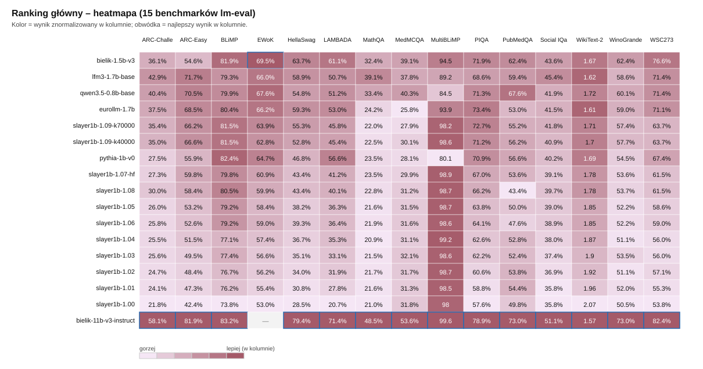

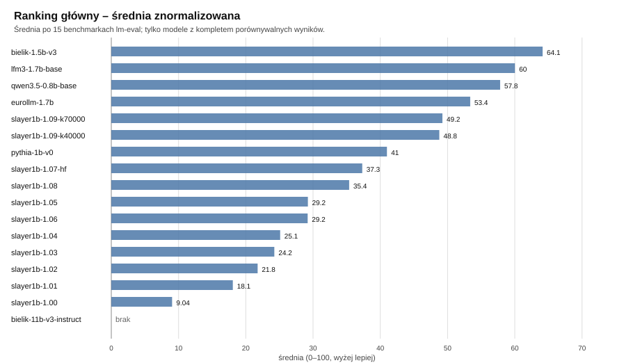

## Polszczyzna / Polish

To wyróżnik projektu: wyniki na polskich danych i polskojęzycznych/PL-lokalnych benchmarkach. Porównuj tylko w obrębie tego samego benchmarku, metryki i ustawień.

### MultiBLiMP PL
Polski podzbiór MultiBLiMP: minimalne pary sprawdzające zgodność gramatyczną w języku polskim.
_Polish subset of MultiBLiMP: minimal pairs testing Polish grammatical agreement._  
Język: pl · Metryka: `accuracy` (↑) · n=3272  
Źródło: [https://github.com/slayerlabs/benchmarks-fabryka-ai/tree/main/research/benchmarks/multiblimp-pl](https://github.com/slayerlabs/benchmarks-fabryka-ai/tree/main/research/benchmarks/multiblimp-pl)

| Model | Metryka | Wynik | n | Flagi | Źródło |
|---|---|---|---|---|---|
| bielik-11b-v3-instruct | accuracy | 99.5721 ± 0.1141 | 3272 |  | [results.json](https://github.com/slayerlabs/benchmarks-fabryka-ai/blob/a46eabf41b22e9ad80f9bf48a1961dc1c32e4faf/research/results/full-run-2026-11/multiblimp-pl/bielik-11b-v3-instruct/results.json) |
| slayer1b-1.04 | accuracy | 99.2359 ± 0.1523 | 3272 |  | [results.json](https://github.com/slayerlabs/benchmarks-fabryka-ai/blob/a46eabf41b22e9ad80f9bf48a1961dc1c32e4faf/research/results/full-run-2026-11/multiblimp-pl/slayer1b-1.04/results.json) |
| slayer1b-1.07-hf | accuracy | 98.8692 ± 0.1849 | 3272 |  | [results.json](https://github.com/slayerlabs/benchmarks-fabryka-ai/blob/a46eabf41b22e9ad80f9bf48a1961dc1c32e4faf/research/results/full-run-2026-11/multiblimp-pl/slayer1b-1.07-hf/results.json) |
| slayer1b-1.05 | accuracy | 98.7469 ± 0.1945 | 3272 |  | [results.json](https://github.com/slayerlabs/benchmarks-fabryka-ai/blob/a46eabf41b22e9ad80f9bf48a1961dc1c32e4faf/research/results/full-run-2026-11/multiblimp-pl/slayer1b-1.05/results.json) |
| slayer1b-1.08 | accuracy | 98.7469 ± 0.1945 | 3272 |  | [results.json](https://github.com/slayerlabs/benchmarks-fabryka-ai/blob/a46eabf41b22e9ad80f9bf48a1961dc1c32e4faf/research/results/full-run-2026-11/multiblimp-pl/slayer1b-1.08/results.json) |
| slayer1b-1.02 | accuracy | 98.6858 ± 0.1991 | 3272 |  | [results.json](https://github.com/slayerlabs/benchmarks-fabryka-ai/blob/a46eabf41b22e9ad80f9bf48a1961dc1c32e4faf/research/results/full-run-2026-11/multiblimp-pl/slayer1b-1.02/results.json) |
| slayer1b-1.06 | accuracy | 98.5941 ± 0.2059 | 3272 |  | [results.json](https://github.com/slayerlabs/benchmarks-fabryka-ai/blob/a46eabf41b22e9ad80f9bf48a1961dc1c32e4faf/research/results/full-run-2026-11/multiblimp-pl/slayer1b-1.06/results.json) |
| slayer1b-1.03 | accuracy | 98.5636 ± 0.208 | 3272 |  | [results.json](https://github.com/slayerlabs/benchmarks-fabryka-ai/blob/a46eabf41b22e9ad80f9bf48a1961dc1c32e4faf/research/results/full-run-2026-11/multiblimp-pl/slayer1b-1.03/results.json) |
| slayer1b-1.09-k40000 | accuracy | 98.5636 ± 0.208 | 3272 |  | [results.json](https://github.com/slayerlabs/benchmarks-fabryka-ai/blob/a46eabf41b22e9ad80f9bf48a1961dc1c32e4faf/research/results/full-run-2026-11/multiblimp-pl/slayer1b-1.09-k40000/results.json) |
| slayer1b-1.01 | accuracy | 98.5024 ± 0.2124 | 3272 |  | [results.json](https://github.com/slayerlabs/benchmarks-fabryka-ai/blob/a46eabf41b22e9ad80f9bf48a1961dc1c32e4faf/research/results/full-run-2026-11/multiblimp-pl/slayer1b-1.01/results.json) |
| slayer1b-1.09-k70000 | accuracy | 98.1663 ± 0.2346 | 3272 |  | [results.json](https://github.com/slayerlabs/benchmarks-fabryka-ai/blob/a46eabf41b22e9ad80f9bf48a1961dc1c32e4faf/research/results/full-run-2026-11/multiblimp-pl/slayer1b-1.09-k70000/results.json) |
| slayer1b-1.00 | accuracy | 97.9829 ± 0.2458 | 3272 |  | [results.json](https://github.com/slayerlabs/benchmarks-fabryka-ai/blob/a46eabf41b22e9ad80f9bf48a1961dc1c32e4faf/research/results/full-run-2026-11/multiblimp-pl/slayer1b-1.00/results.json) |
| bielik-1.5b-v3 | accuracy | 94.4682 ± 0.3997 | 3272 |  | [results.json](https://github.com/slayerlabs/benchmarks-fabryka-ai/blob/a46eabf41b22e9ad80f9bf48a1961dc1c32e4faf/research/results/full-run-2026-11/multiblimp-pl/bielik-1.5b-v3/results.json) |
| eurollm-1.7b | accuracy | 93.857 ± 0.4198 | 3272 |  | [results.json](https://github.com/slayerlabs/benchmarks-fabryka-ai/blob/a46eabf41b22e9ad80f9bf48a1961dc1c32e4faf/research/results/full-run-2026-11/multiblimp-pl/eurollm-1.7b/results.json) |
| lfm3-1.7b-base | accuracy | 89.1504 ± 0.5438 | 3272 |  | [results.json](https://github.com/slayerlabs/benchmarks-fabryka-ai/blob/a46eabf41b22e9ad80f9bf48a1961dc1c32e4faf/research/results/full-run-2026-11/multiblimp-pl/lfm3-1.7b-base/results.json) |
| qwen3.5-0.8b-base | accuracy | 84.5049 ± 0.6327 | 3272 |  | [results.json](https://github.com/slayerlabs/benchmarks-fabryka-ai/blob/a46eabf41b22e9ad80f9bf48a1961dc1c32e4faf/research/results/full-run-2026-11/multiblimp-pl/qwen3.5-0.8b-base/results.json) |
| lfm2.5-1.2b-base | accuracy | 82.9462 ± 0.6576 | 3272 | † | [results.json](https://github.com/slayerlabs/benchmarks-fabryka-ai/blob/a46eabf41b22e9ad80f9bf48a1961dc1c32e4faf/research/results/full-run-2026-11/multiblimp-pl/lfm2.5-1.2b-base/results.json) |
| lfm3-1.7b | accuracy | 80.3484 ± 0.6948 | 3272 | † | [results.json](https://github.com/slayerlabs/benchmarks-fabryka-ai/blob/a46eabf41b22e9ad80f9bf48a1961dc1c32e4faf/research/results/full-run-2026-11/multiblimp-pl/lfm3-1.7b/results.json) |
| pythia-1b-v0 | accuracy | 80.1345 ± 0.6976 | 3272 |  | [results.json](https://github.com/slayerlabs/benchmarks-fabryka-ai/blob/a46eabf41b22e9ad80f9bf48a1961dc1c32e4faf/research/results/full-run-2026-11/multiblimp-pl/pythia-1b-v0/results.json) |

### IFBench (Bielik IF-PL, lokalny)
Lokalny przebieg IFBench w protokole Bielik IF-PL; metryki strict/loose na poziomie promptu i instrukcji. Nieporównywalny z harnessami Bench Team.
_Local IFBench run in Bielik IF-PL protocol; strict/loose prompt- and instruction-level metrics. Not comparable to Bench Team harness runs._  
Język: en · Metryka: `prompt_level_strict` (↑) · n=300  
Źródło: [local://bielik-if-pl](local://bielik-if-pl)

| Model | Metryka | Wynik | n | Flagi | Źródło |
|---|---|---|---|---|---|
| bielik-11b-v3.1 | instruction_level_loose | 25.9% | 300 | ★† | ifbench.json (lokalnie) |

| Model | Metryka | Wynik | n | Flagi | Źródło |
|---|---|---|---|---|---|
| bielik-11b-v3.1 | instruction_level_strict | 19.5% | 300 | ★† | ifbench.json (lokalnie) |

| Model | Metryka | Wynik | n | Flagi | Źródło |
|---|---|---|---|---|---|
| bielik-11b-v3.1 | prompt_level_loose | 22.0% | 300 | ★† | ifbench.json (lokalnie) |

| Model | Metryka | Wynik | n | Flagi | Źródło |
|---|---|---|---|---|---|
| bielik-11b-v3.1 | prompt_level_strict | 17.0% | 300 | ★† | ifbench.json (lokalnie) |

### IFEval (Bielik IF-PL, lokalny)
Lokalny przebieg IFEval w protokole Bielik IF-PL; metryki strict/loose na poziomie promptu i instrukcji. Nieporównywalny z harnessami Bench Team.
_Local IFEval run in Bielik IF-PL protocol; strict/loose prompt- and instruction-level metrics. Not comparable to Bench Team harness runs._  
Język: en · Metryka: `prompt_level_strict` (↑) · n=541  
Źródło: [local://bielik-if-pl](local://bielik-if-pl)

| Model | Metryka | Wynik | n | Flagi | Źródło |
|---|---|---|---|---|---|
| bielik-11b-v3.1 | instruction_level_loose | 70.9% | 541 | ★† | ifeval.json (lokalnie) |

| Model | Metryka | Wynik | n | Flagi | Źródło |
|---|---|---|---|---|---|
| bielik-11b-v3.1 | instruction_level_strict | 69.4% | 541 | ★† | ifeval.json (lokalnie) |

| Model | Metryka | Wynik | n | Flagi | Źródło |
|---|---|---|---|---|---|
| bielik-11b-v3.1 | prompt_level_loose | 60.4% | 541 | ★† | ifeval.json (lokalnie) |

| Model | Metryka | Wynik | n | Flagi | Źródło |
|---|---|---|---|---|---|
| bielik-11b-v3.1 | prompt_level_strict | 58.4% | 541 | ★† | ifeval.json (lokalnie) |

### Płodność tokenizera (tokeny/słowo, 7 domen PL)
Średnia liczba tokenów na słowo na 7 polskich domenach (mniej = lepsza kompresja dla polskiego tekstu).
_Average tokens per word over 7 Polish domains (lower = better compression for Polish text)._  
Język: pl · Metryka: `fertility (tokens/word)` (↓) · n=1918225  
Źródło: [https://github.com/adgr3/tokenizatorex](https://github.com/adgr3/tokenizatorex)

| Model | Metryka | Wynik | n | Flagi | Źródło |
|---|---|---|---|---|---|
| TOKENIZATOREX | fertility (tokens/word) | 1.6557 | 1918225 | ★ | [benchmark.json](https://github.com/adgr3/tokenizatorex/blob/4afe4f85548e510b5ab43ec5aa61aafc4fd8c3e2/results/benchmark.json) |
| APT3-1B | fertility (tokens/word) | 1.7224 | 1918225 | ★ | [benchmark.json](https://github.com/adgr3/tokenizatorex/blob/4afe4f85548e510b5ab43ec5aa61aafc4fd8c3e2/results/benchmark.json) |
| Pollock-2.0 | fertility (tokens/word) | 1.7309 | 1918225 | ★ | [benchmark.json](https://github.com/adgr3/tokenizatorex/blob/4afe4f85548e510b5ab43ec5aa61aafc4fd8c3e2/results/benchmark.json) |
| polish-gpt2 | fertility (tokens/word) | 1.7412 | 1918225 | ★ | [benchmark.json](https://github.com/adgr3/tokenizatorex/blob/4afe4f85548e510b5ab43ec5aa61aafc4fd8c3e2/results/benchmark.json) |
| GoLLeM-v4 | fertility (tokens/word) | 1.8397 | 1918225 | ★ | [benchmark.json](https://github.com/adgr3/tokenizatorex/blob/4afe4f85548e510b5ab43ec5aa61aafc4fd8c3e2/results/benchmark.json) |
| TOKENIZATOREX-base | fertility (tokens/word) | 1.8502 | 1918225 | ★ | [benchmark.json](https://github.com/adgr3/tokenizatorex/blob/4afe4f85548e510b5ab43ec5aa61aafc4fd8c3e2/results/benchmark.json) |
| Slayer1B (GoLLeM-v6) | fertility (tokens/word) | 1.8936 | 1918225 | ★ | [benchmark.json](https://github.com/adgr3/tokenizatorex/blob/4afe4f85548e510b5ab43ec5aa61aafc4fd8c3e2/results/benchmark.json) |
| TokenizerTest-32m-B | fertility (tokens/word) | 2.0354 | 1918225 | ★ | [benchmark.json](https://github.com/adgr3/tokenizatorex/blob/4afe4f85548e510b5ab43ec5aa61aafc4fd8c3e2/results/benchmark.json) |
| Qwen3.5 | fertility (tokens/word) | 2.3169 | 1918225 | ★ | [benchmark.json](https://github.com/adgr3/tokenizatorex/blob/4afe4f85548e510b5ab43ec5aa61aafc4fd8c3e2/results/benchmark.json) |
| PLLuM-4B-2512 | fertility (tokens/word) | 2.317 | 1918225 | ★ | [benchmark.json](https://github.com/adgr3/tokenizatorex/blob/4afe4f85548e510b5ab43ec5aa61aafc4fd8c3e2/results/benchmark.json) |
| GPT-4o / GPT-5 (o200k) | fertility (tokens/word) | 2.3416 | 1918225 | ★ | [benchmark.json](https://github.com/adgr3/tokenizatorex/blob/4afe4f85548e510b5ab43ec5aa61aafc4fd8c3e2/results/benchmark.json) |
| DeepSeek-V3 | fertility (tokens/word) | 2.4254 | 1918225 | ★ | [benchmark.json](https://github.com/adgr3/tokenizatorex/blob/4afe4f85548e510b5ab43ec5aa61aafc4fd8c3e2/results/benchmark.json) |
| PLLuM-12B-2512 | fertility (tokens/word) | 2.4395 | 1918225 | ★ | [benchmark.json](https://github.com/adgr3/tokenizatorex/blob/4afe4f85548e510b5ab43ec5aa61aafc4fd8c3e2/results/benchmark.json) |
| Qwen3 | fertility (tokens/word) | 2.5981 | 1918225 | ★ | [benchmark.json](https://github.com/adgr3/tokenizatorex/blob/4afe4f85548e510b5ab43ec5aa61aafc4fd8c3e2/results/benchmark.json) |
| Llama-PLLuM-8B-2512 | fertility (tokens/word) | 2.6584 | 1918225 | ★ | [benchmark.json](https://github.com/adgr3/tokenizatorex/blob/4afe4f85548e510b5ab43ec5aa61aafc4fd8c3e2/results/benchmark.json) |
| GPT-4 (cl100k) | fertility (tokens/word) | 2.693 | 1918225 | ★ | [benchmark.json](https://github.com/adgr3/tokenizatorex/blob/4afe4f85548e510b5ab43ec5aa61aafc4fd8c3e2/results/benchmark.json) |
| Bielik-11B-v2.3 | fertility (tokens/word) | 3.0615 | 1918225 | ★ | [benchmark.json](https://github.com/adgr3/tokenizatorex/blob/4afe4f85548e510b5ab43ec5aa61aafc4fd8c3e2/results/benchmark.json) |
| PLLuM-8x7B-2412 | fertility (tokens/word) | 3.0615 | 1918225 | ★ | [benchmark.json](https://github.com/adgr3/tokenizatorex/blob/4afe4f85548e510b5ab43ec5aa61aafc4fd8c3e2/results/benchmark.json) |
| Slayer139 | fertility (tokens/word) | 3.5882 | 1918225 | ★ | [benchmark.json](https://github.com/adgr3/tokenizatorex/blob/4afe4f85548e510b5ab43ec5aa61aafc4fd8c3e2/results/benchmark.json) |
| Slayer149 | fertility (tokens/word) | 3.7926 | 1918225 | ★ | [benchmark.json](https://github.com/adgr3/tokenizatorex/blob/4afe4f85548e510b5ab43ec5aa61aafc4fd8c3e2/results/benchmark.json) |

### Korpus held-out (bajty na token)
Kompresja tokenizera na korpusie held-out: średnia liczba bajtów UTF-8 na token (wyżej = lepsza kompresja).
_Tokenizer compression on a held-out corpus: average UTF-8 bytes per token (higher = better compression)._  
Język: pl · Metryka: `bytes per token` (↑) · n=10017776  
Źródło: [https://github.com/adgr3/tokenizatorex](https://github.com/adgr3/tokenizatorex)

| Model | Metryka | Wynik | n | Flagi | Źródło |
|---|---|---|---|---|---|
| tokenizatorex-32k | bytes per token | 5.1449 | 10017776 | ★ | [metrics.json](https://github.com/adgr3/tokenizatorex/blob/4afe4f85548e510b5ab43ec5aa61aafc4fd8c3e2/results/metrics.json) |
| superbpe-32k-t16k | bytes per token | 5.1442 | 10017776 | ★ | [metrics.json](https://github.com/adgr3/tokenizatorex/blob/4afe4f85548e510b5ab43ec5aa61aafc4fd8c3e2/results/metrics.json) |
| superbpe-32k-t24k | bytes per token | 5.1431 | 10017776 | ★ | [metrics.json](https://github.com/adgr3/tokenizatorex/blob/4afe4f85548e510b5ab43ec5aa61aafc4fd8c3e2/results/metrics.json) |
| superbpe-32k-t28k | bytes per token | 5.1127 | 10017776 | ★ | [metrics.json](https://github.com/adgr3/tokenizatorex/blob/4afe4f85548e510b5ab43ec5aa61aafc4fd8c3e2/results/metrics.json) |
| tokenizatorex-base-32k | bytes per token | 4.5917 | 10017776 | ★ | [metrics.json](https://github.com/adgr3/tokenizatorex/blob/4afe4f85548e510b5ab43ec5aa61aafc4fd8c3e2/results/metrics.json) |
| o200k_base | bytes per token | 3.3023 | 10017776 | ★ | [metrics.json](https://github.com/adgr3/tokenizatorex/blob/4afe4f85548e510b5ab43ec5aa61aafc4fd8c3e2/results/metrics.json) |
| cl100k_base | bytes per token | 2.8317 | 10017776 | ★ | [metrics.json](https://github.com/adgr3/tokenizatorex/blob/4afe4f85548e510b5ab43ec5aa61aafc4fd8c3e2/results/metrics.json) |

## Polszczyzna i instrukcje / Polish and instructions

Wyróżnik projektu: benchmarki polskie i instrukcyjne (PL/IF). Porównuj wyniki tylko w obrębie tego samego benchmarku, metryki i ustawień; † oznacza odstępstwo.

### IFBench
Dokładność ścisła na poziomie promptu w IFBench; sprawdza wykonywanie ograniczeń instrukcyjnych.
_Prompt-level strict accuracy on IFBench; tests adherence to instruction constraints._  
Język: en · Metryka: `prompt_level_strict_acc` (↑ wyżej lepiej) · n=300  
Źródło: [https://github.com/slayerlabs/benchmarks-fabryka-ai/tree/main/research/api-benchmarks/ifbench](https://github.com/slayerlabs/benchmarks-fabryka-ai/tree/main/research/api-benchmarks/ifbench)

| Model | Metryka | Wynik | n | Flagi | Ustawienia | Źródło | Odstępstwa |
|---|---|---|---|---|---|---|---|
| bielik-11b-v3.1-vllm | prompt_level_strict_acc | 18.3% ± 2.2% | 300 | † | — | [bielik-11b-v3.1-vllm.json](https://github.com/slayerlabs/benchmarks-fabryka-ai/blob/a46eabf41b22e9ad80f9bf48a1961dc1c32e4faf/research/api-benchmarks/ifbench/results/bielik-11b-v3.1-vllm.json) | see README.md, Deviations |
| slayer1b-60000 | prompt_level_strict_acc | 8.3% ± 1.6% | 300 | † | — | [slayer1b-60000.json](https://github.com/slayerlabs/benchmarks-fabryka-ai/blob/a46eabf41b22e9ad80f9bf48a1961dc1c32e4faf/research/api-benchmarks/ifbench/results/slayer1b-60000.json) | see README.md, Deviations |

### IFBench (Bielik IF-PL, lokalny)
Lokalny przebieg IFBench w protokole Bielik IF-PL; metryki strict/loose na poziomie promptu i instrukcji. Nieporównywalny z harnessami Bench Team.
_Local IFBench run in Bielik IF-PL protocol; strict/loose prompt- and instruction-level metrics. Not comparable to Bench Team harness runs._  
Język: en · Metryka: `prompt_level_strict` (↑ wyżej lepiej) · n=300  
Źródło: [local://bielik-if-pl](local://bielik-if-pl)

| Model | Metryka | Wynik | n | Flagi | Ustawienia | Źródło | Odstępstwa |
|---|---|---|---|---|---|---|---|
| bielik-11b-v3.1 | instruction_level_loose | 25.9% | 300 | ★† | full test set | ifbench.json (lokalnie) | local Bielik IF-PL protocol; not part of Bench Team harness |

| Model | Metryka | Wynik | n | Flagi | Ustawienia | Źródło | Odstępstwa |
|---|---|---|---|---|---|---|---|
| bielik-11b-v3.1 | instruction_level_strict | 19.5% | 300 | ★† | full test set | ifbench.json (lokalnie) | local Bielik IF-PL protocol; not part of Bench Team harness |

| Model | Metryka | Wynik | n | Flagi | Ustawienia | Źródło | Odstępstwa |
|---|---|---|---|---|---|---|---|
| bielik-11b-v3.1 | prompt_level_loose | 22.0% | 300 | ★† | full test set | ifbench.json (lokalnie) | local Bielik IF-PL protocol; not part of Bench Team harness |

| Model | Metryka | Wynik | n | Flagi | Ustawienia | Źródło | Odstępstwa |
|---|---|---|---|---|---|---|---|
| bielik-11b-v3.1 | prompt_level_strict | 17.0% | 300 | ★† | full test set | ifbench.json (lokalnie) | local Bielik IF-PL protocol; not part of Bench Team harness |

### IFEval
Dokładność ścisła na poziomie promptu w IFEval; sprawdza wykonywanie weryfikowalnych instrukcji.
_Prompt-level strict accuracy on IFEval; tests following verifiable instructions._  
Język: en · Metryka: `prompt_level_strict_acc` (↑ wyżej lepiej) · n=541  
Źródło: [https://github.com/slayerlabs/benchmarks-fabryka-ai/tree/main/research/benchmarks/ifeval](https://github.com/slayerlabs/benchmarks-fabryka-ai/tree/main/research/benchmarks/ifeval)

| Model | Metryka | Wynik | n | Flagi | Ustawienia | Źródło | Odstępstwa |
|---|---|---|---|---|---|---|---|
| lfm3-1.7b | prompt_level_strict_acc | 94.6% ± 97.0% | 541 | † | — | [lfm3-1.7b.json](https://github.com/slayerlabs/benchmarks-fabryka-ai/blob/a46eabf41b22e9ad80f9bf48a1961dc1c32e4faf/research/api-benchmarks/ifeval/results/lfm3-1.7b.json) | see README.md, Deviations |
| lfm3-1.7b-ifeval | prompt_level_strict_acc | 94.6% ± 97.0% | 541 |  | own vLLM, card settings, reasoning on | [lfm3-1.7b.json](https://github.com/slayerlabs/benchmarks-fabryka-ai/blob/a46eabf41b22e9ad80f9bf48a1961dc1c32e4faf/research/api-benchmarks/ifeval/results/lfm3-1.7b.json) | — |
| bielik-11b-v3.1-vllm | prompt_level_strict_acc | 60.6% ± 2.1% | 541 |  | own vLLM, chat template, sampled | [bielik-11b-v3.1-vllm.json](https://github.com/slayerlabs/benchmarks-fabryka-ai/blob/a46eabf41b22e9ad80f9bf48a1961dc1c32e4faf/research/api-benchmarks/ifeval/results/bielik-11b-v3.1-vllm.json) | — |
| bielik-11b-v3.1-vllm-no-provider | prompt_level_strict_acc | 57.3% ± 2.1% | 541 |  | own vLLM, no provider system prompt | [bielik-11b-v3.1-vllm-no-provider.json](https://github.com/slayerlabs/benchmarks-fabryka-ai/blob/a46eabf41b22e9ad80f9bf48a1961dc1c32e4faf/research/api-benchmarks/ifeval/results/bielik-11b-v3.1-vllm-no-provider.json) | — |
| bielik-11b-v3.1 | prompt_level_strict_acc | 55.3% ± 2.1% | 541 |  | Fabryka API, chat template, sampled | [bielik-11b-v3.1.json](https://github.com/slayerlabs/benchmarks-fabryka-ai/blob/a46eabf41b22e9ad80f9bf48a1961dc1c32e4faf/research/api-benchmarks/ifeval/results/bielik-11b-v3.1.json) | — |
| slayer1b-1.08 | prompt_level_strict_acc | 18.1% ± 1.7% | 541 |  | local GPU, raw prompt, greedy | [slayer1b-1.08.json](https://github.com/slayerlabs/benchmarks-fabryka-ai/blob/a46eabf41b22e9ad80f9bf48a1961dc1c32e4faf/research/api-benchmarks/ifeval/results/slayer1b-1.08.json) | — |
| slayer1b-1.08-modal | prompt_level_strict_acc | 16.8% ± 1.6% | 541 |  | Modal A100, raw prompt, greedy | [slayer1b-1.08-modal.json](https://github.com/slayerlabs/benchmarks-fabryka-ai/blob/a46eabf41b22e9ad80f9bf48a1961dc1c32e4faf/research/api-benchmarks/ifeval/results/slayer1b-1.08-modal.json) | — |

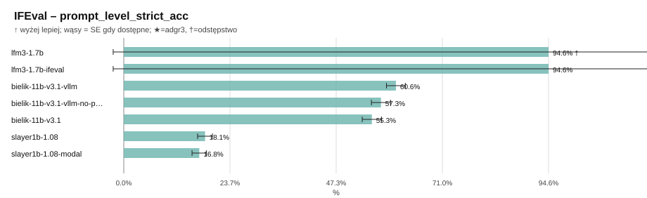

### IFEval (Bielik IF-PL, lokalny)
Lokalny przebieg IFEval w protokole Bielik IF-PL; metryki strict/loose na poziomie promptu i instrukcji. Nieporównywalny z harnessami Bench Team.
_Local IFEval run in Bielik IF-PL protocol; strict/loose prompt- and instruction-level metrics. Not comparable to Bench Team harness runs._  
Język: en · Metryka: `prompt_level_strict` (↑ wyżej lepiej) · n=541  
Źródło: [local://bielik-if-pl](local://bielik-if-pl)

| Model | Metryka | Wynik | n | Flagi | Ustawienia | Źródło | Odstępstwa |
|---|---|---|---|---|---|---|---|
| bielik-11b-v3.1 | instruction_level_loose | 70.9% | 541 | ★† | full test set | ifeval.json (lokalnie) | local Bielik IF-PL protocol; not part of Bench Team harness |

| Model | Metryka | Wynik | n | Flagi | Ustawienia | Źródło | Odstępstwa |
|---|---|---|---|---|---|---|---|
| bielik-11b-v3.1 | instruction_level_strict | 69.4% | 541 | ★† | full test set | ifeval.json (lokalnie) | local Bielik IF-PL protocol; not part of Bench Team harness |

| Model | Metryka | Wynik | n | Flagi | Ustawienia | Źródło | Odstępstwa |
|---|---|---|---|---|---|---|---|
| bielik-11b-v3.1 | prompt_level_loose | 60.4% | 541 | ★† | full test set | ifeval.json (lokalnie) | local Bielik IF-PL protocol; not part of Bench Team harness |

| Model | Metryka | Wynik | n | Flagi | Ustawienia | Źródło | Odstępstwa |
|---|---|---|---|---|---|---|---|
| bielik-11b-v3.1 | prompt_level_strict | 58.4% | 541 | ★† | full test set | ifeval.json (lokalnie) | local Bielik IF-PL protocol; not part of Bench Team harness |

### IFStruct
Odsetek zaliczonych zadań IFStruct; sprawdza wykonywanie instrukcji ze strukturą wyjścia.
_Pass rate on IFStruct; tests following instructions with structured output constraints._  
Język: en · Metryka: `pass_rate` (↑ wyżej lepiej) · n=2000  
Źródło: [https://github.com/slayerlabs/benchmarks-fabryka-ai/tree/main/research/api-benchmarks/ifstruct](https://github.com/slayerlabs/benchmarks-fabryka-ai/tree/main/research/api-benchmarks/ifstruct)

| Model | Metryka | Wynik | n | Flagi | Ustawienia | Źródło | Odstępstwa |
|---|---|---|---|---|---|---|---|
| bielik-11b-v3.1-vllm | pass_rate | 30.9% ± 103.0% | 2000 | † | — | [bielik-11b-v3.1-vllm.json](https://github.com/slayerlabs/benchmarks-fabryka-ai/blob/a46eabf41b22e9ad80f9bf48a1961dc1c32e4faf/research/api-benchmarks/ifstruct/results/bielik-11b-v3.1-vllm.json) | see README.md, Deviations |
| slayer1b-60000 | pass_rate | 0.0% | 2000 | † | — | [slayer1b-60000.json](https://github.com/slayerlabs/benchmarks-fabryka-ai/blob/a46eabf41b22e9ad80f9bf48a1961dc1c32e4faf/research/api-benchmarks/ifstruct/results/slayer1b-60000.json) | see README.md, Deviations |

### Multi-IF
Średnia z 3 tur w Multi-IF (overall, wszystkie języki); mierzy wykonywanie instrukcji w rozmowie wieloturowej.
_Mean over 3 turns of all-languages overall in Multi-IF; measures multi-turn instruction following._  
Język: multilingual · Metryka: `mean over 3 turns of all-languages overall` (↑ wyżej lepiej) · n=13447  
Źródło: [https://github.com/slayerlabs/benchmarks-fabryka-ai/tree/main/research/api-benchmarks/multi-if](https://github.com/slayerlabs/benchmarks-fabryka-ai/tree/main/research/api-benchmarks/multi-if)

| Model | Metryka | Wynik | n | Flagi | Ustawienia | Źródło | Odstępstwa |
|---|---|---|---|---|---|---|---|
| bielik-11b-v3.1-vllm | mean over 3 turns of all-languages overall | 48.66 ± 0.44 | 13447 | † | — | [bielik-11b-v3.1-vllm.json](https://github.com/slayerlabs/benchmarks-fabryka-ai/blob/a46eabf41b22e9ad80f9bf48a1961dc1c32e4faf/research/api-benchmarks/multi-if/results/bielik-11b-v3.1-vllm.json) | see README.md, Deviations |
| slayer1b-60000 | mean over 3 turns of all-languages overall | null (run stopped after 2 of 3 turns (compute budget); turn 3 ran at about 10 conversations per minute) | 0 | †∅ | — | [slayer1b-60000.json](https://github.com/slayerlabs/benchmarks-fabryka-ai/blob/a46eabf41b22e9ad80f9bf48a1961dc1c32e4faf/research/api-benchmarks/multi-if/results/slayer1b-60000.json) | run stopped after 2 of 3 turns (compute budget); turn 3 ran at about 10 conversations per minute |

### MultiBLiMP PL
Polski podzbiór MultiBLiMP: minimalne pary sprawdzające zgodność gramatyczną w języku polskim.
_Polish subset of MultiBLiMP: minimal pairs testing Polish grammatical agreement._  
Język: pl · Metryka: `accuracy` (↑ wyżej lepiej) · n=3272  
Źródło: [https://github.com/slayerlabs/benchmarks-fabryka-ai/tree/main/research/benchmarks/multiblimp-pl](https://github.com/slayerlabs/benchmarks-fabryka-ai/tree/main/research/benchmarks/multiblimp-pl)

| Model | Metryka | Wynik | n | Flagi | Ustawienia | Źródło | Odstępstwa |
|---|---|---|---|---|---|---|---|
| bielik-11b-v3-instruct | accuracy | 99.5721 ± 0.1141 | 3272 |  | bfloat16, no BOS | [results.json](https://github.com/slayerlabs/benchmarks-fabryka-ai/blob/a46eabf41b22e9ad80f9bf48a1961dc1c32e4faf/research/results/full-run-2026-11/multiblimp-pl/bielik-11b-v3-instruct/results.json) | — |
| slayer1b-1.04 | accuracy | 99.2359 ± 0.1523 | 3272 |  | float32, one BOS | [results.json](https://github.com/slayerlabs/benchmarks-fabryka-ai/blob/a46eabf41b22e9ad80f9bf48a1961dc1c32e4faf/research/results/full-run-2026-11/multiblimp-pl/slayer1b-1.04/results.json) | — |
| slayer1b-1.07-hf | accuracy | 98.8692 ± 0.1849 | 3272 |  | float32, one BOS | [results.json](https://github.com/slayerlabs/benchmarks-fabryka-ai/blob/a46eabf41b22e9ad80f9bf48a1961dc1c32e4faf/research/results/full-run-2026-11/multiblimp-pl/slayer1b-1.07-hf/results.json) | — |
| slayer1b-1.05 | accuracy | 98.7469 ± 0.1945 | 3272 |  | float32, one BOS | [results.json](https://github.com/slayerlabs/benchmarks-fabryka-ai/blob/a46eabf41b22e9ad80f9bf48a1961dc1c32e4faf/research/results/full-run-2026-11/multiblimp-pl/slayer1b-1.05/results.json) | — |
| slayer1b-1.08 | accuracy | 98.7469 ± 0.1945 | 3272 |  | float32, one BOS | [results.json](https://github.com/slayerlabs/benchmarks-fabryka-ai/blob/a46eabf41b22e9ad80f9bf48a1961dc1c32e4faf/research/results/full-run-2026-11/multiblimp-pl/slayer1b-1.08/results.json) | — |
| slayer1b-1.02 | accuracy | 98.6858 ± 0.1991 | 3272 |  | float32, one BOS | [results.json](https://github.com/slayerlabs/benchmarks-fabryka-ai/blob/a46eabf41b22e9ad80f9bf48a1961dc1c32e4faf/research/results/full-run-2026-11/multiblimp-pl/slayer1b-1.02/results.json) | — |
| slayer1b-1.06 | accuracy | 98.5941 ± 0.2059 | 3272 |  | float32, one BOS | [results.json](https://github.com/slayerlabs/benchmarks-fabryka-ai/blob/a46eabf41b22e9ad80f9bf48a1961dc1c32e4faf/research/results/full-run-2026-11/multiblimp-pl/slayer1b-1.06/results.json) | — |
| slayer1b-1.03 | accuracy | 98.5636 ± 0.208 | 3272 |  | float32, one BOS | [results.json](https://github.com/slayerlabs/benchmarks-fabryka-ai/blob/a46eabf41b22e9ad80f9bf48a1961dc1c32e4faf/research/results/full-run-2026-11/multiblimp-pl/slayer1b-1.03/results.json) | — |
| slayer1b-1.09-k40000 | accuracy | 98.5636 ± 0.208 | 3272 |  | float32, one BOS | [results.json](https://github.com/slayerlabs/benchmarks-fabryka-ai/blob/a46eabf41b22e9ad80f9bf48a1961dc1c32e4faf/research/results/full-run-2026-11/multiblimp-pl/slayer1b-1.09-k40000/results.json) | — |
| slayer1b-1.01 | accuracy | 98.5024 ± 0.2124 | 3272 |  | float32, one BOS | [results.json](https://github.com/slayerlabs/benchmarks-fabryka-ai/blob/a46eabf41b22e9ad80f9bf48a1961dc1c32e4faf/research/results/full-run-2026-11/multiblimp-pl/slayer1b-1.01/results.json) | — |
| slayer1b-1.09-k70000 | accuracy | 98.1663 ± 0.2346 | 3272 |  | float32, one BOS | [results.json](https://github.com/slayerlabs/benchmarks-fabryka-ai/blob/a46eabf41b22e9ad80f9bf48a1961dc1c32e4faf/research/results/full-run-2026-11/multiblimp-pl/slayer1b-1.09-k70000/results.json) | — |
| slayer1b-1.00 | accuracy | 97.9829 ± 0.2458 | 3272 |  | float32, one BOS | [results.json](https://github.com/slayerlabs/benchmarks-fabryka-ai/blob/a46eabf41b22e9ad80f9bf48a1961dc1c32e4faf/research/results/full-run-2026-11/multiblimp-pl/slayer1b-1.00/results.json) | — |
| bielik-1.5b-v3 | accuracy | 94.4682 ± 0.3997 | 3272 |  | float32, no BOS | [results.json](https://github.com/slayerlabs/benchmarks-fabryka-ai/blob/a46eabf41b22e9ad80f9bf48a1961dc1c32e4faf/research/results/full-run-2026-11/multiblimp-pl/bielik-1.5b-v3/results.json) | — |
| eurollm-1.7b | accuracy | 93.857 ± 0.4198 | 3272 |  | float32, no BOS | [results.json](https://github.com/slayerlabs/benchmarks-fabryka-ai/blob/a46eabf41b22e9ad80f9bf48a1961dc1c32e4faf/research/results/full-run-2026-11/multiblimp-pl/eurollm-1.7b/results.json) | — |
| lfm3-1.7b-base | accuracy | 89.1504 ± 0.5438 | 3272 |  | float32, no BOS | [results.json](https://github.com/slayerlabs/benchmarks-fabryka-ai/blob/a46eabf41b22e9ad80f9bf48a1961dc1c32e4faf/research/results/full-run-2026-11/multiblimp-pl/lfm3-1.7b-base/results.json) | — |
| qwen3.5-0.8b-base | accuracy | 84.5049 ± 0.6327 | 3272 |  | float32, no BOS | [results.json](https://github.com/slayerlabs/benchmarks-fabryka-ai/blob/a46eabf41b22e9ad80f9bf48a1961dc1c32e4faf/research/results/full-run-2026-11/multiblimp-pl/qwen3.5-0.8b-base/results.json) | — |
| lfm2.5-1.2b-base | accuracy | 82.9462 ± 0.6576 | 3272 | † | float32, no BOS | [results.json](https://github.com/slayerlabs/benchmarks-fabryka-ai/blob/a46eabf41b22e9ad80f9bf48a1961dc1c32e4faf/research/results/full-run-2026-11/multiblimp-pl/lfm2.5-1.2b-base/results.json) | reguła kontekstu: acc_pmi poniżej bazy losowej na 2 testach PMI (ARC-Challenge, PIQA); próg 2 ustalony po obejrzeniu tego przebiegu; reguła przebiegu centralnego: wynik różni się od results/central-run dla tej samej rewizji i wag |
| lfm3-1.7b | accuracy | 80.3484 ± 0.6948 | 3272 | † | float32, no BOS | [results.json](https://github.com/slayerlabs/benchmarks-fabryka-ai/blob/a46eabf41b22e9ad80f9bf48a1961dc1c32e4faf/research/results/full-run-2026-11/multiblimp-pl/lfm3-1.7b/results.json) | model instruct liczony na surowym tekście, bez chat template; reguła kontekstu: acc_pmi poniżej bazy losowej na 2 testach PMI (ARC-Challenge, PIQA); próg 2 ustalony po obejrzeniu tego przebiegu |
| pythia-1b-v0 | accuracy | 80.1345 ± 0.6976 | 3272 |  | float32, no BOS | [results.json](https://github.com/slayerlabs/benchmarks-fabryka-ai/blob/a46eabf41b22e9ad80f9bf48a1961dc1c32e4faf/research/results/full-run-2026-11/multiblimp-pl/pythia-1b-v0/results.json) | — |

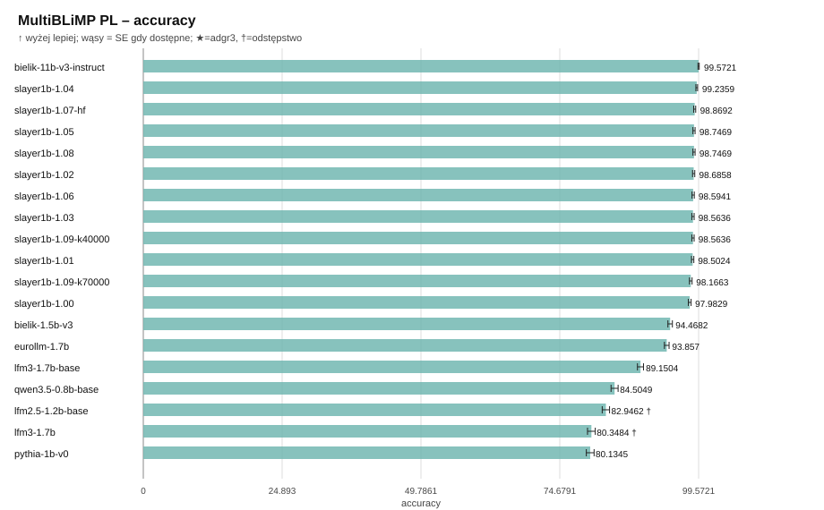

## Wiedza i rozumowanie / Knowledge and reasoning

Sekcja obejmuje benchmarki z rodziny „Wiedza i rozumowanie”. Porównuj tylko w obrębie tego samego benchmarku, metryki i ustawień.

### ARC-Challenge
Pytania przyrodnicze ze szkolnych testów (część trudna), 4 opcje; metryka acc_norm.
_Grade-school science questions (challenge set), 4 options; acc_norm metric._  
Język: en · Metryka: `acc_norm` (↑ wyżej lepiej) · n=1172  
Źródło: [https://github.com/slayerlabs/benchmarks-fabryka-ai/tree/main/research/benchmarks/arc-challenge](https://github.com/slayerlabs/benchmarks-fabryka-ai/tree/main/research/benchmarks/arc-challenge)

| Model | Metryka | Wynik | n | Flagi | Ustawienia | Źródło | Odstępstwa |
|---|---|---|---|---|---|---|---|
| bielik-11b-v3-instruct | acc_norm | 58.1% ± 1.4% | 1172 |  | bfloat16, no BOS | [results.json](https://github.com/slayerlabs/benchmarks-fabryka-ai/blob/a46eabf41b22e9ad80f9bf48a1961dc1c32e4faf/research/results/full-run-2026-11/arc-challenge/bielik-11b-v3-instruct/results.json) | — |
| lfm3-1.7b-base | acc_norm | 42.9% ± 1.4% | 1172 |  | float32, no BOS | [results.json](https://github.com/slayerlabs/benchmarks-fabryka-ai/blob/a46eabf41b22e9ad80f9bf48a1961dc1c32e4faf/research/results/full-run-2026-11/arc-challenge/lfm3-1.7b-base/results.json) | — |
| qwen3.5-0.8b-base | acc_norm | 40.4% ± 1.4% | 1172 |  | float32, no BOS | [results.json](https://github.com/slayerlabs/benchmarks-fabryka-ai/blob/a46eabf41b22e9ad80f9bf48a1961dc1c32e4faf/research/results/full-run-2026-11/arc-challenge/qwen3.5-0.8b-base/results.json) | — |
| eurollm-1.7b | acc_norm | 37.5% ± 1.4% | 1172 |  | float32, no BOS | [results.json](https://github.com/slayerlabs/benchmarks-fabryka-ai/blob/a46eabf41b22e9ad80f9bf48a1961dc1c32e4faf/research/results/full-run-2026-11/arc-challenge/eurollm-1.7b/results.json) | — |
| bielik-1.5b-v3 | acc_norm | 36.1% ± 1.4% | 1172 |  | float32, no BOS | [results.json](https://github.com/slayerlabs/benchmarks-fabryka-ai/blob/a46eabf41b22e9ad80f9bf48a1961dc1c32e4faf/research/results/full-run-2026-11/arc-challenge/bielik-1.5b-v3/results.json) | — |
| slayer1b-1.09-k70000 | acc_norm | 35.4% ± 1.4% | 1172 |  | float32, one BOS | [results.json](https://github.com/slayerlabs/benchmarks-fabryka-ai/blob/a46eabf41b22e9ad80f9bf48a1961dc1c32e4faf/research/results/full-run-2026-11/arc-challenge/slayer1b-1.09-k70000/results.json) | — |
| slayer1b-1.09-k40000 | acc_norm | 35.0% ± 1.4% | 1172 |  | float32, one BOS | [results.json](https://github.com/slayerlabs/benchmarks-fabryka-ai/blob/a46eabf41b22e9ad80f9bf48a1961dc1c32e4faf/research/results/full-run-2026-11/arc-challenge/slayer1b-1.09-k40000/results.json) | — |
| slayer1b-1.08 | acc_norm | 30.0% ± 1.3% | 1172 |  | float32, one BOS | [results.json](https://github.com/slayerlabs/benchmarks-fabryka-ai/blob/a46eabf41b22e9ad80f9bf48a1961dc1c32e4faf/research/results/full-run-2026-11/arc-challenge/slayer1b-1.08/results.json) | — |
| pythia-1b-v0 | acc_norm | 27.5% ± 1.3% | 1172 |  | float32, no BOS | [results.json](https://github.com/slayerlabs/benchmarks-fabryka-ai/blob/a46eabf41b22e9ad80f9bf48a1961dc1c32e4faf/research/results/full-run-2026-11/arc-challenge/pythia-1b-v0/results.json) | — |
| slayer1b-1.07-hf | acc_norm | 27.3% ± 1.3% | 1172 |  | float32, one BOS | [results.json](https://github.com/slayerlabs/benchmarks-fabryka-ai/blob/a46eabf41b22e9ad80f9bf48a1961dc1c32e4faf/research/results/full-run-2026-11/arc-challenge/slayer1b-1.07-hf/results.json) | — |
| lfm3-1.7b | acc_norm | 26.3% ± 1.3% | 1172 | † | float32, no BOS | [results.json](https://github.com/slayerlabs/benchmarks-fabryka-ai/blob/a46eabf41b22e9ad80f9bf48a1961dc1c32e4faf/research/results/full-run-2026-11/arc-challenge/lfm3-1.7b/results.json) | model instruct liczony na surowym tekście, bez chat template; reguła kontekstu: acc_pmi poniżej bazy losowej na 2 testach PMI (ARC-Challenge, PIQA); próg 2 ustalony po obejrzeniu tego przebiegu |
| slayer1b-1.05 | acc_norm | 26.0% ± 1.3% | 1172 |  | float32, one BOS | [results.json](https://github.com/slayerlabs/benchmarks-fabryka-ai/blob/a46eabf41b22e9ad80f9bf48a1961dc1c32e4faf/research/results/full-run-2026-11/arc-challenge/slayer1b-1.05/results.json) | — |
| slayer1b-1.06 | acc_norm | 25.8% ± 1.3% | 1172 |  | float32, one BOS | [results.json](https://github.com/slayerlabs/benchmarks-fabryka-ai/blob/a46eabf41b22e9ad80f9bf48a1961dc1c32e4faf/research/results/full-run-2026-11/arc-challenge/slayer1b-1.06/results.json) | — |
| slayer1b-1.03 | acc_norm | 25.6% ± 1.3% | 1172 |  | float32, one BOS | [results.json](https://github.com/slayerlabs/benchmarks-fabryka-ai/blob/a46eabf41b22e9ad80f9bf48a1961dc1c32e4faf/research/results/full-run-2026-11/arc-challenge/slayer1b-1.03/results.json) | — |
| slayer1b-1.04 | acc_norm | 25.5% ± 1.3% | 1172 |  | float32, one BOS | [results.json](https://github.com/slayerlabs/benchmarks-fabryka-ai/blob/a46eabf41b22e9ad80f9bf48a1961dc1c32e4faf/research/results/full-run-2026-11/arc-challenge/slayer1b-1.04/results.json) | — |
| lfm2.5-1.2b-base | acc_norm | 25.2% ± 1.3% | 1172 | † | float32, no BOS | [results.json](https://github.com/slayerlabs/benchmarks-fabryka-ai/blob/a46eabf41b22e9ad80f9bf48a1961dc1c32e4faf/research/results/full-run-2026-11/arc-challenge/lfm2.5-1.2b-base/results.json) | reguła kontekstu: acc_pmi poniżej bazy losowej na 2 testach PMI (ARC-Challenge, PIQA); próg 2 ustalony po obejrzeniu tego przebiegu; reguła przebiegu centralnego: wynik różni się od results/central-run dla tej samej rewizji i wag |
| slayer1b-1.02 | acc_norm | 24.7% ± 1.3% | 1172 |  | float32, one BOS | [results.json](https://github.com/slayerlabs/benchmarks-fabryka-ai/blob/a46eabf41b22e9ad80f9bf48a1961dc1c32e4faf/research/results/full-run-2026-11/arc-challenge/slayer1b-1.02/results.json) | — |
| slayer1b-1.01 | acc_norm | 24.1% ± 1.3% | 1172 |  | float32, one BOS | [results.json](https://github.com/slayerlabs/benchmarks-fabryka-ai/blob/a46eabf41b22e9ad80f9bf48a1961dc1c32e4faf/research/results/full-run-2026-11/arc-challenge/slayer1b-1.01/results.json) | — |
| slayer1b-1.00 | acc_norm | 21.8% ± 1.2% | 1172 |  | float32, one BOS | [results.json](https://github.com/slayerlabs/benchmarks-fabryka-ai/blob/a46eabf41b22e9ad80f9bf48a1961dc1c32e4faf/research/results/full-run-2026-11/arc-challenge/slayer1b-1.00/results.json) | — |

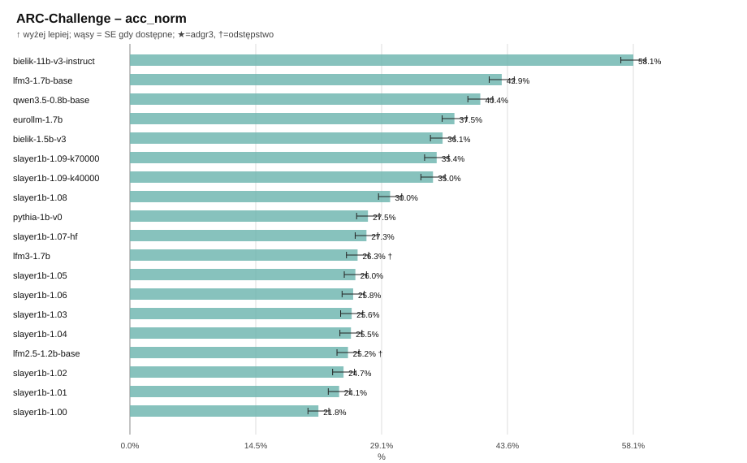

### ARC-Easy
Pytania przyrodnicze ze szkolnych testów (część łatwa), 4 opcje; metryka acc.
_Grade-school science questions (easy set), 4 options; acc metric._  
Język: en · Metryka: `acc` (↑ wyżej lepiej) · n=2376  
Źródło: [https://github.com/slayerlabs/benchmarks-fabryka-ai/tree/main/research/benchmarks/arc-easy](https://github.com/slayerlabs/benchmarks-fabryka-ai/tree/main/research/benchmarks/arc-easy)

| Model | Metryka | Wynik | n | Flagi | Ustawienia | Źródło | Odstępstwa |
|---|---|---|---|---|---|---|---|
| bielik-11b-v3-instruct | acc | 81.9% ± 0.8% | 2376 |  | bfloat16, no BOS | [results.json](https://github.com/slayerlabs/benchmarks-fabryka-ai/blob/a46eabf41b22e9ad80f9bf48a1961dc1c32e4faf/research/results/full-run-2026-11/arc-easy/bielik-11b-v3-instruct/results.json) | — |
| lfm3-1.7b-base | acc | 71.7% ± 0.9% | 2376 |  | float32, no BOS | [results.json](https://github.com/slayerlabs/benchmarks-fabryka-ai/blob/a46eabf41b22e9ad80f9bf48a1961dc1c32e4faf/research/results/full-run-2026-11/arc-easy/lfm3-1.7b-base/results.json) | — |
| qwen3.5-0.8b-base | acc | 70.5% ± 0.9% | 2376 |  | float32, no BOS | [results.json](https://github.com/slayerlabs/benchmarks-fabryka-ai/blob/a46eabf41b22e9ad80f9bf48a1961dc1c32e4faf/research/results/full-run-2026-11/arc-easy/qwen3.5-0.8b-base/results.json) | — |
| eurollm-1.7b | acc | 68.5% ± 1.0% | 2376 |  | float32, no BOS | [results.json](https://github.com/slayerlabs/benchmarks-fabryka-ai/blob/a46eabf41b22e9ad80f9bf48a1961dc1c32e4faf/research/results/full-run-2026-11/arc-easy/eurollm-1.7b/results.json) | — |
| slayer1b-1.09-k40000 | acc | 66.6% ± 1.0% | 2376 |  | float32, one BOS | [results.json](https://github.com/slayerlabs/benchmarks-fabryka-ai/blob/a46eabf41b22e9ad80f9bf48a1961dc1c32e4faf/research/results/full-run-2026-11/arc-easy/slayer1b-1.09-k40000/results.json) | — |
| slayer1b-1.09-k70000 | acc | 66.2% ± 1.0% | 2376 |  | float32, one BOS | [results.json](https://github.com/slayerlabs/benchmarks-fabryka-ai/blob/a46eabf41b22e9ad80f9bf48a1961dc1c32e4faf/research/results/full-run-2026-11/arc-easy/slayer1b-1.09-k70000/results.json) | — |
| slayer1b-1.07-hf | acc | 59.8% ± 1.0% | 2376 |  | float32, one BOS | [results.json](https://github.com/slayerlabs/benchmarks-fabryka-ai/blob/a46eabf41b22e9ad80f9bf48a1961dc1c32e4faf/research/results/full-run-2026-11/arc-easy/slayer1b-1.07-hf/results.json) | — |
| slayer1b-1.08 | acc | 58.4% ± 1.0% | 2376 |  | float32, one BOS | [results.json](https://github.com/slayerlabs/benchmarks-fabryka-ai/blob/a46eabf41b22e9ad80f9bf48a1961dc1c32e4faf/research/results/full-run-2026-11/arc-easy/slayer1b-1.08/results.json) | — |
| pythia-1b-v0 | acc | 55.9% ± 1.0% | 2376 |  | float32, no BOS | [results.json](https://github.com/slayerlabs/benchmarks-fabryka-ai/blob/a46eabf41b22e9ad80f9bf48a1961dc1c32e4faf/research/results/full-run-2026-11/arc-easy/pythia-1b-v0/results.json) | — |
| bielik-1.5b-v3 | acc | 54.6% ± 1.0% | 2376 |  | float32, no BOS | [results.json](https://github.com/slayerlabs/benchmarks-fabryka-ai/blob/a46eabf41b22e9ad80f9bf48a1961dc1c32e4faf/research/results/full-run-2026-11/arc-easy/bielik-1.5b-v3/results.json) | — |
| slayer1b-1.05 | acc | 53.2% ± 1.0% | 2376 |  | float32, one BOS | [results.json](https://github.com/slayerlabs/benchmarks-fabryka-ai/blob/a46eabf41b22e9ad80f9bf48a1961dc1c32e4faf/research/results/full-run-2026-11/arc-easy/slayer1b-1.05/results.json) | — |
| slayer1b-1.06 | acc | 52.6% ± 1.0% | 2376 |  | float32, one BOS | [results.json](https://github.com/slayerlabs/benchmarks-fabryka-ai/blob/a46eabf41b22e9ad80f9bf48a1961dc1c32e4faf/research/results/full-run-2026-11/arc-easy/slayer1b-1.06/results.json) | — |
| slayer1b-1.04 | acc | 51.5% ± 1.0% | 2376 |  | float32, one BOS | [results.json](https://github.com/slayerlabs/benchmarks-fabryka-ai/blob/a46eabf41b22e9ad80f9bf48a1961dc1c32e4faf/research/results/full-run-2026-11/arc-easy/slayer1b-1.04/results.json) | — |
| slayer1b-1.03 | acc | 49.5% ± 1.0% | 2376 |  | float32, one BOS | [results.json](https://github.com/slayerlabs/benchmarks-fabryka-ai/blob/a46eabf41b22e9ad80f9bf48a1961dc1c32e4faf/research/results/full-run-2026-11/arc-easy/slayer1b-1.03/results.json) | — |
| slayer1b-1.02 | acc | 48.4% ± 1.0% | 2376 |  | float32, one BOS | [results.json](https://github.com/slayerlabs/benchmarks-fabryka-ai/blob/a46eabf41b22e9ad80f9bf48a1961dc1c32e4faf/research/results/full-run-2026-11/arc-easy/slayer1b-1.02/results.json) | — |
| slayer1b-1.01 | acc | 47.3% ± 1.0% | 2376 |  | float32, one BOS | [results.json](https://github.com/slayerlabs/benchmarks-fabryka-ai/blob/a46eabf41b22e9ad80f9bf48a1961dc1c32e4faf/research/results/full-run-2026-11/arc-easy/slayer1b-1.01/results.json) | — |
| lfm2.5-1.2b-base | acc | 42.9% ± 1.0% | 2376 | † | float32, no BOS | [results.json](https://github.com/slayerlabs/benchmarks-fabryka-ai/blob/a46eabf41b22e9ad80f9bf48a1961dc1c32e4faf/research/results/full-run-2026-11/arc-easy/lfm2.5-1.2b-base/results.json) | reguła kontekstu: acc_pmi poniżej bazy losowej na 2 testach PMI (ARC-Challenge, PIQA); próg 2 ustalony po obejrzeniu tego przebiegu; reguła przebiegu centralnego: wynik różni się od results/central-run dla tej samej rewizji i wag |
| slayer1b-1.00 | acc | 42.4% ± 1.0% | 2376 |  | float32, one BOS | [results.json](https://github.com/slayerlabs/benchmarks-fabryka-ai/blob/a46eabf41b22e9ad80f9bf48a1961dc1c32e4faf/research/results/full-run-2026-11/arc-easy/slayer1b-1.00/results.json) | — |
| lfm3-1.7b | acc | 40.3% ± 1.0% | 2376 | † | float32, no BOS | [results.json](https://github.com/slayerlabs/benchmarks-fabryka-ai/blob/a46eabf41b22e9ad80f9bf48a1961dc1c32e4faf/research/results/full-run-2026-11/arc-easy/lfm3-1.7b/results.json) | model instruct liczony na surowym tekście, bez chat template; reguła kontekstu: acc_pmi poniżej bazy losowej na 2 testach PMI (ARC-Challenge, PIQA); próg 2 ustalony po obejrzeniu tego przebiegu |

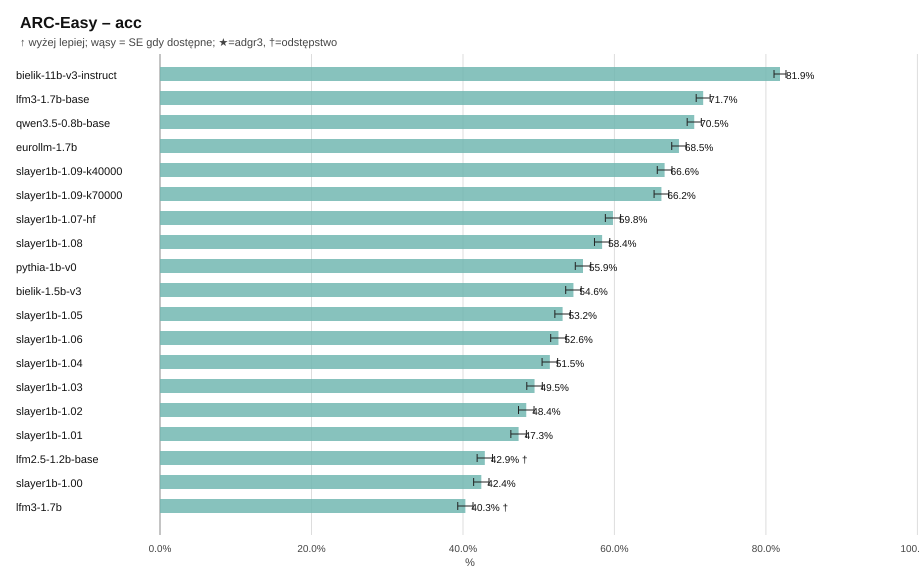

### EWoK
Elements of World Knowledge: ocena wiedzy o świecie przez wybór zdania pasującego do kontekstu.
_Elements of World Knowledge: evaluates world knowledge by choosing context-matching sentence._  
Język: en · Metryka: `ewok` (↑ wyżej lepiej) · n=4374  
Źródło: [https://github.com/slayerlabs/benchmarks-fabryka-ai/tree/main/research/benchmarks/ewok](https://github.com/slayerlabs/benchmarks-fabryka-ai/tree/main/research/benchmarks/ewok)

| Model | Metryka | Wynik | n | Flagi | Ustawienia | Źródło | Odstępstwa |
|---|---|---|---|---|---|---|---|
| bielik-1.5b-v3 | ewok | 69.5% ± 0.8% | 4374 |  | float32, BOS as the card's rule gives it (tokenizer-dependent) | [results_rozszerzone.json](https://github.com/slayerlabs/benchmarks-fabryka-ai/blob/a46eabf41b22e9ad80f9bf48a1961dc1c32e4faf/research/results/full-run-2026-11/ewok/bielik-1.5b-v3/results_rozszerzone.json) | — |
| qwen3.5-0.8b-base | ewok | 67.6% ± 0.8% | 4374 |  | float32, BOS as the card's rule gives it (tokenizer-dependent) | [results_rozszerzone.json](https://github.com/slayerlabs/benchmarks-fabryka-ai/blob/a46eabf41b22e9ad80f9bf48a1961dc1c32e4faf/research/results/full-run-2026-11/ewok/qwen3.5-0.8b-base/results_rozszerzone.json) | — |
| eurollm-1.7b | ewok | 66.2% ± 0.8% | 4374 |  | float32, BOS as the card's rule gives it (tokenizer-dependent) | [results_rozszerzone.json](https://github.com/slayerlabs/benchmarks-fabryka-ai/blob/a46eabf41b22e9ad80f9bf48a1961dc1c32e4faf/research/results/full-run-2026-11/ewok/eurollm-1.7b/results_rozszerzone.json) | — |
| lfm3-1.7b-base | ewok | 66.0% ± 0.8% | 4374 |  | float32, BOS as the card's rule gives it (tokenizer-dependent) | [results_rozszerzone.json](https://github.com/slayerlabs/benchmarks-fabryka-ai/blob/a46eabf41b22e9ad80f9bf48a1961dc1c32e4faf/research/results/full-run-2026-11/ewok/lfm3-1.7b-base/results_rozszerzone.json) | — |
| pythia-1b-v0 | ewok | 64.7% ± 0.8% | 4374 |  | float32, BOS as the card's rule gives it (tokenizer-dependent) | [results_rozszerzone.json](https://github.com/slayerlabs/benchmarks-fabryka-ai/blob/a46eabf41b22e9ad80f9bf48a1961dc1c32e4faf/research/results/full-run-2026-11/ewok/pythia-1b-v0/results_rozszerzone.json) | — |
| slayer1b-1.09-k70000 | ewok | 63.9% ± 0.7% | 4374 |  | float32, BOS as the card's rule gives it (tokenizer-dependent) | [results_rozszerzone.json](https://github.com/slayerlabs/benchmarks-fabryka-ai/blob/a46eabf41b22e9ad80f9bf48a1961dc1c32e4faf/research/results/full-run-2026-11/ewok/slayer1b-1.09-k70000/results_rozszerzone.json) | — |
| slayer1b-1.09-k40000 | ewok | 62.8% ± 0.8% | 4374 |  | float32, BOS as the card's rule gives it (tokenizer-dependent) | [results_rozszerzone.json](https://github.com/slayerlabs/benchmarks-fabryka-ai/blob/a46eabf41b22e9ad80f9bf48a1961dc1c32e4faf/research/results/full-run-2026-11/ewok/slayer1b-1.09-k40000/results_rozszerzone.json) | — |
| lfm3-1.7b | ewok | 61.6% ± 0.7% | 4374 | † | float32, BOS as the card's rule gives it (tokenizer-dependent) | [results_rozszerzone.json](https://github.com/slayerlabs/benchmarks-fabryka-ai/blob/a46eabf41b22e9ad80f9bf48a1961dc1c32e4faf/research/results/full-run-2026-11/ewok/lfm3-1.7b/results_rozszerzone.json) | model instruct liczony na surowym tekście, bez chat template; reguła kontekstu: acc_pmi poniżej bazy losowej na 2 testach PMI (ARC-Challenge, PIQA); próg 2 ustalony po obejrzeniu tego przebiegu |
| lfm2.5-1.2b-base | ewok | 61.3% ± 0.7% | 4374 | † | float32, BOS as the card's rule gives it (tokenizer-dependent) | [results_rozszerzone.json](https://github.com/slayerlabs/benchmarks-fabryka-ai/blob/a46eabf41b22e9ad80f9bf48a1961dc1c32e4faf/research/results/full-run-2026-11/ewok/lfm2.5-1.2b-base/results_rozszerzone.json) | reguła kontekstu: acc_pmi poniżej bazy losowej na 2 testach PMI (ARC-Challenge, PIQA); próg 2 ustalony po obejrzeniu tego przebiegu; reguła przebiegu centralnego: wynik różni się od results/central-run dla tej samej rewizji i wag |
| slayer1b-1.07-hf | ewok | 60.9% ± 0.7% | 4374 |  | float32, BOS as the card's rule gives it (tokenizer-dependent) | [results_rozszerzone.json](https://github.com/slayerlabs/benchmarks-fabryka-ai/blob/a46eabf41b22e9ad80f9bf48a1961dc1c32e4faf/research/results/full-run-2026-11/ewok/slayer1b-1.07-hf/results_rozszerzone.json) | — |
| slayer1b-1.08 | ewok | 59.9% ± 0.7% | 4374 |  | float32, BOS as the card's rule gives it (tokenizer-dependent) | [results_rozszerzone.json](https://github.com/slayerlabs/benchmarks-fabryka-ai/blob/a46eabf41b22e9ad80f9bf48a1961dc1c32e4faf/research/results/full-run-2026-11/ewok/slayer1b-1.08/results_rozszerzone.json) | — |
| slayer1b-1.06 | ewok | 59.0% ± 0.7% | 4374 |  | float32, BOS as the card's rule gives it (tokenizer-dependent) | [results_rozszerzone.json](https://github.com/slayerlabs/benchmarks-fabryka-ai/blob/a46eabf41b22e9ad80f9bf48a1961dc1c32e4faf/research/results/full-run-2026-11/ewok/slayer1b-1.06/results_rozszerzone.json) | — |
| slayer1b-1.05 | ewok | 58.4% ± 0.7% | 4374 |  | float32, BOS as the card's rule gives it (tokenizer-dependent) | [results_rozszerzone.json](https://github.com/slayerlabs/benchmarks-fabryka-ai/blob/a46eabf41b22e9ad80f9bf48a1961dc1c32e4faf/research/results/full-run-2026-11/ewok/slayer1b-1.05/results_rozszerzone.json) | — |
| slayer1b-1.04 | ewok | 57.4% ± 0.7% | 4374 |  | float32, BOS as the card's rule gives it (tokenizer-dependent) | [results_rozszerzone.json](https://github.com/slayerlabs/benchmarks-fabryka-ai/blob/a46eabf41b22e9ad80f9bf48a1961dc1c32e4faf/research/results/full-run-2026-11/ewok/slayer1b-1.04/results_rozszerzone.json) | — |
| slayer1b-1.03 | ewok | 56.6% ± 0.8% | 4374 |  | float32, BOS as the card's rule gives it (tokenizer-dependent) | [results_rozszerzone.json](https://github.com/slayerlabs/benchmarks-fabryka-ai/blob/a46eabf41b22e9ad80f9bf48a1961dc1c32e4faf/research/results/full-run-2026-11/ewok/slayer1b-1.03/results_rozszerzone.json) | — |
| slayer1b-1.02 | ewok | 56.2% ± 0.8% | 4374 |  | float32, BOS as the card's rule gives it (tokenizer-dependent) | [results_rozszerzone.json](https://github.com/slayerlabs/benchmarks-fabryka-ai/blob/a46eabf41b22e9ad80f9bf48a1961dc1c32e4faf/research/results/full-run-2026-11/ewok/slayer1b-1.02/results_rozszerzone.json) | — |
| slayer1b-1.01 | ewok | 55.4% ± 0.8% | 4374 |  | float32, BOS as the card's rule gives it (tokenizer-dependent) | [results_rozszerzone.json](https://github.com/slayerlabs/benchmarks-fabryka-ai/blob/a46eabf41b22e9ad80f9bf48a1961dc1c32e4faf/research/results/full-run-2026-11/ewok/slayer1b-1.01/results_rozszerzone.json) | — |
| slayer1b-1.00 | ewok | 53.0% ± 0.8% | 4374 |  | float32, BOS as the card's rule gives it (tokenizer-dependent) | [results_rozszerzone.json](https://github.com/slayerlabs/benchmarks-fabryka-ai/blob/a46eabf41b22e9ad80f9bf48a1961dc1c32e4faf/research/results/full-run-2026-11/ewok/slayer1b-1.00/results_rozszerzone.json) | — |

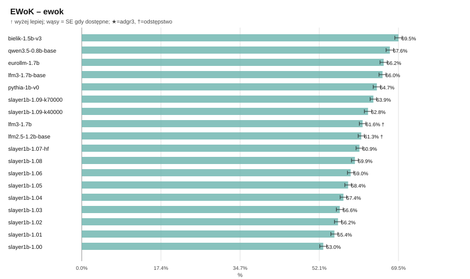

### GPQA Diamond (eksploracyjny, CoT zero-shot)
Eksploracyjny przebieg GPQA Diamond (pytania ekspertowe z nauk ścisłych) w trybie CoT zero-shot; metryka exact match po elastycznej ekstrakcji.
_Exploratory GPQA Diamond run (graduate-level science questions) in CoT zero-shot mode; exact match with flexible extraction._  
Język: en · Metryka: `exact_match (flexible-extract)` (↑ wyżej lepiej) · n=198  
Źródło: [https://github.com/slayerlabs/benchmarks-fabryka-ai/tree/main/research/api-benchmarks/gpqa-diamond](https://github.com/slayerlabs/benchmarks-fabryka-ai/tree/main/research/api-benchmarks/gpqa-diamond)

| Model | Metryka | Wynik | n | Flagi | Ustawienia | Źródło | Odstępstwa |
|---|---|---|---|---|---|---|---|
| lfm3-1.7b | exact_match (flexible-extract) | 58.59 ± 3.51 | 198 | † | — | [lfm3-1.7b-16k.json](https://github.com/slayerlabs/benchmarks-fabryka-ai/blob/a46eabf41b22e9ad80f9bf48a1961dc1c32e4faf/research/api-benchmarks/gpqa-diamond/results/lfm3-1.7b-16k.json) | see README.md, Deviations |
| lfm3-1.7b | exact_match (flexible-extract) | 53.54 ± 3.54 | 198 | † | — | [lfm3-1.7b.json](https://github.com/slayerlabs/benchmarks-fabryka-ai/blob/a46eabf41b22e9ad80f9bf48a1961dc1c32e4faf/research/api-benchmarks/gpqa-diamond/results/lfm3-1.7b.json) | see README.md, Deviations |
| bielik-11b-v3.1 | exact_match (flexible-extract) | 37.88 ± 3.45 | 198 | † | — | [bielik-11b-v3.1.json](https://github.com/slayerlabs/benchmarks-fabryka-ai/blob/a46eabf41b22e9ad80f9bf48a1961dc1c32e4faf/research/api-benchmarks/gpqa-diamond/results/bielik-11b-v3.1.json) | see README.md, Deviations |
| bielik-11b-v3.1 | exact_match (flexible-extract) | 36.36 ± 3.43 | 198 | † | — | [bielik-11b-v3.1-2048.json](https://github.com/slayerlabs/benchmarks-fabryka-ai/blob/a46eabf41b22e9ad80f9bf48a1961dc1c32e4faf/research/api-benchmarks/gpqa-diamond/results/bielik-11b-v3.1-2048.json) | see README.md, Deviations |
| lfm3-1.7b | exact_match (flexible-extract) | 29.29 ± 3.24 | 198 | † | — | [lfm3-1.7b-2048.json](https://github.com/slayerlabs/benchmarks-fabryka-ai/blob/a46eabf41b22e9ad80f9bf48a1961dc1c32e4faf/research/api-benchmarks/gpqa-diamond/results/lfm3-1.7b-2048.json) | see README.md, Deviations |

| Model | Metryka | Wynik | n | Flagi | Ustawienia | Źródło | Odstępstwa |
|---|---|---|---|---|---|---|---|
| lfm3-1.7b | exact_match (flexible-extract), composed full-198 at a 32768 budget (two compositions, see composition and sensitivity_all67_at32768) | 64.65 ± 3.4 | 198 | † | — | [lfm3-1.7b-32k.json](https://github.com/slayerlabs/benchmarks-fabryka-ai/blob/a46eabf41b22e9ad80f9bf48a1961dc1c32e4faf/research/api-benchmarks/gpqa-diamond/results/lfm3-1.7b-32k.json) | see README.md, Deviations |

### HellaSwag
Dokończenie opisu sytuacji zdroworozsądkowej; 4 możliwe zakończenia, metryka acc_norm.
_Commonsense sentence completion; 4 endings, acc_norm metric._  
Język: en · Metryka: `acc_norm` (↑ wyżej lepiej) · n=10042  
Źródło: [https://github.com/slayerlabs/benchmarks-fabryka-ai/tree/main/research/benchmarks/hellaswag](https://github.com/slayerlabs/benchmarks-fabryka-ai/tree/main/research/benchmarks/hellaswag)

| Model | Metryka | Wynik | n | Flagi | Ustawienia | Źródło | Odstępstwa |
|---|---|---|---|---|---|---|---|
| bielik-11b-v3-instruct | acc_norm | 79.4% ± 0.4% | 10042 |  | bfloat16, no BOS | [results.json](https://github.com/slayerlabs/benchmarks-fabryka-ai/blob/a46eabf41b22e9ad80f9bf48a1961dc1c32e4faf/research/results/full-run-2026-11/hellaswag/bielik-11b-v3-instruct/results.json) | — |
| bielik-1.5b-v3 | acc_norm | 63.7% ± 0.5% | 10042 |  | float32, no BOS | [results.json](https://github.com/slayerlabs/benchmarks-fabryka-ai/blob/a46eabf41b22e9ad80f9bf48a1961dc1c32e4faf/research/results/full-run-2026-11/hellaswag/bielik-1.5b-v3/results.json) | — |
| eurollm-1.7b | acc_norm | 59.3% ± 0.5% | 10042 |  | float32, no BOS | [results.json](https://github.com/slayerlabs/benchmarks-fabryka-ai/blob/a46eabf41b22e9ad80f9bf48a1961dc1c32e4faf/research/results/full-run-2026-11/hellaswag/eurollm-1.7b/results.json) | — |
| lfm3-1.7b-base | acc_norm | 58.9% ± 0.5% | 10042 |  | float32, no BOS | [results.json](https://github.com/slayerlabs/benchmarks-fabryka-ai/blob/a46eabf41b22e9ad80f9bf48a1961dc1c32e4faf/research/results/full-run-2026-11/hellaswag/lfm3-1.7b-base/results.json) | — |
| slayer1b-1.09-k70000 | acc_norm | 55.3% ± 0.5% | 10042 |  | float32, one BOS | [results.json](https://github.com/slayerlabs/benchmarks-fabryka-ai/blob/a46eabf41b22e9ad80f9bf48a1961dc1c32e4faf/research/results/full-run-2026-11/hellaswag/slayer1b-1.09-k70000/results.json) | — |
| qwen3.5-0.8b-base | acc_norm | 54.8% ± 0.5% | 10042 |  | float32, no BOS | [results.json](https://github.com/slayerlabs/benchmarks-fabryka-ai/blob/a46eabf41b22e9ad80f9bf48a1961dc1c32e4faf/research/results/full-run-2026-11/hellaswag/qwen3.5-0.8b-base/results.json) | — |
| lfm3-1.7b | acc_norm | 53.7% ± 0.5% | 10042 | † | float32, no BOS | [results.json](https://github.com/slayerlabs/benchmarks-fabryka-ai/blob/a46eabf41b22e9ad80f9bf48a1961dc1c32e4faf/research/results/full-run-2026-11/hellaswag/lfm3-1.7b/results.json) | model instruct liczony na surowym tekście, bez chat template; reguła kontekstu: acc_pmi poniżej bazy losowej na 2 testach PMI (ARC-Challenge, PIQA); próg 2 ustalony po obejrzeniu tego przebiegu |
| slayer1b-1.09-k40000 | acc_norm | 52.8% ± 0.5% | 10042 |  | float32, one BOS | [results.json](https://github.com/slayerlabs/benchmarks-fabryka-ai/blob/a46eabf41b22e9ad80f9bf48a1961dc1c32e4faf/research/results/full-run-2026-11/hellaswag/slayer1b-1.09-k40000/results.json) | — |
| pythia-1b-v0 | acc_norm | 46.8% ± 0.5% | 10042 |  | float32, no BOS | [results.json](https://github.com/slayerlabs/benchmarks-fabryka-ai/blob/a46eabf41b22e9ad80f9bf48a1961dc1c32e4faf/research/results/full-run-2026-11/hellaswag/pythia-1b-v0/results.json) | — |
| slayer1b-1.08 | acc_norm | 43.4% ± 0.5% | 10042 |  | float32, one BOS | [results.json](https://github.com/slayerlabs/benchmarks-fabryka-ai/blob/a46eabf41b22e9ad80f9bf48a1961dc1c32e4faf/research/results/full-run-2026-11/hellaswag/slayer1b-1.08/results.json) | — |
| slayer1b-1.07-hf | acc_norm | 43.4% ± 0.5% | 10042 |  | float32, one BOS | [results.json](https://github.com/slayerlabs/benchmarks-fabryka-ai/blob/a46eabf41b22e9ad80f9bf48a1961dc1c32e4faf/research/results/full-run-2026-11/hellaswag/slayer1b-1.07-hf/results.json) | — |
| slayer1b-1.06 | acc_norm | 39.3% ± 0.5% | 10042 |  | float32, one BOS | [results.json](https://github.com/slayerlabs/benchmarks-fabryka-ai/blob/a46eabf41b22e9ad80f9bf48a1961dc1c32e4faf/research/results/full-run-2026-11/hellaswag/slayer1b-1.06/results.json) | — |
| slayer1b-1.05 | acc_norm | 38.2% ± 0.5% | 10042 |  | float32, one BOS | [results.json](https://github.com/slayerlabs/benchmarks-fabryka-ai/blob/a46eabf41b22e9ad80f9bf48a1961dc1c32e4faf/research/results/full-run-2026-11/hellaswag/slayer1b-1.05/results.json) | — |
| slayer1b-1.04 | acc_norm | 36.7% ± 0.5% | 10042 |  | float32, one BOS | [results.json](https://github.com/slayerlabs/benchmarks-fabryka-ai/blob/a46eabf41b22e9ad80f9bf48a1961dc1c32e4faf/research/results/full-run-2026-11/hellaswag/slayer1b-1.04/results.json) | — |
| lfm2.5-1.2b-base | acc_norm | 36.2% ± 0.5% | 10042 | † | float32, no BOS | [results.json](https://github.com/slayerlabs/benchmarks-fabryka-ai/blob/a46eabf41b22e9ad80f9bf48a1961dc1c32e4faf/research/results/full-run-2026-11/hellaswag/lfm2.5-1.2b-base/results.json) | reguła kontekstu: acc_pmi poniżej bazy losowej na 2 testach PMI (ARC-Challenge, PIQA); próg 2 ustalony po obejrzeniu tego przebiegu; reguła przebiegu centralnego: wynik różni się od results/central-run dla tej samej rewizji i wag |
| slayer1b-1.03 | acc_norm | 35.1% ± 0.5% | 10042 |  | float32, one BOS | [results.json](https://github.com/slayerlabs/benchmarks-fabryka-ai/blob/a46eabf41b22e9ad80f9bf48a1961dc1c32e4faf/research/results/full-run-2026-11/hellaswag/slayer1b-1.03/results.json) | — |
| slayer1b-1.02 | acc_norm | 34.0% ± 0.5% | 10042 |  | float32, one BOS | [results.json](https://github.com/slayerlabs/benchmarks-fabryka-ai/blob/a46eabf41b22e9ad80f9bf48a1961dc1c32e4faf/research/results/full-run-2026-11/hellaswag/slayer1b-1.02/results.json) | — |
| slayer1b-1.01 | acc_norm | 30.8% ± 0.5% | 10042 |  | float32, one BOS | [results.json](https://github.com/slayerlabs/benchmarks-fabryka-ai/blob/a46eabf41b22e9ad80f9bf48a1961dc1c32e4faf/research/results/full-run-2026-11/hellaswag/slayer1b-1.01/results.json) | — |
| slayer1b-1.00 | acc_norm | 28.5% ± 0.5% | 10042 |  | float32, one BOS | [results.json](https://github.com/slayerlabs/benchmarks-fabryka-ai/blob/a46eabf41b22e9ad80f9bf48a1961dc1c32e4faf/research/results/full-run-2026-11/hellaswag/slayer1b-1.00/results.json) | — |

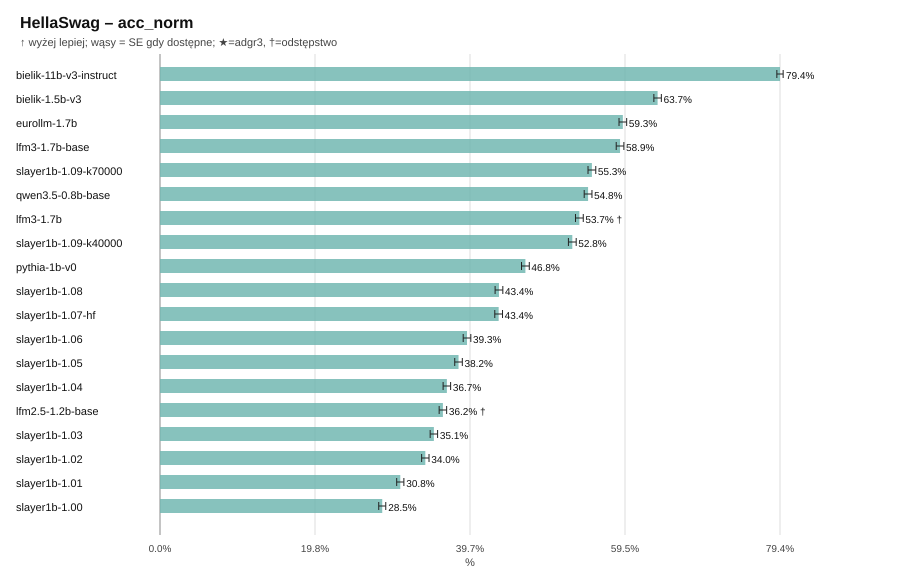

### Humanity's Last Exam (bez narzędzi)
Dokładność na Humanity's Last Exam bez narzędzi; trudne pytania ekspertowe z wielu dziedzin.
_Accuracy on Humanity's Last Exam without tools; difficult expert questions across domains._  
Język: en · Metryka: `accuracy` (↑ wyżej lepiej) · n=2158  
Źródło: [https://github.com/slayerlabs/benchmarks-fabryka-ai/pull/358](https://github.com/slayerlabs/benchmarks-fabryka-ai/pull/358)

| Model | Metryka | Wynik | n | Flagi | Ustawienia | Źródło | Odstępstwa |
|---|---|---|---|---|---|---|---|
| bielik-11b-v3.1 | accuracy | 5.4% ± 48.8% | 2158 | ★† | text-only | [bielik-11b-v3.1.json](https://github.com/slayerlabs/benchmarks-fabryka-ai/pull/358) | 1 sample per item (methodology: 10); 5 unjudged answers counted incorrect; see source README Deviations |
| slayer1b-1.09-k70000 | accuracy | not run (maintainer decision (Slayer not run in PR #358) | — | ★∅ | text-only | [bielik-11b-v3.1.json](https://github.com/slayerlabs/benchmarks-fabryka-ai/pull/358) | — |

### MathQA
Zadania tekstowe z matematyki, 5 opcji odpowiedzi; metryka acc_norm.
_Math word problems, 5 answer options; acc_norm metric._  
Język: en · Metryka: `acc_norm` (↑ wyżej lepiej) · n=2985  
Źródło: [https://github.com/slayerlabs/benchmarks-fabryka-ai/tree/main/research/benchmarks/mathqa](https://github.com/slayerlabs/benchmarks-fabryka-ai/tree/main/research/benchmarks/mathqa)

| Model | Metryka | Wynik | n | Flagi | Ustawienia | Źródło | Odstępstwa |
|---|---|---|---|---|---|---|---|
| bielik-11b-v3-instruct | acc_norm | 48.5% ± 0.9% | 2985 |  | bfloat16, no BOS | [results.json](https://github.com/slayerlabs/benchmarks-fabryka-ai/blob/a46eabf41b22e9ad80f9bf48a1961dc1c32e4faf/research/results/full-run-2026-11/mathqa/bielik-11b-v3-instruct/results.json) | — |
| lfm3-1.7b-base | acc_norm | 39.1% ± 0.9% | 2985 |  | float32, no BOS | [results.json](https://github.com/slayerlabs/benchmarks-fabryka-ai/blob/a46eabf41b22e9ad80f9bf48a1961dc1c32e4faf/research/results/full-run-2026-11/mathqa/lfm3-1.7b-base/results.json) | — |
| qwen3.5-0.8b-base | acc_norm | 33.4% ± 0.9% | 2985 |  | float32, no BOS | [results.json](https://github.com/slayerlabs/benchmarks-fabryka-ai/blob/a46eabf41b22e9ad80f9bf48a1961dc1c32e4faf/research/results/full-run-2026-11/mathqa/qwen3.5-0.8b-base/results.json) | — |
| bielik-1.5b-v3 | acc_norm | 32.4% ± 0.9% | 2985 |  | float32, no BOS | [results.json](https://github.com/slayerlabs/benchmarks-fabryka-ai/blob/a46eabf41b22e9ad80f9bf48a1961dc1c32e4faf/research/results/full-run-2026-11/mathqa/bielik-1.5b-v3/results.json) | — |
| lfm3-1.7b | acc_norm | 24.3% ± 0.8% | 2985 | † | float32, no BOS | [results.json](https://github.com/slayerlabs/benchmarks-fabryka-ai/blob/a46eabf41b22e9ad80f9bf48a1961dc1c32e4faf/research/results/full-run-2026-11/mathqa/lfm3-1.7b/results.json) | model instruct liczony na surowym tekście, bez chat template; reguła kontekstu: acc_pmi poniżej bazy losowej na 2 testach PMI (ARC-Challenge, PIQA); próg 2 ustalony po obejrzeniu tego przebiegu |
| lfm2.5-1.2b-base | acc_norm | 24.3% ± 0.8% | 2985 | † | float32, no BOS | [results.json](https://github.com/slayerlabs/benchmarks-fabryka-ai/blob/a46eabf41b22e9ad80f9bf48a1961dc1c32e4faf/research/results/full-run-2026-11/mathqa/lfm2.5-1.2b-base/results.json) | reguła kontekstu: acc_pmi poniżej bazy losowej na 2 testach PMI (ARC-Challenge, PIQA); próg 2 ustalony po obejrzeniu tego przebiegu; reguła przebiegu centralnego: wynik różni się od results/central-run dla tej samej rewizji i wag |
| eurollm-1.7b | acc_norm | 24.2% ± 0.8% | 2985 |  | float32, no BOS | [results.json](https://github.com/slayerlabs/benchmarks-fabryka-ai/blob/a46eabf41b22e9ad80f9bf48a1961dc1c32e4faf/research/results/full-run-2026-11/mathqa/eurollm-1.7b/results.json) | — |
| pythia-1b-v0 | acc_norm | 23.5% ± 0.8% | 2985 |  | float32, no BOS | [results.json](https://github.com/slayerlabs/benchmarks-fabryka-ai/blob/a46eabf41b22e9ad80f9bf48a1961dc1c32e4faf/research/results/full-run-2026-11/mathqa/pythia-1b-v0/results.json) | — |
| slayer1b-1.07-hf | acc_norm | 23.5% ± 0.8% | 2985 |  | float32, one BOS | [results.json](https://github.com/slayerlabs/benchmarks-fabryka-ai/blob/a46eabf41b22e9ad80f9bf48a1961dc1c32e4faf/research/results/full-run-2026-11/mathqa/slayer1b-1.07-hf/results.json) | — |
| slayer1b-1.08 | acc_norm | 22.8% ± 0.8% | 2985 |  | float32, one BOS | [results.json](https://github.com/slayerlabs/benchmarks-fabryka-ai/blob/a46eabf41b22e9ad80f9bf48a1961dc1c32e4faf/research/results/full-run-2026-11/mathqa/slayer1b-1.08/results.json) | — |
| slayer1b-1.09-k40000 | acc_norm | 22.5% ± 0.8% | 2985 |  | float32, one BOS | [results.json](https://github.com/slayerlabs/benchmarks-fabryka-ai/blob/a46eabf41b22e9ad80f9bf48a1961dc1c32e4faf/research/results/full-run-2026-11/mathqa/slayer1b-1.09-k40000/results.json) | — |
| slayer1b-1.09-k70000 | acc_norm | 22.0% ± 0.8% | 2985 |  | float32, one BOS | [results.json](https://github.com/slayerlabs/benchmarks-fabryka-ai/blob/a46eabf41b22e9ad80f9bf48a1961dc1c32e4faf/research/results/full-run-2026-11/mathqa/slayer1b-1.09-k70000/results.json) | — |
| slayer1b-1.06 | acc_norm | 21.9% ± 0.8% | 2985 |  | float32, one BOS | [results.json](https://github.com/slayerlabs/benchmarks-fabryka-ai/blob/a46eabf41b22e9ad80f9bf48a1961dc1c32e4faf/research/results/full-run-2026-11/mathqa/slayer1b-1.06/results.json) | — |
| slayer1b-1.02 | acc_norm | 21.7% ± 0.8% | 2985 |  | float32, one BOS | [results.json](https://github.com/slayerlabs/benchmarks-fabryka-ai/blob/a46eabf41b22e9ad80f9bf48a1961dc1c32e4faf/research/results/full-run-2026-11/mathqa/slayer1b-1.02/results.json) | — |
| slayer1b-1.05 | acc_norm | 21.6% ± 0.8% | 2985 |  | float32, one BOS | [results.json](https://github.com/slayerlabs/benchmarks-fabryka-ai/blob/a46eabf41b22e9ad80f9bf48a1961dc1c32e4faf/research/results/full-run-2026-11/mathqa/slayer1b-1.05/results.json) | — |
| slayer1b-1.01 | acc_norm | 21.6% ± 0.8% | 2985 |  | float32, one BOS | [results.json](https://github.com/slayerlabs/benchmarks-fabryka-ai/blob/a46eabf41b22e9ad80f9bf48a1961dc1c32e4faf/research/results/full-run-2026-11/mathqa/slayer1b-1.01/results.json) | — |
| slayer1b-1.03 | acc_norm | 21.5% ± 0.8% | 2985 |  | float32, one BOS | [results.json](https://github.com/slayerlabs/benchmarks-fabryka-ai/blob/a46eabf41b22e9ad80f9bf48a1961dc1c32e4faf/research/results/full-run-2026-11/mathqa/slayer1b-1.03/results.json) | — |
| slayer1b-1.00 | acc_norm | 21.0% ± 0.7% | 2985 |  | float32, one BOS | [results.json](https://github.com/slayerlabs/benchmarks-fabryka-ai/blob/a46eabf41b22e9ad80f9bf48a1961dc1c32e4faf/research/results/full-run-2026-11/mathqa/slayer1b-1.00/results.json) | — |
| slayer1b-1.04 | acc_norm | 20.9% ± 0.7% | 2985 |  | float32, one BOS | [results.json](https://github.com/slayerlabs/benchmarks-fabryka-ai/blob/a46eabf41b22e9ad80f9bf48a1961dc1c32e4faf/research/results/full-run-2026-11/mathqa/slayer1b-1.04/results.json) | — |

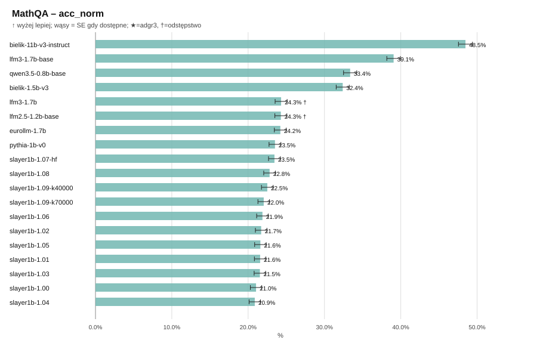

### MedMCQA
Pytania z egzaminów medycznych, 4 opcje; metryka acc.
_Medical exam questions, 4 options; acc metric._  
Język: en · Metryka: `acc` (↑ wyżej lepiej) · n=4183  
Źródło: [https://github.com/slayerlabs/benchmarks-fabryka-ai/tree/main/research/benchmarks/medmcqa](https://github.com/slayerlabs/benchmarks-fabryka-ai/tree/main/research/benchmarks/medmcqa)

| Model | Metryka | Wynik | n | Flagi | Ustawienia | Źródło | Odstępstwa |
|---|---|---|---|---|---|---|---|
| bielik-11b-v3-instruct | acc | 53.6% ± 0.8% | 4183 |  | bfloat16, no BOS | [results.json](https://github.com/slayerlabs/benchmarks-fabryka-ai/blob/a46eabf41b22e9ad80f9bf48a1961dc1c32e4faf/research/results/full-run-2026-11/medmcqa/bielik-11b-v3-instruct/results.json) | — |
| qwen3.5-0.8b-base | acc | 40.3% ± 0.8% | 4183 |  | float32, no BOS | [results.json](https://github.com/slayerlabs/benchmarks-fabryka-ai/blob/a46eabf41b22e9ad80f9bf48a1961dc1c32e4faf/research/results/full-run-2026-11/medmcqa/qwen3.5-0.8b-base/results.json) | — |
| bielik-1.5b-v3 | acc | 39.1% ± 0.8% | 4183 |  | float32, no BOS | [results.json](https://github.com/slayerlabs/benchmarks-fabryka-ai/blob/a46eabf41b22e9ad80f9bf48a1961dc1c32e4faf/research/results/full-run-2026-11/medmcqa/bielik-1.5b-v3/results.json) | — |
| lfm3-1.7b-base | acc | 37.8% ± 0.7% | 4183 |  | float32, no BOS | [results.json](https://github.com/slayerlabs/benchmarks-fabryka-ai/blob/a46eabf41b22e9ad80f9bf48a1961dc1c32e4faf/research/results/full-run-2026-11/medmcqa/lfm3-1.7b-base/results.json) | — |
| slayer1b-1.03 | acc | 32.1% ± 0.7% | 4183 |  | float32, one BOS | [results.json](https://github.com/slayerlabs/benchmarks-fabryka-ai/blob/a46eabf41b22e9ad80f9bf48a1961dc1c32e4faf/research/results/full-run-2026-11/medmcqa/slayer1b-1.03/results.json) | — |
| slayer1b-1.00 | acc | 31.8% ± 0.7% | 4183 |  | float32, one BOS | [results.json](https://github.com/slayerlabs/benchmarks-fabryka-ai/blob/a46eabf41b22e9ad80f9bf48a1961dc1c32e4faf/research/results/full-run-2026-11/medmcqa/slayer1b-1.00/results.json) | — |
| slayer1b-1.02 | acc | 31.7% ± 0.7% | 4183 |  | float32, one BOS | [results.json](https://github.com/slayerlabs/benchmarks-fabryka-ai/blob/a46eabf41b22e9ad80f9bf48a1961dc1c32e4faf/research/results/full-run-2026-11/medmcqa/slayer1b-1.02/results.json) | — |
| slayer1b-1.06 | acc | 31.6% ± 0.7% | 4183 |  | float32, one BOS | [results.json](https://github.com/slayerlabs/benchmarks-fabryka-ai/blob/a46eabf41b22e9ad80f9bf48a1961dc1c32e4faf/research/results/full-run-2026-11/medmcqa/slayer1b-1.06/results.json) | — |
| slayer1b-1.05 | acc | 31.5% ± 0.7% | 4183 |  | float32, one BOS | [results.json](https://github.com/slayerlabs/benchmarks-fabryka-ai/blob/a46eabf41b22e9ad80f9bf48a1961dc1c32e4faf/research/results/full-run-2026-11/medmcqa/slayer1b-1.05/results.json) | — |
| slayer1b-1.01 | acc | 31.3% ± 0.7% | 4183 |  | float32, one BOS | [results.json](https://github.com/slayerlabs/benchmarks-fabryka-ai/blob/a46eabf41b22e9ad80f9bf48a1961dc1c32e4faf/research/results/full-run-2026-11/medmcqa/slayer1b-1.01/results.json) | — |
| slayer1b-1.08 | acc | 31.2% ± 0.7% | 4183 |  | float32, one BOS | [results.json](https://github.com/slayerlabs/benchmarks-fabryka-ai/blob/a46eabf41b22e9ad80f9bf48a1961dc1c32e4faf/research/results/full-run-2026-11/medmcqa/slayer1b-1.08/results.json) | — |
| slayer1b-1.04 | acc | 31.1% ± 0.7% | 4183 |  | float32, one BOS | [results.json](https://github.com/slayerlabs/benchmarks-fabryka-ai/blob/a46eabf41b22e9ad80f9bf48a1961dc1c32e4faf/research/results/full-run-2026-11/medmcqa/slayer1b-1.04/results.json) | — |
| slayer1b-1.09-k40000 | acc | 30.1% ± 0.7% | 4183 |  | float32, one BOS | [results.json](https://github.com/slayerlabs/benchmarks-fabryka-ai/blob/a46eabf41b22e9ad80f9bf48a1961dc1c32e4faf/research/results/full-run-2026-11/medmcqa/slayer1b-1.09-k40000/results.json) | — |
| slayer1b-1.07-hf | acc | 29.9% ± 0.7% | 4183 |  | float32, one BOS | [results.json](https://github.com/slayerlabs/benchmarks-fabryka-ai/blob/a46eabf41b22e9ad80f9bf48a1961dc1c32e4faf/research/results/full-run-2026-11/medmcqa/slayer1b-1.07-hf/results.json) | — |
| lfm3-1.7b | acc | 29.7% ± 0.7% | 4183 | † | float32, no BOS | [results.json](https://github.com/slayerlabs/benchmarks-fabryka-ai/blob/a46eabf41b22e9ad80f9bf48a1961dc1c32e4faf/research/results/full-run-2026-11/medmcqa/lfm3-1.7b/results.json) | model instruct liczony na surowym tekście, bez chat template; reguła kontekstu: acc_pmi poniżej bazy losowej na 2 testach PMI (ARC-Challenge, PIQA); próg 2 ustalony po obejrzeniu tego przebiegu |
| pythia-1b-v0 | acc | 28.1% ± 0.7% | 4183 |  | float32, no BOS | [results.json](https://github.com/slayerlabs/benchmarks-fabryka-ai/blob/a46eabf41b22e9ad80f9bf48a1961dc1c32e4faf/research/results/full-run-2026-11/medmcqa/pythia-1b-v0/results.json) | — |
| slayer1b-1.09-k70000 | acc | 27.9% ± 0.7% | 4183 |  | float32, one BOS | [results.json](https://github.com/slayerlabs/benchmarks-fabryka-ai/blob/a46eabf41b22e9ad80f9bf48a1961dc1c32e4faf/research/results/full-run-2026-11/medmcqa/slayer1b-1.09-k70000/results.json) | — |
| lfm2.5-1.2b-base | acc | 26.1% ± 0.7% | 4183 | † | float32, no BOS | [results.json](https://github.com/slayerlabs/benchmarks-fabryka-ai/blob/a46eabf41b22e9ad80f9bf48a1961dc1c32e4faf/research/results/full-run-2026-11/medmcqa/lfm2.5-1.2b-base/results.json) | reguła kontekstu: acc_pmi poniżej bazy losowej na 2 testach PMI (ARC-Challenge, PIQA); próg 2 ustalony po obejrzeniu tego przebiegu; reguła przebiegu centralnego: wynik różni się od results/central-run dla tej samej rewizji i wag |
| eurollm-1.7b | acc | 25.8% ± 0.7% | 4183 |  | float32, no BOS | [results.json](https://github.com/slayerlabs/benchmarks-fabryka-ai/blob/a46eabf41b22e9ad80f9bf48a1961dc1c32e4faf/research/results/full-run-2026-11/medmcqa/eurollm-1.7b/results.json) | — |

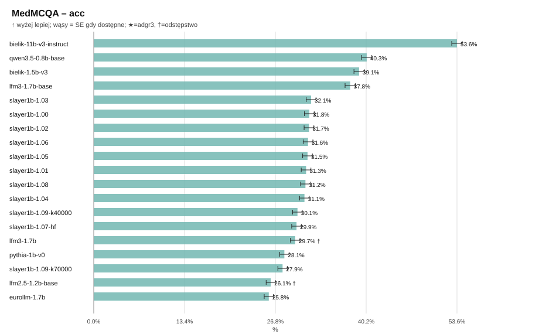

### PIQA
Physical Interaction QA: zdroworozsądkowe rozumowanie o fizycznych interakcjach, 2 opcje; acc_norm.
_Physical Interaction QA: commonsense physical reasoning, 2 options; acc_norm._  
Język: en · Metryka: `acc_norm` (↑ wyżej lepiej) · n=1838  
Źródło: [https://github.com/slayerlabs/benchmarks-fabryka-ai/tree/main/research/benchmarks/piqa](https://github.com/slayerlabs/benchmarks-fabryka-ai/tree/main/research/benchmarks/piqa)

| Model | Metryka | Wynik | n | Flagi | Ustawienia | Źródło | Odstępstwa |
|---|---|---|---|---|---|---|---|
| bielik-11b-v3-instruct | acc_norm | 78.9% ± 1.0% | 1838 |  | bfloat16, no BOS | [results.json](https://github.com/slayerlabs/benchmarks-fabryka-ai/blob/a46eabf41b22e9ad80f9bf48a1961dc1c32e4faf/research/results/full-run-2026-11/piqa/bielik-11b-v3-instruct/results.json) | — |
| eurollm-1.7b | acc_norm | 73.4% ± 1.0% | 1838 |  | float32, no BOS | [results.json](https://github.com/slayerlabs/benchmarks-fabryka-ai/blob/a46eabf41b22e9ad80f9bf48a1961dc1c32e4faf/research/results/full-run-2026-11/piqa/eurollm-1.7b/results.json) | — |
| slayer1b-1.09-k70000 | acc_norm | 72.7% ± 1.0% | 1838 |  | float32, one BOS | [results.json](https://github.com/slayerlabs/benchmarks-fabryka-ai/blob/a46eabf41b22e9ad80f9bf48a1961dc1c32e4faf/research/results/full-run-2026-11/piqa/slayer1b-1.09-k70000/results.json) | — |
| bielik-1.5b-v3 | acc_norm | 71.9% ± 1.0% | 1838 |  | float32, no BOS | [results.json](https://github.com/slayerlabs/benchmarks-fabryka-ai/blob/a46eabf41b22e9ad80f9bf48a1961dc1c32e4faf/research/results/full-run-2026-11/piqa/bielik-1.5b-v3/results.json) | — |
| qwen3.5-0.8b-base | acc_norm | 71.3% ± 1.1% | 1838 |  | float32, no BOS | [results.json](https://github.com/slayerlabs/benchmarks-fabryka-ai/blob/a46eabf41b22e9ad80f9bf48a1961dc1c32e4faf/research/results/full-run-2026-11/piqa/qwen3.5-0.8b-base/results.json) | — |
| slayer1b-1.09-k40000 | acc_norm | 71.2% ± 1.1% | 1838 |  | float32, one BOS | [results.json](https://github.com/slayerlabs/benchmarks-fabryka-ai/blob/a46eabf41b22e9ad80f9bf48a1961dc1c32e4faf/research/results/full-run-2026-11/piqa/slayer1b-1.09-k40000/results.json) | — |
| pythia-1b-v0 | acc_norm | 70.9% ± 1.1% | 1838 |  | float32, no BOS | [results.json](https://github.com/slayerlabs/benchmarks-fabryka-ai/blob/a46eabf41b22e9ad80f9bf48a1961dc1c32e4faf/research/results/full-run-2026-11/piqa/pythia-1b-v0/results.json) | — |
| lfm3-1.7b-base | acc_norm | 68.6% ± 1.1% | 1838 |  | float32, no BOS | [results.json](https://github.com/slayerlabs/benchmarks-fabryka-ai/blob/a46eabf41b22e9ad80f9bf48a1961dc1c32e4faf/research/results/full-run-2026-11/piqa/lfm3-1.7b-base/results.json) | — |
| slayer1b-1.07-hf | acc_norm | 67.0% ± 1.1% | 1838 |  | float32, one BOS | [results.json](https://github.com/slayerlabs/benchmarks-fabryka-ai/blob/a46eabf41b22e9ad80f9bf48a1961dc1c32e4faf/research/results/full-run-2026-11/piqa/slayer1b-1.07-hf/results.json) | — |
| slayer1b-1.08 | acc_norm | 66.2% ± 1.1% | 1838 |  | float32, one BOS | [results.json](https://github.com/slayerlabs/benchmarks-fabryka-ai/blob/a46eabf41b22e9ad80f9bf48a1961dc1c32e4faf/research/results/full-run-2026-11/piqa/slayer1b-1.08/results.json) | — |
| slayer1b-1.06 | acc_norm | 64.1% ± 1.1% | 1838 |  | float32, one BOS | [results.json](https://github.com/slayerlabs/benchmarks-fabryka-ai/blob/a46eabf41b22e9ad80f9bf48a1961dc1c32e4faf/research/results/full-run-2026-11/piqa/slayer1b-1.06/results.json) | — |
| slayer1b-1.05 | acc_norm | 63.8% ± 1.1% | 1838 |  | float32, one BOS | [results.json](https://github.com/slayerlabs/benchmarks-fabryka-ai/blob/a46eabf41b22e9ad80f9bf48a1961dc1c32e4faf/research/results/full-run-2026-11/piqa/slayer1b-1.05/results.json) | — |
| slayer1b-1.04 | acc_norm | 62.6% ± 1.1% | 1838 |  | float32, one BOS | [results.json](https://github.com/slayerlabs/benchmarks-fabryka-ai/blob/a46eabf41b22e9ad80f9bf48a1961dc1c32e4faf/research/results/full-run-2026-11/piqa/slayer1b-1.04/results.json) | — |
| slayer1b-1.03 | acc_norm | 62.2% ± 1.1% | 1838 |  | float32, one BOS | [results.json](https://github.com/slayerlabs/benchmarks-fabryka-ai/blob/a46eabf41b22e9ad80f9bf48a1961dc1c32e4faf/research/results/full-run-2026-11/piqa/slayer1b-1.03/results.json) | — |
| slayer1b-1.02 | acc_norm | 60.6% ± 1.1% | 1838 |  | float32, one BOS | [results.json](https://github.com/slayerlabs/benchmarks-fabryka-ai/blob/a46eabf41b22e9ad80f9bf48a1961dc1c32e4faf/research/results/full-run-2026-11/piqa/slayer1b-1.02/results.json) | — |
| lfm3-1.7b | acc_norm | 59.4% ± 1.1% | 1838 | † | float32, no BOS | [results.json](https://github.com/slayerlabs/benchmarks-fabryka-ai/blob/a46eabf41b22e9ad80f9bf48a1961dc1c32e4faf/research/results/full-run-2026-11/piqa/lfm3-1.7b/results.json) | model instruct liczony na surowym tekście, bez chat template; reguła kontekstu: acc_pmi poniżej bazy losowej na 2 testach PMI (ARC-Challenge, PIQA); próg 2 ustalony po obejrzeniu tego przebiegu |
| slayer1b-1.01 | acc_norm | 58.8% ± 1.1% | 1838 |  | float32, one BOS | [results.json](https://github.com/slayerlabs/benchmarks-fabryka-ai/blob/a46eabf41b22e9ad80f9bf48a1961dc1c32e4faf/research/results/full-run-2026-11/piqa/slayer1b-1.01/results.json) | — |
| lfm2.5-1.2b-base | acc_norm | 58.2% ± 1.2% | 1838 | † | float32, no BOS | [results.json](https://github.com/slayerlabs/benchmarks-fabryka-ai/blob/a46eabf41b22e9ad80f9bf48a1961dc1c32e4faf/research/results/full-run-2026-11/piqa/lfm2.5-1.2b-base/results.json) | reguła kontekstu: acc_pmi poniżej bazy losowej na 2 testach PMI (ARC-Challenge, PIQA); próg 2 ustalony po obejrzeniu tego przebiegu; reguła przebiegu centralnego: wynik różni się od results/central-run dla tej samej rewizji i wag |
| slayer1b-1.00 | acc_norm | 57.6% ± 1.2% | 1838 |  | float32, one BOS | [results.json](https://github.com/slayerlabs/benchmarks-fabryka-ai/blob/a46eabf41b22e9ad80f9bf48a1961dc1c32e4faf/research/results/full-run-2026-11/piqa/slayer1b-1.00/results.json) | — |

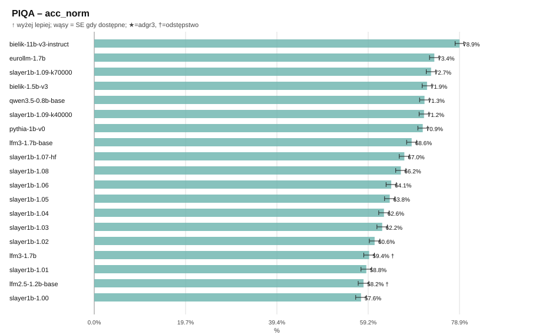

### PubMedQA
Pytania tak/nie/może na podstawie abstraktów PubMed; metryka acc.
_Yes/no/maybe questions over PubMed abstracts; acc metric._  
Język: en · Metryka: `acc` (↑ wyżej lepiej) · n=500  
Źródło: [https://github.com/slayerlabs/benchmarks-fabryka-ai/tree/main/research/benchmarks/pubmedqa](https://github.com/slayerlabs/benchmarks-fabryka-ai/tree/main/research/benchmarks/pubmedqa)

| Model | Metryka | Wynik | n | Flagi | Ustawienia | Źródło | Odstępstwa |
|---|---|---|---|---|---|---|---|
| bielik-11b-v3-instruct | acc | 73.0% ± 2.0% | 500 |  | bfloat16, no BOS | [results.json](https://github.com/slayerlabs/benchmarks-fabryka-ai/blob/a46eabf41b22e9ad80f9bf48a1961dc1c32e4faf/research/results/full-run-2026-11/pubmedqa/bielik-11b-v3-instruct/results.json) | — |
| qwen3.5-0.8b-base | acc | 67.6% ± 2.1% | 500 |  | float32, no BOS | [results.json](https://github.com/slayerlabs/benchmarks-fabryka-ai/blob/a46eabf41b22e9ad80f9bf48a1961dc1c32e4faf/research/results/full-run-2026-11/pubmedqa/qwen3.5-0.8b-base/results.json) | — |
| lfm3-1.7b | acc | 64.0% ± 2.1% | 500 | † | float32, no BOS | [results.json](https://github.com/slayerlabs/benchmarks-fabryka-ai/blob/a46eabf41b22e9ad80f9bf48a1961dc1c32e4faf/research/results/full-run-2026-11/pubmedqa/lfm3-1.7b/results.json) | model instruct liczony na surowym tekście, bez chat template; reguła kontekstu: acc_pmi poniżej bazy losowej na 2 testach PMI (ARC-Challenge, PIQA); próg 2 ustalony po obejrzeniu tego przebiegu |
| bielik-1.5b-v3 | acc | 62.4% ± 2.2% | 500 |  | float32, no BOS | [results.json](https://github.com/slayerlabs/benchmarks-fabryka-ai/blob/a46eabf41b22e9ad80f9bf48a1961dc1c32e4faf/research/results/full-run-2026-11/pubmedqa/bielik-1.5b-v3/results.json) | — |
| lfm3-1.7b-base | acc | 59.4% ± 2.2% | 500 |  | float32, no BOS | [results.json](https://github.com/slayerlabs/benchmarks-fabryka-ai/blob/a46eabf41b22e9ad80f9bf48a1961dc1c32e4faf/research/results/full-run-2026-11/pubmedqa/lfm3-1.7b-base/results.json) | — |
| lfm2.5-1.2b-base | acc | 56.8% ± 2.2% | 500 | † | float32, no BOS | [results.json](https://github.com/slayerlabs/benchmarks-fabryka-ai/blob/a46eabf41b22e9ad80f9bf48a1961dc1c32e4faf/research/results/full-run-2026-11/pubmedqa/lfm2.5-1.2b-base/results.json) | reguła kontekstu: acc_pmi poniżej bazy losowej na 2 testach PMI (ARC-Challenge, PIQA); próg 2 ustalony po obejrzeniu tego przebiegu; reguła przebiegu centralnego: wynik różni się od results/central-run dla tej samej rewizji i wag |
| pythia-1b-v0 | acc | 56.6% ± 2.2% | 500 |  | float32, no BOS | [results.json](https://github.com/slayerlabs/benchmarks-fabryka-ai/blob/a46eabf41b22e9ad80f9bf48a1961dc1c32e4faf/research/results/full-run-2026-11/pubmedqa/pythia-1b-v0/results.json) | — |
| slayer1b-1.09-k40000 | acc | 56.2% ± 2.2% | 500 |  | float32, one BOS | [results.json](https://github.com/slayerlabs/benchmarks-fabryka-ai/blob/a46eabf41b22e9ad80f9bf48a1961dc1c32e4faf/research/results/full-run-2026-11/pubmedqa/slayer1b-1.09-k40000/results.json) | — |
| slayer1b-1.09-k70000 | acc | 55.2% ± 2.2% | 500 |  | float32, one BOS | [results.json](https://github.com/slayerlabs/benchmarks-fabryka-ai/blob/a46eabf41b22e9ad80f9bf48a1961dc1c32e4faf/research/results/full-run-2026-11/pubmedqa/slayer1b-1.09-k70000/results.json) | — |
| slayer1b-1.01 | acc | 54.4% ± 2.2% | 500 |  | float32, one BOS | [results.json](https://github.com/slayerlabs/benchmarks-fabryka-ai/blob/a46eabf41b22e9ad80f9bf48a1961dc1c32e4faf/research/results/full-run-2026-11/pubmedqa/slayer1b-1.01/results.json) | — |
| slayer1b-1.02 | acc | 53.8% ± 2.2% | 500 |  | float32, one BOS | [results.json](https://github.com/slayerlabs/benchmarks-fabryka-ai/blob/a46eabf41b22e9ad80f9bf48a1961dc1c32e4faf/research/results/full-run-2026-11/pubmedqa/slayer1b-1.02/results.json) | — |
| slayer1b-1.07-hf | acc | 53.6% ± 2.2% | 500 |  | float32, one BOS | [results.json](https://github.com/slayerlabs/benchmarks-fabryka-ai/blob/a46eabf41b22e9ad80f9bf48a1961dc1c32e4faf/research/results/full-run-2026-11/pubmedqa/slayer1b-1.07-hf/results.json) | — |
| eurollm-1.7b | acc | 53.0% ± 2.2% | 500 |  | float32, no BOS | [results.json](https://github.com/slayerlabs/benchmarks-fabryka-ai/blob/a46eabf41b22e9ad80f9bf48a1961dc1c32e4faf/research/results/full-run-2026-11/pubmedqa/eurollm-1.7b/results.json) | — |
| slayer1b-1.04 | acc | 52.8% ± 2.2% | 500 |  | float32, one BOS | [results.json](https://github.com/slayerlabs/benchmarks-fabryka-ai/blob/a46eabf41b22e9ad80f9bf48a1961dc1c32e4faf/research/results/full-run-2026-11/pubmedqa/slayer1b-1.04/results.json) | — |
| slayer1b-1.03 | acc | 52.4% ± 2.2% | 500 |  | float32, one BOS | [results.json](https://github.com/slayerlabs/benchmarks-fabryka-ai/blob/a46eabf41b22e9ad80f9bf48a1961dc1c32e4faf/research/results/full-run-2026-11/pubmedqa/slayer1b-1.03/results.json) | — |
| slayer1b-1.05 | acc | 50.0% ± 2.2% | 500 |  | float32, one BOS | [results.json](https://github.com/slayerlabs/benchmarks-fabryka-ai/blob/a46eabf41b22e9ad80f9bf48a1961dc1c32e4faf/research/results/full-run-2026-11/pubmedqa/slayer1b-1.05/results.json) | — |
| slayer1b-1.00 | acc | 49.8% ± 2.2% | 500 |  | float32, one BOS | [results.json](https://github.com/slayerlabs/benchmarks-fabryka-ai/blob/a46eabf41b22e9ad80f9bf48a1961dc1c32e4faf/research/results/full-run-2026-11/pubmedqa/slayer1b-1.00/results.json) | — |
| slayer1b-1.06 | acc | 47.6% ± 2.2% | 500 |  | float32, one BOS | [results.json](https://github.com/slayerlabs/benchmarks-fabryka-ai/blob/a46eabf41b22e9ad80f9bf48a1961dc1c32e4faf/research/results/full-run-2026-11/pubmedqa/slayer1b-1.06/results.json) | — |
| slayer1b-1.08 | acc | 43.4% ± 2.2% | 500 |  | float32, one BOS | [results.json](https://github.com/slayerlabs/benchmarks-fabryka-ai/blob/a46eabf41b22e9ad80f9bf48a1961dc1c32e4faf/research/results/full-run-2026-11/pubmedqa/slayer1b-1.08/results.json) | — |

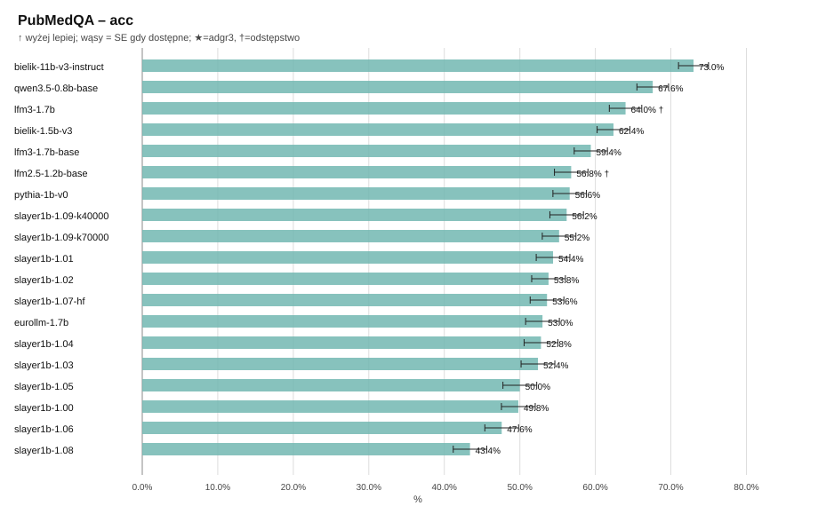

### Social IQa
Rozumowanie o sytuacjach społecznych, 3 opcje; metryka acc.
_Social situation reasoning, 3 options; acc metric._  
Język: en · Metryka: `acc` (↑ wyżej lepiej) · n=1954  
Źródło: [https://github.com/slayerlabs/benchmarks-fabryka-ai/tree/main/research/benchmarks/social-iqa](https://github.com/slayerlabs/benchmarks-fabryka-ai/tree/main/research/benchmarks/social-iqa)

| Model | Metryka | Wynik | n | Flagi | Ustawienia | Źródło | Odstępstwa |
|---|---|---|---|---|---|---|---|
| bielik-11b-v3-instruct | acc | 51.1% ± 1.1% | 1954 |  | bfloat16, no BOS | [results.json](https://github.com/slayerlabs/benchmarks-fabryka-ai/blob/a46eabf41b22e9ad80f9bf48a1961dc1c32e4faf/research/results/full-run-2026-11/social-iqa/bielik-11b-v3-instruct/results.json) | — |
| lfm3-1.7b-base | acc | 45.4% ± 1.1% | 1954 |  | float32, no BOS | [results.json](https://github.com/slayerlabs/benchmarks-fabryka-ai/blob/a46eabf41b22e9ad80f9bf48a1961dc1c32e4faf/research/results/full-run-2026-11/social-iqa/lfm3-1.7b-base/results.json) | — |
| lfm3-1.7b | acc | 43.7% ± 1.1% | 1954 | † | float32, no BOS | [results.json](https://github.com/slayerlabs/benchmarks-fabryka-ai/blob/a46eabf41b22e9ad80f9bf48a1961dc1c32e4faf/research/results/full-run-2026-11/social-iqa/lfm3-1.7b/results.json) | model instruct liczony na surowym tekście, bez chat template; reguła kontekstu: acc_pmi poniżej bazy losowej na 2 testach PMI (ARC-Challenge, PIQA); próg 2 ustalony po obejrzeniu tego przebiegu |
| bielik-1.5b-v3 | acc | 43.6% ± 1.1% | 1954 |  | float32, no BOS | [results.json](https://github.com/slayerlabs/benchmarks-fabryka-ai/blob/a46eabf41b22e9ad80f9bf48a1961dc1c32e4faf/research/results/full-run-2026-11/social-iqa/bielik-1.5b-v3/results.json) | — |
| qwen3.5-0.8b-base | acc | 41.9% ± 1.1% | 1954 |  | float32, no BOS | [results.json](https://github.com/slayerlabs/benchmarks-fabryka-ai/blob/a46eabf41b22e9ad80f9bf48a1961dc1c32e4faf/research/results/full-run-2026-11/social-iqa/qwen3.5-0.8b-base/results.json) | — |
| slayer1b-1.09-k70000 | acc | 41.8% ± 1.1% | 1954 |  | float32, one BOS | [results.json](https://github.com/slayerlabs/benchmarks-fabryka-ai/blob/a46eabf41b22e9ad80f9bf48a1961dc1c32e4faf/research/results/full-run-2026-11/social-iqa/slayer1b-1.09-k70000/results.json) | — |
| eurollm-1.7b | acc | 41.5% ± 1.1% | 1954 |  | float32, no BOS | [results.json](https://github.com/slayerlabs/benchmarks-fabryka-ai/blob/a46eabf41b22e9ad80f9bf48a1961dc1c32e4faf/research/results/full-run-2026-11/social-iqa/eurollm-1.7b/results.json) | — |
| slayer1b-1.09-k40000 | acc | 40.9% ± 1.1% | 1954 |  | float32, one BOS | [results.json](https://github.com/slayerlabs/benchmarks-fabryka-ai/blob/a46eabf41b22e9ad80f9bf48a1961dc1c32e4faf/research/results/full-run-2026-11/social-iqa/slayer1b-1.09-k40000/results.json) | — |
| pythia-1b-v0 | acc | 40.2% ± 1.1% | 1954 |  | float32, no BOS | [results.json](https://github.com/slayerlabs/benchmarks-fabryka-ai/blob/a46eabf41b22e9ad80f9bf48a1961dc1c32e4faf/research/results/full-run-2026-11/social-iqa/pythia-1b-v0/results.json) | — |
| slayer1b-1.08 | acc | 39.7% ± 1.1% | 1954 |  | float32, one BOS | [results.json](https://github.com/slayerlabs/benchmarks-fabryka-ai/blob/a46eabf41b22e9ad80f9bf48a1961dc1c32e4faf/research/results/full-run-2026-11/social-iqa/slayer1b-1.08/results.json) | — |
| slayer1b-1.07-hf | acc | 39.1% ± 1.1% | 1954 |  | float32, one BOS | [results.json](https://github.com/slayerlabs/benchmarks-fabryka-ai/blob/a46eabf41b22e9ad80f9bf48a1961dc1c32e4faf/research/results/full-run-2026-11/social-iqa/slayer1b-1.07-hf/results.json) | — |
| slayer1b-1.05 | acc | 39.0% ± 1.1% | 1954 |  | float32, one BOS | [results.json](https://github.com/slayerlabs/benchmarks-fabryka-ai/blob/a46eabf41b22e9ad80f9bf48a1961dc1c32e4faf/research/results/full-run-2026-11/social-iqa/slayer1b-1.05/results.json) | — |
| slayer1b-1.06 | acc | 38.9% ± 1.1% | 1954 |  | float32, one BOS | [results.json](https://github.com/slayerlabs/benchmarks-fabryka-ai/blob/a46eabf41b22e9ad80f9bf48a1961dc1c32e4faf/research/results/full-run-2026-11/social-iqa/slayer1b-1.06/results.json) | — |
| slayer1b-1.04 | acc | 38.0% ± 1.1% | 1954 |  | float32, one BOS | [results.json](https://github.com/slayerlabs/benchmarks-fabryka-ai/blob/a46eabf41b22e9ad80f9bf48a1961dc1c32e4faf/research/results/full-run-2026-11/social-iqa/slayer1b-1.04/results.json) | — |
| slayer1b-1.03 | acc | 37.4% ± 1.1% | 1954 |  | float32, one BOS | [results.json](https://github.com/slayerlabs/benchmarks-fabryka-ai/blob/a46eabf41b22e9ad80f9bf48a1961dc1c32e4faf/research/results/full-run-2026-11/social-iqa/slayer1b-1.03/results.json) | — |
| slayer1b-1.02 | acc | 36.9% ± 1.1% | 1954 |  | float32, one BOS | [results.json](https://github.com/slayerlabs/benchmarks-fabryka-ai/blob/a46eabf41b22e9ad80f9bf48a1961dc1c32e4faf/research/results/full-run-2026-11/social-iqa/slayer1b-1.02/results.json) | — |
| slayer1b-1.01 | acc | 35.8% ± 1.1% | 1954 |  | float32, one BOS | [results.json](https://github.com/slayerlabs/benchmarks-fabryka-ai/blob/a46eabf41b22e9ad80f9bf48a1961dc1c32e4faf/research/results/full-run-2026-11/social-iqa/slayer1b-1.01/results.json) | — |
| slayer1b-1.00 | acc | 35.8% ± 1.1% | 1954 |  | float32, one BOS | [results.json](https://github.com/slayerlabs/benchmarks-fabryka-ai/blob/a46eabf41b22e9ad80f9bf48a1961dc1c32e4faf/research/results/full-run-2026-11/social-iqa/slayer1b-1.00/results.json) | — |
| lfm2.5-1.2b-base | acc | 34.0% ± 1.1% | 1954 | † | float32, no BOS | [results.json](https://github.com/slayerlabs/benchmarks-fabryka-ai/blob/a46eabf41b22e9ad80f9bf48a1961dc1c32e4faf/research/results/full-run-2026-11/social-iqa/lfm2.5-1.2b-base/results.json) | reguła kontekstu: acc_pmi poniżej bazy losowej na 2 testach PMI (ARC-Challenge, PIQA); próg 2 ustalony po obejrzeniu tego przebiegu; reguła przebiegu centralnego: wynik różni się od results/central-run dla tej samej rewizji i wag |

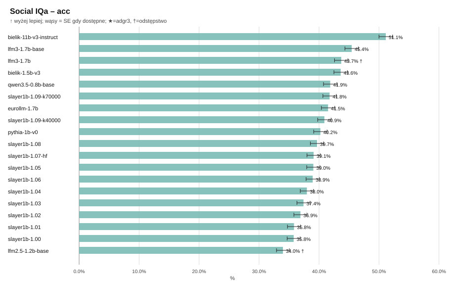

### WinoGrande
Rozwiązywanie koreferencji w stylu Winograd, 2 opcje; metryka acc.
_Winograd-style coreference resolution, 2 options; acc metric._  
Język: en · Metryka: `acc` (↑ wyżej lepiej) · n=1267  
Źródło: [https://github.com/slayerlabs/benchmarks-fabryka-ai/tree/main/research/benchmarks/winogrande](https://github.com/slayerlabs/benchmarks-fabryka-ai/tree/main/research/benchmarks/winogrande)

| Model | Metryka | Wynik | n | Flagi | Ustawienia | Źródło | Odstępstwa |
|---|---|---|---|---|---|---|---|
| bielik-11b-v3-instruct | acc | 73.0% ± 1.2% | 1267 |  | bfloat16, no BOS | [results.json](https://github.com/slayerlabs/benchmarks-fabryka-ai/blob/a46eabf41b22e9ad80f9bf48a1961dc1c32e4faf/research/results/full-run-2026-11/winogrande/bielik-11b-v3-instruct/results.json) | — |
| bielik-1.5b-v3 | acc | 62.4% ± 1.3% | 1267 |  | float32, no BOS | [results.json](https://github.com/slayerlabs/benchmarks-fabryka-ai/blob/a46eabf41b22e9ad80f9bf48a1961dc1c32e4faf/research/results/full-run-2026-11/winogrande/bielik-1.5b-v3/results.json) | — |
| qwen3.5-0.8b-base | acc | 60.1% ± 1.3% | 1267 |  | float32, no BOS | [results.json](https://github.com/slayerlabs/benchmarks-fabryka-ai/blob/a46eabf41b22e9ad80f9bf48a1961dc1c32e4faf/research/results/full-run-2026-11/winogrande/qwen3.5-0.8b-base/results.json) | — |
| eurollm-1.7b | acc | 59.0% ± 1.3% | 1267 |  | float32, no BOS | [results.json](https://github.com/slayerlabs/benchmarks-fabryka-ai/blob/a46eabf41b22e9ad80f9bf48a1961dc1c32e4faf/research/results/full-run-2026-11/winogrande/eurollm-1.7b/results.json) | — |
| lfm3-1.7b-base | acc | 58.6% ± 1.3% | 1267 |  | float32, no BOS | [results.json](https://github.com/slayerlabs/benchmarks-fabryka-ai/blob/a46eabf41b22e9ad80f9bf48a1961dc1c32e4faf/research/results/full-run-2026-11/winogrande/lfm3-1.7b-base/results.json) | — |
| slayer1b-1.09-k40000 | acc | 57.7% ± 1.3% | 1267 |  | float32, one BOS | [results.json](https://github.com/slayerlabs/benchmarks-fabryka-ai/blob/a46eabf41b22e9ad80f9bf48a1961dc1c32e4faf/research/results/full-run-2026-11/winogrande/slayer1b-1.09-k40000/results.json) | — |
| slayer1b-1.09-k70000 | acc | 57.4% ± 1.3% | 1267 |  | float32, one BOS | [results.json](https://github.com/slayerlabs/benchmarks-fabryka-ai/blob/a46eabf41b22e9ad80f9bf48a1961dc1c32e4faf/research/results/full-run-2026-11/winogrande/slayer1b-1.09-k70000/results.json) | — |
| lfm3-1.7b | acc | 55.4% ± 1.3% | 1267 | † | float32, no BOS | [results.json](https://github.com/slayerlabs/benchmarks-fabryka-ai/blob/a46eabf41b22e9ad80f9bf48a1961dc1c32e4faf/research/results/full-run-2026-11/winogrande/lfm3-1.7b/results.json) | model instruct liczony na surowym tekście, bez chat template; reguła kontekstu: acc_pmi poniżej bazy losowej na 2 testach PMI (ARC-Challenge, PIQA); próg 2 ustalony po obejrzeniu tego przebiegu |
| pythia-1b-v0 | acc | 54.5% ± 1.3% | 1267 |  | float32, no BOS | [results.json](https://github.com/slayerlabs/benchmarks-fabryka-ai/blob/a46eabf41b22e9ad80f9bf48a1961dc1c32e4faf/research/results/full-run-2026-11/winogrande/pythia-1b-v0/results.json) | — |
| slayer1b-1.08 | acc | 53.7% ± 1.3% | 1267 |  | float32, one BOS | [results.json](https://github.com/slayerlabs/benchmarks-fabryka-ai/blob/a46eabf41b22e9ad80f9bf48a1961dc1c32e4faf/research/results/full-run-2026-11/winogrande/slayer1b-1.08/results.json) | — |
| slayer1b-1.07-hf | acc | 53.6% ± 1.3% | 1267 |  | float32, one BOS | [results.json](https://github.com/slayerlabs/benchmarks-fabryka-ai/blob/a46eabf41b22e9ad80f9bf48a1961dc1c32e4faf/research/results/full-run-2026-11/winogrande/slayer1b-1.07-hf/results.json) | — |
| slayer1b-1.03 | acc | 53.5% ± 1.3% | 1267 |  | float32, one BOS | [results.json](https://github.com/slayerlabs/benchmarks-fabryka-ai/blob/a46eabf41b22e9ad80f9bf48a1961dc1c32e4faf/research/results/full-run-2026-11/winogrande/slayer1b-1.03/results.json) | — |
| slayer1b-1.05 | acc | 52.2% ± 1.2% | 1267 |  | float32, one BOS | [results.json](https://github.com/slayerlabs/benchmarks-fabryka-ai/blob/a46eabf41b22e9ad80f9bf48a1961dc1c32e4faf/research/results/full-run-2026-11/winogrande/slayer1b-1.05/results.json) | — |
| slayer1b-1.06 | acc | 52.2% ± 1.2% | 1267 |  | float32, one BOS | [results.json](https://github.com/slayerlabs/benchmarks-fabryka-ai/blob/a46eabf41b22e9ad80f9bf48a1961dc1c32e4faf/research/results/full-run-2026-11/winogrande/slayer1b-1.06/results.json) | — |
| slayer1b-1.01 | acc | 52.0% ± 1.3% | 1267 |  | float32, one BOS | [results.json](https://github.com/slayerlabs/benchmarks-fabryka-ai/blob/a46eabf41b22e9ad80f9bf48a1961dc1c32e4faf/research/results/full-run-2026-11/winogrande/slayer1b-1.01/results.json) | — |
| slayer1b-1.04 | acc | 51.1% ± 1.3% | 1267 |  | float32, one BOS | [results.json](https://github.com/slayerlabs/benchmarks-fabryka-ai/blob/a46eabf41b22e9ad80f9bf48a1961dc1c32e4faf/research/results/full-run-2026-11/winogrande/slayer1b-1.04/results.json) | — |
| slayer1b-1.02 | acc | 51.1% ± 1.2% | 1267 |  | float32, one BOS | [results.json](https://github.com/slayerlabs/benchmarks-fabryka-ai/blob/a46eabf41b22e9ad80f9bf48a1961dc1c32e4faf/research/results/full-run-2026-11/winogrande/slayer1b-1.02/results.json) | — |
| lfm2.5-1.2b-base | acc | 51.1% ± 1.3% | 1267 | † | float32, no BOS | [results.json](https://github.com/slayerlabs/benchmarks-fabryka-ai/blob/a46eabf41b22e9ad80f9bf48a1961dc1c32e4faf/research/results/full-run-2026-11/winogrande/lfm2.5-1.2b-base/results.json) | reguła kontekstu: acc_pmi poniżej bazy losowej na 2 testach PMI (ARC-Challenge, PIQA); próg 2 ustalony po obejrzeniu tego przebiegu; reguła przebiegu centralnego: wynik różni się od results/central-run dla tej samej rewizji i wag |
| slayer1b-1.00 | acc | 50.5% ± 1.3% | 1267 |  | float32, one BOS | [results.json](https://github.com/slayerlabs/benchmarks-fabryka-ai/blob/a46eabf41b22e9ad80f9bf48a1961dc1c32e4faf/research/results/full-run-2026-11/winogrande/slayer1b-1.00/results.json) | — |

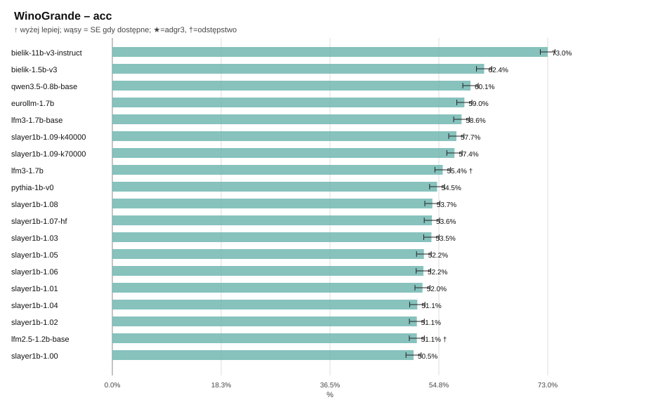

### WSC273
Winograd Schema Challenge (273 przykłady), rozwiązywanie zaimków; metryka acc.
_Winograd Schema Challenge (273 examples), pronoun resolution; acc metric._  
Język: en · Metryka: `acc` (↑ wyżej lepiej) · n=273  
Źródło: [https://github.com/slayerlabs/benchmarks-fabryka-ai/tree/main/research/benchmarks/wsc273](https://github.com/slayerlabs/benchmarks-fabryka-ai/tree/main/research/benchmarks/wsc273)

| Model | Metryka | Wynik | n | Flagi | Ustawienia | Źródło | Odstępstwa |
|---|---|---|---|---|---|---|---|
| bielik-11b-v3-instruct | acc | 82.4% ± 2.4% | 273 |  | bfloat16, no BOS | [results.json](https://github.com/slayerlabs/benchmarks-fabryka-ai/blob/a46eabf41b22e9ad80f9bf48a1961dc1c32e4faf/research/results/full-run-2026-11/wsc273/bielik-11b-v3-instruct/results.json) | — |
| bielik-1.5b-v3 | acc | 76.6% ± 2.4% | 273 |  | float32, no BOS | [results.json](https://github.com/slayerlabs/benchmarks-fabryka-ai/blob/a46eabf41b22e9ad80f9bf48a1961dc1c32e4faf/research/results/full-run-2026-11/wsc273/bielik-1.5b-v3/results.json) | — |
| lfm3-1.7b-base | acc | 71.4% ± 2.4% | 273 |  | float32, no BOS | [results.json](https://github.com/slayerlabs/benchmarks-fabryka-ai/blob/a46eabf41b22e9ad80f9bf48a1961dc1c32e4faf/research/results/full-run-2026-11/wsc273/lfm3-1.7b-base/results.json) | — |
| qwen3.5-0.8b-base | acc | 71.4% ± 2.3% | 273 |  | float32, no BOS | [results.json](https://github.com/slayerlabs/benchmarks-fabryka-ai/blob/a46eabf41b22e9ad80f9bf48a1961dc1c32e4faf/research/results/full-run-2026-11/wsc273/qwen3.5-0.8b-base/results.json) | — |
| eurollm-1.7b | acc | 71.1% ± 2.6% | 273 |  | float32, no BOS | [results.json](https://github.com/slayerlabs/benchmarks-fabryka-ai/blob/a46eabf41b22e9ad80f9bf48a1961dc1c32e4faf/research/results/full-run-2026-11/wsc273/eurollm-1.7b/results.json) | — |
| pythia-1b-v0 | acc | 67.4% ± 2.1% | 273 |  | float32, no BOS | [results.json](https://github.com/slayerlabs/benchmarks-fabryka-ai/blob/a46eabf41b22e9ad80f9bf48a1961dc1c32e4faf/research/results/full-run-2026-11/wsc273/pythia-1b-v0/results.json) | — |
| lfm3-1.7b | acc | 64.5% ± 2.5% | 273 | † | float32, no BOS | [results.json](https://github.com/slayerlabs/benchmarks-fabryka-ai/blob/a46eabf41b22e9ad80f9bf48a1961dc1c32e4faf/research/results/full-run-2026-11/wsc273/lfm3-1.7b/results.json) | model instruct liczony na surowym tekście, bez chat template; reguła kontekstu: acc_pmi poniżej bazy losowej na 2 testach PMI (ARC-Challenge, PIQA); próg 2 ustalony po obejrzeniu tego przebiegu |
| slayer1b-1.09-k40000 | acc | 63.7% ± 2.4% | 273 |  | float32, one BOS | [results.json](https://github.com/slayerlabs/benchmarks-fabryka-ai/blob/a46eabf41b22e9ad80f9bf48a1961dc1c32e4faf/research/results/full-run-2026-11/wsc273/slayer1b-1.09-k40000/results.json) | — |
| slayer1b-1.09-k70000 | acc | 63.7% ± 2.3% | 273 |  | float32, one BOS | [results.json](https://github.com/slayerlabs/benchmarks-fabryka-ai/blob/a46eabf41b22e9ad80f9bf48a1961dc1c32e4faf/research/results/full-run-2026-11/wsc273/slayer1b-1.09-k70000/results.json) | — |
| slayer1b-1.07-hf | acc | 61.5% ± 2.1% | 273 |  | float32, one BOS | [results.json](https://github.com/slayerlabs/benchmarks-fabryka-ai/blob/a46eabf41b22e9ad80f9bf48a1961dc1c32e4faf/research/results/full-run-2026-11/wsc273/slayer1b-1.07-hf/results.json) | — |
| slayer1b-1.08 | acc | 61.5% ± 2.2% | 273 |  | float32, one BOS | [results.json](https://github.com/slayerlabs/benchmarks-fabryka-ai/blob/a46eabf41b22e9ad80f9bf48a1961dc1c32e4faf/research/results/full-run-2026-11/wsc273/slayer1b-1.08/results.json) | — |
| slayer1b-1.06 | acc | 59.0% ± 2.0% | 273 |  | float32, one BOS | [results.json](https://github.com/slayerlabs/benchmarks-fabryka-ai/blob/a46eabf41b22e9ad80f9bf48a1961dc1c32e4faf/research/results/full-run-2026-11/wsc273/slayer1b-1.06/results.json) | — |
| slayer1b-1.05 | acc | 58.6% ± 2.2% | 273 |  | float32, one BOS | [results.json](https://github.com/slayerlabs/benchmarks-fabryka-ai/blob/a46eabf41b22e9ad80f9bf48a1961dc1c32e4faf/research/results/full-run-2026-11/wsc273/slayer1b-1.05/results.json) | — |
| slayer1b-1.02 | acc | 57.1% ± 2.2% | 273 |  | float32, one BOS | [results.json](https://github.com/slayerlabs/benchmarks-fabryka-ai/blob/a46eabf41b22e9ad80f9bf48a1961dc1c32e4faf/research/results/full-run-2026-11/wsc273/slayer1b-1.02/results.json) | — |
| slayer1b-1.03 | acc | 56.0% ± 2.2% | 273 |  | float32, one BOS | [results.json](https://github.com/slayerlabs/benchmarks-fabryka-ai/blob/a46eabf41b22e9ad80f9bf48a1961dc1c32e4faf/research/results/full-run-2026-11/wsc273/slayer1b-1.03/results.json) | — |
| slayer1b-1.04 | acc | 56.0% ± 2.2% | 273 |  | float32, one BOS | [results.json](https://github.com/slayerlabs/benchmarks-fabryka-ai/blob/a46eabf41b22e9ad80f9bf48a1961dc1c32e4faf/research/results/full-run-2026-11/wsc273/slayer1b-1.04/results.json) | — |
| slayer1b-1.01 | acc | 55.3% ± 2.1% | 273 |  | float32, one BOS | [results.json](https://github.com/slayerlabs/benchmarks-fabryka-ai/blob/a46eabf41b22e9ad80f9bf48a1961dc1c32e4faf/research/results/full-run-2026-11/wsc273/slayer1b-1.01/results.json) | — |
| slayer1b-1.00 | acc | 53.8% ± 2.0% | 273 |  | float32, one BOS | [results.json](https://github.com/slayerlabs/benchmarks-fabryka-ai/blob/a46eabf41b22e9ad80f9bf48a1961dc1c32e4faf/research/results/full-run-2026-11/wsc273/slayer1b-1.00/results.json) | — |
| lfm2.5-1.2b-base | acc | 50.2% ± 1.9% | 273 | † | float32, no BOS | [results.json](https://github.com/slayerlabs/benchmarks-fabryka-ai/blob/a46eabf41b22e9ad80f9bf48a1961dc1c32e4faf/research/results/full-run-2026-11/wsc273/lfm2.5-1.2b-base/results.json) | reguła kontekstu: acc_pmi poniżej bazy losowej na 2 testach PMI (ARC-Challenge, PIQA); próg 2 ustalony po obejrzeniu tego przebiegu; reguła przebiegu centralnego: wynik różni się od results/central-run dla tej samej rewizji i wag |

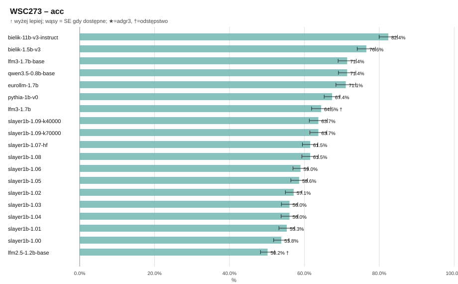

## Kod / Code

Sekcja obejmuje benchmarki z rodziny „Kod”. Porównuj tylko w obrębie tego samego benchmarku, metryki i ustawień.

### LiveCodeBench Pro 25Q2
Odsetek zaakceptowanych rozwiązań (pass@1) w LiveCodeBench Pro 25Q2 (kwartał 2025_4_6).
_Pass@1 (accepted/all problems, percent) on LiveCodeBench Pro 25Q2 (quarter 2025_4_6)._  
Język: en · Metryka: `pass@1 (accepted / all problems, percent)` (↑ wyżej lepiej) · n=167  
Źródło: [https://github.com/slayerlabs/benchmarks-fabryka-ai/tree/main/research/api-benchmarks/livecodebench-pro-25q2](https://github.com/slayerlabs/benchmarks-fabryka-ai/tree/main/research/api-benchmarks/livecodebench-pro-25q2)

| Model | Metryka | Wynik | n | Flagi | Ustawienia | Źródło | Odstępstwa |
|---|---|---|---|---|---|---|---|
| lfm3-1.7b | pass@1 (accepted / all problems, percent) | 32.3% ± 3.6% | 167 | † | — | [lfm3-1.7b.json](https://github.com/slayerlabs/benchmarks-fabryka-ai/blob/a46eabf41b22e9ad80f9bf48a1961dc1c32e4faf/research/api-benchmarks/livecodebench-pro-25q2/results/lfm3-1.7b.json) | see README.md, Deviations |
| lfm3-1.7b-nothink | pass@1 (accepted / all problems, percent) | 28.7% ± 3.5% | 167 | † | — | [lfm3-1.7b-nothink.json](https://github.com/slayerlabs/benchmarks-fabryka-ai/blob/a46eabf41b22e9ad80f9bf48a1961dc1c32e4faf/research/api-benchmarks/livecodebench-pro-25q2/results/lfm3-1.7b-nothink.json) | see README.md, Deviations |
| bielik-11b-v3.1 | pass@1 (accepted / all problems, percent) | 1.8% ± 103.0% | 167 | † | — | [bielik-11b-v3.1.json](https://github.com/slayerlabs/benchmarks-fabryka-ai/blob/a46eabf41b22e9ad80f9bf48a1961dc1c32e4faf/research/api-benchmarks/livecodebench-pro-25q2/results/bielik-11b-v3.1.json) | see README.md, Deviations |
| slayer1b-1.09-k70000 | pass@1 (accepted / all problems, percent) | 0.0% | 167 | † | — | [slayer1b-1.09-k70000.json](https://github.com/slayerlabs/benchmarks-fabryka-ai/blob/a46eabf41b22e9ad80f9bf48a1961dc1c32e4faf/research/api-benchmarks/livecodebench-pro-25q2/results/slayer1b-1.09-k70000.json) | see README.md, Deviations |

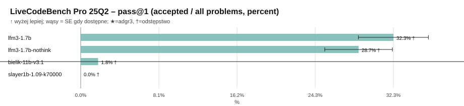

### LiveCodeBench v6 (generowanie kodu)
Pass@1 generowania kodu w LiveCodeBench v6 (release_v6).
_Code generation pass@1 on LiveCodeBench v6 (release_v6)._  
Język: en · Metryka: `pass@1` (↑ wyżej lepiej) · n=1055  
Źródło: [https://github.com/slayerlabs/benchmarks-fabryka-ai/tree/main/research/api-benchmarks/livecodebench-v6](https://github.com/slayerlabs/benchmarks-fabryka-ai/tree/main/research/api-benchmarks/livecodebench-v6)

| Model | Metryka | Wynik | n | Flagi | Ustawienia | Źródło | Odstępstwa |
|---|---|---|---|---|---|---|---|
| lfm3-1.7b-cardsampling | pass@1 | 73.08 ± 1.37 | 1055 | † | — | [lfm3-1.7b-cardsampling.json](https://github.com/slayerlabs/benchmarks-fabryka-ai/blob/a46eabf41b22e9ad80f9bf48a1961dc1c32e4faf/research/api-benchmarks/livecodebench-v6/results/lfm3-1.7b-cardsampling.json) | see README.md, Deviations |
| lfm3-1.7b | pass@1 | 72.04 ± 1.38 | 1055 | † | — | [lfm3-1.7b.json](https://github.com/slayerlabs/benchmarks-fabryka-ai/blob/a46eabf41b22e9ad80f9bf48a1961dc1c32e4faf/research/api-benchmarks/livecodebench-v6/results/lfm3-1.7b.json) | see README.md, Deviations |
| bielik-11b-v3.1 | pass@1 | 16.68 ± 1.15 | 1055 | † | — | [bielik-11b-v3.1.json](https://github.com/slayerlabs/benchmarks-fabryka-ai/blob/a46eabf41b22e9ad80f9bf48a1961dc1c32e4faf/research/api-benchmarks/livecodebench-v6/results/bielik-11b-v3.1.json) | see README.md, Deviations |

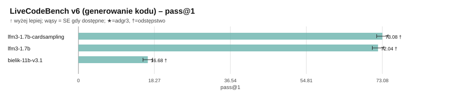

### SciCode
Odsetek zaliczonych podproblemów SciCode z tłem naukowym (poprawne kroki / 288 × 100).
_SciCode subproblem pass rate with background (correct steps / 288 x 100)._  
Język: en · Metryka: `subproblem pass rate, with background (correct steps / 288 x 100, test_generated_code.py)` (↑ wyżej lepiej) · n=288  
Źródło: [https://github.com/slayerlabs/benchmarks-fabryka-ai/tree/main/research/api-benchmarks/scicode](https://github.com/slayerlabs/benchmarks-fabryka-ai/tree/main/research/api-benchmarks/scicode)

| Model | Metryka | Wynik | n | Flagi | Ustawienia | Źródło | Odstępstwa |
|---|---|---|---|---|---|---|---|
| lfm3-1.7b | subproblem pass rate, with background (correct steps / 288 x 100, test_generated_code.py) | 32.64 ± 2.76 | 288 | † | — | [lfm3-1.7b.json](https://github.com/slayerlabs/benchmarks-fabryka-ai/blob/a46eabf41b22e9ad80f9bf48a1961dc1c32e4faf/research/api-benchmarks/scicode/results/lfm3-1.7b.json) | see README.md, Deviations |
| lfm3-1.7b-nothink | subproblem pass rate, with background (correct steps / 288 x 100, test_generated_code.py) | 24.65 ± 2.54 | 288 | † | — | [lfm3-1.7b-nothink.json](https://github.com/slayerlabs/benchmarks-fabryka-ai/blob/a46eabf41b22e9ad80f9bf48a1961dc1c32e4faf/research/api-benchmarks/scicode/results/lfm3-1.7b-nothink.json) | see README.md, Deviations |
| bielik-11b-v3.1 | subproblem pass rate, with background (correct steps / 288 x 100, test_generated_code.py) | 2.43 ± 0.91 | 288 | † | — | [bielik-11b-v3.1.json](https://github.com/slayerlabs/benchmarks-fabryka-ai/blob/a46eabf41b22e9ad80f9bf48a1961dc1c32e4faf/research/api-benchmarks/scicode/results/bielik-11b-v3.1.json) | see README.md, Deviations |
| slayer1b-1.09-k70000 | subproblem pass rate, with background (correct steps / 288 x 100, test_generated_code.py) | null (with_background: 216/288 subproblems (75.0%) had prompt_tokens > 4096 - SLAYER_MIN_ANSWER_TOKENS (256), so they were recorded as context_overflow/unsupported per PROTOCOL.md Amendment 3; headline score is null. Overflow is caused by inserting prior steps' long degenerate extracted outputs into subsequent with-background prompts. See other_metrics.with_background.unsupported and Amendment 3 'Result after the run'.) | 288 | †∅ | — | [slayer1b-1.09-k70000.json](https://github.com/slayerlabs/benchmarks-fabryka-ai/blob/a46eabf41b22e9ad80f9bf48a1961dc1c32e4faf/research/api-benchmarks/scicode/results/slayer1b-1.09-k70000.json) | with_background: 216/288 subproblems (75.0%) had prompt_tokens > 4096 - SLAYER_MIN_ANSWER_TOKENS (256), so they were recorded as context_overflow/unsupported per PROTOCOL.md Amendment 3; headline score is null. Overflow is caused by inserting prior steps' long degenerate extracted outputs into subsequent with-background prompts. See other_metrics.with_background.unsupported and Amendment 3 'Result after the run'. |

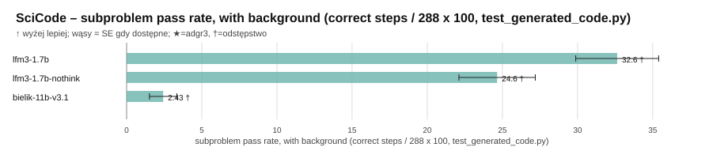

## Długi kontekst / Long context

Sekcja obejmuje benchmarki z rodziny „Długi kontekst”. Porównuj tylko w obrębie tego samego benchmarku, metryki i ustawień.

### AA-LCR
Ocena dokładności na 100 pytaniach AA-LCR z długim kontekstem; odpowiedzi sprawdzane przez automatyczny checker równości oparty o LLM.
_Accuracy over 100 AA-LCR long-context questions, judged by an LLM equality checker._  
Język: en · Metryka: `accuracy over the 100 AA-LCR questions, judged by an LLM equality checker (percent)` (↑ wyżej lepiej) · n=100  
Źródło: [https://github.com/slayerlabs/benchmarks-fabryka-ai/tree/main/research/api-benchmarks/aa-lcr](https://github.com/slayerlabs/benchmarks-fabryka-ai/tree/main/research/api-benchmarks/aa-lcr)

| Model | Metryka | Wynik | n | Flagi | Ustawienia | Źródło | Odstępstwa |
|---|---|---|---|---|---|---|---|
| slayer1b-1.09-k70000 | accuracy over the 100 AA-LCR questions, judged by an LLM equality checker (percent) | not run (the 4096-token context window does not hold any AA-LCR prompt: the shortest of 100 prompts has 85211 tokens, the longest 135882; the benchmark is not cut down (no truncation, chunking or retrieval) | — | †∅ | — | [slayer1b-1.09-k70000.json](https://github.com/slayerlabs/benchmarks-fabryka-ai/blob/a46eabf41b22e9ad80f9bf48a1961dc1c32e4faf/research/api-benchmarks/aa-lcr/results/slayer1b-1.09-k70000.json) | not run: the 4096-token context window does not hold any AA-LCR prompt: the shortest of 100 prompts has 85211 tokens, the longest 135882; the benchmark is not cut down (no truncation, chunking or retrieval) |
| bielik-11b-v3.1 | accuracy over the 100 AA-LCR questions, judged by an LLM equality checker (percent) | not run (the 32768-token context window does not hold any AA-LCR prompt: the shortest of 100 prompts has 100913 tokens, the longest 141519; the benchmark is not cut down (no truncation, chunking or retrieval) | — | †∅ | — | [bielik-11b-v3.1.json](https://github.com/slayerlabs/benchmarks-fabryka-ai/blob/a46eabf41b22e9ad80f9bf48a1961dc1c32e4faf/research/api-benchmarks/aa-lcr/results/bielik-11b-v3.1.json) | not run: the 32768-token context window does not hold any AA-LCR prompt: the shortest of 100 prompts has 100913 tokens, the longest 141519; the benchmark is not cut down (no truncation, chunking or retrieval) |

### RULER
Średnia z 13 zadań RULER przy kontekście 131072 tokenów (procent); mierzy użyteczność długiego kontekstu.
_Mean of 13 RULER task scores at 131072 tokens (percent); measures long-context capability._  
Język: en · Metryka: `mean of the 13 RULER task scores at 131072 tokens (percent)` (↑ wyżej lepiej) · n=650  
Źródło: [https://github.com/slayerlabs/benchmarks-fabryka-ai/tree/main/research/api-benchmarks/ruler-128k](https://github.com/slayerlabs/benchmarks-fabryka-ai/tree/main/research/api-benchmarks/ruler-128k)

| Model | Metryka | Wynik | n | Flagi | Ustawienia | Źródło | Odstępstwa |
|---|---|---|---|---|---|---|---|
| lfm3-1.7b | mean of the 13 RULER task scores at 131072 tokens (percent) | 71.69 ± 0.93 | 650 | † | — | [lfm3-1.7b.json](https://github.com/slayerlabs/benchmarks-fabryka-ai/blob/a46eabf41b22e9ad80f9bf48a1961dc1c32e4faf/research/api-benchmarks/ruler-128k/results/lfm3-1.7b.json) | see README.md, Deviations |
| slayer1b-1.09-k70000 | mean of the 13 RULER task scores at 131072 tokens (percent) | null (the 4096-token context window does not hold a 131072-token RULER sample) | — | †∅ | — | [slayer1b-1.09-k70000.json](https://github.com/slayerlabs/benchmarks-fabryka-ai/blob/a46eabf41b22e9ad80f9bf48a1961dc1c32e4faf/research/api-benchmarks/ruler-128k/results/slayer1b-1.09-k70000.json) | the 4096-token context window does not hold a 131072-token RULER sample |
| bielik-11b-v3.1 | mean of the 13 RULER task scores at 131072 tokens (percent) | null (the 32768-token context window does not hold a 131072-token RULER sample) | — | †∅ | — | [bielik-11b-v3.1.json](https://github.com/slayerlabs/benchmarks-fabryka-ai/blob/a46eabf41b22e9ad80f9bf48a1961dc1c32e4faf/research/api-benchmarks/ruler-128k/results/bielik-11b-v3.1.json) | the 32768-token context window does not hold a 131072-token RULER sample |

## Agenci i narzędzia / Agents and tools

Sekcja obejmuje benchmarki z rodziny „Agenci i narzędzia”. Porównuj tylko w obrębie tego samego benchmarku, metryki i ustawień.

### AA-Omniscience (publiczny)
Indeks omniscience z publicznego zestawu AA-Omniscience; mierzy wiedzę i kalibrację modelu na pytaniach faktograficznych.
_Omniscience index from the public AA-Omniscience set; measures factual knowledge and calibration._  
Język: en · Metryka: `omniscience_index` (↑ wyżej lepiej) · n=600  
Źródło: [https://github.com/slayerlabs/benchmarks-fabryka-ai/tree/main/research/api-benchmarks/aa-omniscience](https://github.com/slayerlabs/benchmarks-fabryka-ai/tree/main/research/api-benchmarks/aa-omniscience)

| Model | Metryka | Wynik | n | Flagi | Ustawienia | Źródło | Odstępstwa |
|---|---|---|---|---|---|---|---|
| slayer1b-60000 | omniscience_index | -59.33 ± 2.14 | 600 | † | — | [slayer1b-60000.json](https://github.com/slayerlabs/benchmarks-fabryka-ai/blob/a46eabf41b22e9ad80f9bf48a1961dc1c32e4faf/research/api-benchmarks/aa-omniscience/results/slayer1b-60000.json) | see README.md, Deviations |
| bielik-11b-v3.1-vllm | omniscience_index | -77.33 ± 2.58 | 600 | † | — | [bielik-11b-v3.1-vllm.json](https://github.com/slayerlabs/benchmarks-fabryka-ai/blob/a46eabf41b22e9ad80f9bf48a1961dc1c32e4faf/research/api-benchmarks/aa-omniscience/results/bielik-11b-v3.1-vllm.json) | see README.md, Deviations |

### AutomationBench (publiczny)
Odsetek zaliczonych zadań automatyzacji w publicznym AutomationBench; model używa narzędzi do wykonania zadań.
_Pass rate on public AutomationBench automation tasks; the model uses tools to complete tasks._  
Język: en · Metryka: `pass_rate` (↑ wyżej lepiej) · n=600  
Źródło: [https://github.com/slayerlabs/benchmarks-fabryka-ai/tree/main/research/api-benchmarks/automationbench](https://github.com/slayerlabs/benchmarks-fabryka-ai/tree/main/research/api-benchmarks/automationbench)

| Model | Metryka | Wynik | n | Flagi | Ustawienia | Źródło | Odstępstwa |
|---|---|---|---|---|---|---|---|
| bielik-11b-v3.1-vllm | pass_rate | 0.0% | 600 | † | — | [bielik-11b-v3.1-vllm.json](https://github.com/slayerlabs/benchmarks-fabryka-ai/blob/a46eabf41b22e9ad80f9bf48a1961dc1c32e4faf/research/api-benchmarks/automationbench/results/bielik-11b-v3.1-vllm.json) | see README.md, Deviations |
| slayer1b-60000 | pass_rate | null (Slayer 1B is a base model without a chat template or tool-calling format; the serving endpoint rejects requests with tools (HTTP 400), so no syntactically valid call is possible.) | 0 | †∅ | — | [slayer1b-60000.json](https://github.com/slayerlabs/benchmarks-fabryka-ai/blob/a46eabf41b22e9ad80f9bf48a1961dc1c32e4faf/research/api-benchmarks/automationbench/results/slayer1b-60000.json) | Slayer 1B is a base model without a chat template or tool-calling format; the serving endpoint rejects requests with tools (HTTP 400), so no syntactically valid call is possible. |

### BFCL V4
Berkeley Function Calling Leaderboard V4; mierzy poprawność wywołań funkcji/narzędzi. Wyniki w tym repo są oznaczone jako niekompletne (brak kategorii web_search).
_Berkeley Function Calling Leaderboard V4; measures function/tool calling accuracy. Results in this repo are marked incomplete (web_search categories not run)._  
Język: en · Metryka: `overall_acc` (↑ wyżej lepiej) · n=4906  
Źródło: [https://github.com/slayerlabs/benchmarks-fabryka-ai/tree/main/research/api-benchmarks/bfcl-v4](https://github.com/slayerlabs/benchmarks-fabryka-ai/tree/main/research/api-benchmarks/bfcl-v4)

| Model | Metryka | Wynik | n | Flagi | Ustawienia | Źródło | Odstępstwa |
|---|---|---|---|---|---|---|---|
| slayer1b-60000 | overall_acc | null (Slayer 1B is a base model without a chat template or tool-calling format; the serving endpoint rejects requests with tools (HTTP 400), so no syntactically valid call is possible.) | 0 | †∅ | — | [slayer1b-60000.json](https://github.com/slayerlabs/benchmarks-fabryka-ai/blob/a46eabf41b22e9ad80f9bf48a1961dc1c32e4faf/research/api-benchmarks/bfcl-v4/results/slayer1b-60000.json) | Slayer 1B is a base model without a chat template or tool-calling format; the serving endpoint rejects requests with tools (HTTP 400), so no syntactically valid call is possible. |
| bielik-11b-v3.1-vllm | overall_acc | not run (they need a search API key. See other_metrics.) | 4906 | †∅ | — | [bielik-11b-v3.1-vllm.json](https://github.com/slayerlabs/benchmarks-fabryka-ai/blob/a46eabf41b22e9ad80f9bf48a1961dc1c32e4faf/research/api-benchmarks/bfcl-v4/results/bielik-11b-v3.1-vllm.json) | Overall Acc needs the web_search categories (200 tasks, 40% x 1/2 of the weight), which were not run: they need a search API key. See other_metrics. |

### Terminal-Bench 2.1
Odsetek zaliczonych zadań w Terminal-Bench 2.1; agent wykonuje zadania w terminalu, oceniane testami.
_Pass rate on Terminal-Bench 2.1; agent completes terminal tasks graded by tests._  
Język: en · Metryka: `pass rate (task tests pass, reward 1), mean over tasks and trials` (↑ wyżej lepiej) · n=89  
Źródło: [https://github.com/slayerlabs/benchmarks-fabryka-ai/tree/main/research/api-benchmarks/terminal-bench-2-1](https://github.com/slayerlabs/benchmarks-fabryka-ai/tree/main/research/api-benchmarks/terminal-bench-2-1)

| Model | Metryka | Wynik | n | Flagi | Ustawienia | Źródło | Odstępstwa |
|---|---|---|---|---|---|---|---|
| lfm3-1.7b | pass rate (task tests pass, reward 1), mean over tasks and trials | 10.6% ± 2.7% | 89 | † | — | [lfm3-1.7b.json](https://github.com/slayerlabs/benchmarks-fabryka-ai/blob/a46eabf41b22e9ad80f9bf48a1961dc1c32e4faf/research/api-benchmarks/terminal-bench-2-1/results/lfm3-1.7b.json) | see README.md, Deviations |
| slayer1b-1.09-k70000 | pass rate (task tests pass, reward 1), mean over tasks and trials | not run (a base model without a chat template or a tool-call format, so OpenCode cannot drive it (see README) | 0 | †∅ | — | [slayer1b-1.09-k70000.json](https://github.com/slayerlabs/benchmarks-fabryka-ai/blob/a46eabf41b22e9ad80f9bf48a1961dc1c32e4faf/research/api-benchmarks/terminal-bench-2-1/results/slayer1b-1.09-k70000.json) | not run: a base model without a chat template or a tool-call format, so OpenCode cannot drive it (see README) |

## Modelowanie języka / Language modeling

Sekcja obejmuje benchmarki z rodziny „Modelowanie języka”. Porównuj tylko w obrębie tego samego benchmarku, metryki i ustawień.

### BLiMP
Minimalne pary gramatyczne angielskiego (67 paradygmatów × 1000 par); model wybiera zdanie bardziej prawdopodobne.
_English grammatical minimal pairs (67 paradigms x 1000 pairs); model prefers the more probable sentence._  
Język: en · Metryka: `acc` (↑ wyżej lepiej) · n=67000  
Źródło: [https://github.com/slayerlabs/benchmarks-fabryka-ai/tree/main/research/benchmarks/blimp](https://github.com/slayerlabs/benchmarks-fabryka-ai/tree/main/research/benchmarks/blimp)

| Model | Metryka | Wynik | n | Flagi | Ustawienia | Źródło | Odstępstwa |
|---|---|---|---|---|---|---|---|
| bielik-11b-v3-instruct | acc | 83.2% ± 1.8% | 67000 |  | bfloat16, BOS not applicable (empty context or rolling windows) | [results.json](https://github.com/slayerlabs/benchmarks-fabryka-ai/blob/a46eabf41b22e9ad80f9bf48a1961dc1c32e4faf/research/results/full-run-2026-11/blimp/bielik-11b-v3-instruct/results.json) | — |
| pythia-1b-v0 | acc | 82.4% ± 2.1% | 67000 |  | float32, BOS not applicable (empty context or rolling windows) | [results.json](https://github.com/slayerlabs/benchmarks-fabryka-ai/blob/a46eabf41b22e9ad80f9bf48a1961dc1c32e4faf/research/results/full-run-2026-11/blimp/pythia-1b-v0/results.json) | — |
| bielik-1.5b-v3 | acc | 81.9% ± 2.0% | 67000 |  | float32, BOS not applicable (empty context or rolling windows) | [results.json](https://github.com/slayerlabs/benchmarks-fabryka-ai/blob/a46eabf41b22e9ad80f9bf48a1961dc1c32e4faf/research/results/full-run-2026-11/blimp/bielik-1.5b-v3/results.json) | — |
| slayer1b-1.09-k40000 | acc | 81.5% ± 2.1% | 67000 |  | float32, BOS not applicable (empty context or rolling windows) | [results.json](https://github.com/slayerlabs/benchmarks-fabryka-ai/blob/a46eabf41b22e9ad80f9bf48a1961dc1c32e4faf/research/results/full-run-2026-11/blimp/slayer1b-1.09-k40000/results.json) | — |
| slayer1b-1.09-k70000 | acc | 81.5% ± 2.1% | 67000 |  | float32, BOS not applicable (empty context or rolling windows) | [results.json](https://github.com/slayerlabs/benchmarks-fabryka-ai/blob/a46eabf41b22e9ad80f9bf48a1961dc1c32e4faf/research/results/full-run-2026-11/blimp/slayer1b-1.09-k70000/results.json) | — |
| slayer1b-1.08 | acc | 80.5% ± 2.1% | 67000 |  | float32, BOS not applicable (empty context or rolling windows) | [results.json](https://github.com/slayerlabs/benchmarks-fabryka-ai/blob/a46eabf41b22e9ad80f9bf48a1961dc1c32e4faf/research/results/full-run-2026-11/blimp/slayer1b-1.08/results.json) | — |
| eurollm-1.7b | acc | 80.4% ± 1.8% | 67000 |  | float32, BOS not applicable (empty context or rolling windows) | [results.json](https://github.com/slayerlabs/benchmarks-fabryka-ai/blob/a46eabf41b22e9ad80f9bf48a1961dc1c32e4faf/research/results/full-run-2026-11/blimp/eurollm-1.7b/results.json) | — |
| qwen3.5-0.8b-base | acc | 79.9% ± 2.2% | 67000 |  | float32, BOS not applicable (empty context or rolling windows) | [results.json](https://github.com/slayerlabs/benchmarks-fabryka-ai/blob/a46eabf41b22e9ad80f9bf48a1961dc1c32e4faf/research/results/full-run-2026-11/blimp/qwen3.5-0.8b-base/results.json) | — |
| slayer1b-1.07-hf | acc | 79.8% ± 2.1% | 67000 |  | float32, BOS not applicable (empty context or rolling windows) | [results.json](https://github.com/slayerlabs/benchmarks-fabryka-ai/blob/a46eabf41b22e9ad80f9bf48a1961dc1c32e4faf/research/results/full-run-2026-11/blimp/slayer1b-1.07-hf/results.json) | — |
| lfm3-1.7b-base | acc | 79.3% ± 2.3% | 67000 |  | float32, BOS not applicable (empty context or rolling windows) | [results.json](https://github.com/slayerlabs/benchmarks-fabryka-ai/blob/a46eabf41b22e9ad80f9bf48a1961dc1c32e4faf/research/results/full-run-2026-11/blimp/lfm3-1.7b-base/results.json) | — |
| slayer1b-1.06 | acc | 79.2% ± 2.0% | 67000 |  | float32, BOS not applicable (empty context or rolling windows) | [results.json](https://github.com/slayerlabs/benchmarks-fabryka-ai/blob/a46eabf41b22e9ad80f9bf48a1961dc1c32e4faf/research/results/full-run-2026-11/blimp/slayer1b-1.06/results.json) | — |
| slayer1b-1.05 | acc | 79.2% ± 2.1% | 67000 |  | float32, BOS not applicable (empty context or rolling windows) | [results.json](https://github.com/slayerlabs/benchmarks-fabryka-ai/blob/a46eabf41b22e9ad80f9bf48a1961dc1c32e4faf/research/results/full-run-2026-11/blimp/slayer1b-1.05/results.json) | — |
| lfm2.5-1.2b-base | acc | 78.6% ± 2.1% | 67000 | † | float32, BOS not applicable (empty context or rolling windows) | [results.json](https://github.com/slayerlabs/benchmarks-fabryka-ai/blob/a46eabf41b22e9ad80f9bf48a1961dc1c32e4faf/research/results/full-run-2026-11/blimp/lfm2.5-1.2b-base/results.json) | reguła kontekstu: acc_pmi poniżej bazy losowej na 2 testach PMI (ARC-Challenge, PIQA); próg 2 ustalony po obejrzeniu tego przebiegu; reguła przebiegu centralnego: wynik różni się od results/central-run dla tej samej rewizji i wag |
| slayer1b-1.03 | acc | 77.4% ± 2.2% | 67000 |  | float32, BOS not applicable (empty context or rolling windows) | [results.json](https://github.com/slayerlabs/benchmarks-fabryka-ai/blob/a46eabf41b22e9ad80f9bf48a1961dc1c32e4faf/research/results/full-run-2026-11/blimp/slayer1b-1.03/results.json) | — |
| lfm3-1.7b | acc | 77.3% ± 2.4% | 67000 | † | float32, BOS not applicable (empty context or rolling windows) | [results.json](https://github.com/slayerlabs/benchmarks-fabryka-ai/blob/a46eabf41b22e9ad80f9bf48a1961dc1c32e4faf/research/results/full-run-2026-11/blimp/lfm3-1.7b/results.json) | model instruct liczony na surowym tekście, bez chat template; reguła kontekstu: acc_pmi poniżej bazy losowej na 2 testach PMI (ARC-Challenge, PIQA); próg 2 ustalony po obejrzeniu tego przebiegu |
| slayer1b-1.04 | acc | 77.1% ± 2.3% | 67000 |  | float32, BOS not applicable (empty context or rolling windows) | [results.json](https://github.com/slayerlabs/benchmarks-fabryka-ai/blob/a46eabf41b22e9ad80f9bf48a1961dc1c32e4faf/research/results/full-run-2026-11/blimp/slayer1b-1.04/results.json) | — |
| slayer1b-1.02 | acc | 76.7% ± 2.3% | 67000 |  | float32, BOS not applicable (empty context or rolling windows) | [results.json](https://github.com/slayerlabs/benchmarks-fabryka-ai/blob/a46eabf41b22e9ad80f9bf48a1961dc1c32e4faf/research/results/full-run-2026-11/blimp/slayer1b-1.02/results.json) | — |
| slayer1b-1.01 | acc | 76.2% ± 2.3% | 67000 |  | float32, BOS not applicable (empty context or rolling windows) | [results.json](https://github.com/slayerlabs/benchmarks-fabryka-ai/blob/a46eabf41b22e9ad80f9bf48a1961dc1c32e4faf/research/results/full-run-2026-11/blimp/slayer1b-1.01/results.json) | — |
| slayer1b-1.00 | acc | 73.8% ± 2.6% | 67000 |  | float32, BOS not applicable (empty context or rolling windows) | [results.json](https://github.com/slayerlabs/benchmarks-fabryka-ai/blob/a46eabf41b22e9ad80f9bf48a1961dc1c32e4faf/research/results/full-run-2026-11/blimp/slayer1b-1.00/results.json) | — |

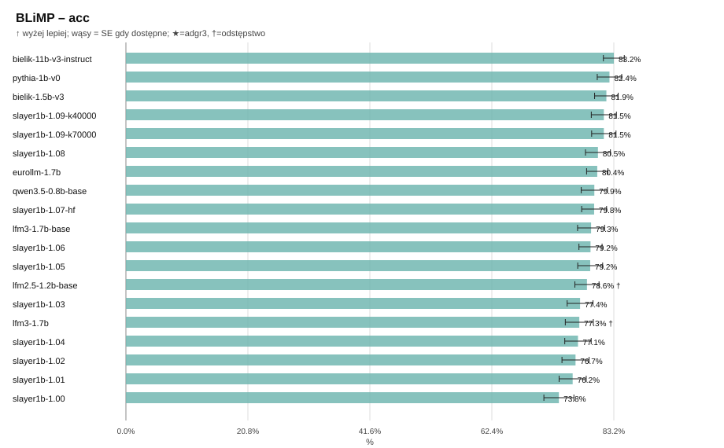

### LAMBADA
Przewidywanie ostatniego słowa fragmentu wymagającego szerokiego kontekstu; metryka acc.
_Predicting the last word of a passage requiring broad context; acc metric._  
Język: en · Metryka: `acc` (↑ wyżej lepiej) · n=5153  
Źródło: [https://github.com/slayerlabs/benchmarks-fabryka-ai/tree/main/research/benchmarks/lambada](https://github.com/slayerlabs/benchmarks-fabryka-ai/tree/main/research/benchmarks/lambada)

| Model | Metryka | Wynik | n | Flagi | Ustawienia | Źródło | Odstępstwa |
|---|---|---|---|---|---|---|---|
| bielik-11b-v3-instruct | acc | 71.4% ± 0.6% | 5153 |  | bfloat16, no BOS | [results.json](https://github.com/slayerlabs/benchmarks-fabryka-ai/blob/a46eabf41b22e9ad80f9bf48a1961dc1c32e4faf/research/results/full-run-2026-11/lambada/bielik-11b-v3-instruct/results.json) | — |
| bielik-1.5b-v3 | acc | 61.1% ± 0.7% | 5153 |  | float32, no BOS | [results.json](https://github.com/slayerlabs/benchmarks-fabryka-ai/blob/a46eabf41b22e9ad80f9bf48a1961dc1c32e4faf/research/results/full-run-2026-11/lambada/bielik-1.5b-v3/results.json) | — |
| pythia-1b-v0 | acc | 56.6% ± 0.7% | 5153 |  | float32, no BOS | [results.json](https://github.com/slayerlabs/benchmarks-fabryka-ai/blob/a46eabf41b22e9ad80f9bf48a1961dc1c32e4faf/research/results/full-run-2026-11/lambada/pythia-1b-v0/results.json) | — |
| eurollm-1.7b | acc | 53.0% ± 0.7% | 5153 |  | float32, no BOS | [results.json](https://github.com/slayerlabs/benchmarks-fabryka-ai/blob/a46eabf41b22e9ad80f9bf48a1961dc1c32e4faf/research/results/full-run-2026-11/lambada/eurollm-1.7b/results.json) | — |
| qwen3.5-0.8b-base | acc | 51.2% ± 0.7% | 5153 |  | float32, no BOS | [results.json](https://github.com/slayerlabs/benchmarks-fabryka-ai/blob/a46eabf41b22e9ad80f9bf48a1961dc1c32e4faf/research/results/full-run-2026-11/lambada/qwen3.5-0.8b-base/results.json) | — |
| lfm3-1.7b-base | acc | 50.7% ± 0.7% | 5153 |  | float32, no BOS | [results.json](https://github.com/slayerlabs/benchmarks-fabryka-ai/blob/a46eabf41b22e9ad80f9bf48a1961dc1c32e4faf/research/results/full-run-2026-11/lambada/lfm3-1.7b-base/results.json) | — |
| slayer1b-1.09-k70000 | acc | 45.8% ± 0.7% | 5153 |  | float32, one BOS | [results.json](https://github.com/slayerlabs/benchmarks-fabryka-ai/blob/a46eabf41b22e9ad80f9bf48a1961dc1c32e4faf/research/results/full-run-2026-11/lambada/slayer1b-1.09-k70000/results.json) | — |
| slayer1b-1.09-k40000 | acc | 45.4% ± 0.7% | 5153 |  | float32, one BOS | [results.json](https://github.com/slayerlabs/benchmarks-fabryka-ai/blob/a46eabf41b22e9ad80f9bf48a1961dc1c32e4faf/research/results/full-run-2026-11/lambada/slayer1b-1.09-k40000/results.json) | — |
| slayer1b-1.07-hf | acc | 41.2% ± 0.7% | 5153 |  | float32, one BOS | [results.json](https://github.com/slayerlabs/benchmarks-fabryka-ai/blob/a46eabf41b22e9ad80f9bf48a1961dc1c32e4faf/research/results/full-run-2026-11/lambada/slayer1b-1.07-hf/results.json) | — |
| lfm3-1.7b | acc | 40.6% ± 0.7% | 5153 | † | float32, no BOS | [results.json](https://github.com/slayerlabs/benchmarks-fabryka-ai/blob/a46eabf41b22e9ad80f9bf48a1961dc1c32e4faf/research/results/full-run-2026-11/lambada/lfm3-1.7b/results.json) | model instruct liczony na surowym tekście, bez chat template; reguła kontekstu: acc_pmi poniżej bazy losowej na 2 testach PMI (ARC-Challenge, PIQA); próg 2 ustalony po obejrzeniu tego przebiegu |
| slayer1b-1.08 | acc | 40.1% ± 0.7% | 5153 |  | float32, one BOS | [results.json](https://github.com/slayerlabs/benchmarks-fabryka-ai/blob/a46eabf41b22e9ad80f9bf48a1961dc1c32e4faf/research/results/full-run-2026-11/lambada/slayer1b-1.08/results.json) | — |
| slayer1b-1.06 | acc | 36.4% ± 0.7% | 5153 |  | float32, one BOS | [results.json](https://github.com/slayerlabs/benchmarks-fabryka-ai/blob/a46eabf41b22e9ad80f9bf48a1961dc1c32e4faf/research/results/full-run-2026-11/lambada/slayer1b-1.06/results.json) | — |
| slayer1b-1.05 | acc | 36.3% ± 0.7% | 5153 |  | float32, one BOS | [results.json](https://github.com/slayerlabs/benchmarks-fabryka-ai/blob/a46eabf41b22e9ad80f9bf48a1961dc1c32e4faf/research/results/full-run-2026-11/lambada/slayer1b-1.05/results.json) | — |
| slayer1b-1.04 | acc | 35.3% ± 0.7% | 5153 |  | float32, one BOS | [results.json](https://github.com/slayerlabs/benchmarks-fabryka-ai/blob/a46eabf41b22e9ad80f9bf48a1961dc1c32e4faf/research/results/full-run-2026-11/lambada/slayer1b-1.04/results.json) | — |
| slayer1b-1.03 | acc | 33.1% ± 0.7% | 5153 |  | float32, one BOS | [results.json](https://github.com/slayerlabs/benchmarks-fabryka-ai/blob/a46eabf41b22e9ad80f9bf48a1961dc1c32e4faf/research/results/full-run-2026-11/lambada/slayer1b-1.03/results.json) | — |
| slayer1b-1.02 | acc | 31.9% ± 0.6% | 5153 |  | float32, one BOS | [results.json](https://github.com/slayerlabs/benchmarks-fabryka-ai/blob/a46eabf41b22e9ad80f9bf48a1961dc1c32e4faf/research/results/full-run-2026-11/lambada/slayer1b-1.02/results.json) | — |
| slayer1b-1.01 | acc | 27.8% ± 0.6% | 5153 |  | float32, one BOS | [results.json](https://github.com/slayerlabs/benchmarks-fabryka-ai/blob/a46eabf41b22e9ad80f9bf48a1961dc1c32e4faf/research/results/full-run-2026-11/lambada/slayer1b-1.01/results.json) | — |
| slayer1b-1.00 | acc | 20.7% ± 0.6% | 5153 |  | float32, one BOS | [results.json](https://github.com/slayerlabs/benchmarks-fabryka-ai/blob/a46eabf41b22e9ad80f9bf48a1961dc1c32e4faf/research/results/full-run-2026-11/lambada/slayer1b-1.00/results.json) | — |
| lfm2.5-1.2b-base | acc | 13.0% ± 0.5% | 5153 | † | float32, no BOS | [results.json](https://github.com/slayerlabs/benchmarks-fabryka-ai/blob/a46eabf41b22e9ad80f9bf48a1961dc1c32e4faf/research/results/full-run-2026-11/lambada/lfm2.5-1.2b-base/results.json) | reguła kontekstu: acc_pmi poniżej bazy losowej na 2 testach PMI (ARC-Challenge, PIQA); próg 2 ustalony po obejrzeniu tego przebiegu; reguła przebiegu centralnego: wynik różni się od results/central-run dla tej samej rewizji i wag |

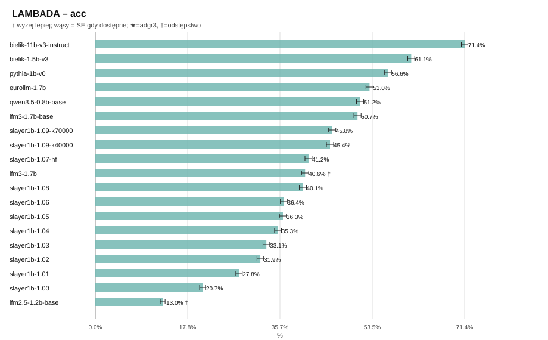

### WikiText-2
Perpleksja bajtowa na WikiText-2 (modelowanie języka). Niżej = lepiej.
_Byte perplexity on WikiText-2 (language modeling). Lower is better._  
Język: en · Metryka: `byte_perplexity` (↓ niżej lepiej) · n=62  
Źródło: [https://github.com/slayerlabs/benchmarks-fabryka-ai/tree/main/research/benchmarks/wikitext-2](https://github.com/slayerlabs/benchmarks-fabryka-ai/tree/main/research/benchmarks/wikitext-2)

| Model | Metryka | Wynik | n | Flagi | Ustawienia | Źródło | Odstępstwa |
|---|---|---|---|---|---|---|---|
| bielik-11b-v3-instruct | byte_perplexity | 1.5659 ± 0.011 | 62 |  | bfloat16, BOS not applicable (empty context or rolling windows) | [results.json](https://github.com/slayerlabs/benchmarks-fabryka-ai/blob/a46eabf41b22e9ad80f9bf48a1961dc1c32e4faf/research/results/full-run-2026-11/wikitext-2/bielik-11b-v3-instruct/results.json) | — |
| eurollm-1.7b | byte_perplexity | 1.6077 ± 0.0137 | 62 |  | float32, BOS not applicable (empty context or rolling windows) | [results.json](https://github.com/slayerlabs/benchmarks-fabryka-ai/blob/a46eabf41b22e9ad80f9bf48a1961dc1c32e4faf/research/results/full-run-2026-11/wikitext-2/eurollm-1.7b/results.json) | — |
| lfm3-1.7b-base | byte_perplexity | 1.6157 ± 0.0142 | 62 |  | float32, BOS not applicable (empty context or rolling windows) | [results.json](https://github.com/slayerlabs/benchmarks-fabryka-ai/blob/a46eabf41b22e9ad80f9bf48a1961dc1c32e4faf/research/results/full-run-2026-11/wikitext-2/lfm3-1.7b-base/results.json) | — |
| bielik-1.5b-v3 | byte_perplexity | 1.6736 ± 0.0109 | 62 |  | float32, BOS not applicable (empty context or rolling windows) | [results.json](https://github.com/slayerlabs/benchmarks-fabryka-ai/blob/a46eabf41b22e9ad80f9bf48a1961dc1c32e4faf/research/results/full-run-2026-11/wikitext-2/bielik-1.5b-v3/results.json) | — |
| pythia-1b-v0 | byte_perplexity | 1.6877 ± 0.0139 | 62 |  | float32, BOS not applicable (empty context or rolling windows) | [results.json](https://github.com/slayerlabs/benchmarks-fabryka-ai/blob/a46eabf41b22e9ad80f9bf48a1961dc1c32e4faf/research/results/full-run-2026-11/wikitext-2/pythia-1b-v0/results.json) | — |
| slayer1b-1.09-k40000 | byte_perplexity | 1.7023 ± 0.0156 | 62 |  | float32, BOS not applicable (empty context or rolling windows) | [results.json](https://github.com/slayerlabs/benchmarks-fabryka-ai/blob/a46eabf41b22e9ad80f9bf48a1961dc1c32e4faf/research/results/full-run-2026-11/wikitext-2/slayer1b-1.09-k40000/results.json) | — |
| slayer1b-1.09-k70000 | byte_perplexity | 1.7141 ± 0.0147 | 62 |  | float32, BOS not applicable (empty context or rolling windows) | [results.json](https://github.com/slayerlabs/benchmarks-fabryka-ai/blob/a46eabf41b22e9ad80f9bf48a1961dc1c32e4faf/research/results/full-run-2026-11/wikitext-2/slayer1b-1.09-k70000/results.json) | — |
| qwen3.5-0.8b-base | byte_perplexity | 1.7174 ± 0.013 | 62 |  | float32, BOS not applicable (empty context or rolling windows) | [results.json](https://github.com/slayerlabs/benchmarks-fabryka-ai/blob/a46eabf41b22e9ad80f9bf48a1961dc1c32e4faf/research/results/full-run-2026-11/wikitext-2/qwen3.5-0.8b-base/results.json) | — |
| lfm3-1.7b | byte_perplexity | 1.7241 ± 0.0152 | 62 | † | float32, BOS not applicable (empty context or rolling windows) | [results.json](https://github.com/slayerlabs/benchmarks-fabryka-ai/blob/a46eabf41b22e9ad80f9bf48a1961dc1c32e4faf/research/results/full-run-2026-11/wikitext-2/lfm3-1.7b/results.json) | model instruct liczony na surowym tekście, bez chat template; reguła kontekstu: acc_pmi poniżej bazy losowej na 2 testach PMI (ARC-Challenge, PIQA); próg 2 ustalony po obejrzeniu tego przebiegu |
| lfm2.5-1.2b-base | byte_perplexity | 1.7348 ± 0.0217 | 62 | † | float32, BOS not applicable (empty context or rolling windows) | [results.json](https://github.com/slayerlabs/benchmarks-fabryka-ai/blob/a46eabf41b22e9ad80f9bf48a1961dc1c32e4faf/research/results/full-run-2026-11/wikitext-2/lfm2.5-1.2b-base/results.json) | reguła kontekstu: acc_pmi poniżej bazy losowej na 2 testach PMI (ARC-Challenge, PIQA); próg 2 ustalony po obejrzeniu tego przebiegu; reguła przebiegu centralnego: wynik różni się od results/central-run dla tej samej rewizji i wag |
| slayer1b-1.08 | byte_perplexity | 1.7802 ± 0.0149 | 62 |  | float32, BOS not applicable (empty context or rolling windows) | [results.json](https://github.com/slayerlabs/benchmarks-fabryka-ai/blob/a46eabf41b22e9ad80f9bf48a1961dc1c32e4faf/research/results/full-run-2026-11/wikitext-2/slayer1b-1.08/results.json) | — |
| slayer1b-1.07-hf | byte_perplexity | 1.7817 ± 0.0147 | 62 |  | float32, BOS not applicable (empty context or rolling windows) | [results.json](https://github.com/slayerlabs/benchmarks-fabryka-ai/blob/a46eabf41b22e9ad80f9bf48a1961dc1c32e4faf/research/results/full-run-2026-11/wikitext-2/slayer1b-1.07-hf/results.json) | — |
| slayer1b-1.06 | byte_perplexity | 1.8463 ± 0.0162 | 62 |  | float32, BOS not applicable (empty context or rolling windows) | [results.json](https://github.com/slayerlabs/benchmarks-fabryka-ai/blob/a46eabf41b22e9ad80f9bf48a1961dc1c32e4faf/research/results/full-run-2026-11/wikitext-2/slayer1b-1.06/results.json) | — |
| slayer1b-1.05 | byte_perplexity | 1.8513 ± 0.0161 | 62 |  | float32, BOS not applicable (empty context or rolling windows) | [results.json](https://github.com/slayerlabs/benchmarks-fabryka-ai/blob/a46eabf41b22e9ad80f9bf48a1961dc1c32e4faf/research/results/full-run-2026-11/wikitext-2/slayer1b-1.05/results.json) | — |
| slayer1b-1.04 | byte_perplexity | 1.8705 ± 0.0163 | 62 |  | float32, BOS not applicable (empty context or rolling windows) | [results.json](https://github.com/slayerlabs/benchmarks-fabryka-ai/blob/a46eabf41b22e9ad80f9bf48a1961dc1c32e4faf/research/results/full-run-2026-11/wikitext-2/slayer1b-1.04/results.json) | — |
| slayer1b-1.03 | byte_perplexity | 1.8988 ± 0.0168 | 62 |  | float32, BOS not applicable (empty context or rolling windows) | [results.json](https://github.com/slayerlabs/benchmarks-fabryka-ai/blob/a46eabf41b22e9ad80f9bf48a1961dc1c32e4faf/research/results/full-run-2026-11/wikitext-2/slayer1b-1.03/results.json) | — |
| slayer1b-1.02 | byte_perplexity | 1.9169 ± 0.0168 | 62 |  | float32, BOS not applicable (empty context or rolling windows) | [results.json](https://github.com/slayerlabs/benchmarks-fabryka-ai/blob/a46eabf41b22e9ad80f9bf48a1961dc1c32e4faf/research/results/full-run-2026-11/wikitext-2/slayer1b-1.02/results.json) | — |
| slayer1b-1.01 | byte_perplexity | 1.9591 ± 0.0178 | 62 |  | float32, BOS not applicable (empty context or rolling windows) | [results.json](https://github.com/slayerlabs/benchmarks-fabryka-ai/blob/a46eabf41b22e9ad80f9bf48a1961dc1c32e4faf/research/results/full-run-2026-11/wikitext-2/slayer1b-1.01/results.json) | — |
| slayer1b-1.00 | byte_perplexity | 2.0706 ± 0.0194 | 62 |  | float32, BOS not applicable (empty context or rolling windows) | [results.json](https://github.com/slayerlabs/benchmarks-fabryka-ai/blob/a46eabf41b22e9ad80f9bf48a1961dc1c32e4faf/research/results/full-run-2026-11/wikitext-2/slayer1b-1.00/results.json) | — |

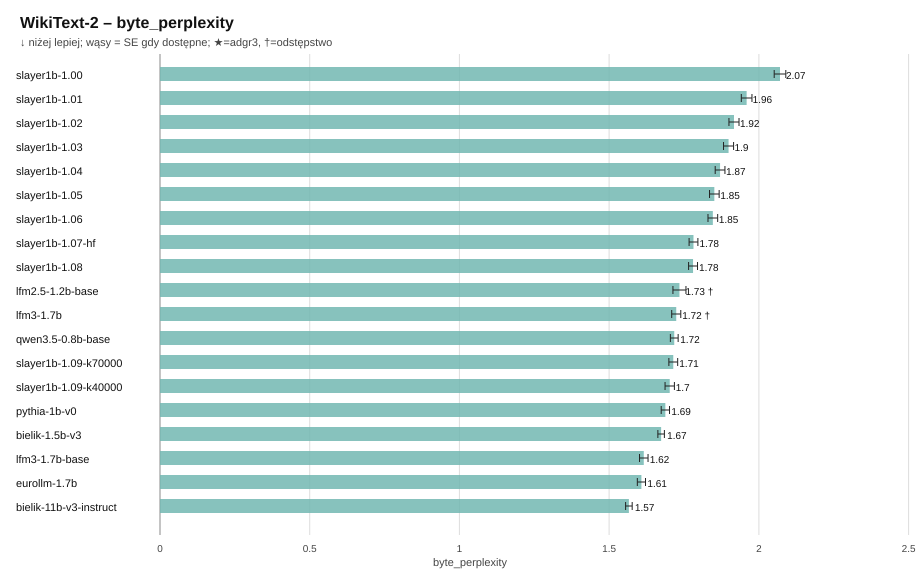

## Slayer w checkpointach / Slayer checkpoints

| Model | Benchmark | Metryka | Wynik | n | Flagi | Źródło |
|---|---|---|---|---|---|---|
| slayer1b-1.00 | ARC-Challenge | acc_norm | 21.8% ± 1.2% | 1172 |  | [results.json](https://github.com/slayerlabs/benchmarks-fabryka-ai/blob/a46eabf41b22e9ad80f9bf48a1961dc1c32e4faf/research/results/full-run-2026-11/arc-challenge/slayer1b-1.00/results.json) |
| slayer1b-1.00 | ARC-Easy | acc | 42.4% ± 1.0% | 2376 |  | [results.json](https://github.com/slayerlabs/benchmarks-fabryka-ai/blob/a46eabf41b22e9ad80f9bf48a1961dc1c32e4faf/research/results/full-run-2026-11/arc-easy/slayer1b-1.00/results.json) |
| slayer1b-1.00 | BLiMP | acc | 73.8% ± 2.6% | 67000 |  | [results.json](https://github.com/slayerlabs/benchmarks-fabryka-ai/blob/a46eabf41b22e9ad80f9bf48a1961dc1c32e4faf/research/results/full-run-2026-11/blimp/slayer1b-1.00/results.json) |
| slayer1b-1.00 | EWoK | ewok | 53.0% ± 0.8% | 4374 |  | [results_rozszerzone.json](https://github.com/slayerlabs/benchmarks-fabryka-ai/blob/a46eabf41b22e9ad80f9bf48a1961dc1c32e4faf/research/results/full-run-2026-11/ewok/slayer1b-1.00/results_rozszerzone.json) |
| slayer1b-1.00 | HellaSwag | acc_norm | 28.5% ± 0.5% | 10042 |  | [results.json](https://github.com/slayerlabs/benchmarks-fabryka-ai/blob/a46eabf41b22e9ad80f9bf48a1961dc1c32e4faf/research/results/full-run-2026-11/hellaswag/slayer1b-1.00/results.json) |
| slayer1b-1.00 | LAMBADA | acc | 20.7% ± 0.6% | 5153 |  | [results.json](https://github.com/slayerlabs/benchmarks-fabryka-ai/blob/a46eabf41b22e9ad80f9bf48a1961dc1c32e4faf/research/results/full-run-2026-11/lambada/slayer1b-1.00/results.json) |
| slayer1b-1.00 | MathQA | acc_norm | 21.0% ± 0.7% | 2985 |  | [results.json](https://github.com/slayerlabs/benchmarks-fabryka-ai/blob/a46eabf41b22e9ad80f9bf48a1961dc1c32e4faf/research/results/full-run-2026-11/mathqa/slayer1b-1.00/results.json) |
| slayer1b-1.00 | MedMCQA | acc | 31.8% ± 0.7% | 4183 |  | [results.json](https://github.com/slayerlabs/benchmarks-fabryka-ai/blob/a46eabf41b22e9ad80f9bf48a1961dc1c32e4faf/research/results/full-run-2026-11/medmcqa/slayer1b-1.00/results.json) |
| slayer1b-1.00 | MultiBLiMP PL | accuracy | 97.9829 ± 0.2458 | 3272 |  | [results.json](https://github.com/slayerlabs/benchmarks-fabryka-ai/blob/a46eabf41b22e9ad80f9bf48a1961dc1c32e4faf/research/results/full-run-2026-11/multiblimp-pl/slayer1b-1.00/results.json) |
| slayer1b-1.00 | PIQA | acc_norm | 57.6% ± 1.2% | 1838 |  | [results.json](https://github.com/slayerlabs/benchmarks-fabryka-ai/blob/a46eabf41b22e9ad80f9bf48a1961dc1c32e4faf/research/results/full-run-2026-11/piqa/slayer1b-1.00/results.json) |
| slayer1b-1.00 | PubMedQA | acc | 49.8% ± 2.2% | 500 |  | [results.json](https://github.com/slayerlabs/benchmarks-fabryka-ai/blob/a46eabf41b22e9ad80f9bf48a1961dc1c32e4faf/research/results/full-run-2026-11/pubmedqa/slayer1b-1.00/results.json) |
| slayer1b-1.00 | Social IQa | acc | 35.8% ± 1.1% | 1954 |  | [results.json](https://github.com/slayerlabs/benchmarks-fabryka-ai/blob/a46eabf41b22e9ad80f9bf48a1961dc1c32e4faf/research/results/full-run-2026-11/social-iqa/slayer1b-1.00/results.json) |
| slayer1b-1.00 | WikiText-2 | byte_perplexity | 2.0706 ± 0.0194 | 62 |  | [results.json](https://github.com/slayerlabs/benchmarks-fabryka-ai/blob/a46eabf41b22e9ad80f9bf48a1961dc1c32e4faf/research/results/full-run-2026-11/wikitext-2/slayer1b-1.00/results.json) |
| slayer1b-1.00 | WinoGrande | acc | 50.5% ± 1.3% | 1267 |  | [results.json](https://github.com/slayerlabs/benchmarks-fabryka-ai/blob/a46eabf41b22e9ad80f9bf48a1961dc1c32e4faf/research/results/full-run-2026-11/winogrande/slayer1b-1.00/results.json) |
| slayer1b-1.00 | WSC273 | acc | 53.8% ± 2.0% | 273 |  | [results.json](https://github.com/slayerlabs/benchmarks-fabryka-ai/blob/a46eabf41b22e9ad80f9bf48a1961dc1c32e4faf/research/results/full-run-2026-11/wsc273/slayer1b-1.00/results.json) |
| slayer1b-1.01 | ARC-Challenge | acc_norm | 24.1% ± 1.3% | 1172 |  | [results.json](https://github.com/slayerlabs/benchmarks-fabryka-ai/blob/a46eabf41b22e9ad80f9bf48a1961dc1c32e4faf/research/results/full-run-2026-11/arc-challenge/slayer1b-1.01/results.json) |
| slayer1b-1.01 | ARC-Easy | acc | 47.3% ± 1.0% | 2376 |  | [results.json](https://github.com/slayerlabs/benchmarks-fabryka-ai/blob/a46eabf41b22e9ad80f9bf48a1961dc1c32e4faf/research/results/full-run-2026-11/arc-easy/slayer1b-1.01/results.json) |
| slayer1b-1.01 | BLiMP | acc | 76.2% ± 2.3% | 67000 |  | [results.json](https://github.com/slayerlabs/benchmarks-fabryka-ai/blob/a46eabf41b22e9ad80f9bf48a1961dc1c32e4faf/research/results/full-run-2026-11/blimp/slayer1b-1.01/results.json) |
| slayer1b-1.01 | EWoK | ewok | 55.4% ± 0.8% | 4374 |  | [results_rozszerzone.json](https://github.com/slayerlabs/benchmarks-fabryka-ai/blob/a46eabf41b22e9ad80f9bf48a1961dc1c32e4faf/research/results/full-run-2026-11/ewok/slayer1b-1.01/results_rozszerzone.json) |
| slayer1b-1.01 | HellaSwag | acc_norm | 30.8% ± 0.5% | 10042 |  | [results.json](https://github.com/slayerlabs/benchmarks-fabryka-ai/blob/a46eabf41b22e9ad80f9bf48a1961dc1c32e4faf/research/results/full-run-2026-11/hellaswag/slayer1b-1.01/results.json) |
| slayer1b-1.01 | LAMBADA | acc | 27.8% ± 0.6% | 5153 |  | [results.json](https://github.com/slayerlabs/benchmarks-fabryka-ai/blob/a46eabf41b22e9ad80f9bf48a1961dc1c32e4faf/research/results/full-run-2026-11/lambada/slayer1b-1.01/results.json) |
| slayer1b-1.01 | MathQA | acc_norm | 21.6% ± 0.8% | 2985 |  | [results.json](https://github.com/slayerlabs/benchmarks-fabryka-ai/blob/a46eabf41b22e9ad80f9bf48a1961dc1c32e4faf/research/results/full-run-2026-11/mathqa/slayer1b-1.01/results.json) |
| slayer1b-1.01 | MedMCQA | acc | 31.3% ± 0.7% | 4183 |  | [results.json](https://github.com/slayerlabs/benchmarks-fabryka-ai/blob/a46eabf41b22e9ad80f9bf48a1961dc1c32e4faf/research/results/full-run-2026-11/medmcqa/slayer1b-1.01/results.json) |
| slayer1b-1.01 | MultiBLiMP PL | accuracy | 98.5024 ± 0.2124 | 3272 |  | [results.json](https://github.com/slayerlabs/benchmarks-fabryka-ai/blob/a46eabf41b22e9ad80f9bf48a1961dc1c32e4faf/research/results/full-run-2026-11/multiblimp-pl/slayer1b-1.01/results.json) |
| slayer1b-1.01 | PIQA | acc_norm | 58.8% ± 1.1% | 1838 |  | [results.json](https://github.com/slayerlabs/benchmarks-fabryka-ai/blob/a46eabf41b22e9ad80f9bf48a1961dc1c32e4faf/research/results/full-run-2026-11/piqa/slayer1b-1.01/results.json) |
| slayer1b-1.01 | PubMedQA | acc | 54.4% ± 2.2% | 500 |  | [results.json](https://github.com/slayerlabs/benchmarks-fabryka-ai/blob/a46eabf41b22e9ad80f9bf48a1961dc1c32e4faf/research/results/full-run-2026-11/pubmedqa/slayer1b-1.01/results.json) |
| slayer1b-1.01 | Social IQa | acc | 35.8% ± 1.1% | 1954 |  | [results.json](https://github.com/slayerlabs/benchmarks-fabryka-ai/blob/a46eabf41b22e9ad80f9bf48a1961dc1c32e4faf/research/results/full-run-2026-11/social-iqa/slayer1b-1.01/results.json) |
| slayer1b-1.01 | WikiText-2 | byte_perplexity | 1.9591 ± 0.0178 | 62 |  | [results.json](https://github.com/slayerlabs/benchmarks-fabryka-ai/blob/a46eabf41b22e9ad80f9bf48a1961dc1c32e4faf/research/results/full-run-2026-11/wikitext-2/slayer1b-1.01/results.json) |
| slayer1b-1.01 | WinoGrande | acc | 52.0% ± 1.3% | 1267 |  | [results.json](https://github.com/slayerlabs/benchmarks-fabryka-ai/blob/a46eabf41b22e9ad80f9bf48a1961dc1c32e4faf/research/results/full-run-2026-11/winogrande/slayer1b-1.01/results.json) |
| slayer1b-1.01 | WSC273 | acc | 55.3% ± 2.1% | 273 |  | [results.json](https://github.com/slayerlabs/benchmarks-fabryka-ai/blob/a46eabf41b22e9ad80f9bf48a1961dc1c32e4faf/research/results/full-run-2026-11/wsc273/slayer1b-1.01/results.json) |
| slayer1b-1.02 | ARC-Challenge | acc_norm | 24.7% ± 1.3% | 1172 |  | [results.json](https://github.com/slayerlabs/benchmarks-fabryka-ai/blob/a46eabf41b22e9ad80f9bf48a1961dc1c32e4faf/research/results/full-run-2026-11/arc-challenge/slayer1b-1.02/results.json) |
| slayer1b-1.02 | ARC-Easy | acc | 48.4% ± 1.0% | 2376 |  | [results.json](https://github.com/slayerlabs/benchmarks-fabryka-ai/blob/a46eabf41b22e9ad80f9bf48a1961dc1c32e4faf/research/results/full-run-2026-11/arc-easy/slayer1b-1.02/results.json) |
| slayer1b-1.02 | BLiMP | acc | 76.7% ± 2.3% | 67000 |  | [results.json](https://github.com/slayerlabs/benchmarks-fabryka-ai/blob/a46eabf41b22e9ad80f9bf48a1961dc1c32e4faf/research/results/full-run-2026-11/blimp/slayer1b-1.02/results.json) |
| slayer1b-1.02 | EWoK | ewok | 56.2% ± 0.8% | 4374 |  | [results_rozszerzone.json](https://github.com/slayerlabs/benchmarks-fabryka-ai/blob/a46eabf41b22e9ad80f9bf48a1961dc1c32e4faf/research/results/full-run-2026-11/ewok/slayer1b-1.02/results_rozszerzone.json) |
| slayer1b-1.02 | HellaSwag | acc_norm | 34.0% ± 0.5% | 10042 |  | [results.json](https://github.com/slayerlabs/benchmarks-fabryka-ai/blob/a46eabf41b22e9ad80f9bf48a1961dc1c32e4faf/research/results/full-run-2026-11/hellaswag/slayer1b-1.02/results.json) |
| slayer1b-1.02 | LAMBADA | acc | 31.9% ± 0.6% | 5153 |  | [results.json](https://github.com/slayerlabs/benchmarks-fabryka-ai/blob/a46eabf41b22e9ad80f9bf48a1961dc1c32e4faf/research/results/full-run-2026-11/lambada/slayer1b-1.02/results.json) |
| slayer1b-1.02 | MathQA | acc_norm | 21.7% ± 0.8% | 2985 |  | [results.json](https://github.com/slayerlabs/benchmarks-fabryka-ai/blob/a46eabf41b22e9ad80f9bf48a1961dc1c32e4faf/research/results/full-run-2026-11/mathqa/slayer1b-1.02/results.json) |
| slayer1b-1.02 | MedMCQA | acc | 31.7% ± 0.7% | 4183 |  | [results.json](https://github.com/slayerlabs/benchmarks-fabryka-ai/blob/a46eabf41b22e9ad80f9bf48a1961dc1c32e4faf/research/results/full-run-2026-11/medmcqa/slayer1b-1.02/results.json) |
| slayer1b-1.02 | MultiBLiMP PL | accuracy | 98.6858 ± 0.1991 | 3272 |  | [results.json](https://github.com/slayerlabs/benchmarks-fabryka-ai/blob/a46eabf41b22e9ad80f9bf48a1961dc1c32e4faf/research/results/full-run-2026-11/multiblimp-pl/slayer1b-1.02/results.json) |
| slayer1b-1.02 | PIQA | acc_norm | 60.6% ± 1.1% | 1838 |  | [results.json](https://github.com/slayerlabs/benchmarks-fabryka-ai/blob/a46eabf41b22e9ad80f9bf48a1961dc1c32e4faf/research/results/full-run-2026-11/piqa/slayer1b-1.02/results.json) |
| slayer1b-1.02 | PubMedQA | acc | 53.8% ± 2.2% | 500 |  | [results.json](https://github.com/slayerlabs/benchmarks-fabryka-ai/blob/a46eabf41b22e9ad80f9bf48a1961dc1c32e4faf/research/results/full-run-2026-11/pubmedqa/slayer1b-1.02/results.json) |
| slayer1b-1.02 | Social IQa | acc | 36.9% ± 1.1% | 1954 |  | [results.json](https://github.com/slayerlabs/benchmarks-fabryka-ai/blob/a46eabf41b22e9ad80f9bf48a1961dc1c32e4faf/research/results/full-run-2026-11/social-iqa/slayer1b-1.02/results.json) |
| slayer1b-1.02 | WikiText-2 | byte_perplexity | 1.9169 ± 0.0168 | 62 |  | [results.json](https://github.com/slayerlabs/benchmarks-fabryka-ai/blob/a46eabf41b22e9ad80f9bf48a1961dc1c32e4faf/research/results/full-run-2026-11/wikitext-2/slayer1b-1.02/results.json) |
| slayer1b-1.02 | WinoGrande | acc | 51.1% ± 1.2% | 1267 |  | [results.json](https://github.com/slayerlabs/benchmarks-fabryka-ai/blob/a46eabf41b22e9ad80f9bf48a1961dc1c32e4faf/research/results/full-run-2026-11/winogrande/slayer1b-1.02/results.json) |
| slayer1b-1.02 | WSC273 | acc | 57.1% ± 2.2% | 273 |  | [results.json](https://github.com/slayerlabs/benchmarks-fabryka-ai/blob/a46eabf41b22e9ad80f9bf48a1961dc1c32e4faf/research/results/full-run-2026-11/wsc273/slayer1b-1.02/results.json) |
| slayer1b-1.03 | ARC-Challenge | acc_norm | 25.6% ± 1.3% | 1172 |  | [results.json](https://github.com/slayerlabs/benchmarks-fabryka-ai/blob/a46eabf41b22e9ad80f9bf48a1961dc1c32e4faf/research/results/full-run-2026-11/arc-challenge/slayer1b-1.03/results.json) |
| slayer1b-1.03 | ARC-Easy | acc | 49.5% ± 1.0% | 2376 |  | [results.json](https://github.com/slayerlabs/benchmarks-fabryka-ai/blob/a46eabf41b22e9ad80f9bf48a1961dc1c32e4faf/research/results/full-run-2026-11/arc-easy/slayer1b-1.03/results.json) |
| slayer1b-1.03 | BLiMP | acc | 77.4% ± 2.2% | 67000 |  | [results.json](https://github.com/slayerlabs/benchmarks-fabryka-ai/blob/a46eabf41b22e9ad80f9bf48a1961dc1c32e4faf/research/results/full-run-2026-11/blimp/slayer1b-1.03/results.json) |
| slayer1b-1.03 | EWoK | ewok | 56.6% ± 0.8% | 4374 |  | [results_rozszerzone.json](https://github.com/slayerlabs/benchmarks-fabryka-ai/blob/a46eabf41b22e9ad80f9bf48a1961dc1c32e4faf/research/results/full-run-2026-11/ewok/slayer1b-1.03/results_rozszerzone.json) |
| slayer1b-1.03 | HellaSwag | acc_norm | 35.1% ± 0.5% | 10042 |  | [results.json](https://github.com/slayerlabs/benchmarks-fabryka-ai/blob/a46eabf41b22e9ad80f9bf48a1961dc1c32e4faf/research/results/full-run-2026-11/hellaswag/slayer1b-1.03/results.json) |
| slayer1b-1.03 | LAMBADA | acc | 33.1% ± 0.7% | 5153 |  | [results.json](https://github.com/slayerlabs/benchmarks-fabryka-ai/blob/a46eabf41b22e9ad80f9bf48a1961dc1c32e4faf/research/results/full-run-2026-11/lambada/slayer1b-1.03/results.json) |
| slayer1b-1.03 | MathQA | acc_norm | 21.5% ± 0.8% | 2985 |  | [results.json](https://github.com/slayerlabs/benchmarks-fabryka-ai/blob/a46eabf41b22e9ad80f9bf48a1961dc1c32e4faf/research/results/full-run-2026-11/mathqa/slayer1b-1.03/results.json) |
| slayer1b-1.03 | MedMCQA | acc | 32.1% ± 0.7% | 4183 |  | [results.json](https://github.com/slayerlabs/benchmarks-fabryka-ai/blob/a46eabf41b22e9ad80f9bf48a1961dc1c32e4faf/research/results/full-run-2026-11/medmcqa/slayer1b-1.03/results.json) |
| slayer1b-1.03 | MultiBLiMP PL | accuracy | 98.5636 ± 0.208 | 3272 |  | [results.json](https://github.com/slayerlabs/benchmarks-fabryka-ai/blob/a46eabf41b22e9ad80f9bf48a1961dc1c32e4faf/research/results/full-run-2026-11/multiblimp-pl/slayer1b-1.03/results.json) |
| slayer1b-1.03 | PIQA | acc_norm | 62.2% ± 1.1% | 1838 |  | [results.json](https://github.com/slayerlabs/benchmarks-fabryka-ai/blob/a46eabf41b22e9ad80f9bf48a1961dc1c32e4faf/research/results/full-run-2026-11/piqa/slayer1b-1.03/results.json) |
| slayer1b-1.03 | PubMedQA | acc | 52.4% ± 2.2% | 500 |  | [results.json](https://github.com/slayerlabs/benchmarks-fabryka-ai/blob/a46eabf41b22e9ad80f9bf48a1961dc1c32e4faf/research/results/full-run-2026-11/pubmedqa/slayer1b-1.03/results.json) |
| slayer1b-1.03 | Social IQa | acc | 37.4% ± 1.1% | 1954 |  | [results.json](https://github.com/slayerlabs/benchmarks-fabryka-ai/blob/a46eabf41b22e9ad80f9bf48a1961dc1c32e4faf/research/results/full-run-2026-11/social-iqa/slayer1b-1.03/results.json) |
| slayer1b-1.03 | WikiText-2 | byte_perplexity | 1.8988 ± 0.0168 | 62 |  | [results.json](https://github.com/slayerlabs/benchmarks-fabryka-ai/blob/a46eabf41b22e9ad80f9bf48a1961dc1c32e4faf/research/results/full-run-2026-11/wikitext-2/slayer1b-1.03/results.json) |
| slayer1b-1.03 | WinoGrande | acc | 53.5% ± 1.3% | 1267 |  | [results.json](https://github.com/slayerlabs/benchmarks-fabryka-ai/blob/a46eabf41b22e9ad80f9bf48a1961dc1c32e4faf/research/results/full-run-2026-11/winogrande/slayer1b-1.03/results.json) |
| slayer1b-1.03 | WSC273 | acc | 56.0% ± 2.2% | 273 |  | [results.json](https://github.com/slayerlabs/benchmarks-fabryka-ai/blob/a46eabf41b22e9ad80f9bf48a1961dc1c32e4faf/research/results/full-run-2026-11/wsc273/slayer1b-1.03/results.json) |
| slayer1b-1.04 | ARC-Challenge | acc_norm | 25.5% ± 1.3% | 1172 |  | [results.json](https://github.com/slayerlabs/benchmarks-fabryka-ai/blob/a46eabf41b22e9ad80f9bf48a1961dc1c32e4faf/research/results/full-run-2026-11/arc-challenge/slayer1b-1.04/results.json) |
| slayer1b-1.04 | ARC-Easy | acc | 51.5% ± 1.0% | 2376 |  | [results.json](https://github.com/slayerlabs/benchmarks-fabryka-ai/blob/a46eabf41b22e9ad80f9bf48a1961dc1c32e4faf/research/results/full-run-2026-11/arc-easy/slayer1b-1.04/results.json) |
| slayer1b-1.04 | BLiMP | acc | 77.1% ± 2.3% | 67000 |  | [results.json](https://github.com/slayerlabs/benchmarks-fabryka-ai/blob/a46eabf41b22e9ad80f9bf48a1961dc1c32e4faf/research/results/full-run-2026-11/blimp/slayer1b-1.04/results.json) |
| slayer1b-1.04 | EWoK | ewok | 57.4% ± 0.7% | 4374 |  | [results_rozszerzone.json](https://github.com/slayerlabs/benchmarks-fabryka-ai/blob/a46eabf41b22e9ad80f9bf48a1961dc1c32e4faf/research/results/full-run-2026-11/ewok/slayer1b-1.04/results_rozszerzone.json) |
| slayer1b-1.04 | HellaSwag | acc_norm | 36.7% ± 0.5% | 10042 |  | [results.json](https://github.com/slayerlabs/benchmarks-fabryka-ai/blob/a46eabf41b22e9ad80f9bf48a1961dc1c32e4faf/research/results/full-run-2026-11/hellaswag/slayer1b-1.04/results.json) |
| slayer1b-1.04 | LAMBADA | acc | 35.3% ± 0.7% | 5153 |  | [results.json](https://github.com/slayerlabs/benchmarks-fabryka-ai/blob/a46eabf41b22e9ad80f9bf48a1961dc1c32e4faf/research/results/full-run-2026-11/lambada/slayer1b-1.04/results.json) |
| slayer1b-1.04 | MathQA | acc_norm | 20.9% ± 0.7% | 2985 |  | [results.json](https://github.com/slayerlabs/benchmarks-fabryka-ai/blob/a46eabf41b22e9ad80f9bf48a1961dc1c32e4faf/research/results/full-run-2026-11/mathqa/slayer1b-1.04/results.json) |
| slayer1b-1.04 | MedMCQA | acc | 31.1% ± 0.7% | 4183 |  | [results.json](https://github.com/slayerlabs/benchmarks-fabryka-ai/blob/a46eabf41b22e9ad80f9bf48a1961dc1c32e4faf/research/results/full-run-2026-11/medmcqa/slayer1b-1.04/results.json) |
| slayer1b-1.04 | MultiBLiMP PL | accuracy | 99.2359 ± 0.1523 | 3272 |  | [results.json](https://github.com/slayerlabs/benchmarks-fabryka-ai/blob/a46eabf41b22e9ad80f9bf48a1961dc1c32e4faf/research/results/full-run-2026-11/multiblimp-pl/slayer1b-1.04/results.json) |
| slayer1b-1.04 | PIQA | acc_norm | 62.6% ± 1.1% | 1838 |  | [results.json](https://github.com/slayerlabs/benchmarks-fabryka-ai/blob/a46eabf41b22e9ad80f9bf48a1961dc1c32e4faf/research/results/full-run-2026-11/piqa/slayer1b-1.04/results.json) |
| slayer1b-1.04 | PubMedQA | acc | 52.8% ± 2.2% | 500 |  | [results.json](https://github.com/slayerlabs/benchmarks-fabryka-ai/blob/a46eabf41b22e9ad80f9bf48a1961dc1c32e4faf/research/results/full-run-2026-11/pubmedqa/slayer1b-1.04/results.json) |
| slayer1b-1.04 | Social IQa | acc | 38.0% ± 1.1% | 1954 |  | [results.json](https://github.com/slayerlabs/benchmarks-fabryka-ai/blob/a46eabf41b22e9ad80f9bf48a1961dc1c32e4faf/research/results/full-run-2026-11/social-iqa/slayer1b-1.04/results.json) |
| slayer1b-1.04 | WikiText-2 | byte_perplexity | 1.8705 ± 0.0163 | 62 |  | [results.json](https://github.com/slayerlabs/benchmarks-fabryka-ai/blob/a46eabf41b22e9ad80f9bf48a1961dc1c32e4faf/research/results/full-run-2026-11/wikitext-2/slayer1b-1.04/results.json) |
| slayer1b-1.04 | WinoGrande | acc | 51.1% ± 1.3% | 1267 |  | [results.json](https://github.com/slayerlabs/benchmarks-fabryka-ai/blob/a46eabf41b22e9ad80f9bf48a1961dc1c32e4faf/research/results/full-run-2026-11/winogrande/slayer1b-1.04/results.json) |
| slayer1b-1.04 | WSC273 | acc | 56.0% ± 2.2% | 273 |  | [results.json](https://github.com/slayerlabs/benchmarks-fabryka-ai/blob/a46eabf41b22e9ad80f9bf48a1961dc1c32e4faf/research/results/full-run-2026-11/wsc273/slayer1b-1.04/results.json) |
| slayer1b-1.05 | ARC-Challenge | acc_norm | 26.0% ± 1.3% | 1172 |  | [results.json](https://github.com/slayerlabs/benchmarks-fabryka-ai/blob/a46eabf41b22e9ad80f9bf48a1961dc1c32e4faf/research/results/full-run-2026-11/arc-challenge/slayer1b-1.05/results.json) |
| slayer1b-1.05 | ARC-Easy | acc | 53.2% ± 1.0% | 2376 |  | [results.json](https://github.com/slayerlabs/benchmarks-fabryka-ai/blob/a46eabf41b22e9ad80f9bf48a1961dc1c32e4faf/research/results/full-run-2026-11/arc-easy/slayer1b-1.05/results.json) |
| slayer1b-1.05 | BLiMP | acc | 79.2% ± 2.1% | 67000 |  | [results.json](https://github.com/slayerlabs/benchmarks-fabryka-ai/blob/a46eabf41b22e9ad80f9bf48a1961dc1c32e4faf/research/results/full-run-2026-11/blimp/slayer1b-1.05/results.json) |
| slayer1b-1.05 | EWoK | ewok | 58.4% ± 0.7% | 4374 |  | [results_rozszerzone.json](https://github.com/slayerlabs/benchmarks-fabryka-ai/blob/a46eabf41b22e9ad80f9bf48a1961dc1c32e4faf/research/results/full-run-2026-11/ewok/slayer1b-1.05/results_rozszerzone.json) |
| slayer1b-1.05 | HellaSwag | acc_norm | 38.2% ± 0.5% | 10042 |  | [results.json](https://github.com/slayerlabs/benchmarks-fabryka-ai/blob/a46eabf41b22e9ad80f9bf48a1961dc1c32e4faf/research/results/full-run-2026-11/hellaswag/slayer1b-1.05/results.json) |
| slayer1b-1.05 | LAMBADA | acc | 36.3% ± 0.7% | 5153 |  | [results.json](https://github.com/slayerlabs/benchmarks-fabryka-ai/blob/a46eabf41b22e9ad80f9bf48a1961dc1c32e4faf/research/results/full-run-2026-11/lambada/slayer1b-1.05/results.json) |
| slayer1b-1.05 | MathQA | acc_norm | 21.6% ± 0.8% | 2985 |  | [results.json](https://github.com/slayerlabs/benchmarks-fabryka-ai/blob/a46eabf41b22e9ad80f9bf48a1961dc1c32e4faf/research/results/full-run-2026-11/mathqa/slayer1b-1.05/results.json) |
| slayer1b-1.05 | MedMCQA | acc | 31.5% ± 0.7% | 4183 |  | [results.json](https://github.com/slayerlabs/benchmarks-fabryka-ai/blob/a46eabf41b22e9ad80f9bf48a1961dc1c32e4faf/research/results/full-run-2026-11/medmcqa/slayer1b-1.05/results.json) |
| slayer1b-1.05 | MultiBLiMP PL | accuracy | 98.7469 ± 0.1945 | 3272 |  | [results.json](https://github.com/slayerlabs/benchmarks-fabryka-ai/blob/a46eabf41b22e9ad80f9bf48a1961dc1c32e4faf/research/results/full-run-2026-11/multiblimp-pl/slayer1b-1.05/results.json) |
| slayer1b-1.05 | PIQA | acc_norm | 63.8% ± 1.1% | 1838 |  | [results.json](https://github.com/slayerlabs/benchmarks-fabryka-ai/blob/a46eabf41b22e9ad80f9bf48a1961dc1c32e4faf/research/results/full-run-2026-11/piqa/slayer1b-1.05/results.json) |
| slayer1b-1.05 | PubMedQA | acc | 50.0% ± 2.2% | 500 |  | [results.json](https://github.com/slayerlabs/benchmarks-fabryka-ai/blob/a46eabf41b22e9ad80f9bf48a1961dc1c32e4faf/research/results/full-run-2026-11/pubmedqa/slayer1b-1.05/results.json) |
| slayer1b-1.05 | Social IQa | acc | 39.0% ± 1.1% | 1954 |  | [results.json](https://github.com/slayerlabs/benchmarks-fabryka-ai/blob/a46eabf41b22e9ad80f9bf48a1961dc1c32e4faf/research/results/full-run-2026-11/social-iqa/slayer1b-1.05/results.json) |
| slayer1b-1.05 | WikiText-2 | byte_perplexity | 1.8513 ± 0.0161 | 62 |  | [results.json](https://github.com/slayerlabs/benchmarks-fabryka-ai/blob/a46eabf41b22e9ad80f9bf48a1961dc1c32e4faf/research/results/full-run-2026-11/wikitext-2/slayer1b-1.05/results.json) |
| slayer1b-1.05 | WinoGrande | acc | 52.2% ± 1.2% | 1267 |  | [results.json](https://github.com/slayerlabs/benchmarks-fabryka-ai/blob/a46eabf41b22e9ad80f9bf48a1961dc1c32e4faf/research/results/full-run-2026-11/winogrande/slayer1b-1.05/results.json) |
| slayer1b-1.05 | WSC273 | acc | 58.6% ± 2.2% | 273 |  | [results.json](https://github.com/slayerlabs/benchmarks-fabryka-ai/blob/a46eabf41b22e9ad80f9bf48a1961dc1c32e4faf/research/results/full-run-2026-11/wsc273/slayer1b-1.05/results.json) |
| slayer1b-1.06 | ARC-Challenge | acc_norm | 25.8% ± 1.3% | 1172 |  | [results.json](https://github.com/slayerlabs/benchmarks-fabryka-ai/blob/a46eabf41b22e9ad80f9bf48a1961dc1c32e4faf/research/results/full-run-2026-11/arc-challenge/slayer1b-1.06/results.json) |
| slayer1b-1.06 | ARC-Easy | acc | 52.6% ± 1.0% | 2376 |  | [results.json](https://github.com/slayerlabs/benchmarks-fabryka-ai/blob/a46eabf41b22e9ad80f9bf48a1961dc1c32e4faf/research/results/full-run-2026-11/arc-easy/slayer1b-1.06/results.json) |
| slayer1b-1.06 | BLiMP | acc | 79.2% ± 2.0% | 67000 |  | [results.json](https://github.com/slayerlabs/benchmarks-fabryka-ai/blob/a46eabf41b22e9ad80f9bf48a1961dc1c32e4faf/research/results/full-run-2026-11/blimp/slayer1b-1.06/results.json) |
| slayer1b-1.06 | EWoK | ewok | 59.0% ± 0.7% | 4374 |  | [results_rozszerzone.json](https://github.com/slayerlabs/benchmarks-fabryka-ai/blob/a46eabf41b22e9ad80f9bf48a1961dc1c32e4faf/research/results/full-run-2026-11/ewok/slayer1b-1.06/results_rozszerzone.json) |
| slayer1b-1.06 | HellaSwag | acc_norm | 39.3% ± 0.5% | 10042 |  | [results.json](https://github.com/slayerlabs/benchmarks-fabryka-ai/blob/a46eabf41b22e9ad80f9bf48a1961dc1c32e4faf/research/results/full-run-2026-11/hellaswag/slayer1b-1.06/results.json) |
| slayer1b-1.06 | LAMBADA | acc | 36.4% ± 0.7% | 5153 |  | [results.json](https://github.com/slayerlabs/benchmarks-fabryka-ai/blob/a46eabf41b22e9ad80f9bf48a1961dc1c32e4faf/research/results/full-run-2026-11/lambada/slayer1b-1.06/results.json) |
| slayer1b-1.06 | MathQA | acc_norm | 21.9% ± 0.8% | 2985 |  | [results.json](https://github.com/slayerlabs/benchmarks-fabryka-ai/blob/a46eabf41b22e9ad80f9bf48a1961dc1c32e4faf/research/results/full-run-2026-11/mathqa/slayer1b-1.06/results.json) |
| slayer1b-1.06 | MedMCQA | acc | 31.6% ± 0.7% | 4183 |  | [results.json](https://github.com/slayerlabs/benchmarks-fabryka-ai/blob/a46eabf41b22e9ad80f9bf48a1961dc1c32e4faf/research/results/full-run-2026-11/medmcqa/slayer1b-1.06/results.json) |
| slayer1b-1.06 | MultiBLiMP PL | accuracy | 98.5941 ± 0.2059 | 3272 |  | [results.json](https://github.com/slayerlabs/benchmarks-fabryka-ai/blob/a46eabf41b22e9ad80f9bf48a1961dc1c32e4faf/research/results/full-run-2026-11/multiblimp-pl/slayer1b-1.06/results.json) |
| slayer1b-1.06 | PIQA | acc_norm | 64.1% ± 1.1% | 1838 |  | [results.json](https://github.com/slayerlabs/benchmarks-fabryka-ai/blob/a46eabf41b22e9ad80f9bf48a1961dc1c32e4faf/research/results/full-run-2026-11/piqa/slayer1b-1.06/results.json) |
| slayer1b-1.06 | PubMedQA | acc | 47.6% ± 2.2% | 500 |  | [results.json](https://github.com/slayerlabs/benchmarks-fabryka-ai/blob/a46eabf41b22e9ad80f9bf48a1961dc1c32e4faf/research/results/full-run-2026-11/pubmedqa/slayer1b-1.06/results.json) |
| slayer1b-1.06 | Social IQa | acc | 38.9% ± 1.1% | 1954 |  | [results.json](https://github.com/slayerlabs/benchmarks-fabryka-ai/blob/a46eabf41b22e9ad80f9bf48a1961dc1c32e4faf/research/results/full-run-2026-11/social-iqa/slayer1b-1.06/results.json) |
| slayer1b-1.06 | WikiText-2 | byte_perplexity | 1.8463 ± 0.0162 | 62 |  | [results.json](https://github.com/slayerlabs/benchmarks-fabryka-ai/blob/a46eabf41b22e9ad80f9bf48a1961dc1c32e4faf/research/results/full-run-2026-11/wikitext-2/slayer1b-1.06/results.json) |
| slayer1b-1.06 | WinoGrande | acc | 52.2% ± 1.2% | 1267 |  | [results.json](https://github.com/slayerlabs/benchmarks-fabryka-ai/blob/a46eabf41b22e9ad80f9bf48a1961dc1c32e4faf/research/results/full-run-2026-11/winogrande/slayer1b-1.06/results.json) |
| slayer1b-1.06 | WSC273 | acc | 59.0% ± 2.0% | 273 |  | [results.json](https://github.com/slayerlabs/benchmarks-fabryka-ai/blob/a46eabf41b22e9ad80f9bf48a1961dc1c32e4faf/research/results/full-run-2026-11/wsc273/slayer1b-1.06/results.json) |
| slayer1b-1.07-hf | ARC-Challenge | acc_norm | 27.3% ± 1.3% | 1172 |  | [results.json](https://github.com/slayerlabs/benchmarks-fabryka-ai/blob/a46eabf41b22e9ad80f9bf48a1961dc1c32e4faf/research/results/full-run-2026-11/arc-challenge/slayer1b-1.07-hf/results.json) |
| slayer1b-1.07-hf | ARC-Easy | acc | 59.8% ± 1.0% | 2376 |  | [results.json](https://github.com/slayerlabs/benchmarks-fabryka-ai/blob/a46eabf41b22e9ad80f9bf48a1961dc1c32e4faf/research/results/full-run-2026-11/arc-easy/slayer1b-1.07-hf/results.json) |
| slayer1b-1.07-hf | BLiMP | acc | 79.8% ± 2.1% | 67000 |  | [results.json](https://github.com/slayerlabs/benchmarks-fabryka-ai/blob/a46eabf41b22e9ad80f9bf48a1961dc1c32e4faf/research/results/full-run-2026-11/blimp/slayer1b-1.07-hf/results.json) |
| slayer1b-1.07-hf | EWoK | ewok | 60.9% ± 0.7% | 4374 |  | [results_rozszerzone.json](https://github.com/slayerlabs/benchmarks-fabryka-ai/blob/a46eabf41b22e9ad80f9bf48a1961dc1c32e4faf/research/results/full-run-2026-11/ewok/slayer1b-1.07-hf/results_rozszerzone.json) |
| slayer1b-1.07-hf | HellaSwag | acc_norm | 43.4% ± 0.5% | 10042 |  | [results.json](https://github.com/slayerlabs/benchmarks-fabryka-ai/blob/a46eabf41b22e9ad80f9bf48a1961dc1c32e4faf/research/results/full-run-2026-11/hellaswag/slayer1b-1.07-hf/results.json) |
| slayer1b-1.07-hf | LAMBADA | acc | 41.2% ± 0.7% | 5153 |  | [results.json](https://github.com/slayerlabs/benchmarks-fabryka-ai/blob/a46eabf41b22e9ad80f9bf48a1961dc1c32e4faf/research/results/full-run-2026-11/lambada/slayer1b-1.07-hf/results.json) |
| slayer1b-1.07-hf | MathQA | acc_norm | 23.5% ± 0.8% | 2985 |  | [results.json](https://github.com/slayerlabs/benchmarks-fabryka-ai/blob/a46eabf41b22e9ad80f9bf48a1961dc1c32e4faf/research/results/full-run-2026-11/mathqa/slayer1b-1.07-hf/results.json) |
| slayer1b-1.07-hf | MedMCQA | acc | 29.9% ± 0.7% | 4183 |  | [results.json](https://github.com/slayerlabs/benchmarks-fabryka-ai/blob/a46eabf41b22e9ad80f9bf48a1961dc1c32e4faf/research/results/full-run-2026-11/medmcqa/slayer1b-1.07-hf/results.json) |
| slayer1b-1.07-hf | MultiBLiMP PL | accuracy | 98.8692 ± 0.1849 | 3272 |  | [results.json](https://github.com/slayerlabs/benchmarks-fabryka-ai/blob/a46eabf41b22e9ad80f9bf48a1961dc1c32e4faf/research/results/full-run-2026-11/multiblimp-pl/slayer1b-1.07-hf/results.json) |
| slayer1b-1.07-hf | PIQA | acc_norm | 67.0% ± 1.1% | 1838 |  | [results.json](https://github.com/slayerlabs/benchmarks-fabryka-ai/blob/a46eabf41b22e9ad80f9bf48a1961dc1c32e4faf/research/results/full-run-2026-11/piqa/slayer1b-1.07-hf/results.json) |
| slayer1b-1.07-hf | PubMedQA | acc | 53.6% ± 2.2% | 500 |  | [results.json](https://github.com/slayerlabs/benchmarks-fabryka-ai/blob/a46eabf41b22e9ad80f9bf48a1961dc1c32e4faf/research/results/full-run-2026-11/pubmedqa/slayer1b-1.07-hf/results.json) |
| slayer1b-1.07-hf | Social IQa | acc | 39.1% ± 1.1% | 1954 |  | [results.json](https://github.com/slayerlabs/benchmarks-fabryka-ai/blob/a46eabf41b22e9ad80f9bf48a1961dc1c32e4faf/research/results/full-run-2026-11/social-iqa/slayer1b-1.07-hf/results.json) |
| slayer1b-1.07-hf | WikiText-2 | byte_perplexity | 1.7817 ± 0.0147 | 62 |  | [results.json](https://github.com/slayerlabs/benchmarks-fabryka-ai/blob/a46eabf41b22e9ad80f9bf48a1961dc1c32e4faf/research/results/full-run-2026-11/wikitext-2/slayer1b-1.07-hf/results.json) |
| slayer1b-1.07-hf | WinoGrande | acc | 53.6% ± 1.3% | 1267 |  | [results.json](https://github.com/slayerlabs/benchmarks-fabryka-ai/blob/a46eabf41b22e9ad80f9bf48a1961dc1c32e4faf/research/results/full-run-2026-11/winogrande/slayer1b-1.07-hf/results.json) |
| slayer1b-1.07-hf | WSC273 | acc | 61.5% ± 2.1% | 273 |  | [results.json](https://github.com/slayerlabs/benchmarks-fabryka-ai/blob/a46eabf41b22e9ad80f9bf48a1961dc1c32e4faf/research/results/full-run-2026-11/wsc273/slayer1b-1.07-hf/results.json) |
| slayer1b-1.08 | IFEval | prompt_level_strict_acc | 18.1% ± 1.7% | 541 |  | [slayer1b-1.08.json](https://github.com/slayerlabs/benchmarks-fabryka-ai/blob/a46eabf41b22e9ad80f9bf48a1961dc1c32e4faf/research/api-benchmarks/ifeval/results/slayer1b-1.08.json) |
| slayer1b-1.08 | ARC-Challenge | acc_norm | 30.0% ± 1.3% | 1172 |  | [results.json](https://github.com/slayerlabs/benchmarks-fabryka-ai/blob/a46eabf41b22e9ad80f9bf48a1961dc1c32e4faf/research/results/full-run-2026-11/arc-challenge/slayer1b-1.08/results.json) |
| slayer1b-1.08 | ARC-Easy | acc | 58.4% ± 1.0% | 2376 |  | [results.json](https://github.com/slayerlabs/benchmarks-fabryka-ai/blob/a46eabf41b22e9ad80f9bf48a1961dc1c32e4faf/research/results/full-run-2026-11/arc-easy/slayer1b-1.08/results.json) |
| slayer1b-1.08 | BLiMP | acc | 80.5% ± 2.1% | 67000 |  | [results.json](https://github.com/slayerlabs/benchmarks-fabryka-ai/blob/a46eabf41b22e9ad80f9bf48a1961dc1c32e4faf/research/results/full-run-2026-11/blimp/slayer1b-1.08/results.json) |
| slayer1b-1.08 | EWoK | ewok | 59.9% ± 0.7% | 4374 |  | [results_rozszerzone.json](https://github.com/slayerlabs/benchmarks-fabryka-ai/blob/a46eabf41b22e9ad80f9bf48a1961dc1c32e4faf/research/results/full-run-2026-11/ewok/slayer1b-1.08/results_rozszerzone.json) |
| slayer1b-1.08 | HellaSwag | acc_norm | 43.4% ± 0.5% | 10042 |  | [results.json](https://github.com/slayerlabs/benchmarks-fabryka-ai/blob/a46eabf41b22e9ad80f9bf48a1961dc1c32e4faf/research/results/full-run-2026-11/hellaswag/slayer1b-1.08/results.json) |
| slayer1b-1.08 | LAMBADA | acc | 40.1% ± 0.7% | 5153 |  | [results.json](https://github.com/slayerlabs/benchmarks-fabryka-ai/blob/a46eabf41b22e9ad80f9bf48a1961dc1c32e4faf/research/results/full-run-2026-11/lambada/slayer1b-1.08/results.json) |
| slayer1b-1.08 | MathQA | acc_norm | 22.8% ± 0.8% | 2985 |  | [results.json](https://github.com/slayerlabs/benchmarks-fabryka-ai/blob/a46eabf41b22e9ad80f9bf48a1961dc1c32e4faf/research/results/full-run-2026-11/mathqa/slayer1b-1.08/results.json) |
| slayer1b-1.08 | MedMCQA | acc | 31.2% ± 0.7% | 4183 |  | [results.json](https://github.com/slayerlabs/benchmarks-fabryka-ai/blob/a46eabf41b22e9ad80f9bf48a1961dc1c32e4faf/research/results/full-run-2026-11/medmcqa/slayer1b-1.08/results.json) |
| slayer1b-1.08 | MultiBLiMP PL | accuracy | 98.7469 ± 0.1945 | 3272 |  | [results.json](https://github.com/slayerlabs/benchmarks-fabryka-ai/blob/a46eabf41b22e9ad80f9bf48a1961dc1c32e4faf/research/results/full-run-2026-11/multiblimp-pl/slayer1b-1.08/results.json) |
| slayer1b-1.08 | PIQA | acc_norm | 66.2% ± 1.1% | 1838 |  | [results.json](https://github.com/slayerlabs/benchmarks-fabryka-ai/blob/a46eabf41b22e9ad80f9bf48a1961dc1c32e4faf/research/results/full-run-2026-11/piqa/slayer1b-1.08/results.json) |
| slayer1b-1.08 | PubMedQA | acc | 43.4% ± 2.2% | 500 |  | [results.json](https://github.com/slayerlabs/benchmarks-fabryka-ai/blob/a46eabf41b22e9ad80f9bf48a1961dc1c32e4faf/research/results/full-run-2026-11/pubmedqa/slayer1b-1.08/results.json) |
| slayer1b-1.08 | Social IQa | acc | 39.7% ± 1.1% | 1954 |  | [results.json](https://github.com/slayerlabs/benchmarks-fabryka-ai/blob/a46eabf41b22e9ad80f9bf48a1961dc1c32e4faf/research/results/full-run-2026-11/social-iqa/slayer1b-1.08/results.json) |
| slayer1b-1.08 | WikiText-2 | byte_perplexity | 1.7802 ± 0.0149 | 62 |  | [results.json](https://github.com/slayerlabs/benchmarks-fabryka-ai/blob/a46eabf41b22e9ad80f9bf48a1961dc1c32e4faf/research/results/full-run-2026-11/wikitext-2/slayer1b-1.08/results.json) |
| slayer1b-1.08 | WinoGrande | acc | 53.7% ± 1.3% | 1267 |  | [results.json](https://github.com/slayerlabs/benchmarks-fabryka-ai/blob/a46eabf41b22e9ad80f9bf48a1961dc1c32e4faf/research/results/full-run-2026-11/winogrande/slayer1b-1.08/results.json) |
| slayer1b-1.08 | WSC273 | acc | 61.5% ± 2.2% | 273 |  | [results.json](https://github.com/slayerlabs/benchmarks-fabryka-ai/blob/a46eabf41b22e9ad80f9bf48a1961dc1c32e4faf/research/results/full-run-2026-11/wsc273/slayer1b-1.08/results.json) |
| slayer1b-1.08-modal | IFEval | prompt_level_strict_acc | 16.8% ± 1.6% | 541 |  | [slayer1b-1.08-modal.json](https://github.com/slayerlabs/benchmarks-fabryka-ai/blob/a46eabf41b22e9ad80f9bf48a1961dc1c32e4faf/research/api-benchmarks/ifeval/results/slayer1b-1.08-modal.json) |
| slayer1b-1.09-k40000 | ARC-Challenge | acc_norm | 35.0% ± 1.4% | 1172 |  | [results.json](https://github.com/slayerlabs/benchmarks-fabryka-ai/blob/a46eabf41b22e9ad80f9bf48a1961dc1c32e4faf/research/results/full-run-2026-11/arc-challenge/slayer1b-1.09-k40000/results.json) |
| slayer1b-1.09-k40000 | ARC-Easy | acc | 66.6% ± 1.0% | 2376 |  | [results.json](https://github.com/slayerlabs/benchmarks-fabryka-ai/blob/a46eabf41b22e9ad80f9bf48a1961dc1c32e4faf/research/results/full-run-2026-11/arc-easy/slayer1b-1.09-k40000/results.json) |
| slayer1b-1.09-k40000 | BLiMP | acc | 81.5% ± 2.1% | 67000 |  | [results.json](https://github.com/slayerlabs/benchmarks-fabryka-ai/blob/a46eabf41b22e9ad80f9bf48a1961dc1c32e4faf/research/results/full-run-2026-11/blimp/slayer1b-1.09-k40000/results.json) |
| slayer1b-1.09-k40000 | EWoK | ewok | 62.8% ± 0.8% | 4374 |  | [results_rozszerzone.json](https://github.com/slayerlabs/benchmarks-fabryka-ai/blob/a46eabf41b22e9ad80f9bf48a1961dc1c32e4faf/research/results/full-run-2026-11/ewok/slayer1b-1.09-k40000/results_rozszerzone.json) |
| slayer1b-1.09-k40000 | HellaSwag | acc_norm | 52.8% ± 0.5% | 10042 |  | [results.json](https://github.com/slayerlabs/benchmarks-fabryka-ai/blob/a46eabf41b22e9ad80f9bf48a1961dc1c32e4faf/research/results/full-run-2026-11/hellaswag/slayer1b-1.09-k40000/results.json) |
| slayer1b-1.09-k40000 | LAMBADA | acc | 45.4% ± 0.7% | 5153 |  | [results.json](https://github.com/slayerlabs/benchmarks-fabryka-ai/blob/a46eabf41b22e9ad80f9bf48a1961dc1c32e4faf/research/results/full-run-2026-11/lambada/slayer1b-1.09-k40000/results.json) |
| slayer1b-1.09-k40000 | MathQA | acc_norm | 22.5% ± 0.8% | 2985 |  | [results.json](https://github.com/slayerlabs/benchmarks-fabryka-ai/blob/a46eabf41b22e9ad80f9bf48a1961dc1c32e4faf/research/results/full-run-2026-11/mathqa/slayer1b-1.09-k40000/results.json) |
| slayer1b-1.09-k40000 | MedMCQA | acc | 30.1% ± 0.7% | 4183 |  | [results.json](https://github.com/slayerlabs/benchmarks-fabryka-ai/blob/a46eabf41b22e9ad80f9bf48a1961dc1c32e4faf/research/results/full-run-2026-11/medmcqa/slayer1b-1.09-k40000/results.json) |
| slayer1b-1.09-k40000 | MultiBLiMP PL | accuracy | 98.5636 ± 0.208 | 3272 |  | [results.json](https://github.com/slayerlabs/benchmarks-fabryka-ai/blob/a46eabf41b22e9ad80f9bf48a1961dc1c32e4faf/research/results/full-run-2026-11/multiblimp-pl/slayer1b-1.09-k40000/results.json) |
| slayer1b-1.09-k40000 | PIQA | acc_norm | 71.2% ± 1.1% | 1838 |  | [results.json](https://github.com/slayerlabs/benchmarks-fabryka-ai/blob/a46eabf41b22e9ad80f9bf48a1961dc1c32e4faf/research/results/full-run-2026-11/piqa/slayer1b-1.09-k40000/results.json) |
| slayer1b-1.09-k40000 | PubMedQA | acc | 56.2% ± 2.2% | 500 |  | [results.json](https://github.com/slayerlabs/benchmarks-fabryka-ai/blob/a46eabf41b22e9ad80f9bf48a1961dc1c32e4faf/research/results/full-run-2026-11/pubmedqa/slayer1b-1.09-k40000/results.json) |
| slayer1b-1.09-k40000 | Social IQa | acc | 40.9% ± 1.1% | 1954 |  | [results.json](https://github.com/slayerlabs/benchmarks-fabryka-ai/blob/a46eabf41b22e9ad80f9bf48a1961dc1c32e4faf/research/results/full-run-2026-11/social-iqa/slayer1b-1.09-k40000/results.json) |
| slayer1b-1.09-k40000 | WikiText-2 | byte_perplexity | 1.7023 ± 0.0156 | 62 |  | [results.json](https://github.com/slayerlabs/benchmarks-fabryka-ai/blob/a46eabf41b22e9ad80f9bf48a1961dc1c32e4faf/research/results/full-run-2026-11/wikitext-2/slayer1b-1.09-k40000/results.json) |
| slayer1b-1.09-k40000 | WinoGrande | acc | 57.7% ± 1.3% | 1267 |  | [results.json](https://github.com/slayerlabs/benchmarks-fabryka-ai/blob/a46eabf41b22e9ad80f9bf48a1961dc1c32e4faf/research/results/full-run-2026-11/winogrande/slayer1b-1.09-k40000/results.json) |
| slayer1b-1.09-k40000 | WSC273 | acc | 63.7% ± 2.4% | 273 |  | [results.json](https://github.com/slayerlabs/benchmarks-fabryka-ai/blob/a46eabf41b22e9ad80f9bf48a1961dc1c32e4faf/research/results/full-run-2026-11/wsc273/slayer1b-1.09-k40000/results.json) |
| slayer1b-1.09-k70000 | AA-LCR | accuracy over the 100 AA-LCR questions, judged by an LLM equality checker (percent) | not run (the 4096-token context window does not hold any AA-LCR prompt: the shortest of 100 prompts has 85211 tokens, the longest 135882; the benchmark is not cut down (no truncation, chunking or retrieval) | — | †∅ | [slayer1b-1.09-k70000.json](https://github.com/slayerlabs/benchmarks-fabryka-ai/blob/a46eabf41b22e9ad80f9bf48a1961dc1c32e4faf/research/api-benchmarks/aa-lcr/results/slayer1b-1.09-k70000.json) |
| slayer1b-1.09-k70000 | Humanity's Last Exam (bez narzędzi) | accuracy | not run (maintainer decision (Slayer not run in PR #358) | — | ★∅ | [bielik-11b-v3.1.json](https://github.com/slayerlabs/benchmarks-fabryka-ai/pull/358) |
| slayer1b-1.09-k70000 | LiveCodeBench Pro 25Q2 | pass@1 (accepted / all problems, percent) | 0.0% | 167 | † | [slayer1b-1.09-k70000.json](https://github.com/slayerlabs/benchmarks-fabryka-ai/blob/a46eabf41b22e9ad80f9bf48a1961dc1c32e4faf/research/api-benchmarks/livecodebench-pro-25q2/results/slayer1b-1.09-k70000.json) |
| slayer1b-1.09-k70000 | RULER | mean of the 13 RULER task scores at 131072 tokens (percent) | null (the 4096-token context window does not hold a 131072-token RULER sample) | — | †∅ | [slayer1b-1.09-k70000.json](https://github.com/slayerlabs/benchmarks-fabryka-ai/blob/a46eabf41b22e9ad80f9bf48a1961dc1c32e4faf/research/api-benchmarks/ruler-128k/results/slayer1b-1.09-k70000.json) |
| slayer1b-1.09-k70000 | SciCode | subproblem pass rate, with background (correct steps / 288 x 100, test_generated_code.py) | null (with_background: 216/288 subproblems (75.0%) had prompt_tokens > 4096 - SLAYER_MIN_ANSWER_TOKENS (256), so they were recorded as context_overflow/unsupported per PROTOCOL.md Amendment 3; headline score is null. Overflow is caused by inserting prior steps' long degenerate extracted outputs into subsequent with-background prompts. See other_metrics.with_background.unsupported and Amendment 3 'Result after the run'.) | 288 | †∅ | [slayer1b-1.09-k70000.json](https://github.com/slayerlabs/benchmarks-fabryka-ai/blob/a46eabf41b22e9ad80f9bf48a1961dc1c32e4faf/research/api-benchmarks/scicode/results/slayer1b-1.09-k70000.json) |
| slayer1b-1.09-k70000 | Terminal-Bench 2.1 | pass rate (task tests pass, reward 1), mean over tasks and trials | not run (a base model without a chat template or a tool-call format, so OpenCode cannot drive it (see README) | 0 | †∅ | [slayer1b-1.09-k70000.json](https://github.com/slayerlabs/benchmarks-fabryka-ai/blob/a46eabf41b22e9ad80f9bf48a1961dc1c32e4faf/research/api-benchmarks/terminal-bench-2-1/results/slayer1b-1.09-k70000.json) |
| slayer1b-1.09-k70000 | ARC-Challenge | acc_norm | 35.4% ± 1.4% | 1172 |  | [results.json](https://github.com/slayerlabs/benchmarks-fabryka-ai/blob/a46eabf41b22e9ad80f9bf48a1961dc1c32e4faf/research/results/full-run-2026-11/arc-challenge/slayer1b-1.09-k70000/results.json) |
| slayer1b-1.09-k70000 | ARC-Easy | acc | 66.2% ± 1.0% | 2376 |  | [results.json](https://github.com/slayerlabs/benchmarks-fabryka-ai/blob/a46eabf41b22e9ad80f9bf48a1961dc1c32e4faf/research/results/full-run-2026-11/arc-easy/slayer1b-1.09-k70000/results.json) |
| slayer1b-1.09-k70000 | BLiMP | acc | 81.5% ± 2.1% | 67000 |  | [results.json](https://github.com/slayerlabs/benchmarks-fabryka-ai/blob/a46eabf41b22e9ad80f9bf48a1961dc1c32e4faf/research/results/full-run-2026-11/blimp/slayer1b-1.09-k70000/results.json) |
| slayer1b-1.09-k70000 | EWoK | ewok | 63.9% ± 0.7% | 4374 |  | [results_rozszerzone.json](https://github.com/slayerlabs/benchmarks-fabryka-ai/blob/a46eabf41b22e9ad80f9bf48a1961dc1c32e4faf/research/results/full-run-2026-11/ewok/slayer1b-1.09-k70000/results_rozszerzone.json) |
| slayer1b-1.09-k70000 | HellaSwag | acc_norm | 55.3% ± 0.5% | 10042 |  | [results.json](https://github.com/slayerlabs/benchmarks-fabryka-ai/blob/a46eabf41b22e9ad80f9bf48a1961dc1c32e4faf/research/results/full-run-2026-11/hellaswag/slayer1b-1.09-k70000/results.json) |
| slayer1b-1.09-k70000 | LAMBADA | acc | 45.8% ± 0.7% | 5153 |  | [results.json](https://github.com/slayerlabs/benchmarks-fabryka-ai/blob/a46eabf41b22e9ad80f9bf48a1961dc1c32e4faf/research/results/full-run-2026-11/lambada/slayer1b-1.09-k70000/results.json) |
| slayer1b-1.09-k70000 | MathQA | acc_norm | 22.0% ± 0.8% | 2985 |  | [results.json](https://github.com/slayerlabs/benchmarks-fabryka-ai/blob/a46eabf41b22e9ad80f9bf48a1961dc1c32e4faf/research/results/full-run-2026-11/mathqa/slayer1b-1.09-k70000/results.json) |
| slayer1b-1.09-k70000 | MedMCQA | acc | 27.9% ± 0.7% | 4183 |  | [results.json](https://github.com/slayerlabs/benchmarks-fabryka-ai/blob/a46eabf41b22e9ad80f9bf48a1961dc1c32e4faf/research/results/full-run-2026-11/medmcqa/slayer1b-1.09-k70000/results.json) |
| slayer1b-1.09-k70000 | MultiBLiMP PL | accuracy | 98.1663 ± 0.2346 | 3272 |  | [results.json](https://github.com/slayerlabs/benchmarks-fabryka-ai/blob/a46eabf41b22e9ad80f9bf48a1961dc1c32e4faf/research/results/full-run-2026-11/multiblimp-pl/slayer1b-1.09-k70000/results.json) |
| slayer1b-1.09-k70000 | PIQA | acc_norm | 72.7% ± 1.0% | 1838 |  | [results.json](https://github.com/slayerlabs/benchmarks-fabryka-ai/blob/a46eabf41b22e9ad80f9bf48a1961dc1c32e4faf/research/results/full-run-2026-11/piqa/slayer1b-1.09-k70000/results.json) |
| slayer1b-1.09-k70000 | PubMedQA | acc | 55.2% ± 2.2% | 500 |  | [results.json](https://github.com/slayerlabs/benchmarks-fabryka-ai/blob/a46eabf41b22e9ad80f9bf48a1961dc1c32e4faf/research/results/full-run-2026-11/pubmedqa/slayer1b-1.09-k70000/results.json) |
| slayer1b-1.09-k70000 | Social IQa | acc | 41.8% ± 1.1% | 1954 |  | [results.json](https://github.com/slayerlabs/benchmarks-fabryka-ai/blob/a46eabf41b22e9ad80f9bf48a1961dc1c32e4faf/research/results/full-run-2026-11/social-iqa/slayer1b-1.09-k70000/results.json) |
| slayer1b-1.09-k70000 | WikiText-2 | byte_perplexity | 1.7141 ± 0.0147 | 62 |  | [results.json](https://github.com/slayerlabs/benchmarks-fabryka-ai/blob/a46eabf41b22e9ad80f9bf48a1961dc1c32e4faf/research/results/full-run-2026-11/wikitext-2/slayer1b-1.09-k70000/results.json) |
| slayer1b-1.09-k70000 | WinoGrande | acc | 57.4% ± 1.3% | 1267 |  | [results.json](https://github.com/slayerlabs/benchmarks-fabryka-ai/blob/a46eabf41b22e9ad80f9bf48a1961dc1c32e4faf/research/results/full-run-2026-11/winogrande/slayer1b-1.09-k70000/results.json) |
| slayer1b-1.09-k70000 | WSC273 | acc | 63.7% ± 2.3% | 273 |  | [results.json](https://github.com/slayerlabs/benchmarks-fabryka-ai/blob/a46eabf41b22e9ad80f9bf48a1961dc1c32e4faf/research/results/full-run-2026-11/wsc273/slayer1b-1.09-k70000/results.json) |
| slayer1b-60000 | AA-Omniscience (publiczny) | omniscience_index | -59.33 ± 2.14 | 600 | † | [slayer1b-60000.json](https://github.com/slayerlabs/benchmarks-fabryka-ai/blob/a46eabf41b22e9ad80f9bf48a1961dc1c32e4faf/research/api-benchmarks/aa-omniscience/results/slayer1b-60000.json) |
| slayer1b-60000 | AutomationBench (publiczny) | pass_rate | null (Slayer 1B is a base model without a chat template or tool-calling format; the serving endpoint rejects requests with tools (HTTP 400), so no syntactically valid call is possible.) | 0 | †∅ | [slayer1b-60000.json](https://github.com/slayerlabs/benchmarks-fabryka-ai/blob/a46eabf41b22e9ad80f9bf48a1961dc1c32e4faf/research/api-benchmarks/automationbench/results/slayer1b-60000.json) |
| slayer1b-60000 | BFCL V4 | overall_acc | null (Slayer 1B is a base model without a chat template or tool-calling format; the serving endpoint rejects requests with tools (HTTP 400), so no syntactically valid call is possible.) | 0 | †∅ | [slayer1b-60000.json](https://github.com/slayerlabs/benchmarks-fabryka-ai/blob/a46eabf41b22e9ad80f9bf48a1961dc1c32e4faf/research/api-benchmarks/bfcl-v4/results/slayer1b-60000.json) |
| slayer1b-60000 | IFBench | prompt_level_strict_acc | 8.3% ± 1.6% | 300 | † | [slayer1b-60000.json](https://github.com/slayerlabs/benchmarks-fabryka-ai/blob/a46eabf41b22e9ad80f9bf48a1961dc1c32e4faf/research/api-benchmarks/ifbench/results/slayer1b-60000.json) |
| slayer1b-60000 | IFStruct | pass_rate | 0.0% | 2000 | † | [slayer1b-60000.json](https://github.com/slayerlabs/benchmarks-fabryka-ai/blob/a46eabf41b22e9ad80f9bf48a1961dc1c32e4faf/research/api-benchmarks/ifstruct/results/slayer1b-60000.json) |
| slayer1b-60000 | Multi-IF | mean over 3 turns of all-languages overall | null (run stopped after 2 of 3 turns (compute budget); turn 3 ran at about 10 conversations per minute) | 0 | †∅ | [slayer1b-60000.json](https://github.com/slayerlabs/benchmarks-fabryka-ai/blob/a46eabf41b22e9ad80f9bf48a1961dc1c32e4faf/research/api-benchmarks/multi-if/results/slayer1b-60000.json) |

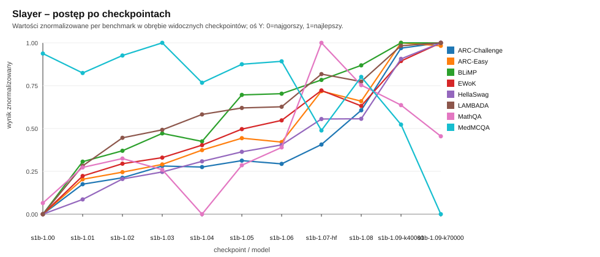

## Tokenizery / Tokenizers

Porównania tokenizatorów: fertility (↓ lepiej) i bytes/token (↑ lepiej). Osobna tabela, bez mieszania z benchmarkami modeli.

### Korpus held-out (bajty na token)
Kompresja tokenizera na korpusie held-out: średnia liczba bajtów UTF-8 na token (wyżej = lepsza kompresja).  
Źródło: [https://github.com/adgr3/tokenizatorex](https://github.com/adgr3/tokenizatorex)

| Tokenizer/model | Metryka | Wynik | n | Flagi | Źródło |
|---|---|---|---|---|---|
| tokenizatorex-32k | bytes per token | 5.1449 | 10017776 | ★ | [metrics.json](https://github.com/adgr3/tokenizatorex/blob/4afe4f85548e510b5ab43ec5aa61aafc4fd8c3e2/results/metrics.json) |
| superbpe-32k-t16k | bytes per token | 5.1442 | 10017776 | ★ | [metrics.json](https://github.com/adgr3/tokenizatorex/blob/4afe4f85548e510b5ab43ec5aa61aafc4fd8c3e2/results/metrics.json) |
| superbpe-32k-t24k | bytes per token | 5.1431 | 10017776 | ★ | [metrics.json](https://github.com/adgr3/tokenizatorex/blob/4afe4f85548e510b5ab43ec5aa61aafc4fd8c3e2/results/metrics.json) |
| superbpe-32k-t28k | bytes per token | 5.1127 | 10017776 | ★ | [metrics.json](https://github.com/adgr3/tokenizatorex/blob/4afe4f85548e510b5ab43ec5aa61aafc4fd8c3e2/results/metrics.json) |
| tokenizatorex-base-32k | bytes per token | 4.5917 | 10017776 | ★ | [metrics.json](https://github.com/adgr3/tokenizatorex/blob/4afe4f85548e510b5ab43ec5aa61aafc4fd8c3e2/results/metrics.json) |
| o200k_base | bytes per token | 3.3023 | 10017776 | ★ | [metrics.json](https://github.com/adgr3/tokenizatorex/blob/4afe4f85548e510b5ab43ec5aa61aafc4fd8c3e2/results/metrics.json) |
| cl100k_base | bytes per token | 2.8317 | 10017776 | ★ | [metrics.json](https://github.com/adgr3/tokenizatorex/blob/4afe4f85548e510b5ab43ec5aa61aafc4fd8c3e2/results/metrics.json) |

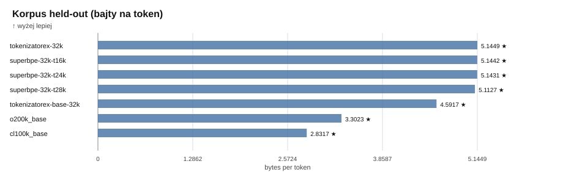

### Płodność tokenizera (tokeny/słowo, 7 domen PL)
Średnia liczba tokenów na słowo na 7 polskich domenach (mniej = lepsza kompresja dla polskiego tekstu).  
Źródło: [https://github.com/adgr3/tokenizatorex](https://github.com/adgr3/tokenizatorex)

| Tokenizer/model | Metryka | Wynik | n | Flagi | Źródło |
|---|---|---|---|---|---|
| TOKENIZATOREX | fertility (tokens/word) | 1.6557 | 1918225 | ★ | [benchmark.json](https://github.com/adgr3/tokenizatorex/blob/4afe4f85548e510b5ab43ec5aa61aafc4fd8c3e2/results/benchmark.json) |
| APT3-1B | fertility (tokens/word) | 1.7224 | 1918225 | ★ | [benchmark.json](https://github.com/adgr3/tokenizatorex/blob/4afe4f85548e510b5ab43ec5aa61aafc4fd8c3e2/results/benchmark.json) |
| Pollock-2.0 | fertility (tokens/word) | 1.7309 | 1918225 | ★ | [benchmark.json](https://github.com/adgr3/tokenizatorex/blob/4afe4f85548e510b5ab43ec5aa61aafc4fd8c3e2/results/benchmark.json) |
| polish-gpt2 | fertility (tokens/word) | 1.7412 | 1918225 | ★ | [benchmark.json](https://github.com/adgr3/tokenizatorex/blob/4afe4f85548e510b5ab43ec5aa61aafc4fd8c3e2/results/benchmark.json) |
| GoLLeM-v4 | fertility (tokens/word) | 1.8397 | 1918225 | ★ | [benchmark.json](https://github.com/adgr3/tokenizatorex/blob/4afe4f85548e510b5ab43ec5aa61aafc4fd8c3e2/results/benchmark.json) |
| TOKENIZATOREX-base | fertility (tokens/word) | 1.8502 | 1918225 | ★ | [benchmark.json](https://github.com/adgr3/tokenizatorex/blob/4afe4f85548e510b5ab43ec5aa61aafc4fd8c3e2/results/benchmark.json) |
| Slayer1B (GoLLeM-v6) | fertility (tokens/word) | 1.8936 | 1918225 | ★ | [benchmark.json](https://github.com/adgr3/tokenizatorex/blob/4afe4f85548e510b5ab43ec5aa61aafc4fd8c3e2/results/benchmark.json) |
| TokenizerTest-32m-B | fertility (tokens/word) | 2.0354 | 1918225 | ★ | [benchmark.json](https://github.com/adgr3/tokenizatorex/blob/4afe4f85548e510b5ab43ec5aa61aafc4fd8c3e2/results/benchmark.json) |
| Qwen3.5 | fertility (tokens/word) | 2.3169 | 1918225 | ★ | [benchmark.json](https://github.com/adgr3/tokenizatorex/blob/4afe4f85548e510b5ab43ec5aa61aafc4fd8c3e2/results/benchmark.json) |
| PLLuM-4B-2512 | fertility (tokens/word) | 2.317 | 1918225 | ★ | [benchmark.json](https://github.com/adgr3/tokenizatorex/blob/4afe4f85548e510b5ab43ec5aa61aafc4fd8c3e2/results/benchmark.json) |
| GPT-4o / GPT-5 (o200k) | fertility (tokens/word) | 2.3416 | 1918225 | ★ | [benchmark.json](https://github.com/adgr3/tokenizatorex/blob/4afe4f85548e510b5ab43ec5aa61aafc4fd8c3e2/results/benchmark.json) |
| DeepSeek-V3 | fertility (tokens/word) | 2.4254 | 1918225 | ★ | [benchmark.json](https://github.com/adgr3/tokenizatorex/blob/4afe4f85548e510b5ab43ec5aa61aafc4fd8c3e2/results/benchmark.json) |
| PLLuM-12B-2512 | fertility (tokens/word) | 2.4395 | 1918225 | ★ | [benchmark.json](https://github.com/adgr3/tokenizatorex/blob/4afe4f85548e510b5ab43ec5aa61aafc4fd8c3e2/results/benchmark.json) |
| Qwen3 | fertility (tokens/word) | 2.5981 | 1918225 | ★ | [benchmark.json](https://github.com/adgr3/tokenizatorex/blob/4afe4f85548e510b5ab43ec5aa61aafc4fd8c3e2/results/benchmark.json) |
| Llama-PLLuM-8B-2512 | fertility (tokens/word) | 2.6584 | 1918225 | ★ | [benchmark.json](https://github.com/adgr3/tokenizatorex/blob/4afe4f85548e510b5ab43ec5aa61aafc4fd8c3e2/results/benchmark.json) |
| GPT-4 (cl100k) | fertility (tokens/word) | 2.693 | 1918225 | ★ | [benchmark.json](https://github.com/adgr3/tokenizatorex/blob/4afe4f85548e510b5ab43ec5aa61aafc4fd8c3e2/results/benchmark.json) |
| Bielik-11B-v2.3 | fertility (tokens/word) | 3.0615 | 1918225 | ★ | [benchmark.json](https://github.com/adgr3/tokenizatorex/blob/4afe4f85548e510b5ab43ec5aa61aafc4fd8c3e2/results/benchmark.json) |
| PLLuM-8x7B-2412 | fertility (tokens/word) | 3.0615 | 1918225 | ★ | [benchmark.json](https://github.com/adgr3/tokenizatorex/blob/4afe4f85548e510b5ab43ec5aa61aafc4fd8c3e2/results/benchmark.json) |
| Slayer139 | fertility (tokens/word) | 3.5882 | 1918225 | ★ | [benchmark.json](https://github.com/adgr3/tokenizatorex/blob/4afe4f85548e510b5ab43ec5aa61aafc4fd8c3e2/results/benchmark.json) |
| Slayer149 | fertility (tokens/word) | 3.7926 | 1918225 | ★ | [benchmark.json](https://github.com/adgr3/tokenizatorex/blob/4afe4f85548e510b5ab43ec5aa61aafc4fd8c3e2/results/benchmark.json) |

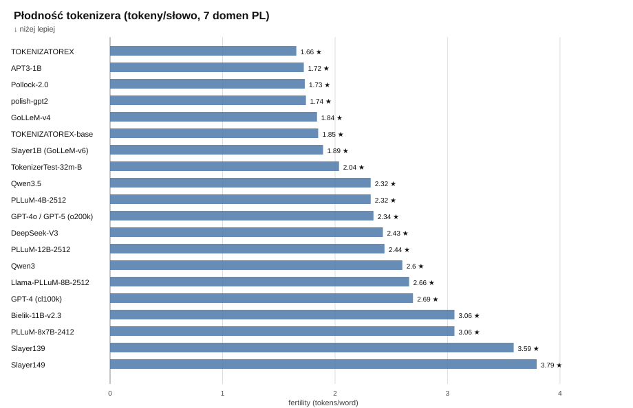

## Odstępstwa i znane problemy / Deviations

- [adgr3] bielik-11b-v3.1 / Humanity's Last Exam (no tools) / accuracy: 1 sample per item (methodology: 10); 5 unjudged answers counted incorrect; see source README Deviations ([bielik-11b-v3.1.json](https://github.com/slayerlabs/benchmarks-fabryka-ai/pull/358))
- [adgr3] bielik-11b-v3.1 / IFBench (Bielik IF-PL local) / instruction_level_loose: local Bielik IF-PL protocol; not part of Bench Team harness; not comparable: different harness from Bench IFEval (ifbench.json (lokalnie))
- [adgr3] bielik-11b-v3.1 / IFBench (Bielik IF-PL local) / instruction_level_strict: local Bielik IF-PL protocol; not part of Bench Team harness; not comparable: different harness from Bench IFEval (ifbench.json (lokalnie))
- [adgr3] bielik-11b-v3.1 / IFBench (Bielik IF-PL local) / prompt_level_loose: local Bielik IF-PL protocol; not part of Bench Team harness; not comparable: different harness from Bench IFEval (ifbench.json (lokalnie))
- [adgr3] bielik-11b-v3.1 / IFBench (Bielik IF-PL local) / prompt_level_strict: local Bielik IF-PL protocol; not part of Bench Team harness; not comparable: different harness from Bench IFEval (ifbench.json (lokalnie))
- [adgr3] bielik-11b-v3.1 / IFEval (Bielik IF-PL local) / instruction_level_loose: local Bielik IF-PL protocol; not part of Bench Team harness; not comparable: different harness from Bench IFEval (ifeval.json (lokalnie))
- [adgr3] bielik-11b-v3.1 / IFEval (Bielik IF-PL local) / instruction_level_strict: local Bielik IF-PL protocol; not part of Bench Team harness; not comparable: different harness from Bench IFEval (ifeval.json (lokalnie))
- [adgr3] bielik-11b-v3.1 / IFEval (Bielik IF-PL local) / prompt_level_loose: local Bielik IF-PL protocol; not part of Bench Team harness; not comparable: different harness from Bench IFEval (ifeval.json (lokalnie))
- [adgr3] bielik-11b-v3.1 / IFEval (Bielik IF-PL local) / prompt_level_strict: local Bielik IF-PL protocol; not part of Bench Team harness; not comparable: different harness from Bench IFEval (ifeval.json (lokalnie))
- [adgr3] slayer1b-1.09-k70000 / Humanity's Last Exam (no tools) / accuracy: null: not run — maintainer decision (Slayer not run in PR #358); not comparable: not run ([bielik-11b-v3.1.json](https://github.com/slayerlabs/benchmarks-fabryka-ai/pull/358))
- [bench-team] bielik-11b-v3.1 / AA-LCR / accuracy over the 100 AA-LCR questions, judged by an LLM equality checker (percent): not run: the 32768-token context window does not hold any AA-LCR prompt: the shortest of 100 prompts has 100913 tokens, the longest 141519; the benchmark is not cut down (no truncation, chunking or retrieval); null: not run: the 32768-token context window does not hold any AA-LCR prompt: the shortest of 100 prompts has 100913 tokens, the longest 141519; the benchmark is not cut down (no truncation, chunking or retrieval) ([bielik-11b-v3.1.json](https://github.com/slayerlabs/benchmarks-fabryka-ai/blob/a46eabf41b22e9ad80f9bf48a1961dc1c32e4faf/research/api-benchmarks/aa-lcr/results/bielik-11b-v3.1.json))
- [bench-team] bielik-11b-v3.1 / GPQA Diamond (exploratory, CoT zero-shot) / exact_match (flexible-extract): see README.md, Deviations ([bielik-11b-v3.1-2048.json](https://github.com/slayerlabs/benchmarks-fabryka-ai/blob/a46eabf41b22e9ad80f9bf48a1961dc1c32e4faf/research/api-benchmarks/gpqa-diamond/results/bielik-11b-v3.1-2048.json))
- [bench-team] bielik-11b-v3.1 / GPQA Diamond (exploratory, CoT zero-shot) / exact_match (flexible-extract): see README.md, Deviations ([bielik-11b-v3.1.json](https://github.com/slayerlabs/benchmarks-fabryka-ai/blob/a46eabf41b22e9ad80f9bf48a1961dc1c32e4faf/research/api-benchmarks/gpqa-diamond/results/bielik-11b-v3.1.json))
- [bench-team] bielik-11b-v3.1 / LiveCodeBench Pro 25Q2 (quater_2025_4_6) / pass@1 (accepted / all problems, percent): see README.md, Deviations ([bielik-11b-v3.1.json](https://github.com/slayerlabs/benchmarks-fabryka-ai/blob/a46eabf41b22e9ad80f9bf48a1961dc1c32e4faf/research/api-benchmarks/livecodebench-pro-25q2/results/bielik-11b-v3.1.json))
- [bench-team] bielik-11b-v3.1 / LiveCodeBench v6 (code generation, release_v6) / pass@1: see README.md, Deviations ([bielik-11b-v3.1.json](https://github.com/slayerlabs/benchmarks-fabryka-ai/blob/a46eabf41b22e9ad80f9bf48a1961dc1c32e4faf/research/api-benchmarks/livecodebench-v6/results/bielik-11b-v3.1.json))
- [bench-team] bielik-11b-v3.1 / RULER / mean of the 13 RULER task scores at 131072 tokens (percent): the 32768-token context window does not hold a 131072-token RULER sample; null: the 32768-token context window does not hold a 131072-token RULER sample ([bielik-11b-v3.1.json](https://github.com/slayerlabs/benchmarks-fabryka-ai/blob/a46eabf41b22e9ad80f9bf48a1961dc1c32e4faf/research/api-benchmarks/ruler-128k/results/bielik-11b-v3.1.json))
- [bench-team] bielik-11b-v3.1 / SciCode / subproblem pass rate, with background (correct steps / 288 x 100, test_generated_code.py): see README.md, Deviations ([bielik-11b-v3.1.json](https://github.com/slayerlabs/benchmarks-fabryka-ai/blob/a46eabf41b22e9ad80f9bf48a1961dc1c32e4faf/research/api-benchmarks/scicode/results/bielik-11b-v3.1.json))
- [bench-team] bielik-11b-v3.1-vllm / AA-Omniscience (public) / omniscience_index: see README.md, Deviations ([bielik-11b-v3.1-vllm.json](https://github.com/slayerlabs/benchmarks-fabryka-ai/blob/a46eabf41b22e9ad80f9bf48a1961dc1c32e4faf/research/api-benchmarks/aa-omniscience/results/bielik-11b-v3.1-vllm.json))
- [bench-team] bielik-11b-v3.1-vllm / AutomationBench (public) / pass_rate: see README.md, Deviations ([bielik-11b-v3.1-vllm.json](https://github.com/slayerlabs/benchmarks-fabryka-ai/blob/a46eabf41b22e9ad80f9bf48a1961dc1c32e4faf/research/api-benchmarks/automationbench/results/bielik-11b-v3.1-vllm.json))
- [bench-team] bielik-11b-v3.1-vllm / BFCL V4 / overall_acc: Overall Acc needs the web_search categories (200 tasks, 40% x 1/2 of the weight), which were not run: they need a search API key. See other_metrics.; null: Overall Acc needs the web_search categories (200 tasks, 40% x 1/2 of the weight), which were not run: they need a search API key. See other_metrics. ([bielik-11b-v3.1-vllm.json](https://github.com/slayerlabs/benchmarks-fabryka-ai/blob/a46eabf41b22e9ad80f9bf48a1961dc1c32e4faf/research/api-benchmarks/bfcl-v4/results/bielik-11b-v3.1-vllm.json))
- [bench-team] bielik-11b-v3.1-vllm / IFBench / prompt_level_strict_acc: see README.md, Deviations ([bielik-11b-v3.1-vllm.json](https://github.com/slayerlabs/benchmarks-fabryka-ai/blob/a46eabf41b22e9ad80f9bf48a1961dc1c32e4faf/research/api-benchmarks/ifbench/results/bielik-11b-v3.1-vllm.json))
- [bench-team] bielik-11b-v3.1-vllm / IFStruct / pass_rate: see README.md, Deviations ([bielik-11b-v3.1-vllm.json](https://github.com/slayerlabs/benchmarks-fabryka-ai/blob/a46eabf41b22e9ad80f9bf48a1961dc1c32e4faf/research/api-benchmarks/ifstruct/results/bielik-11b-v3.1-vllm.json))
- [bench-team] bielik-11b-v3.1-vllm / Multi-IF / mean over 3 turns of all-languages overall: see README.md, Deviations ([bielik-11b-v3.1-vllm.json](https://github.com/slayerlabs/benchmarks-fabryka-ai/blob/a46eabf41b22e9ad80f9bf48a1961dc1c32e4faf/research/api-benchmarks/multi-if/results/bielik-11b-v3.1-vllm.json))
- [bench-team] lfm2.5-1.2b-base / arc-challenge / acc_norm: reguła kontekstu: acc_pmi poniżej bazy losowej na 2 testach PMI (ARC-Challenge, PIQA); próg 2 ustalony po obejrzeniu tego przebiegu; reguła przebiegu centralnego: wynik różni się od results/central-run dla tej samej rewizji i wag ([results.json](https://github.com/slayerlabs/benchmarks-fabryka-ai/blob/a46eabf41b22e9ad80f9bf48a1961dc1c32e4faf/research/results/full-run-2026-11/arc-challenge/lfm2.5-1.2b-base/results.json))
- [bench-team] lfm2.5-1.2b-base / arc-easy / acc: reguła kontekstu: acc_pmi poniżej bazy losowej na 2 testach PMI (ARC-Challenge, PIQA); próg 2 ustalony po obejrzeniu tego przebiegu; reguła przebiegu centralnego: wynik różni się od results/central-run dla tej samej rewizji i wag ([results.json](https://github.com/slayerlabs/benchmarks-fabryka-ai/blob/a46eabf41b22e9ad80f9bf48a1961dc1c32e4faf/research/results/full-run-2026-11/arc-easy/lfm2.5-1.2b-base/results.json))
- [bench-team] lfm2.5-1.2b-base / blimp / acc: reguła kontekstu: acc_pmi poniżej bazy losowej na 2 testach PMI (ARC-Challenge, PIQA); próg 2 ustalony po obejrzeniu tego przebiegu; reguła przebiegu centralnego: wynik różni się od results/central-run dla tej samej rewizji i wag ([results.json](https://github.com/slayerlabs/benchmarks-fabryka-ai/blob/a46eabf41b22e9ad80f9bf48a1961dc1c32e4faf/research/results/full-run-2026-11/blimp/lfm2.5-1.2b-base/results.json))
- [bench-team] lfm2.5-1.2b-base / ewok / ewok: reguła kontekstu: acc_pmi poniżej bazy losowej na 2 testach PMI (ARC-Challenge, PIQA); próg 2 ustalony po obejrzeniu tego przebiegu; reguła przebiegu centralnego: wynik różni się od results/central-run dla tej samej rewizji i wag ([results_rozszerzone.json](https://github.com/slayerlabs/benchmarks-fabryka-ai/blob/a46eabf41b22e9ad80f9bf48a1961dc1c32e4faf/research/results/full-run-2026-11/ewok/lfm2.5-1.2b-base/results_rozszerzone.json))
- [bench-team] lfm2.5-1.2b-base / hellaswag / acc_norm: reguła kontekstu: acc_pmi poniżej bazy losowej na 2 testach PMI (ARC-Challenge, PIQA); próg 2 ustalony po obejrzeniu tego przebiegu; reguła przebiegu centralnego: wynik różni się od results/central-run dla tej samej rewizji i wag ([results.json](https://github.com/slayerlabs/benchmarks-fabryka-ai/blob/a46eabf41b22e9ad80f9bf48a1961dc1c32e4faf/research/results/full-run-2026-11/hellaswag/lfm2.5-1.2b-base/results.json))
- [bench-team] lfm2.5-1.2b-base / lambada / acc: reguła kontekstu: acc_pmi poniżej bazy losowej na 2 testach PMI (ARC-Challenge, PIQA); próg 2 ustalony po obejrzeniu tego przebiegu; reguła przebiegu centralnego: wynik różni się od results/central-run dla tej samej rewizji i wag ([results.json](https://github.com/slayerlabs/benchmarks-fabryka-ai/blob/a46eabf41b22e9ad80f9bf48a1961dc1c32e4faf/research/results/full-run-2026-11/lambada/lfm2.5-1.2b-base/results.json))
- [bench-team] lfm2.5-1.2b-base / mathqa / acc_norm: reguła kontekstu: acc_pmi poniżej bazy losowej na 2 testach PMI (ARC-Challenge, PIQA); próg 2 ustalony po obejrzeniu tego przebiegu; reguła przebiegu centralnego: wynik różni się od results/central-run dla tej samej rewizji i wag ([results.json](https://github.com/slayerlabs/benchmarks-fabryka-ai/blob/a46eabf41b22e9ad80f9bf48a1961dc1c32e4faf/research/results/full-run-2026-11/mathqa/lfm2.5-1.2b-base/results.json))
- [bench-team] lfm2.5-1.2b-base / medmcqa / acc: reguła kontekstu: acc_pmi poniżej bazy losowej na 2 testach PMI (ARC-Challenge, PIQA); próg 2 ustalony po obejrzeniu tego przebiegu; reguła przebiegu centralnego: wynik różni się od results/central-run dla tej samej rewizji i wag ([results.json](https://github.com/slayerlabs/benchmarks-fabryka-ai/blob/a46eabf41b22e9ad80f9bf48a1961dc1c32e4faf/research/results/full-run-2026-11/medmcqa/lfm2.5-1.2b-base/results.json))
- [bench-team] lfm2.5-1.2b-base / multiblimp-pl / accuracy: reguła kontekstu: acc_pmi poniżej bazy losowej na 2 testach PMI (ARC-Challenge, PIQA); próg 2 ustalony po obejrzeniu tego przebiegu; reguła przebiegu centralnego: wynik różni się od results/central-run dla tej samej rewizji i wag ([results.json](https://github.com/slayerlabs/benchmarks-fabryka-ai/blob/a46eabf41b22e9ad80f9bf48a1961dc1c32e4faf/research/results/full-run-2026-11/multiblimp-pl/lfm2.5-1.2b-base/results.json))
- [bench-team] lfm2.5-1.2b-base / piqa / acc_norm: reguła kontekstu: acc_pmi poniżej bazy losowej na 2 testach PMI (ARC-Challenge, PIQA); próg 2 ustalony po obejrzeniu tego przebiegu; reguła przebiegu centralnego: wynik różni się od results/central-run dla tej samej rewizji i wag ([results.json](https://github.com/slayerlabs/benchmarks-fabryka-ai/blob/a46eabf41b22e9ad80f9bf48a1961dc1c32e4faf/research/results/full-run-2026-11/piqa/lfm2.5-1.2b-base/results.json))
- [bench-team] lfm2.5-1.2b-base / pubmedqa / acc: reguła kontekstu: acc_pmi poniżej bazy losowej na 2 testach PMI (ARC-Challenge, PIQA); próg 2 ustalony po obejrzeniu tego przebiegu; reguła przebiegu centralnego: wynik różni się od results/central-run dla tej samej rewizji i wag ([results.json](https://github.com/slayerlabs/benchmarks-fabryka-ai/blob/a46eabf41b22e9ad80f9bf48a1961dc1c32e4faf/research/results/full-run-2026-11/pubmedqa/lfm2.5-1.2b-base/results.json))
- [bench-team] lfm2.5-1.2b-base / social-iqa / acc: reguła kontekstu: acc_pmi poniżej bazy losowej na 2 testach PMI (ARC-Challenge, PIQA); próg 2 ustalony po obejrzeniu tego przebiegu; reguła przebiegu centralnego: wynik różni się od results/central-run dla tej samej rewizji i wag ([results.json](https://github.com/slayerlabs/benchmarks-fabryka-ai/blob/a46eabf41b22e9ad80f9bf48a1961dc1c32e4faf/research/results/full-run-2026-11/social-iqa/lfm2.5-1.2b-base/results.json))
- [bench-team] lfm2.5-1.2b-base / wikitext-2 / byte_perplexity: reguła kontekstu: acc_pmi poniżej bazy losowej na 2 testach PMI (ARC-Challenge, PIQA); próg 2 ustalony po obejrzeniu tego przebiegu; reguła przebiegu centralnego: wynik różni się od results/central-run dla tej samej rewizji i wag ([results.json](https://github.com/slayerlabs/benchmarks-fabryka-ai/blob/a46eabf41b22e9ad80f9bf48a1961dc1c32e4faf/research/results/full-run-2026-11/wikitext-2/lfm2.5-1.2b-base/results.json))
- [bench-team] lfm2.5-1.2b-base / winogrande / acc: reguła kontekstu: acc_pmi poniżej bazy losowej na 2 testach PMI (ARC-Challenge, PIQA); próg 2 ustalony po obejrzeniu tego przebiegu; reguła przebiegu centralnego: wynik różni się od results/central-run dla tej samej rewizji i wag ([results.json](https://github.com/slayerlabs/benchmarks-fabryka-ai/blob/a46eabf41b22e9ad80f9bf48a1961dc1c32e4faf/research/results/full-run-2026-11/winogrande/lfm2.5-1.2b-base/results.json))
- [bench-team] lfm2.5-1.2b-base / wsc273 / acc: reguła kontekstu: acc_pmi poniżej bazy losowej na 2 testach PMI (ARC-Challenge, PIQA); próg 2 ustalony po obejrzeniu tego przebiegu; reguła przebiegu centralnego: wynik różni się od results/central-run dla tej samej rewizji i wag ([results.json](https://github.com/slayerlabs/benchmarks-fabryka-ai/blob/a46eabf41b22e9ad80f9bf48a1961dc1c32e4faf/research/results/full-run-2026-11/wsc273/lfm2.5-1.2b-base/results.json))
- [bench-team] lfm3-1.7b / GPQA Diamond (exploratory, CoT zero-shot) / exact_match (flexible-extract): see README.md, Deviations ([lfm3-1.7b-16k.json](https://github.com/slayerlabs/benchmarks-fabryka-ai/blob/a46eabf41b22e9ad80f9bf48a1961dc1c32e4faf/research/api-benchmarks/gpqa-diamond/results/lfm3-1.7b-16k.json))
- [bench-team] lfm3-1.7b / GPQA Diamond (exploratory, CoT zero-shot) / exact_match (flexible-extract): see README.md, Deviations ([lfm3-1.7b-2048.json](https://github.com/slayerlabs/benchmarks-fabryka-ai/blob/a46eabf41b22e9ad80f9bf48a1961dc1c32e4faf/research/api-benchmarks/gpqa-diamond/results/lfm3-1.7b-2048.json))
- [bench-team] lfm3-1.7b / GPQA Diamond (exploratory, CoT zero-shot) / exact_match (flexible-extract): see README.md, Deviations ([lfm3-1.7b.json](https://github.com/slayerlabs/benchmarks-fabryka-ai/blob/a46eabf41b22e9ad80f9bf48a1961dc1c32e4faf/research/api-benchmarks/gpqa-diamond/results/lfm3-1.7b.json))
- [bench-team] lfm3-1.7b / GPQA Diamond (exploratory, CoT zero-shot) / exact_match (flexible-extract), composed full-198 at a 32768 budget (two compositions, see composition and sensitivity_all67_at32768): see README.md, Deviations ([lfm3-1.7b-32k.json](https://github.com/slayerlabs/benchmarks-fabryka-ai/blob/a46eabf41b22e9ad80f9bf48a1961dc1c32e4faf/research/api-benchmarks/gpqa-diamond/results/lfm3-1.7b-32k.json))
- [bench-team] lfm3-1.7b / IFEval / prompt_level_strict_acc: see README.md, Deviations ([lfm3-1.7b.json](https://github.com/slayerlabs/benchmarks-fabryka-ai/blob/a46eabf41b22e9ad80f9bf48a1961dc1c32e4faf/research/api-benchmarks/ifeval/results/lfm3-1.7b.json))
- [bench-team] lfm3-1.7b / LiveCodeBench Pro 25Q2 (quater_2025_4_6) / pass@1 (accepted / all problems, percent): see README.md, Deviations ([lfm3-1.7b.json](https://github.com/slayerlabs/benchmarks-fabryka-ai/blob/a46eabf41b22e9ad80f9bf48a1961dc1c32e4faf/research/api-benchmarks/livecodebench-pro-25q2/results/lfm3-1.7b.json))
- [bench-team] lfm3-1.7b / LiveCodeBench v6 (code generation, release_v6) / pass@1: see README.md, Deviations ([lfm3-1.7b.json](https://github.com/slayerlabs/benchmarks-fabryka-ai/blob/a46eabf41b22e9ad80f9bf48a1961dc1c32e4faf/research/api-benchmarks/livecodebench-v6/results/lfm3-1.7b.json))
- [bench-team] lfm3-1.7b / RULER / mean of the 13 RULER task scores at 131072 tokens (percent): see README.md, Deviations ([lfm3-1.7b.json](https://github.com/slayerlabs/benchmarks-fabryka-ai/blob/a46eabf41b22e9ad80f9bf48a1961dc1c32e4faf/research/api-benchmarks/ruler-128k/results/lfm3-1.7b.json))
- [bench-team] lfm3-1.7b / SciCode / subproblem pass rate, with background (correct steps / 288 x 100, test_generated_code.py): see README.md, Deviations ([lfm3-1.7b.json](https://github.com/slayerlabs/benchmarks-fabryka-ai/blob/a46eabf41b22e9ad80f9bf48a1961dc1c32e4faf/research/api-benchmarks/scicode/results/lfm3-1.7b.json))
- [bench-team] lfm3-1.7b / Terminal-Bench 2.1 / pass rate (task tests pass, reward 1), mean over tasks and trials: see README.md, Deviations ([lfm3-1.7b.json](https://github.com/slayerlabs/benchmarks-fabryka-ai/blob/a46eabf41b22e9ad80f9bf48a1961dc1c32e4faf/research/api-benchmarks/terminal-bench-2-1/results/lfm3-1.7b.json))
- [bench-team] lfm3-1.7b / arc-challenge / acc_norm: model instruct liczony na surowym tekście, bez chat template; reguła kontekstu: acc_pmi poniżej bazy losowej na 2 testach PMI (ARC-Challenge, PIQA); próg 2 ustalony po obejrzeniu tego przebiegu ([results.json](https://github.com/slayerlabs/benchmarks-fabryka-ai/blob/a46eabf41b22e9ad80f9bf48a1961dc1c32e4faf/research/results/full-run-2026-11/arc-challenge/lfm3-1.7b/results.json))
- [bench-team] lfm3-1.7b / arc-easy / acc: model instruct liczony na surowym tekście, bez chat template; reguła kontekstu: acc_pmi poniżej bazy losowej na 2 testach PMI (ARC-Challenge, PIQA); próg 2 ustalony po obejrzeniu tego przebiegu ([results.json](https://github.com/slayerlabs/benchmarks-fabryka-ai/blob/a46eabf41b22e9ad80f9bf48a1961dc1c32e4faf/research/results/full-run-2026-11/arc-easy/lfm3-1.7b/results.json))
- [bench-team] lfm3-1.7b / blimp / acc: model instruct liczony na surowym tekście, bez chat template; reguła kontekstu: acc_pmi poniżej bazy losowej na 2 testach PMI (ARC-Challenge, PIQA); próg 2 ustalony po obejrzeniu tego przebiegu ([results.json](https://github.com/slayerlabs/benchmarks-fabryka-ai/blob/a46eabf41b22e9ad80f9bf48a1961dc1c32e4faf/research/results/full-run-2026-11/blimp/lfm3-1.7b/results.json))
- [bench-team] lfm3-1.7b / ewok / ewok: model instruct liczony na surowym tekście, bez chat template; reguła kontekstu: acc_pmi poniżej bazy losowej na 2 testach PMI (ARC-Challenge, PIQA); próg 2 ustalony po obejrzeniu tego przebiegu ([results_rozszerzone.json](https://github.com/slayerlabs/benchmarks-fabryka-ai/blob/a46eabf41b22e9ad80f9bf48a1961dc1c32e4faf/research/results/full-run-2026-11/ewok/lfm3-1.7b/results_rozszerzone.json))
- [bench-team] lfm3-1.7b / hellaswag / acc_norm: model instruct liczony na surowym tekście, bez chat template; reguła kontekstu: acc_pmi poniżej bazy losowej na 2 testach PMI (ARC-Challenge, PIQA); próg 2 ustalony po obejrzeniu tego przebiegu ([results.json](https://github.com/slayerlabs/benchmarks-fabryka-ai/blob/a46eabf41b22e9ad80f9bf48a1961dc1c32e4faf/research/results/full-run-2026-11/hellaswag/lfm3-1.7b/results.json))
- [bench-team] lfm3-1.7b / lambada / acc: model instruct liczony na surowym tekście, bez chat template; reguła kontekstu: acc_pmi poniżej bazy losowej na 2 testach PMI (ARC-Challenge, PIQA); próg 2 ustalony po obejrzeniu tego przebiegu ([results.json](https://github.com/slayerlabs/benchmarks-fabryka-ai/blob/a46eabf41b22e9ad80f9bf48a1961dc1c32e4faf/research/results/full-run-2026-11/lambada/lfm3-1.7b/results.json))
- [bench-team] lfm3-1.7b / mathqa / acc_norm: model instruct liczony na surowym tekście, bez chat template; reguła kontekstu: acc_pmi poniżej bazy losowej na 2 testach PMI (ARC-Challenge, PIQA); próg 2 ustalony po obejrzeniu tego przebiegu ([results.json](https://github.com/slayerlabs/benchmarks-fabryka-ai/blob/a46eabf41b22e9ad80f9bf48a1961dc1c32e4faf/research/results/full-run-2026-11/mathqa/lfm3-1.7b/results.json))
- [bench-team] lfm3-1.7b / medmcqa / acc: model instruct liczony na surowym tekście, bez chat template; reguła kontekstu: acc_pmi poniżej bazy losowej na 2 testach PMI (ARC-Challenge, PIQA); próg 2 ustalony po obejrzeniu tego przebiegu ([results.json](https://github.com/slayerlabs/benchmarks-fabryka-ai/blob/a46eabf41b22e9ad80f9bf48a1961dc1c32e4faf/research/results/full-run-2026-11/medmcqa/lfm3-1.7b/results.json))
- [bench-team] lfm3-1.7b / multiblimp-pl / accuracy: model instruct liczony na surowym tekście, bez chat template; reguła kontekstu: acc_pmi poniżej bazy losowej na 2 testach PMI (ARC-Challenge, PIQA); próg 2 ustalony po obejrzeniu tego przebiegu ([results.json](https://github.com/slayerlabs/benchmarks-fabryka-ai/blob/a46eabf41b22e9ad80f9bf48a1961dc1c32e4faf/research/results/full-run-2026-11/multiblimp-pl/lfm3-1.7b/results.json))
- [bench-team] lfm3-1.7b / piqa / acc_norm: model instruct liczony na surowym tekście, bez chat template; reguła kontekstu: acc_pmi poniżej bazy losowej na 2 testach PMI (ARC-Challenge, PIQA); próg 2 ustalony po obejrzeniu tego przebiegu ([results.json](https://github.com/slayerlabs/benchmarks-fabryka-ai/blob/a46eabf41b22e9ad80f9bf48a1961dc1c32e4faf/research/results/full-run-2026-11/piqa/lfm3-1.7b/results.json))
- [bench-team] lfm3-1.7b / pubmedqa / acc: model instruct liczony na surowym tekście, bez chat template; reguła kontekstu: acc_pmi poniżej bazy losowej na 2 testach PMI (ARC-Challenge, PIQA); próg 2 ustalony po obejrzeniu tego przebiegu ([results.json](https://github.com/slayerlabs/benchmarks-fabryka-ai/blob/a46eabf41b22e9ad80f9bf48a1961dc1c32e4faf/research/results/full-run-2026-11/pubmedqa/lfm3-1.7b/results.json))
- [bench-team] lfm3-1.7b / social-iqa / acc: model instruct liczony na surowym tekście, bez chat template; reguła kontekstu: acc_pmi poniżej bazy losowej na 2 testach PMI (ARC-Challenge, PIQA); próg 2 ustalony po obejrzeniu tego przebiegu ([results.json](https://github.com/slayerlabs/benchmarks-fabryka-ai/blob/a46eabf41b22e9ad80f9bf48a1961dc1c32e4faf/research/results/full-run-2026-11/social-iqa/lfm3-1.7b/results.json))
- [bench-team] lfm3-1.7b / wikitext-2 / byte_perplexity: model instruct liczony na surowym tekście, bez chat template; reguła kontekstu: acc_pmi poniżej bazy losowej na 2 testach PMI (ARC-Challenge, PIQA); próg 2 ustalony po obejrzeniu tego przebiegu ([results.json](https://github.com/slayerlabs/benchmarks-fabryka-ai/blob/a46eabf41b22e9ad80f9bf48a1961dc1c32e4faf/research/results/full-run-2026-11/wikitext-2/lfm3-1.7b/results.json))
- [bench-team] lfm3-1.7b / winogrande / acc: model instruct liczony na surowym tekście, bez chat template; reguła kontekstu: acc_pmi poniżej bazy losowej na 2 testach PMI (ARC-Challenge, PIQA); próg 2 ustalony po obejrzeniu tego przebiegu ([results.json](https://github.com/slayerlabs/benchmarks-fabryka-ai/blob/a46eabf41b22e9ad80f9bf48a1961dc1c32e4faf/research/results/full-run-2026-11/winogrande/lfm3-1.7b/results.json))
- [bench-team] lfm3-1.7b / wsc273 / acc: model instruct liczony na surowym tekście, bez chat template; reguła kontekstu: acc_pmi poniżej bazy losowej na 2 testach PMI (ARC-Challenge, PIQA); próg 2 ustalony po obejrzeniu tego przebiegu ([results.json](https://github.com/slayerlabs/benchmarks-fabryka-ai/blob/a46eabf41b22e9ad80f9bf48a1961dc1c32e4faf/research/results/full-run-2026-11/wsc273/lfm3-1.7b/results.json))
- [bench-team] lfm3-1.7b-cardsampling / LiveCodeBench v6 (code generation, release_v6) / pass@1: see README.md, Deviations ([lfm3-1.7b-cardsampling.json](https://github.com/slayerlabs/benchmarks-fabryka-ai/blob/a46eabf41b22e9ad80f9bf48a1961dc1c32e4faf/research/api-benchmarks/livecodebench-v6/results/lfm3-1.7b-cardsampling.json))
- [bench-team] lfm3-1.7b-nothink / LiveCodeBench Pro 25Q2 (quater_2025_4_6) / pass@1 (accepted / all problems, percent): see README.md, Deviations ([lfm3-1.7b-nothink.json](https://github.com/slayerlabs/benchmarks-fabryka-ai/blob/a46eabf41b22e9ad80f9bf48a1961dc1c32e4faf/research/api-benchmarks/livecodebench-pro-25q2/results/lfm3-1.7b-nothink.json))
- [bench-team] lfm3-1.7b-nothink / SciCode / subproblem pass rate, with background (correct steps / 288 x 100, test_generated_code.py): see README.md, Deviations ([lfm3-1.7b-nothink.json](https://github.com/slayerlabs/benchmarks-fabryka-ai/blob/a46eabf41b22e9ad80f9bf48a1961dc1c32e4faf/research/api-benchmarks/scicode/results/lfm3-1.7b-nothink.json))
- [bench-team] slayer1b-1.09-k70000 / AA-LCR / accuracy over the 100 AA-LCR questions, judged by an LLM equality checker (percent): not run: the 4096-token context window does not hold any AA-LCR prompt: the shortest of 100 prompts has 85211 tokens, the longest 135882; the benchmark is not cut down (no truncation, chunking or retrieval); null: not run: the 4096-token context window does not hold any AA-LCR prompt: the shortest of 100 prompts has 85211 tokens, the longest 135882; the benchmark is not cut down (no truncation, chunking or retrieval) ([slayer1b-1.09-k70000.json](https://github.com/slayerlabs/benchmarks-fabryka-ai/blob/a46eabf41b22e9ad80f9bf48a1961dc1c32e4faf/research/api-benchmarks/aa-lcr/results/slayer1b-1.09-k70000.json))
- [bench-team] slayer1b-1.09-k70000 / LiveCodeBench Pro 25Q2 (quater_2025_4_6) / pass@1 (accepted / all problems, percent): see README.md, Deviations ([slayer1b-1.09-k70000.json](https://github.com/slayerlabs/benchmarks-fabryka-ai/blob/a46eabf41b22e9ad80f9bf48a1961dc1c32e4faf/research/api-benchmarks/livecodebench-pro-25q2/results/slayer1b-1.09-k70000.json))
- [bench-team] slayer1b-1.09-k70000 / RULER / mean of the 13 RULER task scores at 131072 tokens (percent): the 4096-token context window does not hold a 131072-token RULER sample; null: the 4096-token context window does not hold a 131072-token RULER sample ([slayer1b-1.09-k70000.json](https://github.com/slayerlabs/benchmarks-fabryka-ai/blob/a46eabf41b22e9ad80f9bf48a1961dc1c32e4faf/research/api-benchmarks/ruler-128k/results/slayer1b-1.09-k70000.json))
- [bench-team] slayer1b-1.09-k70000 / SciCode / subproblem pass rate, with background (correct steps / 288 x 100, test_generated_code.py): with_background: 216/288 subproblems (75.0%) had prompt_tokens > 4096 - SLAYER_MIN_ANSWER_TOKENS (256), so they were recorded as context_overflow/unsupported per PROTOCOL.md Amendment 3; headline score is null. Overflow is caused by inserting prior steps' long degenerate extracted outputs into subsequent with-background prompts. See other_metrics.with_background.unsupported and Amendment 3 'Result after the run'.; null: with_background: 216/288 subproblems (75.0%) had prompt_tokens > 4096 - SLAYER_MIN_ANSWER_TOKENS (256), so they were recorded as context_overflow/unsupported per PROTOCOL.md Amendment 3; headline score is null. Overflow is caused by inserting prior steps' long degenerate extracted outputs into subsequent with-background prompts. See other_metrics.with_background.unsupported and Amendment 3 'Result after the run'. ([slayer1b-1.09-k70000.json](https://github.com/slayerlabs/benchmarks-fabryka-ai/blob/a46eabf41b22e9ad80f9bf48a1961dc1c32e4faf/research/api-benchmarks/scicode/results/slayer1b-1.09-k70000.json))
- [bench-team] slayer1b-1.09-k70000 / Terminal-Bench 2.1 / pass rate (task tests pass, reward 1), mean over tasks and trials: not run: a base model without a chat template or a tool-call format, so OpenCode cannot drive it (see README); null: not run: a base model without a chat template or a tool-call format, so OpenCode cannot drive it (see README) ([slayer1b-1.09-k70000.json](https://github.com/slayerlabs/benchmarks-fabryka-ai/blob/a46eabf41b22e9ad80f9bf48a1961dc1c32e4faf/research/api-benchmarks/terminal-bench-2-1/results/slayer1b-1.09-k70000.json))
- [bench-team] slayer1b-60000 / AA-Omniscience (public) / omniscience_index: see README.md, Deviations ([slayer1b-60000.json](https://github.com/slayerlabs/benchmarks-fabryka-ai/blob/a46eabf41b22e9ad80f9bf48a1961dc1c32e4faf/research/api-benchmarks/aa-omniscience/results/slayer1b-60000.json))
- [bench-team] slayer1b-60000 / AutomationBench (public) / pass_rate: Slayer 1B is a base model without a chat template or tool-calling format; the serving endpoint rejects requests with tools (HTTP 400), so no syntactically valid call is possible.; null: Slayer 1B is a base model without a chat template or tool-calling format; the serving endpoint rejects requests with tools (HTTP 400), so no syntactically valid call is possible. ([slayer1b-60000.json](https://github.com/slayerlabs/benchmarks-fabryka-ai/blob/a46eabf41b22e9ad80f9bf48a1961dc1c32e4faf/research/api-benchmarks/automationbench/results/slayer1b-60000.json))
- [bench-team] slayer1b-60000 / BFCL V4 / overall_acc: Slayer 1B is a base model without a chat template or tool-calling format; the serving endpoint rejects requests with tools (HTTP 400), so no syntactically valid call is possible.; null: Slayer 1B is a base model without a chat template or tool-calling format; the serving endpoint rejects requests with tools (HTTP 400), so no syntactically valid call is possible. ([slayer1b-60000.json](https://github.com/slayerlabs/benchmarks-fabryka-ai/blob/a46eabf41b22e9ad80f9bf48a1961dc1c32e4faf/research/api-benchmarks/bfcl-v4/results/slayer1b-60000.json))
- [bench-team] slayer1b-60000 / IFBench / prompt_level_strict_acc: see README.md, Deviations ([slayer1b-60000.json](https://github.com/slayerlabs/benchmarks-fabryka-ai/blob/a46eabf41b22e9ad80f9bf48a1961dc1c32e4faf/research/api-benchmarks/ifbench/results/slayer1b-60000.json))
- [bench-team] slayer1b-60000 / IFStruct / pass_rate: see README.md, Deviations ([slayer1b-60000.json](https://github.com/slayerlabs/benchmarks-fabryka-ai/blob/a46eabf41b22e9ad80f9bf48a1961dc1c32e4faf/research/api-benchmarks/ifstruct/results/slayer1b-60000.json))
- [bench-team] slayer1b-60000 / Multi-IF / mean over 3 turns of all-languages overall: run stopped after 2 of 3 turns (compute budget); turn 3 ran at about 10 conversations per minute; null: run stopped after 2 of 3 turns (compute budget); turn 3 ran at about 10 conversations per minute ([slayer1b-60000.json](https://github.com/slayerlabs/benchmarks-fabryka-ai/blob/a46eabf41b22e9ad80f9bf48a1961dc1c32e4faf/research/api-benchmarks/multi-if/results/slayer1b-60000.json))

## Metodologia skrótem / Methodology summary

- Dane pochodzą z `wyniki/*.json`, walidowane schematem `schema/wynik.schema.json`; tabela jest generowana przez `scripts/buduj.py --check`.
- Opisy benchmarków są w `opisy/benchmarki.yaml` i muszą mieć źródło.
- Ranking główny: 15 benchmarków lm-eval, tylko porównywalne wyniki, bez `†`; średnia tylko przy komplecie 15/15.
- Szczegóły: [METODOLOGIA.md](METODOLOGIA.md).

## Jak dodać wynik / How to add a result

1. Dodaj JSON do `wyniki/` zgodny ze schematem i z pełnym `source`.
2. Ustaw `measured_by`, `status`, `deviations`, `comparable_to_reference` uczciwie.
3. Uruchom `python scripts/buduj.py` i `python scripts/buduj.py --check`.
4. Uruchom `python scripts/eksport_hf.py --check` i `python -m pytest -q`.

## Stopka

- Najnowszy rekord: 2026-11-26
- SHA-256 danych (`wyniki/*.json`): `5009d2058ea6d4d0a922a272a78cff0e8d467ee42a213b842e5796f47fb039a6`
- Rekordy per measured_by: {'adgr3': 37, 'bench-team': 327} (adgr3: 37)
- Modele w rankingu głównym (komplet 15/15): 16 / 17
- Pełna lista: [docs/wszystkie_rekordy.md](docs/wszystkie_rekordy.md)

